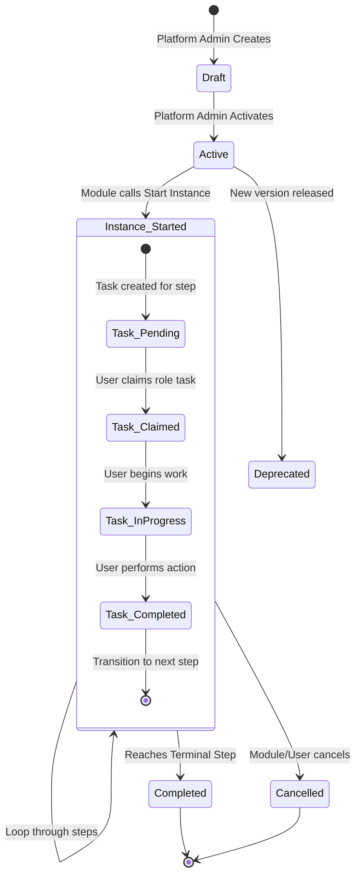
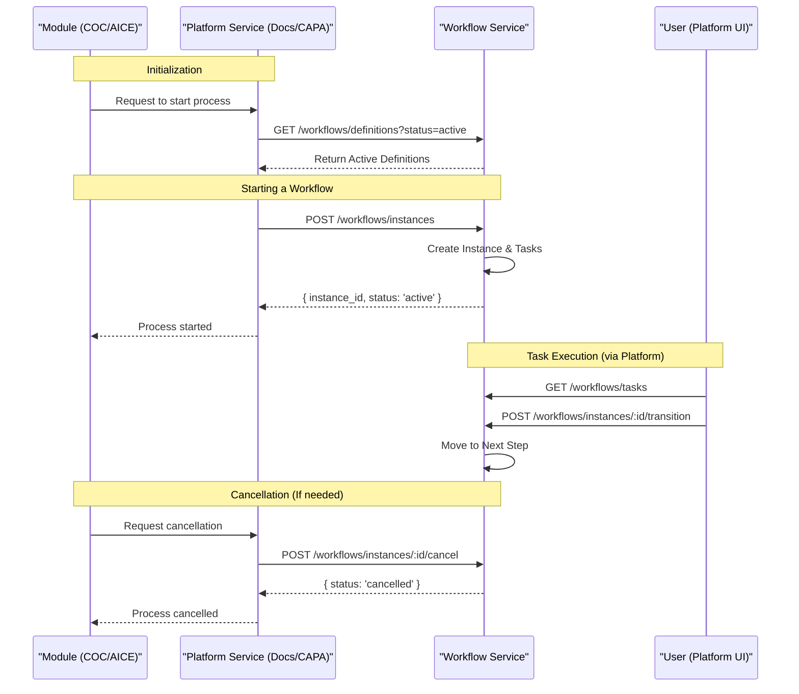
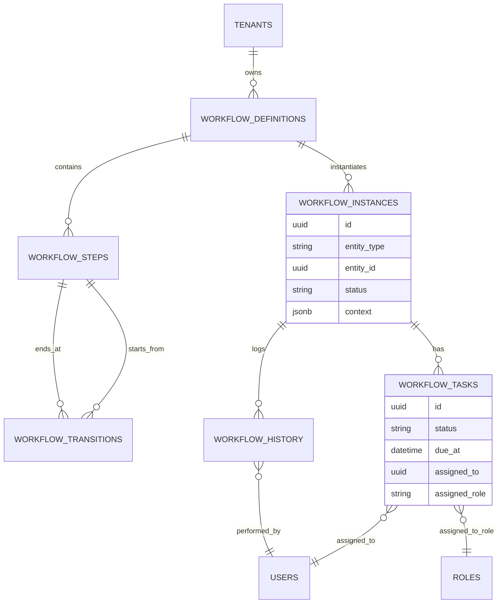

# Workflow Service Integration Guide for Module Developers

This guide provides the necessary information for module developers to integrate with the QAssure Workflow Service. The Workflow Service is a centralized engine that manages business processes, task assignments, and audit trails.

## 1. Workflow Lifecycle Overview

The following diagram illustrates the lifecycle of a workflow from definition to completion.



## 2. Integration Sequence Diagram

This diagram shows how a module (like COC or AICE) uses Platform Services (like Documents or CAPA) to manage workflows.



## 3. Database Schema (ER Diagram)

Understanding how the data is structured helps in filtering and querying.



## 4. API Documentation for Modules

### 4.1 Get Active Definitions

Before starting a workflow, you need to find the correct template.

- **Endpoint:** `GET /api/v1/workflows/definitions`
- **Query Params:**
  - `status`: `active` (Required for starting instances)
  - `entity_type`: e.g., `document`, `capa`, `supplier` (Filters by target entity)
- **Use Case:** Find the `workflow_definition_id` to use for your service.

### 4.2 Start a Workflow Instance

Creates a new running workflow for a specific record.

- **Endpoint:** `POST /api/v1/workflows/instances`
- **Body:**

```json
{
  "workflow_definition_id": "05a392f8-8cef-48e3-b8ac-65bbda57f4c5",
  "entity_type": "document-coc-new",
  "entity_id": "11111111-1111-1111-1111-111111111111",
  "entity_name": "SOP-PM-001 Standard Operating Procedure",
  "context": {
    "priority": "high"
  }
}
```

### 4.3 List Instances for an Entity

Check the status of workflows associated with a specific record. Use this to show a "Status" badge in your module's table view.

- **Endpoint:** `GET /api/v1/workflows/instances`
- **Query Params:** `entity_type`, `entity_id`
- **Example Response:**

```json
{
  "success": true,
  "data": [
    {
      "id": "c33edfd7-8882-4bb7-bb0c",
      "workflow_name": "Document Approval Workflow",
      "current_step": "File Upload",
      "status": "active",
      "started_at": "2026-03-09T06:24:57.574Z"
    }
  ]
}
```

### 4.4 Get Instance Details

Retrieve full state information, including pending tasks and available actions.

- **Endpoint:** `GET /api/v1/workflows/instances/:id`
- **Example Response:**

```json
{
  "success": true,
  "data": {
    "id": "c33edfd7-8882-4bb7-bb0c-914edcb29d12",
    "workflow": { "name": "Document Approval Workflow" },
    "current_step": { "name": "File Upload" },
    "status": "active",
    "tasks": [
      {
        "id": "task_uuid",
        "assigned_to": "Manager",
        "status": "pending"
      }
    ],
    "available_actions": [
      {
        "action": "submit",
        "next_step": "Extract Data"
      }
    ]
  }
}
```

### 4.5 Get Audit History

Retrieve the full trail of who did what and when.

- **Endpoint:** `GET /api/v1/workflows/instances/:id/history`
- **Example Response:**

```json
{
  "success": true,
  "data": [
    {
      "event_type": "workflow_started",
      "to_step": "File Upload",
      "performed_by": "admin@gmail.com",
      "performed_at": "2026-03-09T06:24:57.574Z"
    }
  ]
}
```

### 4.6 Cancel Instance

Aborts the workflow and skips all pending tasks. Associated tasks will no longer appear in users' "My Tasks" list.

- **Endpoint:** `POST /api/v1/workflows/instances/:id/cancel`
- **Body:** `{ "reason": "User deleted the draft" }`
- **Behavior:** Transitions instance status to `cancelled` and updates all `pending` tasks to `skipped`.

---

## 5. Advanced Features & Logic

### 5.1 Automatic Task Assignment

The engine calculates assignees immediately upon entering a new step:

- **Direct User Assignment:** `assignee.type = 'user'` with an `id`.
- **Role-Based:** `assignee.type = 'role'`. The task is available to anyone with that role.
- **Multi-Role Assignment:** If `assignee.role` is an array (e.g., `["Manager", "QA"]`), the task is assigned to all matching roles. The first person to **Claim** it becomes the owner.
- **Originator Context:** The person who started the instance can be automatically assigned via `assignee.type = 'originator'`.

### 5.3 SLA and Escalation

Steps can have defined SLAs in hours:

- `sla_hours`: Total time allowed.
- `sla_warning_hours`: When to send a reminder.
- `sla_escalation_hours`: When to notify a supervisor.

### 5.4 Conditional Transitions

Transitions can be configured with conditions based on the entity `context`. For example, a "Priority: High" ticket might skip a "Standard Review" step and go straight to "Manager Approval".

---

## 6. Success vs. Terminal States

A workflow ends when it reaches a step with `step_type = 'terminal'`.

- Common terminal step names: `Approved`, `Rejected`, `Closed`.
- Once terminal, the instance status changes to `completed` and no further transitions are possible.
