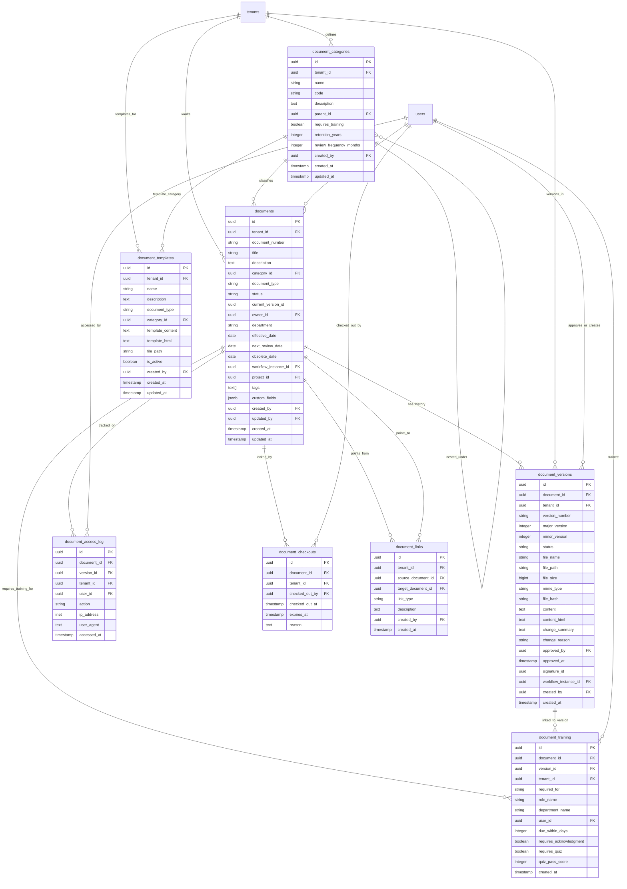

# Database ER Diagram — Document Vault Service (AiDV)

This service manages controlled document categories, draft documents, document versioning histories, access trace audits, concurrent editing checkouts, training acknowledgments, document relationship links, and file templates.

