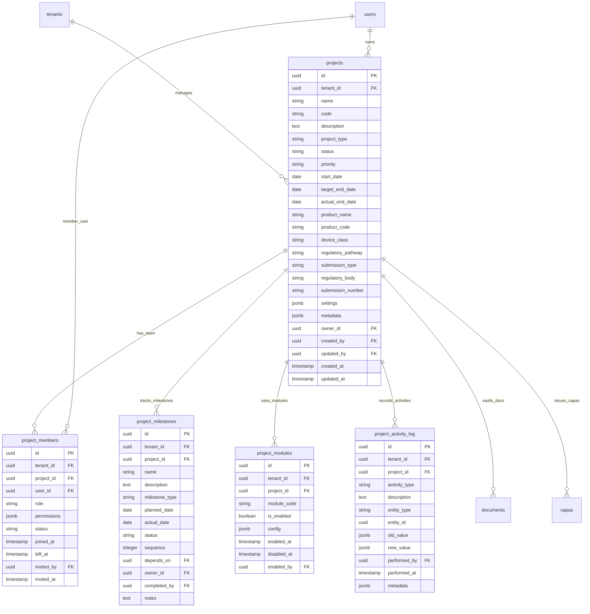

# Database ER Diagram — Project Management Service

This service tracks regulatory projects portfolios, active milestones dates, milestones task details, team access lists, enabled platform modules, and historical activity logs.

