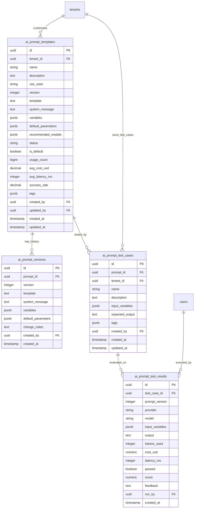

# Database ER Diagram — Prompt Management Service

This service manages versions, system messages, input variables, and evaluation/testing benchmarks (test cases, test runs, test scores) for AI prompt templates.

