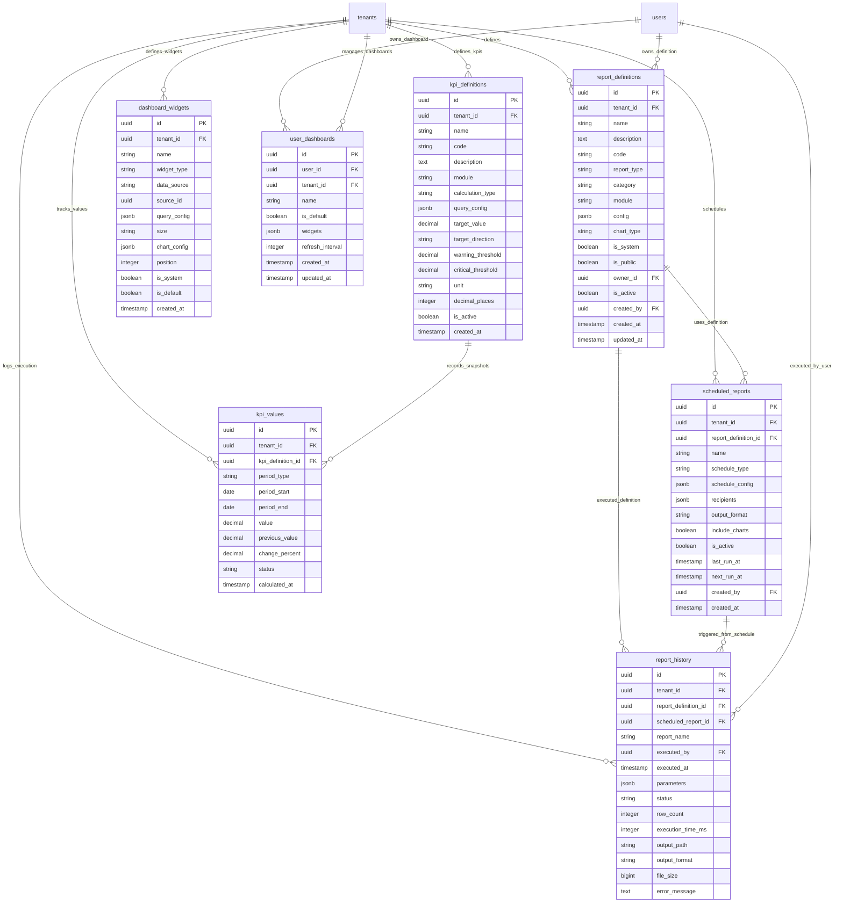

# Database ER Diagram — Report Service

This service acts as a centralized reporting & analytics engine, handling saved custom reports definitions, execution history, automated delivery schedules, KPIs definitions and snapshots, dashboard widgets, and user dashboard layouts.

