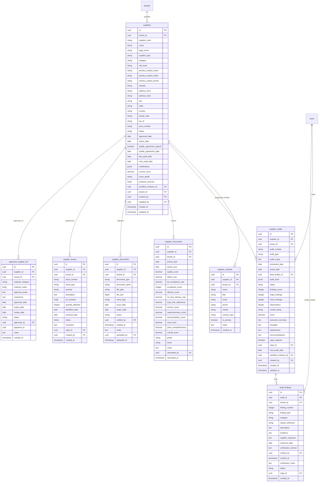

# Database ER Diagram — Supplier Service

This module manages supplier profiles, contacts, audits findings, performance scorecards, certifications and quality records, issues log, and the Approved Supplier List (ASL).

