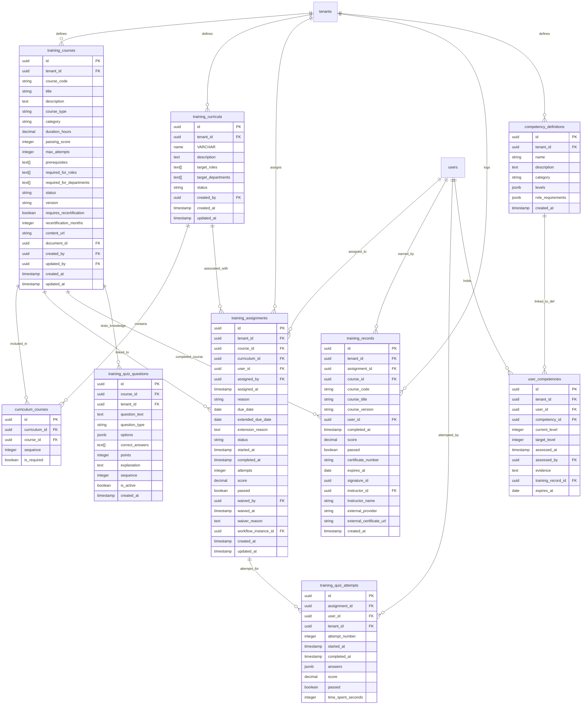

# Database ER Diagram — Training Service

This service tracks employee compliance training courses, curricula groups, course contents, user assignments status, certification histories, quiz questions, quiz attempts, and competency requirements.

