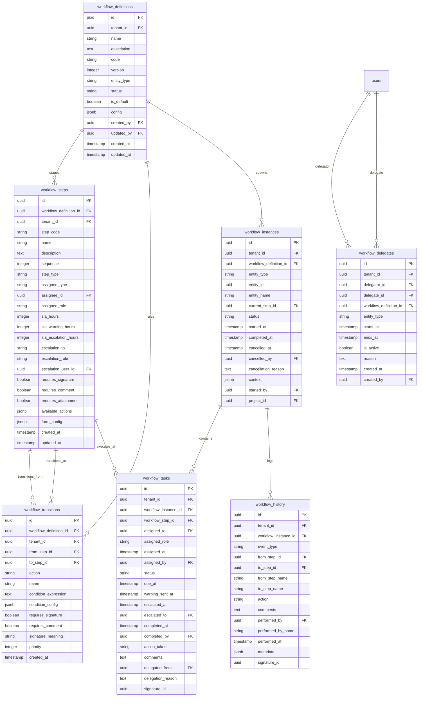

# Database ER Diagram — Workflow Engine Service

This service stores custom approval paths templates (definitions, steps, transitions), running instances, delegated roles, assigned tasks, and audit logs.

