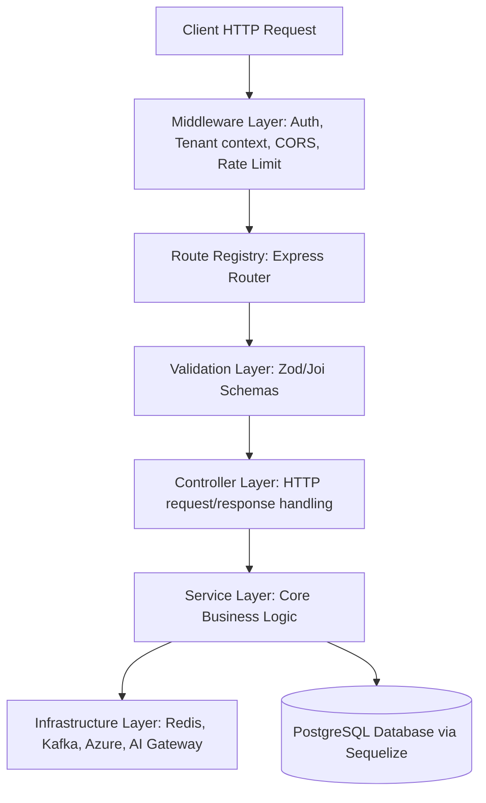

# Backend Source File Structure

This document provides a comprehensive overview of the QAssure Backend codebase structure, architectural layers, directory mapping, and design patterns.

---

## 1. Architectural Overview

The QAssure backend is designed using a **layered (service-oriented) MVC pattern** on top of **Node.js, Express, and Sequelize (PostgreSQL)**. The logic is strictly segregated into distinct layers to promote modularity, testability, and horizontal scalability:



---

## 2. Directory Layout & Key Components

Below is the directory map of the backend project with the purpose of each directory:

```
QAssur-backend/
├── .env.example                  # Template for environment variables (DB, Redis, Azure, SMTP, Kafka)
├── app.js                        # Express application instance setup & global configuration
├── server.js                     # Root entry point of the server (starts HTTP listener)
├── escalation.scheduler.js       # Background cron service handling document/workflow escalations
├── smtp.scheduler.js             # Background cron service checking SMTP servers connectivity
├── docker-compose.yml            # Docker container configurations for PostgreSQL, Redis, Kafka, etc.
├── Dockerfile                    # Production container build specification
├── Jenkinsfile                   # CI/CD pipeline definition for automated builds and deployment
├── package.json                  # Dependencies, scripts, and package information
├── run_migrations.sh             # Shell script wrapper for executing database migrations
│
├── src/                          # Main source code folder
│   ├── config/                   # Configuration adapters for global variables, DB, and logger
│   ├── controllers/              # HTTP Request handlers mapping user inputs to business services
│   ├── infrastructure/           # Outer-boundary integrations (AI providers, cache, messaging, QMS)
│   ├── middleware/               # Express interceptors (authentication, context resolution, logging)
│   ├── migrations/               # Database schema versioning and change-log scripts
│   ├── models/                   # Main Sequelize ORM model declarations
│   ├── routes/                   # Route path definitions binding URLs to controllers
│   ├── routes-indexs/            # Alternative/legacy registry folders
│   ├── scripts/                  # Seed scripts, database reset utilities, and cron jobs
│   ├── seeds/                    # Raw database seed files for default settings
│   ├── sequelize-models/         # Composite or legacy Sequelize models
│   ├── services/                 # Core domain business logic, computations, and transactions
│   ├── utils/                    # Common helper utilities, error classes, date formatters, etc.
│   └── validation/               # Request body/parameter validation schemas
│
├── logs/                         # File directory for winston system logs (app-combined, error logs)
├── uploads/                      # Local file storage folder (fallback from cloud blob storage)
├── exports/                      # Target directory for generated Excel/PDF export downloads
├── docs/                         # Architecture, compliance, and API reference documentation
├── k8s/                          # Kubernetes deployment manifest templates
├── helm/                         # Helm chart configuration files for cloud deployments
└── deploy/                       # Shell scripts for manual or production server deployment
```

---

## 3. Layered Component Details

### 3.1 Server Entry Point & Configurations
*   **`server.js`**: Initializes the database and starts the Express server. It handles system signals (`SIGTERM`, `SIGINT`) to ensure graceful shutdown of database connections, Redis clients, and HTTP listeners.
*   **`app.js`**: Configures global Express settings. It sets up security headers (Helmet), CORS, body parsers, rate limiters, request loggers, API prefix matching (`/api/v1`), and handles default error boundaries.
*   **`src/config/`**:
    *   `config.js`: Centralized config loader reading from `.env` with fallback defaults.
    *   `database.js`: Manages PostgreSQL database connection pool using Sequelize.
    *   `logger.js`: Sets up `winston` for writing system logs to console and rotating files.

### 3.2 Routing & Middlewares
*   **`src/routes/`**: Handles the mapping of API end-points to specific controller functions.
    *   `index.js`: Dynamically loads and binds all routes inside the directory to make registrations clean and automatic.
    *   Naming convention: `[module-name].routes.js` (e.g., `tenant-storage-bucket.routes.js`).
*   **`src/middleware/`**:
    *   `auth.middleware.js`: Validates JWT tokens or API keys. Provides security functions like `authorize()` or `authorizeAny()` for RBAC.
    *   `tenant.middleware.js`: Identifies the request tenant via subdomain, request header, or query param, and mounts it to `req.tenantId` for isolation.
    *   `audit.middleware.js`: Captures user requests and records them in the audit trail database.
    *   `correlation.middleware.js`: Injects unique request IDs to trace logs across distributed services.
    *   `validationMiddleware.js`: Validates request bodies against schemas and halts invalid payloads.
    *   `service.middleware.js`: Gates route endpoints based on enabled platform services for the tenant, using an in-memory TTL cache.

### 3.3 Controller Layer
*   **`src/controllers/`**: Intermediary controllers that accept requests, fetch values from parameters/bodies, invoke services, and respond with unified JSON formats.
    *   They do *not* execute SQL queries or heavy business logic.
    *   Naming convention: `[module-name].controller.js` or `[module-name]_controller.js` (e.g., `tenant-storage-bucket.controller.js`).

### 3.4 Service Layer
*   **`src/services/`**: The core domain engine of the system containing business logic, computations, validations, transaction scopes, and database writes.
    *   Services are designed to be reusable across controllers, crons, or background workers.
    *   Naming convention: `[module-name].service.js` or `[module-name]_service.js` (e.g., `tenant-storage-bucket.service.js`).

### 3.5 Infrastructure Layer
*   **`src/infrastructure/`**: Encapsulates external systems and platforms so they can be swapped out easily.
    *   `ai/`: Coordinates AI gateway provider mappings (OpenAI, Anthropic, Gemini, local LLMs), token trackers, cost estimators, and document vectorizer/chunkers.
    *   `cache/`: Wraps Redis connections to cache session and performance-critical databases.
    *   `kafka/`: Contains producers/consumers for message queue operations and pub-sub workflows.
    *   `email/`: Handles transactional email SMTP connections.
    *   `qms/`: Synchronization adapters mapping documents and entities to Quality Management Systems.

### 3.6 Database Models & Migrations
*   **`src/models/` & `src/sequelize-models/`**: Represent table structures as Sequelize JavaScript objects. Defines constraints, relations (hasMany, belongsTo), and database schemas.
*   **`src/migrations/`**: Codebase change-log files containing `up` and `down` schema modifiers. Allows schema propagation without losing state.
    *   Naming convention: `[incremental_number]_[description].js` (e.g., `103_create_tenant_storage_buckets.js`).

---

## 4. Coding & Naming Conventions

To keep the large-scale codebase clean, development must follow these structural guidelines:

1.  **Strict Isolation**: Services should not directly access `req` or `res` objects; parameters must be explicitly unpacked in the controller and passed as arguments to the service.
2.  **Naming Parity**: The name of routes, controllers, services, and tests for a module should match (e.g. `audit_log_routes.js` -> `audit_log_controller.js` -> `audit_log_service.js`).
3.  **Tenant Context Handling**: When writing queries, always restrict operations to `req.tenantId` unless the user is a super administrator/platform user executing platform-wide queries.
4.  **Graceful Errors**: Use specialized helper errors (e.g. `NotFoundError`, `UnauthorizedError`, `ValidationError`) in the services; these are automatically caught and transformed to appropriate HTTP codes by the global error middleware in `app.js`.
