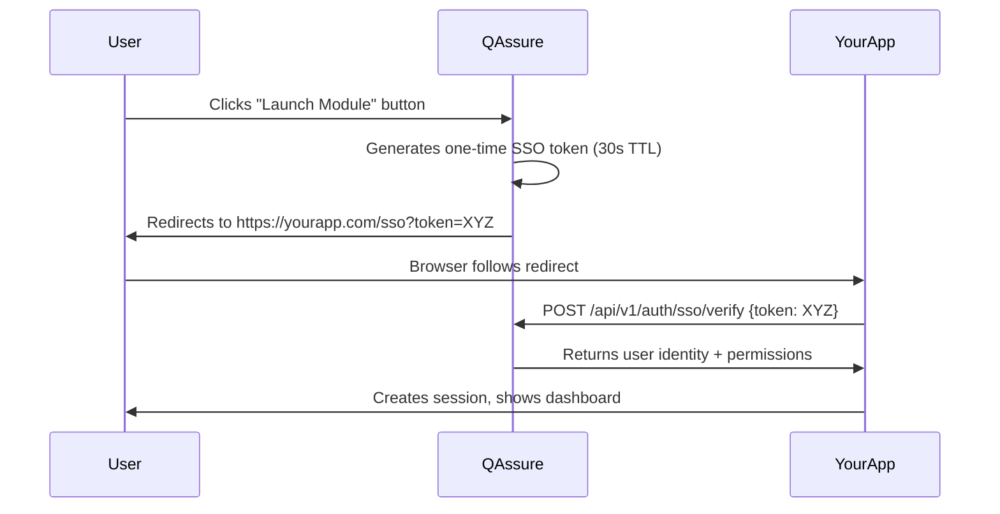
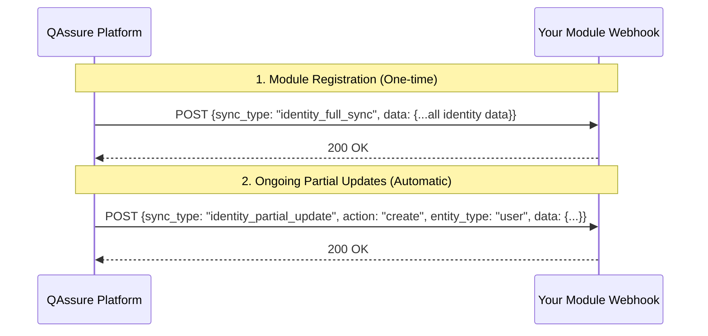

# QAssure Platform
# Module Integration Guide

| **Document ID**     | QASSURE-INT-001          |
| ------------------- | ------------------------ |
| **Version**         | 1.0.0                    |
| **Release Date**    | 09 June 2026             |
| **Prepared For**    | L&T Technology Services  |
| **Prepared By**     | QAssure Development Team |
| **Status**          | Final Draft              |
| **Classification**  | CONFIDENTIAL             |

---

## Who is This Guide For?

This guide is for **integration engineers, system architects, and developers** who need to integrate external quality tools or third-party applications with the QAssure Platform. No prior knowledge of QAssure internals is required.

---

## Part 1: Understanding the QAssure Integration Model

### 1.1 What Can Be Integrated?

QAssure supports three integration modes:

| Mode | Description | Use Case |
|------|-------------|----------|
| **Module SSO Launch** | QAssure launches an external application with an authenticated session | Your ERP, document viewer, or specialized QMS tool |
| **REST API Integration** | External systems call QAssure APIs to read/write quality data | MES, ERP, IoT systems pushing non-conformances |
| **Webhook Identity Sync** | QAssure pushes identity and access data to your module's webhook endpoint automatically | External modules that need up-to-date user, role, tenant, and permission data from QAssure |

### 1.2 Integration Architecture

```
┌─────────────────────────────────────────────────────────┐
│                  QAssure Platform                        │
│                                                          │
│  ┌──────────┐    ┌──────────┐    ┌─────────────────┐    │
│  │  REST API│    │ SSO Auth │    │  Webhook Sync   │    │
│  │ /api/v1/ │    │  Engine  │    │  (Push-based)   │    │
│  └──────────┘    └──────────┘    └─────────────────┘    │
│        ▲               │                  │              │
└────────┼───────────────┼──────────────────┼─────────────┘
         │               │                  │
    ┌────┘        ┌──────▼──────┐   ┌───────▼────────┐
    │             │  External   │   │  Your Module's │
┌───▼────┐        │  Module     │   │  Webhook URL   │
│ Your   │        │ (SSO Launch)│   │ (POST receiver)│
│ System │        └─────────────┘   └────────────────┘
└────────┘
```

---

## Part 2: REST API Integration (Step-by-Step)

### Step 1: Obtain API Credentials

Contact your QAssure Tenant Admin to get an **API Key**. API Keys are used for server-to-server integration.

```
X-API-Key: qassure_live_XXXXXXXXXXXXXXXX
```

> ⚠️ **Never** use user JWT tokens in server-to-server integrations. Always use API Keys.

### Step 2: Make Your First API Call

**Test connectivity:**
```bash
curl -X GET \
  https://api.qassure.com/api/v1/auth/me \
  -H "X-API-Key: qassure_live_XXXXXXXXXXXXXXXX" \
  -H "x-tenant-id: your-tenant-uuid"
```

**Expected Response:**
```json
{
  "success": true,
  "data": {
    "id": "api-key-service-account",
    "type": "API_KEY",
    "tenantId": "your-tenant-uuid",
    "permissions": ["capa:read", "capa:create", "documents:read"]
  }
}
```

### Step 3: Common Integration Scenarios

#### Scenario A: Push Non-Conformance → Create CAPA

When your MES/ERP detects a defect, automatically create a CAPA in QAssure:

```bash
curl -X POST \
  https://api.qassure.com/api/v1/capas \
  -H "X-API-Key: qassure_live_XXXXXXXXXXXXXXXX" \
  -H "x-tenant-id: your-tenant-uuid" \
  -H "Content-Type: application/json" \
  -d '{
    "title": "Defect NCR-2026-0847 - Batch dimensional non-conformance",
    "description": "MES detected 12 units outside tolerance on production line 3",
    "source": "PRODUCTION",
    "severity": "MAJOR",
    "externalReference": "NCR-2026-0847",
    "detectedDate": "2026-06-09",
    "ownerId": "quality-engineer-user-uuid"
  }'
```

#### Scenario B: Retrieve Open CAPAs for Dashboard

Pull all open CAPAs for your management dashboard:

```bash
curl -X GET \
  "https://api.qassure.com/api/v1/capas?status=open&page=1&limit=50" \
  -H "X-API-Key: qassure_live_XXXXXXXXXXXXXXXX" \
  -H "x-tenant-id: your-tenant-uuid"
```

#### Scenario C: Sync Training Completion from LMS

When your LMS records a training completion, update QAssure:

```bash
curl -X PUT \
  https://api.qassure.com/api/v1/training/assignments/assignment-uuid/complete \
  -H "X-API-Key: qassure_live_XXXXXXXXXXXXXXXX" \
  -H "x-tenant-id: your-tenant-uuid" \
  -H "Content-Type: application/json" \
  -d '{
    "score": 92,
    "status": "PASSED",
    "completedAt": "2026-06-09T08:30:00Z",
    "externalCertificateId": "LMS-CERT-4521"
  }'
```

---

## Part 3: Module SSO Launch Integration

This enables your users to click a button in QAssure and be automatically logged in to your external application.

### 3.1 How SSO Launch Works



### 3.2 Register Your Module in QAssure

Ask your QAssure Super Admin to register your module:

| Field | Example |
|-------|---------|
| Module Name | My ERP Quality Module |
| Module Type | EXTERNAL |
| Launch URL | `https://yourapp.com/sso` |
| Callback URL | `https://yourapp.com/sso/callback` |
| Allowed Tenants | Select tenant(s) |

### 3.3 Implement the SSO Endpoint in Your Application

Your application must expose an endpoint that:
1. Receives the SSO token
2. Validates it with QAssure
3. Creates a local session

**Example (Node.js/Express):**

```javascript
const express = require('express');
const axios = require('axios');

app.get('/sso', async (req, res) => {
  const { token } = req.query;

  if (!token) {
    return res.status(400).send('Missing SSO token');
  }

  try {
    // Step 1: Verify token with QAssure
    const response = await axios.post(
      'https://api.qassure.com/api/v1/auth/sso/verify',
      { token },
      { headers: { 'X-API-Key': process.env.QASSURE_API_KEY } }
    );

    const { user, tenantId, permissions } = response.data.data;

    // Step 2: Create session in your application
    req.session.userId = user.id;
    req.session.email = user.email;
    req.session.tenantId = tenantId;
    req.session.qassurePermissions = permissions;

    // Step 3: Redirect to your app's dashboard
    res.redirect('/dashboard');

  } catch (error) {
    console.error('SSO verification failed:', error.message);
    res.status(401).send('SSO authentication failed');
  }
});
```

> [!NOTE]
> For **Platform Users**, the `tenantId` in the SSO verification response may be `null` or set to the platform default, as they operate at the system level and bypass standard tenant context limitations. External modules should handle `tenantId === null` appropriately if they support global/platform administration.

**Example (Python/Flask):**

```python
from flask import Flask, request, session, redirect
import requests

@app.route('/sso')
def sso_login():
    token = request.args.get('token')

    if not token:
        return 'Missing SSO token', 400

    # Verify with QAssure
    response = requests.post(
        'https://api.qassure.com/api/v1/auth/sso/verify',
        json={'token': token},
        headers={'X-API-Key': os.environ['QASSURE_API_KEY']}
    )

    if response.status_code != 200:
        return 'SSO verification failed', 401

    user_data = response.json()['data']
    session['user_id'] = user_data['user']['id']
    session['tenant_id'] = user_data['tenantId']

    return redirect('/dashboard')
```

### 3.4 SSO Token Security Rules

| Rule | Detail |
|------|--------|
| Single-use | Each token can only be verified **once** |
| Short-lived | Tokens expire after **30 seconds** |
| Tenant-scoped | Token is only valid for the initiating tenant |
| IP-verified | Token must be verified from the same IP that received it (optional) |

---

## Part 4: Webhook Identity Sync

QAssure uses a **push-based webhook mechanism** to keep your module's user, role, tenant, and permission data synchronized with the QAssure platform. There is no Kafka or message broker required — QAssure makes direct HTTPS POST requests to your module's endpoint whenever identity data changes.

### 4.1 How It Works



There are two sync modes:

| Sync Type | When Triggered | Header Sent |
|-----------|---------------|-------------|
| `identity_full_sync` | On module registration (if `sync_webhook_url` is set), or manually via API | `X-Sync-Action: identity_full_sync` |
| `identity_partial_update` | Automatically whenever a user, role, tenant, permission, or related entity changes in QAssure | `X-Sync-Action: identity_partial_update` |

---

### 4.2 Module Registration Fields

When registering your module with the QAssure Super Admin, provide these two webhook-related fields:

| Field | Required | Description |
|-------|----------|-------------|
| `webhookurl` | Optional | A one-time endpoint that receives your module's auto-generated API key immediately after registration |
| `sync_webhook_url` | Optional | The persistent endpoint that receives all identity sync payloads (full and partial) |

> **Important:** Both fields serve different purposes. `webhookurl` fires **once** with your API key. `sync_webhook_url` receives **ongoing** data sync.

---

### 4.3 API Key Delivery Webhook (`webhookurl`)

Immediately after module registration, if `webhookurl` is set, QAssure sends a POST request with the module's auto-generated API key. **This is the only time the plain API key is transmitted — it is not retrievable afterward.**

**Payload received at `webhookurl`:**
```json
{
  "module_id": "your-module-id",
  "uuid": "platform-internal-uuid",
  "api_key": "qassure_live_XXXXXXXXXXXXXXXX",
  "qassure_api_url": "https://api.qassure.com/api/v1",
  "message": {
    "warning": "Save this key securely. It will not be shown again."
  }
}
```

> Store this key in your secrets manager immediately. It is used in the `X-API-Key` header for all subsequent calls to the QAssure REST API.

---

### 4.4 Full Identity Sync Payload (`identity_full_sync`)

Sent to `sync_webhook_url` when:
- The module is first registered with a `sync_webhook_url`
- A Super Admin manually triggers a sync via `POST /api/v1/modules/:id/webhook-sync`

**HTTP Headers:**
```
Content-Type: application/json
X-Sync-Action: identity_full_sync
```

**Payload structure:**
```json
{
  "sync_type": "identity_full_sync",
  "timestamp": "2026-07-20T08:00:00.000Z",
  "source": "QAssure Super Admin",
  "data": {
    "modules": [ { "id": "...", "module_id": "...", "name": "..." } ],
    "tenants": [ { "id": "...", "name": "...", "slug": "...", "status": "active" } ],
    "roles": [ { "id": "...", "name": "...", "code": "..." } ],
    "departments": [ { "id": "...", "name": "...", "tenant_id": "..." } ],
    "designations": [ { "id": "...", "name": "...", "tenant_id": "..." } ],
    "suppliers": [ { "id": "...", "name": "...", "tenant_id": "..." } ],
    "users": [
      {
        "id": "...",
        "email": "user@example.com",
        "first_name": "Jane",
        "last_name": "Doe",
        "status": "active",
        "department_id": "...",
        "designation_id": "...",
        "supplier_id": null,
        "user_category_id": "...",
        "created_at": "2026-01-01T00:00:00.000Z"
      }
    ],
    "user_categories": [
      { "id": "tenant_user", "name": "Tenant User", "code": "tenant_user" },
      { "id": "supplier_user", "name": "Supplier User", "code": "supplier_user" }
    ],
    "user_roles": [ { "user_id": "...", "role_id": "..." } ],
    "user_tenants": [ { "user_id": "...", "tenant_id": "...", "status": "active" } ],
    "tenant_modules": [ { "tenant_id": "...", "module_id": "..." } ],
    "user_modules": [ { "user_id": "...", "module_id": "..." } ],
    "role_modules": [ { "role_id": "...", "module_id": "..." } ],
    "permissions": [ { "id": "...", "role_id": "...", "resource": "...", "action": "..." } ],
    "tenant_module_access": [ { "tenant_id": "...", "module_id": "...", "is_active": true } ]
  }
}
```

> **Note:** The payload only contains data **scoped to your module** — tenants, users, and roles that are actually associated with it. The `tenant_admin` role and all tenant admins for your assigned tenants are automatically included and merged into the payload, even if not explicitly mapped to the module, to ensure admin access is always reflected.

---

### 4.5 Partial Identity Update Payload (`identity_partial_update`)

Sent automatically to `sync_webhook_url` whenever any identity-related entity changes in QAssure (create, update, or delete). QAssure determines which modules are affected by the changed entity and sends the update only to those modules.

**HTTP Headers:**
```
Content-Type: application/json
X-Sync-Action: identity_partial_update
```

**Payload structure:**
```json
{
  "sync_type": "identity_partial_update",
  "action": "create",
  "entity_type": "user",
  "timestamp": "2026-07-20T09:15:00.000Z",
  "source": "QAssure Super Admin",
  "data": {
    "users": [
      {
        "id": "...",
        "email": "newuser@example.com",
        "first_name": "John",
        "last_name": "Smith",
        "status": "active",
        "department_id": "...",
        "designation_id": "...",
        "supplier_id": null,
        "user_category_id": "..."
      }
    ],
    "user_roles": [ { "user_id": "...", "role_id": "..." } ],
    "user_tenants": [ { "user_id": "...", "tenant_id": "..." } ],
    "user_modules": [ { "user_id": "...", "module_id": "..." } ]
  }
}
```

**Supported `action` values:** `create`, `update`, `delete`

**Supported `entity_type` values and their associated `data` keys:**

| entity_type | Primary data key | Additional data included |
|-------------|------------------|--------------------------|
| `user` | `users` | `user_roles`, `user_tenants`, `user_modules`, `departments`, `designations`, `suppliers` |
| `role` | `roles` | `permissions`, `role_modules` |
| `tenant` | `tenants` | `tenant_modules`, `departments`, `designations`, `suppliers` |
| `department` | `departments` | — |
| `designation` | `designations` | — |
| `supplier` | `suppliers` | — |
| `user_role` | `user_roles` | `users`, `roles` |
| `user_tenant` | `user_tenants` | `users`, `tenants` |
| `tenant_module` | `tenant_modules` | `modules`, `tenants` |
| `user_module` | `user_modules` | `modules`, `users` |
| `role_module` | `role_modules` | `modules`, `roles` |
| `permission` | `permissions` | — |
| `tenant_module_access` | `tenant_module_access` | `modules`, `tenants` |

---

### 4.6 Implementing the Webhook Receiver

Your module must expose an HTTPS endpoint that:
1. Accepts `POST` requests with `Content-Type: application/json`
2. Reads the `X-Sync-Action` header to distinguish full sync from partial updates
3. Responds with `HTTP 200` promptly (QAssure has a 30-second timeout for full sync, 10 seconds for partial updates)
4. Processes the data asynchronously if needed

**Example (Node.js/Express):**
```javascript
const express = require('express');
const app = express();
app.use(express.json());

app.post('/webhooks/qassure-sync', async (req, res) => {
  const syncAction = req.headers['x-sync-action'];
  const payload = req.body;

  // Respond immediately to avoid timeout
  res.status(200).json({ received: true });

  // Process asynchronously
  setImmediate(async () => {
    if (syncAction === 'identity_full_sync') {
      await handleFullSync(payload.data);
    } else if (syncAction === 'identity_partial_update') {
      await handlePartialUpdate(
        payload.action,       // 'create' | 'update' | 'delete'
        payload.entity_type,  // e.g. 'user', 'role'
        payload.data
      );
    }
  });
});

async function handleFullSync(data) {
  // Rebuild your local identity store from the full snapshot
  await db.users.bulkUpsert(data.users);
  await db.roles.bulkUpsert(data.roles);
  await db.tenants.bulkUpsert(data.tenants);
  // ... handle other entities
  console.log(`Full sync complete: ${data.users.length} users, ${data.roles.length} roles`);
}

async function handlePartialUpdate(action, entityType, data) {
  if (action === 'delete') {
    // data contains the deleted record(s) with their IDs
    if (entityType === 'user') {
      await db.users.remove(data.users.map(u => u.id));
    }
  } else {
    // action is 'create' or 'update'
    if (entityType === 'user') {
      await db.users.upsert(data.users);
      if (data.user_roles) await db.userRoles.sync(data.user_roles);
    }
  }
}
```

---

### 4.7 Manually Triggering a Full Sync

A Super Admin can manually re-trigger a full identity sync at any time:

```bash
POST /api/v1/modules/:id/webhook-sync
Authorization: Bearer <super_admin_jwt>
Content-Type: application/json

# Optionally update the sync webhook URL at the same time:
{
  "sync_webhook_url": "https://yourapp.com/webhooks/qassure-sync"
}
```

**Response:**
```json
{
  "success": true,
  "message": "Identity data sync triggered successfully",
  "data": {
    "module_id": "your-module-id",
    "webhook_url": "https://yourapp.com/webhooks/qassure-sync",
    "counts": {
      "tenants": 3,
      "users": 42,
      "roles": 8,
      "permissions": 120
    }
  }
}
```

> The sync runs in the background (`setImmediate`). The API responds immediately with counts while the actual POST to your webhook URL is dispatched asynchronously.

---

## Part 5: Webhook Integration (Polling Alternative)

If you cannot expose a public HTTPS endpoint to receive webhook pushes, use the audit log API to poll for changes:

```bash
# Poll every 5 minutes for new events since last check
curl -X GET \
  "https://api.qassure.com/api/v1/audit-logs?action=DOCUMENT_APPROVED&fromDate=2026-06-09T00:00:00Z" \
  -H "X-API-Key: qassure_live_XXXXXXXXXXXXXXXX" \
  -H "x-tenant-id: your-tenant-uuid"
```

> **Recommendation:** Prefer the webhook identity sync for real-time integration. Polling adds load to the QAssure API and introduces delay. Note that audit writes are synchronous database inserts, so the audit log REST API reflects all recorded actions in near real-time, making it a reliable polling source for compliance integrations that cannot receive webhook pushes.

---

## Part 6: Error Handling Best Practices

### Retry Logic

For transient errors (5xx, 429), implement exponential backoff:

```javascript
async function callWithRetry(fn, maxRetries = 3) {
  for (let attempt = 0; attempt <= maxRetries; attempt++) {
    try {
      return await fn();
    } catch (error) {
      if (attempt === maxRetries) throw error;

      const delay = Math.pow(2, attempt) * 1000; // 1s, 2s, 4s
      if (error.response?.status === 429) {
        // Respect rate limit retry-after header
        const retryAfter = error.response.headers['retry-after'] || delay;
        await sleep(retryAfter * 1000);
      } else if (error.response?.status >= 500) {
        await sleep(delay);
      } else {
        throw error; // Don't retry 4xx errors
      }
    }
  }
}
```

### Idempotency

For create operations, include an idempotency key to prevent duplicate records:

```bash
curl -X POST \
  https://api.qassure.com/api/v1/capas \
  -H "X-Idempotency-Key: NCR-2026-0847-creation" \
  ...
```

---

## Part 7: Testing the Integration

### Sandbox Environment

A sandbox environment is available for development and testing:

```
Base URL: https://sandbox.qassure.com/api/v1
Webhook Sync URL: Use your local tunnel (e.g. ngrok) or a test endpoint to receive identity sync payloads during development
```

Contact your QAssure integration team for sandbox API keys.

### Integration Checklist

- [ ] API Key obtained and stored securely (not in source code)
- [ ] Tenant ID confirmed
- [ ] SSL/TLS verified for all connections
- [ ] Rate limiting handled with retry logic
- [ ] Error responses logged and alerted
- [ ] Idempotency keys used for create operations
- [ ] SSO token verification working (if applicable)
- [ ] `sync_webhook_url` endpoint exposed and reachable from QAssure (if using identity sync)
- [ ] Webhook receiver responds `HTTP 200` within timeout (30s full sync / 10s partial update)
- [ ] Full identity sync received and validated on module registration
- [ ] Partial update handling tested for `create`, `update`, and `delete` actions
- [ ] Tested in sandbox environment
- [ ] Load tested at expected peak volume

---

## Part 8: Service Tokens for Long-Running Background AI Operations

For long-running background tasks (e.g. section-by-section AI document processing, large-scale report generations, etc.), standard access tokens will expire before the job completes. 

To prevent job interruption:
1. **Request a Service Token**: Convert your active user session into a long-lived service token.
2. **Execute Background Jobs**: Use the service token in the `Authorization: Bearer <service_token>` header of your API requests.
3. **Revoke When Finished**: Once the background job completes or is canceled, revoke the service token to secure the system.

### 8.1 Obtaining a Service Token

Send a request using your active session token in the authorization header:

```bash
curl -X POST \
  https://api.qassure.com/api/v1/auth/service-token \
  -H "Authorization: Bearer <active_access_token>" \
  -H "Content-Type: application/json" \
  -d '{
    "duration": "12h"
  }'
```

**Response:**
```json
{
  "success": true,
  "data": {
    "service_token": "eyJhbGciOiJIUzI1NiIsInR5cCI6IkpXVCJ9...",
    "refresh_token": "eyJhbGciOiJIUzI1NiIsInR5cCI6IkpXVCJ9...",
    "expires_in": 43200,
    "expires_at": "2026-06-17T00:00:00.000Z",
    "refresh_expires_at": "2026-06-18T00:00:00.000Z",
    "session_id": "uuid-session-id"
  }
}
```

### 8.1.1 Refreshing a Service Token

Service tokens can be programmatically renewed using the standard `/auth/refresh` endpoint. The refresh token's lifespan is set exactly to the service access token's expiry + 24 hours.

**Security Guard & Renewal Constraint**:
To prevent abuse, the `/auth/refresh` API enforces an "expired-only" policy. You cannot request a token refresh until the current `service_token` (access token) has officially expired. Attempting to refresh early will return a `400 Bad Request` with `TOKEN_NOT_EXPIRED`.

**Refresh Request:**
```bash
curl -X POST \
  https://api.qassure.com/api/v1/auth/refresh \
  -H "Content-Type: application/json" \
  -d '{
    "refreshToken": "eyJhbGciOiJIUzI1NiIsInR5cCI6IkpXVCJ9..."
  }'
```

**Response:**
```json
{
  "success": true,
  "data": {
    "access_token": "new_service_token...",
    "refresh_token": "new_refresh_token..."
  }
}
```

### 8.2 Revoking a Service Token

Once your background processing task finishes, immediately revoke the token:

```bash
curl -X POST \
  https://api.qassure.com/api/v1/auth/service-token/revoke \
  -H "Authorization: Bearer <active_access_token>" \
  -H "Content-Type: application/json" \
  -d '{
    "token": "eyJhbGciOiJIUzI1NiIsInR5cCI6IkpXVCJ9..."
  }'
```

**Response:**
```json
{
  "success": true,
  "data": {
    "success": true,
    "message": "Service token revoked successfully"
  }
}
```

---

## Support Contacts

| Role | Contact |
|------|---------|
| Integration Support | integration-support@qassure.com |
| API Issues | api-support@qassure.com |
| Security Concerns | security@qassure.com |
| Documentation | docs@qassure.com |

---

*End of QASSURE-INT-001*
