**QAssure Platform**

Software Design Document

| **Document ID**     | QASSURE-DES-001          |
| ------------------- | ------------------------ |
| **Version/Release** | 1.0.0                    |
| **Release Date**    | 09 February 2026         |
| **Prepared For**    | L&T Technology Services  |
| **Prepared By**     | QAssure Development Team |
| **Status**          | Final Draft              |
| **Classification**  | CONFIDENTIAL             |

**CONFIDENTIAL**

## New Document Structure (Updated TOC)

### Part I — Introduction & System Overview
- 1. Introduction (Purpose, Scope)
- 2. Acronyms & References
- 3. System Overview (Description, Capabilities, I/O)

### Part II — Architecture
- 4. System Architecture
  - 4.1. High-Level Architecture Diagram
  - 4.2. Technology Stack (Frontend, Backend)
  - 4.3. Control Plane vs Data Plane Separation (**NEW**)
  - 4.4. Platform Services vs Domain Services (**NEW**)
  - 4.5. Data Flow Overview
  - 4.6. Control Flow Overview

### Part III — Component Design (**SIGNIFICANTLY EXPANDED**)
For each component:
- Responsibility
- Scope
- Internal Structure (Controller / Service / Data layers)
- Key Functionality
- Interfaces (APIs / Events)
- Dependencies

Components to document:
- 5.1. Identity & Access Management (IAM)
- 5.2. Authentication Service
- 5.3. Multi-Tenancy Platform
- 5.4. Workflow Engine
- 5.5. Document Management
- 5.6. CAPA Management
- 5.7. Training Management
- 5.8. Supplier Quality Management
- 5.9. AI Gateway
- 5.10. Notification System
- 5.11. File Management
- 5.12. Reporting & Analytics
- 5.13. Licensing & Billing
- 5.14. Security & Compliance (E-Signatures)
- 5.15. QMS Integration

### Part IV — Data Plane Design (**NEW SECTION**)
- 6.1. Data Ownership Model
- 6.2. Data Lifecycle Management
- 6.3. Multi-Tenancy Data Isolation
- 6.4. Data Flow Diagrams (per domain)
- 6.5. Event-Driven Data Propagation (Kafka)

### Part V — Control Plane Design (**NEW SECTION**)
- 7.1. System Startup Sequence
- 7.2. Runtime Execution Flow
- 7.3. Failure & Recovery Scenarios
- 7.4. Session & Token Management
- 7.5. Middleware Pipeline

### Part VI — Interface Design (**EXPANDED**)
- 8.1. API Design Principles
- 8.2. Standard Request/Response Contracts
- 8.3. Authentication & Authorization Mapping
- 8.4. REST API Endpoint Reference (per module)
- 8.5. Event/Message Contracts (Kafka)
- 8.6. WebSocket Interface
- 8.7. Frontend Screen Mapping

### Part VII — Data Model
- 9.1. Schema Design Principles
- 9.2. ER Diagrams (all domains)
- 9.3. Key Table Schemas

### Part VIII — Deployment Design (**EXPANDED**)
- 10.1. Deployment Architecture
- 10.2. Docker Compose (Dev)
- 10.3. Kubernetes / Helm (Production)
- 10.4. Horizontal Scaling Strategy (**NEW**)
- 10.5. CI/CD Pipeline
- 10.6. Environment Variables
- 10.7. Monitoring & Maintenance

### Appendices
- A. Middleware Reference
- B. Error Code Reference
- C. Configuration Defaults
- D. Component Dependency Matrix (**NEW**)

---


# Table of Figures

| **Figure #** | **Description**                                     |
| ------------ | --------------------------------------------------- |
| Figure 1     | High-Level System Architecture                      |
| Figure 2     | Frontend Architecture Diagram                       |
| Figure 3     | Backend Architecture Diagram                        |
| Figure 4     | Authentication Flow Sequence Diagram                |
| Figure 5     | Module SSO Launch Flow Sequence Diagram             |
| Figure 6     | Workflow Engine State Machine                       |
| Figure 7     | Entity-Relationship Diagram - Core IAM              |
| Figure 8     | Entity-Relationship Diagram - Module Management     |
| Figure 9     | Entity-Relationship Diagram - Document Management   |
| Figure 10    | Entity-Relationship Diagram - CAPA Management       |
| Figure 11    | Entity-Relationship Diagram - Training Management   |
| Figure 12    | Entity-Relationship Diagram - Supplier Management   |
| Figure 13    | Entity-Relationship Diagram - Workflow Engine       |
| Figure 14    | Entity-Relationship Diagram - Notification System   |
| Figure 15    | Entity-Relationship Diagram - Licensing & Billing   |
| Figure 16    | Entity-Relationship Diagram - AI Gateway            |
| Figure 17    | Entity-Relationship Diagram - Security & Compliance |
| Figure 18    | Entity-Relationship Diagram - File Management       |
| Figure 19    | Entity-Relationship Diagram - Reporting & Analytics |
| Figure 20    | Deployment Architecture Diagram                     |
| Figure 21    | Role Hierarchy Diagram                              |
| Figure 22    | Token Lifecycle Diagram                             |
| Figure 23    | CAPA Workflow State Diagram                         |
| Figure 24    | Document Lifecycle State Diagram                    |
| Figure 25    | Multi-Tenant Data Isolation Diagram                 |

# Table of Tables

| **Table #** | **Description**                              |
| ----------- | -------------------------------------------- |
| Table 1     | Acronyms and Abbreviations                   |
| Table 2     | External Documents                           |
| Table 3     | Internal Documents                           |
| Table 4     | Technology Stack - Frontend                  |
| Table 5     | Technology Stack - Backend                   |
| Table 6     | User Roles and Permissions                   |
| Table 7     | API Endpoint Summary - Authentication        |
| Table 8     | API Endpoint Summary - Users                 |
| Table 9     | API Endpoint Summary - Tenants               |
| Table 10    | API Endpoint Summary - Roles & Permissions   |
| Table 11    | API Endpoint Summary - Modules               |
| Table 12    | API Endpoint Summary - Audit Logs            |
| Table 13    | API Endpoint Summary - Workflows             |
| Table 14    | API Endpoint Summary - Documents             |
| Table 15    | API Endpoint Summary - Projects              |
| Table 16    | API Endpoint Summary - CAPA                  |
| Table 17    | API Endpoint Summary - Training              |
| Table 18    | API Endpoint Summary - Suppliers             |
| Table 19    | API Endpoint Summary - Notifications         |
| Table 20    | API Endpoint Summary - Files                 |
| Table 21    | API Endpoint Summary - Reporting             |
| Table 22    | API Endpoint Summary - Security              |
| Table 23    | API Endpoint Summary - Electronic Signatures |
| Table 24    | API Endpoint Summary - AI Gateway            |
| Table 25    | API Endpoint Summary - Licenses              |
| Table 26    | API Endpoint Summary - Billing               |
| Table 27    | API Endpoint Summary - System Configuration  |
| Table 28    | API Endpoint Summary - Dashboard             |
| Table 29    | Database Table - users                       |
| Table 30    | Database Table - tenants                     |
| Table 31    | Database Table - roles                       |
| Table 32    | Database Table - modules                     |
| Table 33    | Database Table - audit_logs                  |
| Table 34    | Database Table - api_keys                    |
| Table 35    | Screen-to-Role Access Matrix                 |

# 1\. Introduction

## 1.1. Purpose

This Software Design Document (SDD) provides the high-level and low-level software design for the QAssure Platform - a comprehensive, multi-tenant Quality Assurance Management System built for enterprise-grade quality management, regulatory compliance, and operational excellence.

This SDD establishes the basis for software development and requirements-based testing. It identifies the operational and performance requirements for each function, the hardware/software interface requirements, the data model design, the API interface specifications, and the deployment architecture. This document complies with the documentation standards established by L&T Technology Services and serves as the definitive technical reference for the QAssure platform.

The QAssure Platform is designed to serve organizations requiring robust quality management capabilities including document control, CAPA management, training management, supplier quality management, workflow automation, electronic signatures (FDA 21 CFR Part 11 compliance), and AI-powered analytics - all within a secure, multi-tenant architecture.

## 1.2. Scope

This SDD contains, but is not limited to, the following:

- **Software Architecture:** Complete system architecture encompassing frontend SPA, backend REST API, database layer, caching layer, event streaming, and supporting infrastructure
- **Frontend Design:** React-based Single Page Application with TypeScript, Redux state management, role-based access control, and multi-tenant theming
- **Backend Design:** Node.js/Express REST API with Sequelize ORM, JWT authentication, API key authentication, RBAC authorization, and multi-tenant data isolation
- **Data Model:** Complete PostgreSQL database schema with 120+ tables covering IAM, modules, documents, workflows, CAPA, training, suppliers, reporting, notifications, licensing, billing, AI gateway, and security
- **Interface Design:** All REST API endpoints (200+) with request/response specifications, authentication requirements, and error handling
- **Module SSO Integration:** Single Sign-On flow for launching external quality modules from the QAssure platform
- **Security Design:** Authentication, authorization, encryption, audit logging, and FDA 21 CFR Part 11 electronic signature compliance
- **Deployment Architecture:** Docker containerization, Kubernetes orchestration, CI/CD pipeline, and monitoring infrastructure

**Intended Users:** This document is intended for client stakeholders, project sponsors, business analysts, product managers, QA engineers, testers, and development team members.

# 2\. Acronyms and Abbreviations

**Table 1: Acronyms and Abbreviations**

| **Acronym** | **Abbreviation / Definition**                   |
| ----------- | ----------------------------------------------- |
| API         | Application Programming Interface               |
| CAPA        | Corrective and Preventive Action                |
| CI/CD       | Continuous Integration / Continuous Deployment  |
| CORS        | Cross-Origin Resource Sharing                   |
| CRUD        | Create, Read, Update, Delete                    |
| CSS         | Cascading Style Sheets                          |
| DB          | Database                                        |
| DOM         | Document Object Model                           |
| ER          | Entity-Relationship                             |
| FDA         | Food and Drug Administration                    |
| HMAC        | Hash-based Message Authentication Code          |
| HTML        | HyperText Markup Language                       |
| HTTP        | HyperText Transfer Protocol                     |
| IAM         | Identity and Access Management                  |
| IDE         | Integrated Development Environment              |
| ISO         | International Organization for Standardization  |
| JSON        | JavaScript Object Notation                      |
| JWT         | JSON Web Token                                  |
| K8s         | Kubernetes                                      |
| KPI         | Key Performance Indicator                       |
| LDAP        | Lightweight Directory Access Protocol           |
| LTS         | Long-Term Support                               |
| MFA         | Multi-Factor Authentication                     |
| ORM         | Object-Relational Mapping                       |
| PDF         | Portable Document Format                        |
| PIN         | Personal Identification Number                  |
| QMS         | Quality Management System                       |
| RBAC        | Role-Based Access Control                       |
| REST        | Representational State Transfer                 |
| SAML        | Security Assertion Markup Language              |
| SDD         | Software Design Document                        |
| SDK         | Software Development Kit                        |
| SMTP        | Simple Mail Transfer Protocol                   |
| SPA         | Single Page Application                         |
| SQL         | Structured Query Language                       |
| SRD         | Software Requirements Document                  |
| SSO         | Single Sign-On                                  |
| TLS         | Transport Layer Security                        |
| UI          | User Interface                                  |
| URL         | Uniform Resource Locator                        |
| UUID        | Universally Unique Identifier                   |
| UX          | User Experience                                 |
| WSS         | WebSocket Secure                                |
| 2FA         | Two-Factor Authentication                       |
| 8D          | Eight Disciplines (Problem-Solving Methodology) |

# 3\. Applicable Reference Documents

This document identifies or references the input used to create the SDD. The following documents are applicable to the extent described herein. In the event of a conflict, this document supersedes the requirements of the referenced documents unless otherwise specified in the contract and the latest revision of the noted document should be used for informative references.

## 3.1. External Documents

**Table 2: External Documents**

| **Ref. No.** | **Document No.**    | **Description**                              |
| ------------ | ------------------- | -------------------------------------------- |
| ED-001       | FDA 21 CFR Part 11  | Electronic Records; Electronic Signatures    |
| ED-002       | ISO 9001:2015       | Quality Management Systems - Requirements    |
| ED-003       | ISO 13485:2016      | Medical Devices - Quality Management Systems |
| ED-004       | ISO/IEC 27001:2022  | Information Security Management Systems      |
| ED-005       | OWASP Top 10 (2021) | Web Application Security Risks               |
| ED-006       | RFC 7519            | JSON Web Token (JWT) Specification           |
| ED-007       | RFC 6749            | OAuth 2.0 Authorization Framework            |
| ED-008       | OpenAPI 3.0         | REST API Specification Standard              |
| ED-009       | WCAG 2.1 AA         | Web Content Accessibility Guidelines         |
| ED-010       | GDPR                | General Data Protection Regulation           |

## 3.2. Internal Documents

**Table 3: Internal Documents**

| **Ref. No.** | **Document No.** | **Description**                                      |
| ------------ | ---------------- | ---------------------------------------------------- |
| ID-001       | QASSURE-SRS-001  | QAssure Platform Software Requirements Specification |
| ID-002       | QASSURE-API-001  | QAssure Platform API Quick Reference Guide           |
| ID-003       | QASSURE-INT-001  | QAssure Module Integration Guide (Beginner Friendly) |
| ID-004       | QASSURE-DEP-001  | QAssure Deployment Guide                             |
| ID-005       | QASSURE-USR-001  | QAssure User Manual                                  |
| ID-006       | QASSURE-TST-001  | QAssure Test Plan Document                           |
| ID-007       | QASSURE-SEC-001  | QAssure Security Policy Document                     |

# 4\. Software Overview

## 4.1. System Description


### Platform Architecture Component Diagram
```mermaid
graph TB
    subgraph Control Plane
        IAM[IAM Service]
        Auth[Auth Service]
        Tenant[Tenant Service]
        Billing[Licensing & Billing]
    end
    subgraph Data Plane
        Doc[Document Management]
        CAPA[CAPA Management]
        Train[Training Management]
        WF[Workflow Engine]
    end
    subgraph Infrastructure
        K[Kafka]
        R[Redis]
        DB[(PostgreSQL)]
        S3[(S3 Storage)]
    end
    Auth --> R
    IAM --> DB
    Doc --> S3
    Doc --> WF
    CAPA --> WF
    Control Plane -.->|Policies/Context| Data Plane
    Data Plane --> K
```

QAssure is a **cloud-native, multi-tenant Quality Assurance Management** Platform that provides a unified ecosystem for managing quality processes across an enterprise. The platform integrates multiple quality domains - document control, corrective/preventive actions (CAPA), training management, supplier quality, workflow automation, and regulatory compliance - into a single, cohesive system.

The platform operates on a **modular architecture** where quality modules (e.g., Document Management, CAPA, Training) can be independently deployed, registered, and launched via a Single Sign-On (SSO) mechanism. This allows organizations to adopt quality management capabilities incrementally while maintaining a unified user experience.

## 4.2. Key Capabilities

- **Multi-Tenant Architecture:** Complete data isolation between tenants with configurable branding, security policies, and module assignments
- **Role-Based Access Control (RBAC):** Three-tier role hierarchy (Super Admin → Tenant Admin → Tenant User) with granular resource-action permissions
- **Module SSO Launch:** Seamless single sign-on integration enabling users to launch external quality modules from the QAssure dashboard
- **Workflow Engine:** Configurable workflow definitions with state machine-based transitions, task assignment, escalation, and delegation
- **Document Management:** Version-controlled document lifecycle with checkout/checkin, review workflows, and periodic review tracking
- **CAPA Management:** Full 8D problem-solving methodology with root cause analysis, corrective/preventive actions, and effectiveness verification
- **Training Management:** Course management, training assignments, competency tracking, and certification management
- **Supplier Quality Management:** Supplier qualification, audit management, scorecards, and approved supplier list (ASL) management
- **Electronic Signatures:** FDA 21 CFR Part 11 compliant electronic signatures with PIN-based verification and signature audit trails
- **AI Gateway:** Multi-provider AI integration (OpenAI, Anthropic) for intelligent document analysis, compliance recommendations, and predictive analytics
- **Reporting & Analytics:** Executive dashboards, KPI tracking, trend analysis, scheduled reports, and data export (PDF/Excel)
- **Real-Time Notifications:** WebSocket-based real-time notifications with email digests, alert rules, and escalation policies
- **Licensing & Billing:** License management, usage tracking, pricing plans, invoice generation, and payment processing

## 4.3. Inputs and Outputs

### System Inputs

- User authentication credentials (email, password, SSO tokens)
- Quality management data (documents, CAPAs, training records, supplier data)
- Configuration data (tenant settings, security policies, workflow definitions)
- File uploads (documents, logos, attachments)
- API requests from external modules (via API keys)

### System Outputs

- Authenticated user sessions with JWT tokens
- Quality management dashboards and reports
- Real-time notifications (WebSocket, email)
- Audit trails and compliance reports
- Module launch URLs with SSO tokens
- Exported reports (PDF, Excel)
- API responses (JSON)


## 4.5. Control Flow Overview


# Part II — Architecture

## 4. System Architecture

## 5.1. High-Level Architecture

The QAssure Platform follows a client-server architecture with a clear separation of concerns between the frontend Single Page Application (SPA) and the backend REST API server.


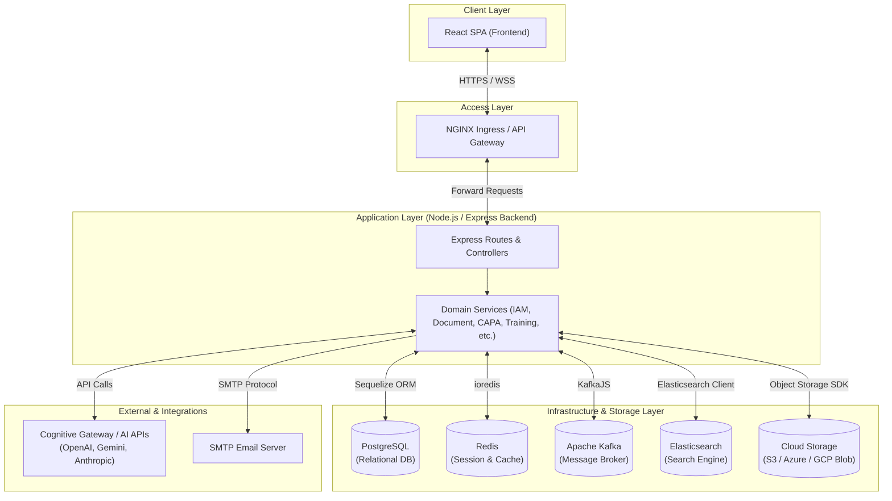

## 5.2. Technology Stack

**Table 4: Technology Stack - Frontend**

| **Technology**   | **Version** | **Purpose**                              |
| ---------------- | ----------- | ---------------------------------------- |
| React            | 19.2.0      | UI component framework                   |
| TypeScript       | 5.9.3       | Type-safe JavaScript                     |
| Vite             | 7.2.4       | Build tool and development server        |
| React Router DOM | 7.12.0      | Client-side routing with lazy loading    |
| Redux Toolkit    | 2.11.2      | Centralized state management             |
| Redux Persist    | 6.0.0       | Persistent state across browser sessions |
| React Hook Form  | 7.71.1      | Performant form state management         |
| Zod              | 4.3.5       | Schema-based validation                  |
| Axios            | 1.13.2      | HTTP client with interceptors            |
| Tailwind CSS     | 4.1.18      | Utility-first CSS framework              |
| Radix UI         | Latest      | Accessible headless UI components        |
| shadcn/ui        | Latest      | Pre-built component library              |
| Lucide React     | 0.562.0     | Icon library                             |
| Recharts         | 3.6.0       | Charts and data visualization            |
| Sonner           | 2.0.7       | Toast notification library               |

**Table 5: Technology Stack - Backend**

| **Technology**     | **Version** | **Purpose**                              |
| ------------------ | ----------- | ---------------------------------------- |
| Node.js            | Latest LTS  | Server-side JavaScript runtime           |
| Express.js         | 4.18.2      | HTTP web application framework           |
| Sequelize          | 6.35.0      | Promise-based ORM for PostgreSQL         |
| PostgreSQL         | 15 (Alpine) | Primary relational database              |
| Redis (ioredis)    | 5.8.2       | In-memory caching and session management |
| KafkaJS            | 2.2.4       | Event streaming and message broker       |
| Elasticsearch      | 8.x         | Full-text search and analytics           |
| JSON Web Token     | 9.0.2       | JWT-based authentication                 |
| Bcrypt.js          | 2.4.3       | Password hashing (bcrypt algorithm)      |
| Multer             | 2.0.2       | Multipart file upload handling           |
| Zod                | 3.24.2      | Server-side request validation           |
| Winston            | 3.11.0      | Structured logging framework             |
| Nodemailer         | 7.0.12      | Email delivery service                   |
| Socket.io          | Latest      | Real-time WebSocket communication        |
| Helmet.js          | Latest      | HTTP security headers                    |
| express-rate-limit | Latest      | API rate limiting                        |
| Prometheus         | Latest      | Application metrics collection           |

## 5.3. Frontend Architecture


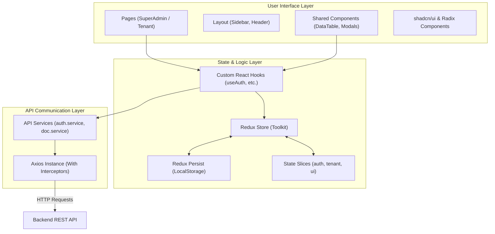

**Folder Structure:**

qassure-frontend/src/

├── components/ # Reusable UI components

│ ├── layout/ # Layout (Sidebar, Header, PageHeader)

│ ├── shared/ # Shared (DataTable, Modals, Forms)

│ ├── superadmin/ # Super Admin-specific components

│ └── ui/ # Base UI components (shadcn/ui)

├── features/ # Feature modules (dashboard)

├── hooks/ # Custom React hooks

├── pages/ # Page components

│ ├── superadmin/ # Super Admin pages

│ └── tenant/ # Tenant Admin/User pages

├── routes/ # Route definitions

├── services/ # API service layer (Axios calls)

├── store/ # Redux store, slices, persist config

├── types/ # TypeScript type definitions

└── utils/ # Utility functions

## 5.4. Backend Architecture


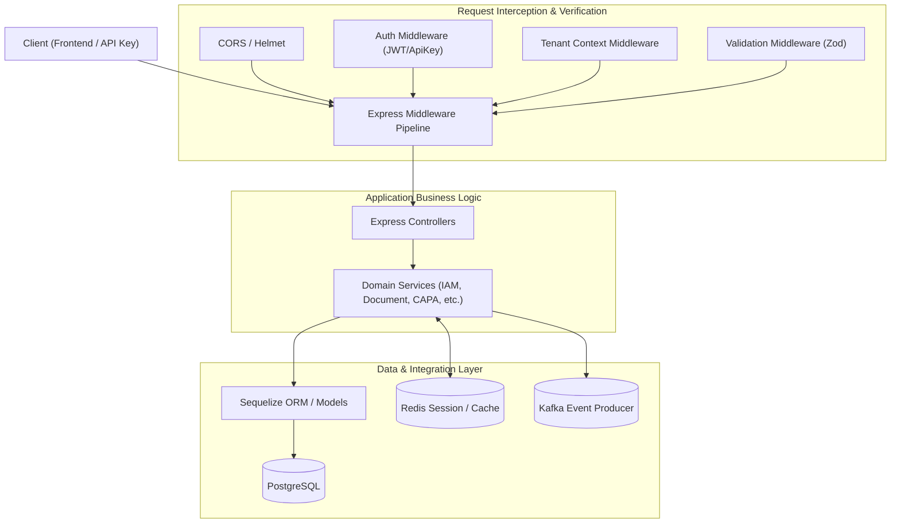

## 5.5. Communication Architecture


The platform uses a multi-protocol communication architecture combining REST APIs for synchronous operations, WebSockets (Socket.io) for real-time notifications, and Kafka for asynchronous event streaming.


## 4.3. Control Plane vs Data Plane Separation

The QAssure platform strictly enforces a separation between the Control Plane (management and configuration) and the Data Plane (execution and business logic). This architectural boundary ensures that administrative operations do not impact the performance of critical quality management processes.

### Control Plane
The Control Plane is responsible for managing the platform's configuration, defining policies, managing identities, and monitoring system health. It is the "brain" of the system that dictates how the Data Plane should behave.

**Core Responsibilities:**
- **Identity & Access Management (IAM):** Provisioning users, roles, and granular permissions, including tenant-scoped roles and platform-scoped administrator roles.
- **Tenant Management:** Provisioning new tenants, managing cross-tenant isolation boundaries, and branding configurations.
- **Workflow & Policy Definition:** Defining the states, transitions, and rules for quality processes (e.g., CAPA, Document Control).
- **System Configuration:** Managing global environment variables, SMTP parameters, AI Gateway timeouts, and storage integrations.
- **Module Launch Configuration:** Managing SSO tokens and external module registration.
- **Delegated Platform Administration:** Allowing platform-scoped users to perform administrative duties (SMTP config, global templates, modules) without root Super Admin access.

**Characteristics:**
- Optimizes for consistency and durability over extreme low latency.
- State changes are propagated to the Data Plane via the Redis caching layer or Kafka event streams.
- Primarily accessed by Super Admins, Platform Users (delegated), and Tenant Admins.

### Data Plane
The Data Plane handles the day-to-end execution of business workflows, document processing, and data ingestion. It operates based on the rules and contexts established by the Control Plane.

**Core Responsibilities:**
- **Request Processing:** Handling high-volume API requests for document uploads, CAPA transitions, and training completions.
- **Context Resolution:** Dynamically resolving tenant contexts (e.g., via `x-tenant-id`) and user permissions per request.
- **Event Streaming:** Emitting and consuming Kafka events for asynchronous tasks (e.g., notification dispatch, AI prompt execution).
- **File & Blob Storage:** Managing physical file attachments and deduplication logic.

**Characteristics:**
- Optimizes for high throughput, low latency, and horizontal scalability.
- Relies heavily on Redis for fast session and permission lookups to avoid database bottlenecks.
- Primarily accessed by standard Tenant Users and system integrations.

## 4.4. Platform Services vs Domain Services

To maintain modularity, the backend architecture distinguishes between generic Platform Services and specific Domain Services.

### Platform Services
Platform services provide cross-cutting capabilities used by all business modules. They are domain-agnostic and form the infrastructure backbone.

- **Authentication/Authorization Service:** Handles JWT validation, SSO, and RBAC evaluation.
- **Tenant Context Service:** Resolves the active tenant and ensures data isolation in queries.
- **File Attachment Service:** Manages binary storage, file metadata, and blob deduplication.
- **Event Bus (Kafka) Service:** Standardizes message publishing and consumption for async tasks.
- **Notification Service:** Routes emails and WebSocket events.
- **AI Gateway Service:** Manages LLM provider routing, fallbacks, and streaming connections.

### Domain Services
Domain services implement the specific business logic for quality management standards (ISO 9001, FDA 21 CFR Part 11).

- **Document Management Service:** Document versioning, review lifecycles, and check-in/out logic.
- **CAPA Service:** 8D problem-solving workflows, root cause analysis, and action plans.
- **Workflow Engine Service:** State machine execution, transition validation, and escalations.
- **Training Service:** Course assignments, competency gaps, and certification tracking.
- **E-Signature Service:** Part 11 compliant signature capture and audit trailing.


# Part III — Component Design

# 5. Component Design

This section defines the core components of the QAssure Platform. For each component, the responsibilities, internal structure, interfaces, and dependencies are explicitly documented to clearly define system boundaries.

## 5.1. Identity & Access Management (IAM)
**Responsibility:** Manages user identities, role definitions, and granular resource-action permissions across both tenant-level and platform-level scopes.

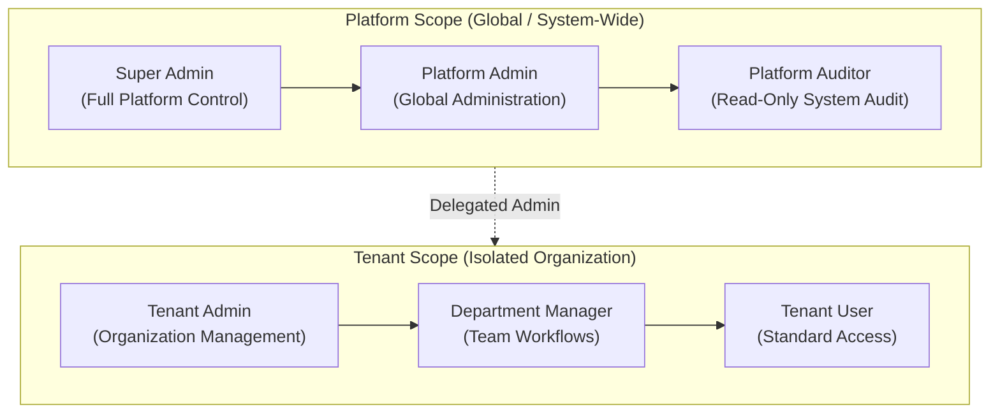

**Internal Structure:**
- **Controller:** `UserController`, `RoleController`, `PermissionController`, `PlatformUserController`, `PlatformRoleController`
- **Service:** `UserService`, `RoleService`, `PermissionService`
- **Data Layer:** `users`, `roles` (including `platform` scope roles), `permissions`, `user_roles`, `platform_users`, `platform_roles` tables
**Key Functionality:**
- User provisioning and lifecycle management.
- Dynamic permission resolution and caching.
- Dual-scoped Role assignment: `tenant` scope (bound to specific organizations) and `platform` scope (unbound from tenant boundaries, enabling system-wide delegated administration).
- Authorization verification via `PermissionService.hasPlatformPermission` and `PermissionService.isPlatformUser`.
**Interfaces:**
- **REST APIs:** `/api/v1/users/*`, `/api/v1/roles/*`, `/api/v1/permissions/*`, `/api/v1/platform-users/*`, `/api/v1/platform-roles/*`
**Dependencies:**
- Relies on PostgreSQL for persistent identity storage.
- Relies on Redis for caching active permission sets.

## 5.2. Authentication Service


### Authentication Flow
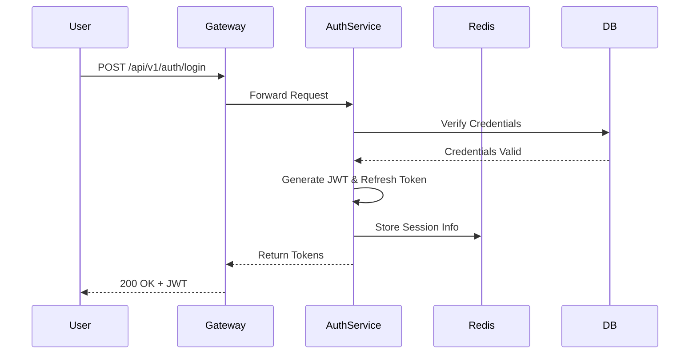

### Module SSO Launch
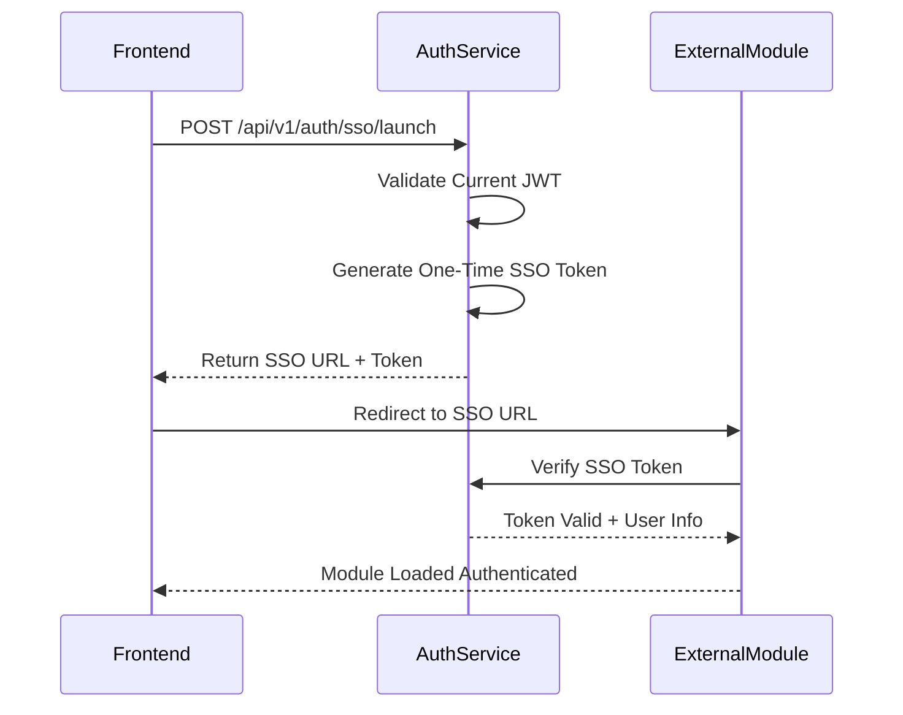

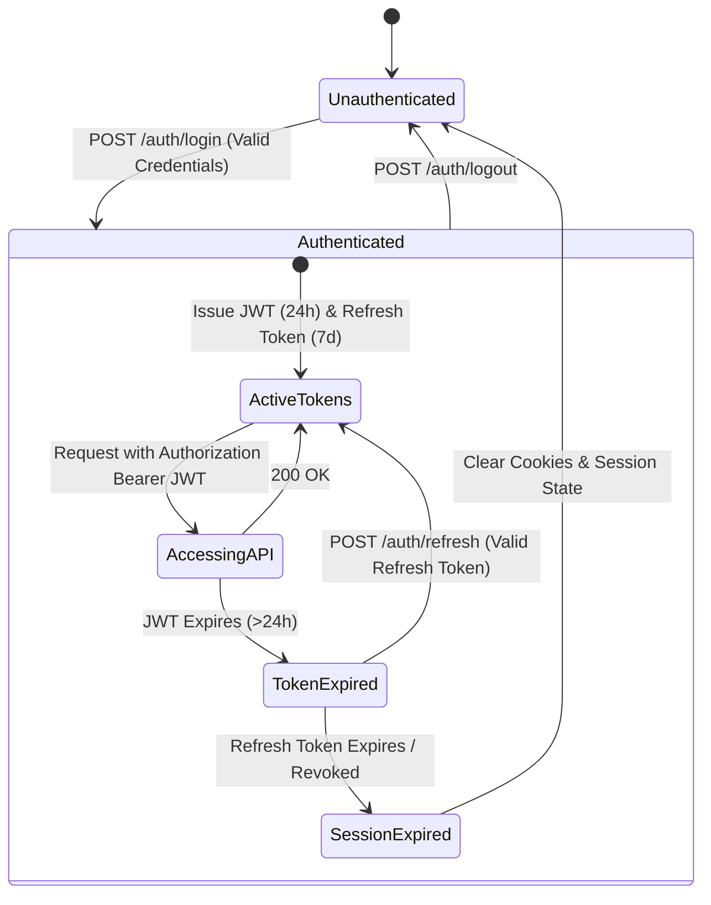

**Responsibility:** Authenticates users and system clients, issues and validates security tokens, and enforces access control rules on API requests.
**Scope:** Data Plane service that intercepts every incoming request.
**Internal Structure:**
- **Controller:** `AuthController`
- **Service:** `AuthService`, `JwtService`, `ApiKeyService`
- **Middleware:** `auth.middleware.js`, `tenant.middleware.js`
**Key Functionality:**
- JWT generation and verification.
- API Key validation for external systems.
- SSO token issuance and validation for module launching.
- **Dual-Mode Authorization Middlewares:**
  - `requireSuperAdmin(resource, action)`: Direct middleware or permission check factory. Allows system Super Admins, or Platform Users with the required platform-scoped permission checked via `PermissionService.hasPlatformPermission`.
  - `requireTenantAdmin(resource, action)`: Direct middleware or permission check factory. Allows Super Admins, delegated Platform Users, or Tenant Admins.
- **Tenant Context Resolution:** Bypasses mandatory tenant context validation in `tenantContext` if the user is identified as a Super Admin or Platform User, allowing platform-wide operations without the `x-tenant-id` header.
**Interfaces:**
- **REST APIs:** `/api/v1/auth/login`, `/api/v1/auth/refresh`, `/api/v1/auth/sso`
**Dependencies:**
- Depends on the IAM component for credential verification.
- Depends on Redis for JWT blacklist/revocation checks.

## 5.3. Multi-Tenancy Platform
**Responsibility:** Ensures strict data and configuration isolation between different tenant organizations sharing the platform.
**Scope:** Platform-level capability spanning both Control and Data planes.
**Internal Structure:**
- **Controller:** `TenantController`
- **Service:** `TenantService`
- **Middleware:** `tenant.middleware.js` (Context Resolver)
- **Data Layer:** `tenants` table; `tenant_id` foreign keys on all domain tables.
**Key Functionality:**
- Tenant onboarding and configuration.
- Dynamic branding retrieval (logos, favicons). **Note:** Logo and favicon uploads are deferred to post-creation (via Organisation Settings), as file attachment storage buckets are only provisioned after tenant creation is complete. Attempting to upload branding assets during the creation wizard would fail silently.
- Automatic injection of `tenant_id` into all database queries to prevent cross-tenant data leakage.
**Interfaces:**
- **REST APIs:** `/api/v1/tenants/*`
- **Headers:** Expects `x-tenant-id` header in requests.
**Dependencies:**
- Core dependency for all Domain Services.

## 5.4. Workflow Engine


### Workflow State Transition
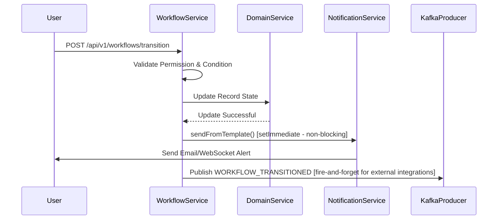
**Responsibility:** Provides a configurable state machine to govern the lifecycle of quality records (Documents, CAPAs, etc.).
**Scope:** Domain Service bridging generic state management with specific QMS workflows.
**Internal Structure:**
- **Controller:** `WorkflowController`
- **Service:** `WorkflowService`, `StateTransitionService`
- **Data Layer:** `workflows`, `workflow_states`, `workflow_transitions` tables
**Key Functionality:**
- Defining custom workflow templates.
- Executing state transitions.
- Enforcing transition conditions and approval requirements.
**Interfaces:**
- **REST APIs:** `/api/v1/workflows/*`
- **Internal Events:** Publishes `WORKFLOW_TRANSITIONED` events to the Kafka producer for external integrations and webhook delivery. Internal notification dispatch is done via a direct `NotificationService.sendFromTemplate()` call (wrapped in `setImmediate` to be non-blocking).
**Dependencies:**
- Depends on Notification Service (direct call) to alert users of pending workflow actions.
- Used heavily by Document Management and CAPA Management.

## 5.5. Document Management


### Document Lifecycle
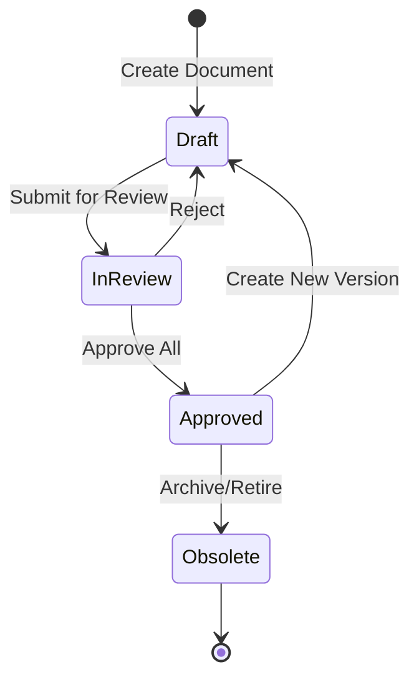
**Responsibility:** Manages the creation, versioning, review, and archival of controlled quality documents.
**Scope:** Core Domain Service.
**Internal Structure:**
- **Controller:** `DocumentController`
- **Service:** `DocumentService`, `DocumentVersionService`
- **Data Layer:** `documents`, `document_versions` tables
**Key Functionality:**
- Document check-in/check-out.
- Automated version incrementing (Major.Minor).
- Periodic review scheduling.
**Interfaces:**
- **REST APIs:** `/api/v1/documents/*`
**Dependencies:**
- Depends on File Management for storing document binaries.
- Depends on Workflow Engine for routing documents through Draft -> Review -> Approved states.

## 5.6. CAPA Management


### CAPA Workflow
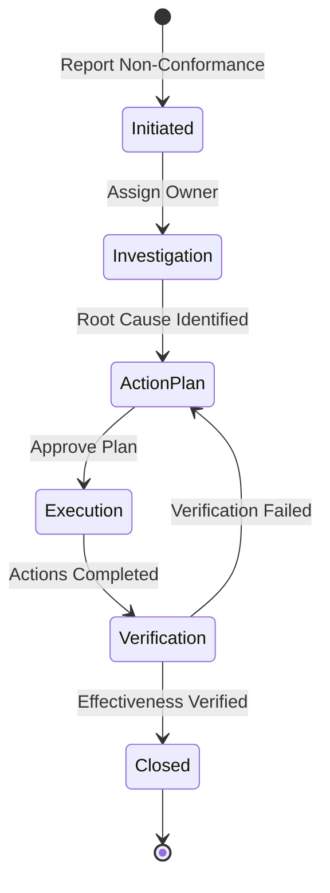
**Responsibility:** Manages Corrective and Preventive Actions (CAPA) using the 8D problem-solving methodology.
**Scope:** Core Domain Service.
**Internal Structure:**
- **Controller:** `CapaController`
- **Service:** `CapaService`
- **Data Layer:** `capas`, `capa_actions` tables
**Key Functionality:**
- Recording non-conformances.
- Root cause analysis tracking.
- Action plan execution and effectiveness verification.
**Interfaces:**
- **REST APIs:** `/api/v1/capas/*`
**Dependencies:**
- Depends on Workflow Engine for CAPA state transitions.

## 5.7. Training Management
**Responsibility:** Tracks employee training records, competencies, and certification requirements.
**Scope:** Domain Service.
**Internal Structure:**
- **Controller:** `TrainingController`
- **Service:** `TrainingService`
**Key Functionality:**
- Course creation and assignment.
- Training effectiveness evaluation.
**Interfaces:**
- **REST APIs:** `/api/v1/training/*`
**Dependencies:**
- Integrates with Document Management (e.g., "Read and Understand" tasks triggered by new document versions).

## 5.8. Supplier Quality Management
**Responsibility:** Manages supplier lifecycles, qualifications, and audits.
**Scope:** Domain Service.
**Internal Structure:**
- **Controller:** `SupplierController`
- **Service:** `SupplierService`
**Key Functionality:**
- Approved Supplier List (ASL) maintenance.
- Supplier scorecard generation.
**Interfaces:**
- **REST APIs:** `/api/v1/suppliers/*`

## 5.9. AI Gateway
**Responsibility:** Routes prompt execution requests to external LLM providers (OpenAI, Anthropic, custom VLLM) and handles streaming responses.
**Scope:** Platform Service.
**Internal Structure:**
- **Controller:** `AIController`
- **Service:** `AIGatewayService`, `PromptService`, `ExecutionRegistry`
**Key Functionality:**
- AI prompt execution (streaming and standard).
- Request cancellation and timeout handling.
- Provider fallback logic.
**Interfaces:**
- **REST APIs:** `/api/v1/ai/*`
**Dependencies:**
- External AI Provider APIs.

## 5.10. Notification System
**Responsibility:** Dispatches alerts, emails, and real-time updates to users.
**Scope:** Platform Service.
**Internal Structure:**
- **Service:** `NotificationService`, `EmailService`, `WebSocketService`
**Key Functionality:**
- Real-time in-app notifications (WSS).
- Email delivery via SMTP.
- Template-based notification dispatch (`sendFromTemplate()`) supporting tenant-level template overrides and user preference filtering.
**Interfaces:**
- **WebSocket:** `/ws` connection endpoint.
- **REST APIs:** `/api/v1/notifications/*`
**Dependencies:**
- Invoked **directly** by domain services (e.g., `AuthService`, `WorkflowEngineService`, `BillingService`) via `getNotificationService().sendFromTemplate()`. Calls are wrapped in `setImmediate()` to run asynchronously without blocking the HTTP response. The Notification Service does **not** act as a Kafka consumer; it is triggered by direct in-process method calls.

## 5.11. File Management
**Responsibility:** Handles binary file uploads, downloads, and storage optimization.
**Scope:** Platform Service.
**Internal Structure:**
- **Controller:** `FileAttachmentController`
- **Service:** `FileAttachmentService`
- **Data Layer:** `file_attachments`, `file_blobs` tables
**Key Functionality:**
- Blob deduplication (tracking reference counts).
- Soft deletion and cleanup.
- File status caching.
**Interfaces:**
- **REST APIs:** `/api/v1/files/*`
**Dependencies:**
- Cloud Storage provider (e.g., AWS S3).

## 5.12. Reporting & Analytics
**Responsibility:** Aggregates quality data into dashboards and exportable reports.
**Scope:** Platform Service.
**Interfaces:**
- **REST APIs:** `/api/v1/reports/*`

## 5.13. Licensing & Billing
**Responsibility:** Tracks tenant usage limits and manages subscription billing.
**Scope:** Control Plane Service.
**Interfaces:**
- **REST APIs:** `/api/v1/billing/*`

## 5.14. Security & Compliance (E-Signatures)
**Responsibility:** Enforces FDA 21 CFR Part 11 requirements for electronic records and signatures.
**Scope:** Domain Service.
**Internal Structure:**
- **Controller:** `ElectronicSignatureController`
- **Service:** `ElectronicSignatureService`
**Key Functionality:**
- Prompting for PIN re-authentication.
- Generating unalterable audit trails for signature events.
**Interfaces:**
- **REST APIs:** `/api/v1/electronic-signatures/*`

## 5.15. QMS Integration
**Responsibility:** Facilitates data sync between QAssure and legacy Quality Management Systems.
**Scope:** Platform Service.
**Interfaces:**
- **REST APIs:** `/api/v1/qms-sync/*`


# Part IV — Data Plane Design

# 6. Data Plane Design

The Data Plane governs the high-volume transactional data operations within the QAssure platform. It ensures data integrity, isolation, and efficient propagation.

## 6.1. Data Ownership Model
To maintain a decoupled microservice-like architecture within the monolithic codebase, strict data ownership rules are enforced:
- **Domain Services Own Their Data:** The Document Service exclusively owns the `documents` and `document_versions` tables. The CAPA Service owns the `capas` table.
- **No Cross-Domain Database Joins:** Services are strictly prohibited from performing direct SQL joins across domain boundaries (e.g., Document Service cannot join directly with CAPA tables).
- **Service API Interaction:** If a service requires data from another domain, it must query that domain's Service layer or consume its emitted events.

## 6.2. Data Lifecycle Management
- **Creation:** Records are created in a `Draft` or `Initiated` state.
- **Modification & Audit:** Updates trigger automatic audit log generation in the `audit_logs` table to ensure 21 CFR Part 11 compliance.
- **Archival/Soft Deletion:** Records are rarely hard-deleted. Instead, an `is_deleted` or `status='Archived'` flag is utilized to maintain referential integrity and historical accuracy.

## 6.3. Multi-Tenancy Data Isolation


### Data Isolation Flow
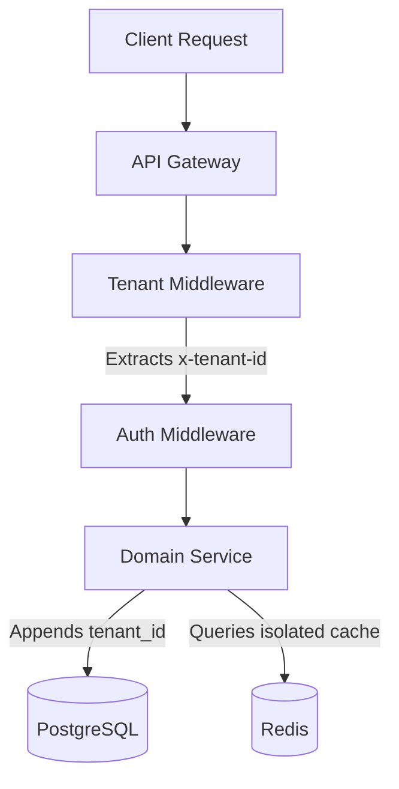
Data isolation is the most critical constraint in the Data Plane.
- **Tenant ID Injection:** The `x-tenant-id` header is extracted by the `tenant.middleware.js` and attached to the Express request object (`req.tenantId`).
- **Database Scoping:** All Data Plane service queries automatically append a `WHERE tenant_id = ?` clause.
- **Cross-Tenant Branding:** Specific branding assets (logos, favicons) are stored with global access flags to allow Super Admins to view them across tenants, utilizing fallback deduplication logic if a tenant misses an asset.

## 6.4. Event-Driven Data Propagation


### Event Publishing Architecture
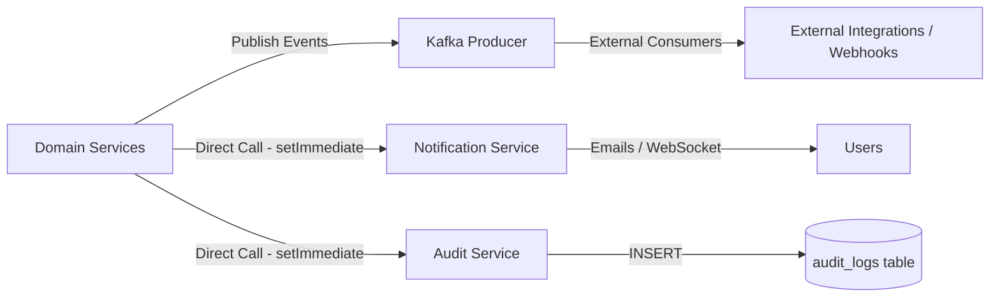
The platform uses a **hybrid communication model** for asynchronous operations:

- **Kafka Producers (External Event Bus):** Domain services (Auth, Workflow Engine, etc.) publish structured events to Kafka topics (e.g., `WORKFLOW_TRANSITIONED`, `USER_LOGIN`). This is intended for external module integrations, webhook delivery, and future cross-service consumers. The `KafkaProducerService` is configured to fail gracefully — if Kafka is unavailable, the event publish is logged and skipped without impacting the request flow.

- **Direct Service Calls (Internal Notifications & Audit):** Internally, **Notification dispatch and Audit logging are NOT handled via Kafka consumers**. They are performed by direct in-process method calls:
  - `getNotificationService().sendFromTemplate(...)` for in-app and email notifications.
  - `getAuditService().log(...)` for compliance audit trail writes to the `audit_logs` PostgreSQL table.
  
  Both calls are wrapped in `setImmediate()` to execute asynchronously after the HTTP response is sent, ensuring that a notification or audit failure never blocks or degrades the user-facing API response.

- **Design Rationale:** This hybrid approach ensures that FDA 21 CFR Part 11 audit trail durability (immediate, synchronous-equivalent DB write) is maintained even if the Kafka broker is unavailable, while still publishing events to Kafka for any external systems that subscribe to the event bus.

# 7. Control Plane Design

The Control Plane dictates the operational rules, startup routines, and failure recovery mechanisms of the platform.

## 7.1. System Startup Sequence
1. **Environment Initialization:** Load and validate `.env` configuration (e.g., DB credentials, AI Provider timeouts).
2. **Database Connection:** Establish Sequelize/Prisma connection pools. Run pending migrations.
3. **Cache Connection:** Connect to Redis. Flush stale session caches if configured.
4. **Infrastructure Services:** Initialize Kafka producers/consumers and WebSocket server.
5. **Route Registration:** Load Express controllers and attach middleware pipelines.
6. **Health Check Readiness:** `/health` endpoint transitions from 503 to 200 OK.

## 7.2. Runtime Execution Flow
1. **Request Ingress:** API Gateway routes request to the Node.js Express server.
2. **Middleware Pipeline:**
   - Security Headers (Helmet, CORS)
   - Authentication (JWT validation via Redis)
   - Tenant Resolution (`x-tenant-id`)
   - Authorization (RBAC permission check)
3. **Controller/Service Execution:** Request is handled by the appropriate Domain Service.
4. **Response Egress:** Standardized JSON response payload is returned.

## 7.3. Failure & Recovery Scenarios
- **Database Disconnection:** The application logs a critical alert. Kubernetes liveness probes detect the failure and restart the pod.
- **Redis Failure:** If Redis is unreachable, the system falls back to querying the primary PostgreSQL database for session and permission validation, albeit with higher latency.
- **AI Gateway Timeout:** If an AI provider (e.g., OpenAI) times out, the `AIGatewayService` automatically retries the request. If the primary provider fails repeatedly, traffic is routed to a secondary provider (e.g., Anthropic or custom VLLM) using the configured `AI_PROVIDER_MAX_RETRIES` logic.
- **Event Bus Failure:** If Kafka is down, events are temporarily buffered in memory or dead-letter queues until the connection is restored.

## 7.4. Session & Token Management
- **JWT Lifecycle:** Short-lived access tokens (15-60 minutes), long-lived refresh tokens (7-30 days), and long-lived session-backed service tokens (up to 24 hours).
- **Redis Backing:** Active sessions and revoked tokens are tracked in Redis. When a user logs out or their permissions are changed by an Admin, their token is immediately added to the Redis blacklist, forcing re-authentication.
- **Service Tokens (Long-Running background tasks):** Service tokens are generated by exchanging an active user token (`POST /api/v1/auth/service-token`). They map to a dedicated record in the `sessions` database table (with both the `token_hash` and a corresponding `refresh_token_hash` representing a refresh token valid for access token expiry + 24 hours) and are cached in Redis. The authentication middleware validates the session state in Redis/PostgreSQL for every request, and programmatic renewal is enabled via the `/auth/refresh` endpoint under the strict validation guard that the active access token must be expired. Immediate revocation of the service token session remains supported when the background task calls `/api/v1/auth/service-token/revoke` upon completion or termination.

## 7.5. Middleware Pipeline
The explicit ordering of middleware is crucial to system security:
1. `requestLogger`
2. `tenantMiddleware` (Resolves context)
3. `authMiddleware` (Validates identity)
4. `permissionMiddleware` (Validates action authorization)
5. `validationMiddleware` (Validates request payload schema)


# Part VI — Interface Design

# 8. Interface Design

## 8.1. API Design Principles
- **RESTful Resource Naming:** Endpoints strictly use plural nouns (e.g., `/api/v1/documents`, not `/api/v1/getDocuments`).
- **Statelessness:** All API calls are stateless. Session state is maintained via JWTs passed in the `Authorization: Bearer <token>` header.
- **Versioning:** All APIs are prefixed with `/api/v1/` to allow for future non-breaking updates.
- **Pagination & Filtering:** GET requests returning collections utilize standard `?page=1&limit=10&sort=createdAt` query parameters.

## 8.2. Standard Request/Response Contracts
All API responses follow a standardized JSON envelope structure to ensure frontend predictability.

**Success Response:**
```json
{
  "success": true,
  "data": { ... },
  "meta": {
    "page": 1,
    "limit": 10,
    "total": 45
  }
}
```

**Error Response:**
```json
{
  "success": false,
  "error": {
    "code": "VALIDATION_FAILED",
    "message": "The provided document title is invalid.",
    "details": [ ... ]
  }
}
```

**Service Disabled (HTTP 403):**
```json
{
  "success": false,
  "error": {
    "code": "SERVICE_DISABLED",
    "service": "electronic_signature",
    "message": "The 'electronic signature' service is not enabled for your organization."
  }
}
```
> The `service.middleware.js` guard emits this standardised nested format for all platform-service rejections, keeping it consistent with the global error handler structure.

## 8.3. Authentication & Authorization Mapping
Every endpoint is mapped to specific permission requirements.
- **Example:** `POST /api/v1/documents` requires the `document:create` permission.
- **Evaluation:** Evaluated by `permission.middleware.js` before reaching the controller. If the user lacks the permission, a `403 Forbidden` is returned.

## 8.4. REST API Endpoint Reference
*(Note: A full OpenAPI/Swagger specification is maintained separately. This section highlights the core domain endpoints.)*

- **Auth:** `POST /api/v1/auth/login`, `POST /api/v1/auth/sso`
- **Tenants:** `GET /api/v1/tenants`, `POST /api/v1/tenants`
- **Documents:** `GET /api/v1/documents`, `POST /api/v1/documents`, `PUT /api/v1/documents/:id`
- **Files:** `POST /api/v1/files/upload`, `GET /api/v1/files/:id/download`
- **AI Gateway:** `POST /api/v1/ai/execute`, `POST /api/v1/ai/stream`

## 8.5. Event/Message Contracts (Kafka)
Kafka messages use a standardized payload to ensure consumers can parse routing context.
```json
{
  "eventId": "uuid",
  "eventType": "DOCUMENT_APPROVED",
  "tenantId": "uuid",
  "timestamp": "2024-03-20T10:00:00Z",
  "payload": {
    "documentId": "123",
    "approvedBy": "uuid"
  }
}
```

## 8.6. WebSocket Interface
WebSockets are used exclusively for real-time notifications (e.g., prompt execution completion, workflow assignment).
- **Endpoint:** `wss://api.qassure.com/ws`
- **Authentication:** Token passed via the initial handshake or connection payload.

## 8.7. Frontend Screen Mapping
- API Endpoints map directly to frontend views to ensure clean separation. For example, the `/api/v1/documents` endpoint serves the `DocumentList.tsx` frontend component.


# Part VII — Data Model

## 9.1. Schema Design Principles
- **Soft Deletes:** Tables utilize `deleted_at` timestamps instead of hard deletes to ensure historical tracking.
- **Audit Columns:** All domain tables include `created_at`, `updated_at`, `created_by`, and `updated_by`.
- **Tenant Isolation:** All tenant-specific data tables include a `tenant_id` foreign key.

*(Note: Detailed ER diagrams are maintained in the database migration files and the platform data dictionary.)*


## 8.1. Schema Design Principles

- **UUID Primary Keys:** All tables use UUID v4 for global uniqueness across distributed systems
- **Tenant Isolation:** Most tables include a tenant_id foreign key for multi-tenant data isolation
- **Soft Deletes:** Critical entities use deleted_at timestamps instead of hard deletes
- **Timestamps:** All tables include created_at and updated_at columns
- **JSONB Columns:** Flexible metadata stored as JSONB for extensibility without schema migration
- **Foreign Key Constraints:** Referential integrity with CASCADE and SET NULL rules
- **Indexes:** Composite indexes on frequently queried columns (tenant_id + status, etc.)

## 8.2. Entity-Relationship Diagrams


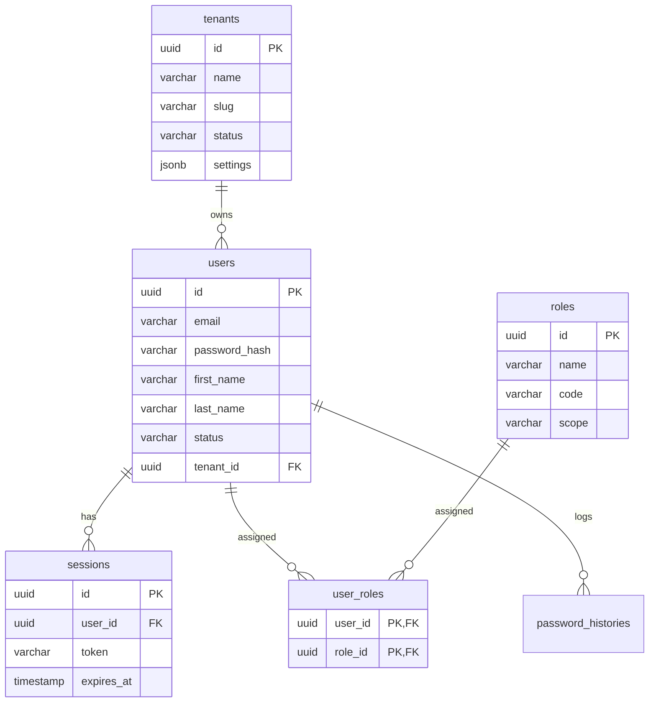

### 8.2.2. Module Management ER Diagram

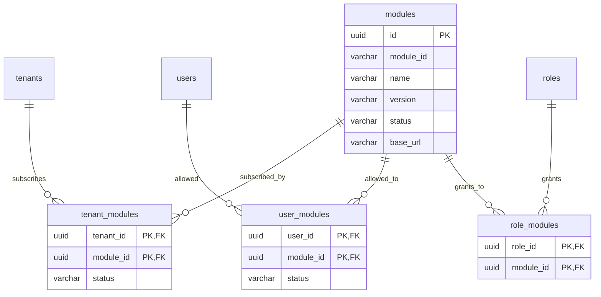

### 8.2.3. Document Management ER Diagram

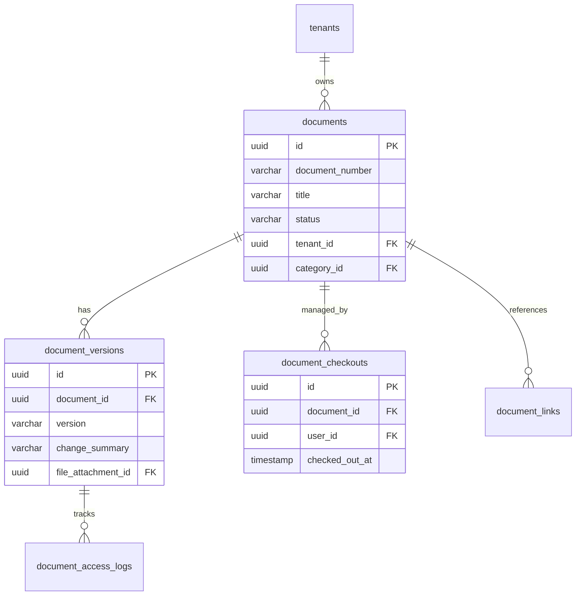

### 8.2.4. CAPA Management ER Diagram

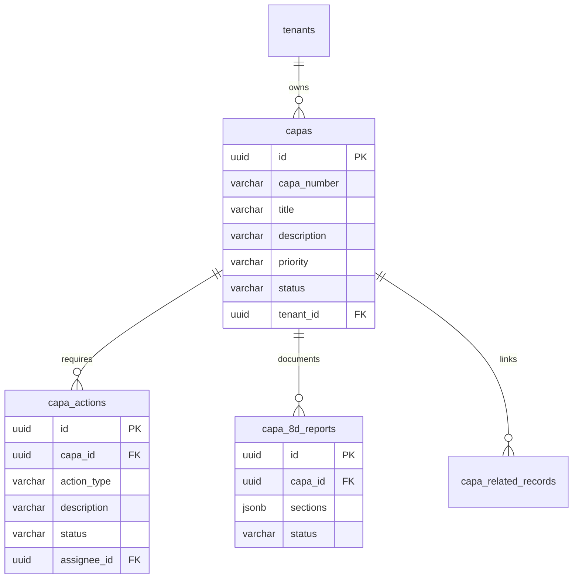

### 8.2.5. Training Management ER Diagram

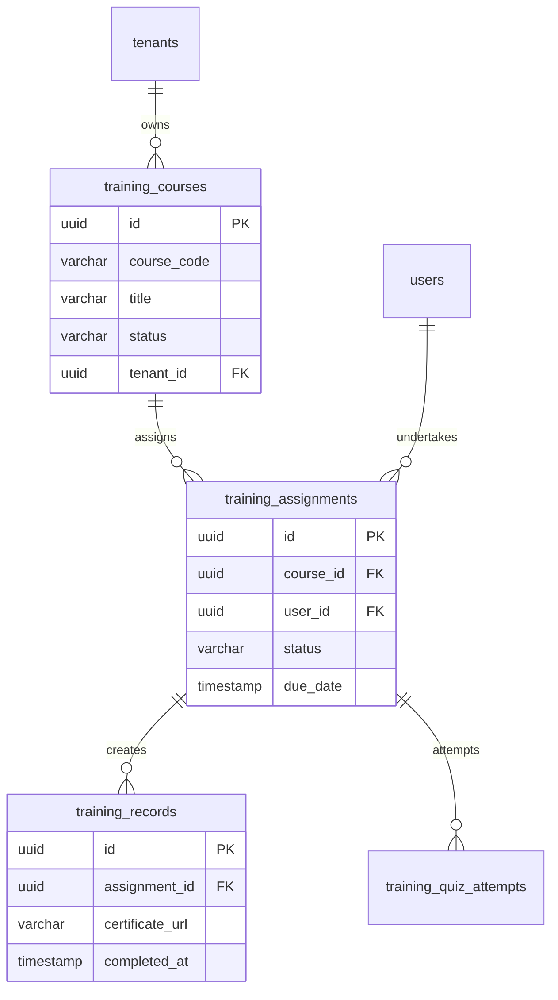

### 8.2.6. Supplier Quality Management ER Diagram

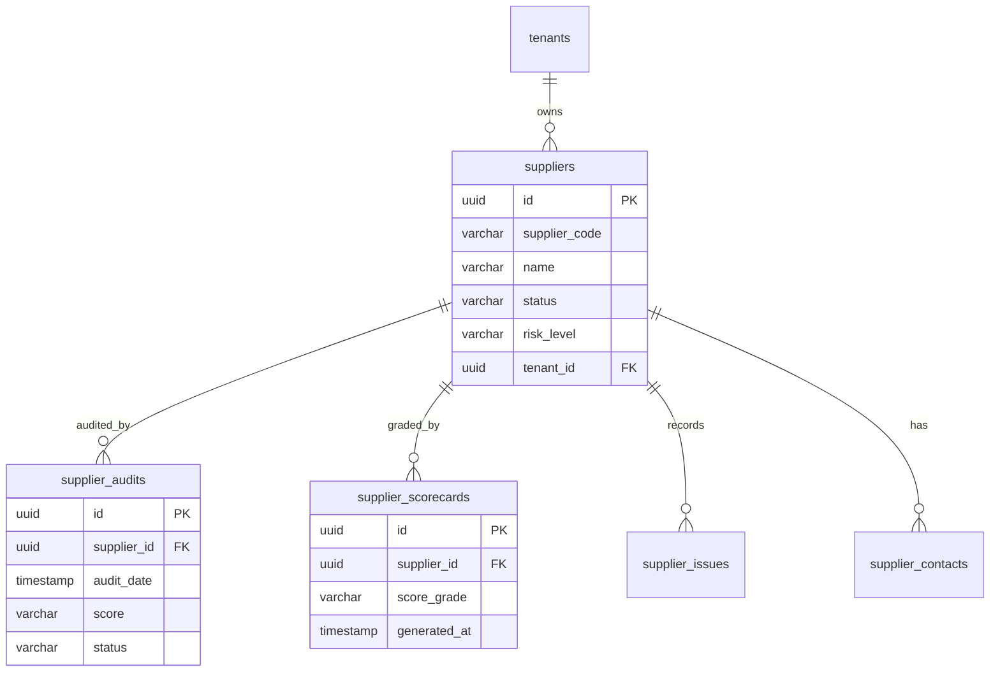

### 8.2.7. Workflow Engine ER Diagram

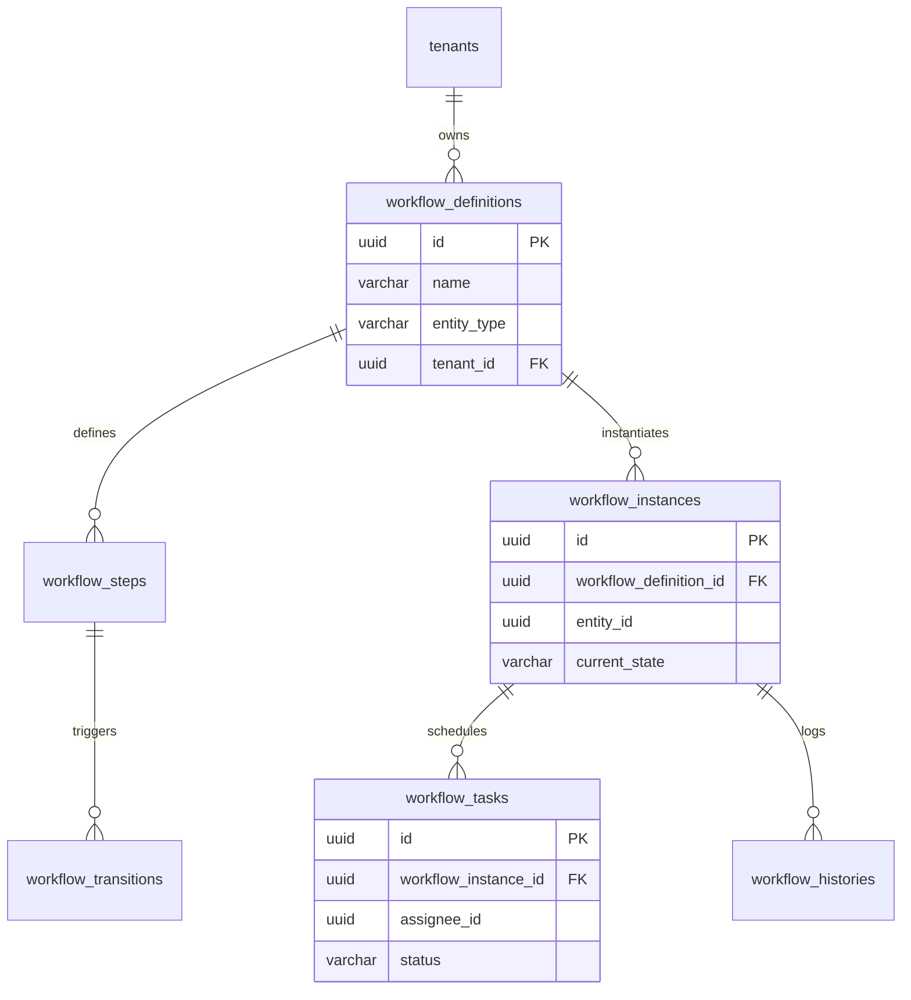

### 8.2.8. Notification System ER Diagram

```mermaid
erDiagram
    tenants ||--o{ notifications : "owns"
    users ||--o{ notifications : "receives"
    users ||--o{ notification_preferences : "configures"
    notifications ||--o{ notification_digest_queue : "queued_in"
    notifications {
        uuid id PK
        uuid user_id FK
        varchar type
        varchar title
        text message
        boolean is_read
        uuid tenant_id FK
    }
    notification_preferences {
        uuid id PK
        uuid user_id FK
        jsonb channels
    }
```

### 8.2.9. Licensing & Billing ER Diagram

```mermaid
erDiagram
    tenants ||--o{ licenses : "owns"
    pricing_plans ||--o{ licenses : "determines"
    licenses ||--o{ license_activations : "has"
    licenses ||--o{ invoices : "bills"
    invoices ||--o{ payments : "paid_by"
    licenses {
        uuid id PK
        uuid tenant_id FK
        uuid pricing_plan_id FK
        varchar status
        timestamp expires_at
    }
    invoices {
        uuid id PK
        uuid license_id FK
        decimal total_amount
        varchar status
    }
    payments {
        uuid id PK
        uuid invoice_id FK
        decimal amount
        varchar status
    }
```

### 8.2.10. AI Gateway ER Diagram

```mermaid
erDiagram
    tenants ||--o{ ai_prompt_templates : "owns"
    ai_prompt_templates ||--o{ ai_prompt_versions : "has"
    ai_prompt_versions ||--o{ ai_prompt_test_cases : "tested_by"
    ai_prompt_test_cases ||--o{ ai_prompt_test_results : "outputs"
    tenants ||--o{ ai_usages : "tracks"
    ai_prompt_templates {
        uuid id PK
        varchar name
        varchar service_type
        uuid tenant_id FK
    }
    ai_prompt_versions {
        uuid id PK
        uuid ai_prompt_template_id FK
        text template_content
        varchar version
    }
    ai_usages {
        uuid id PK
        uuid tenant_id FK
        varchar provider
        integer token_count
    }
```

### 8.2.11. Security & Compliance ER Diagram

```mermaid
erDiagram
    tenants ||--o{ security_policies : "enforces"
    tenants ||--o{ security_settings : "configures"
    security_policies ||--o{ access_reviews : "audits"
    access_reviews ||--o{ access_review_items : "contains"
    security_policies {
        uuid id PK
        varchar name
        jsonb rules
        uuid tenant_id FK
    }
    security_settings {
        uuid id PK
        uuid tenant_id FK
        integer session_timeout
        integer max_login_attempts
    }
    access_reviews {
        uuid id PK
        uuid security_policy_id FK
        varchar status
    }
```

### 8.2.12. File Management ER Diagram

```mermaid
erDiagram
    tenants ||--o{ file_attachments : "owns"
    file_blobs ||--o{ file_attachments : "stored_in"
    file_attachments ||--o{ file_access_logs : "tracks"
    file_attachments ||--o{ file_shares : "shares"
    file_attachments {
        uuid id PK
        varchar filename
        varchar mime_type
        uuid tenant_id FK
        uuid file_blob_id FK
    }
    file_blobs {
        uuid id PK
        varchar storage_key
        varchar provider
        integer size_bytes
    }
    file_shares {
        uuid id PK
        uuid file_attachment_id FK
        varchar share_token
        timestamp expires_at
    }
```

### 8.2.13. Reporting & Analytics ER Diagram

```mermaid
erDiagram
    tenants ||--o{ report_definitions : "owns"
    report_definitions ||--o{ scheduled_reports : "triggers"
    report_definitions ||--o{ report_histories : "archives"
    tenants ||--o{ kpi_definitions : "tracks"
    kpi_definitions ||--o{ kpi_values : "evaluates"
    report_definitions {
        uuid id PK
        varchar title
        jsonb query_config
        uuid tenant_id FK
    }
    report_histories {
        uuid id PK
        uuid report_definition_id FK
        varchar file_path
        timestamp generated_at
    }
    kpi_definitions {
        uuid id PK
        varchar name
        varchar metric_type
        uuid tenant_id FK
    }
```


## 8.3. Database Table Schemas

### 8.3.1. Users Table

**Table 29: Database Table - users**

| **Column**     | **Data Type** | **Constraints**                | **Description**                   |
| -------------- | ------------- | ------------------------------ | --------------------------------- |
| id             | UUID          | PK, DEFAULT uuid_generate_v4() | Unique user identifier            |
| email          | VARCHAR(255)  | UNIQUE, NOT NULL               | User email address                |
| password_hash  | VARCHAR(255)  | NOT NULL                       | Bcrypt-hashed password            |
| first_name     | VARCHAR(100)  | NOT NULL                       | User first name                   |
| last_name      | VARCHAR(100)  | NOT NULL                       | User last name                    |
| status         | ENUM          | NOT NULL, DEFAULT 'pending'    | active, inactive, locked, pending |
| auth_provider  | VARCHAR(50)   | DEFAULT 'local'                | Authentication provider           |
| saml_subject   | VARCHAR(255)  |                                | SAML subject identifier           |
| oauth_provider | VARCHAR(100)  |                                | OAuth provider name               |
| oauth_subject  | VARCHAR(255)  |                                | OAuth subject identifier          |
| last_login_at  | TIMESTAMP     |                                | Last successful login             |
| login_count    | INTEGER       | DEFAULT 0                      | Total login count                 |
| last_login_ip  | VARCHAR(45)   |                                | IP of last login                  |
| preferences    | JSONB         | DEFAULT '{}'                   | User preferences                  |
| created_at     | TIMESTAMP     | NOT NULL, DEFAULT NOW()        | Creation timestamp                |
| updated_at     | TIMESTAMP     | NOT NULL, DEFAULT NOW()        | Last update timestamp             |

**Indexes:**

- **users_email_unique -** UNIQUE **on email**
- **users_status_idx -** INDEX on **status**
- **users_auth_provider_idx -** INDEX on **auth_provider**

**Validation Rules:**

### Email must be valid email format

### Password must meet password policy (min 8 chars, uppercase, lowercase, number, special character)

### First/last name: 1-100 characters, trimmed

### 8.3.2. Tenants Table

**Table 30: Database Table - tenants**

| **Column**        | **Data Type** | **Constraints**                | **Description**             |
| ----------------- | ------------- | ------------------------------ | --------------------------- |
| id                | UUID          | PK, DEFAULT uuid_generate_v4() | Unique tenant identifier    |
| name              | VARCHAR(255)  | NOT NULL                       | Tenant organization name    |
| slug              | VARCHAR(100)  | UNIQUE, NOT NULL               | URL-safe tenant identifier  |
| status            | ENUM          | NOT NULL, DEFAULT 'active'     | active, inactive, suspended |
| settings          | JSONB         | DEFAULT '{}'                   | Tenant-specific settings    |
| subscription_tier | VARCHAR(50)   | DEFAULT 'free'                 | Subscription tier level     |
| max_users         | INTEGER       | DEFAULT 10                     | Maximum allowed users       |
| max_modules       | INTEGER       | DEFAULT 5                      | Maximum allowed modules     |
| created_at        | TIMESTAMP     | NOT NULL, DEFAULT NOW()        | Creation timestamp          |
| updated_at        | TIMESTAMP     | NOT NULL, DEFAULT NOW()        | Last update timestamp       |

**Indexes:**

### tenants_slug_unique - UNIQUE on slug

### tenants_status_idx - INDEX on status

### 8.3.3. Roles Table

**Table 31: Database Table - roles**

| **Column**  | **Data Type** | **Constraints**                | **Description**                                    |
| ----------- | ------------- | ------------------------------ | -------------------------------------------------- |
| id          | UUID          | PK, DEFAULT uuid_generate_v4() | Unique role identifier                             |
| name        | VARCHAR(100)  | NOT NULL                       | Role display name                                  |
| code        | VARCHAR(50)   | UNIQUE, NOT NULL               | Role code (super_admin, tenant_admin, tenant_user) |
| description | TEXT          |                                | Role description                                   |
| scope       | ENUM          | NOT NULL                       | platform, tenant                                   |
| is_system   | BOOLEAN       | DEFAULT false                  | System-managed role (cannot be deleted)            |
| created_at  | TIMESTAMP     | NOT NULL, DEFAULT NOW()        | Creation timestamp                                 |
| updated_at  | TIMESTAMP     | NOT NULL, DEFAULT NOW()        | Last update timestamp                              |

### 8.3.4. Modules Table

**Table 32: Database Table - modules**

| **Column**           | **Data Type** | **Constraints**                | **Description**                                                        |
| -------------------- | ------------- | ------------------------------ | ---------------------------------------------------------------------- |
| id                   | UUID          | PK, DEFAULT uuid_generate_v4() | Unique module record ID                                                |
| module_id            | VARCHAR(100)  | UNIQUE, NOT NULL               | Module identifier code                                                 |
| name                 | VARCHAR(255)  | NOT NULL                       | Module display name                                                    |
| description          | TEXT          |                                | Module description                                                     |
| version              | VARCHAR(50)   | DEFAULT '1.0.0'                | Semantic version                                                       |
| status               | ENUM          | NOT NULL, DEFAULT 'registered' | registered, starting, running, stopped, error, maintenance, deprecated |
| runtime_language     | VARCHAR(50)   |                                | e.g., nodejs, python, java                                             |
| framework            | VARCHAR(50)   |                                | e.g., express, fastapi, spring                                         |
| base_url             | VARCHAR(500)  | NOT NULL                       | Module backend base URL                                                |
| health_endpoint      | VARCHAR(200)  | DEFAULT '/health'              | Health check endpoint path                                             |
| endpoints            | JSONB         | DEFAULT '\[\]'                 | Registered API endpoints                                               |
| kafka_topics         | JSONB         | DEFAULT '{}'                   | Kafka topics the module uses                                           |
| cpu_request          | VARCHAR(20)   |                                | Kubernetes CPU request                                                 |
| cpu_limit            | VARCHAR(20)   |                                | Kubernetes CPU limit                                                   |
| memory_request       | VARCHAR(20)   |                                | Kubernetes memory request                                              |
| memory_limit         | VARCHAR(20)   |                                | Kubernetes memory limit                                                |
| min_replicas         | INTEGER       | DEFAULT 1                      | Minimum pod replicas                                                   |
| max_replicas         | INTEGER       | DEFAULT 3                      | Maximum pod replicas                                                   |
| last_health_check    | TIMESTAMP     |                                | Last health check timestamp                                            |
| health_status        | ENUM          | DEFAULT 'unknown'              | healthy, unhealthy, degraded, unknown                                  |
| consecutive_failures | INTEGER       | DEFAULT 0                      | Consecutive health check failures                                      |
| registered_by        | UUID          | FK → users.id                  | User who registered the module                                         |
| tenant_id            | UUID          | FK → tenants.id                | Tenant that owns the module                                            |
| metadata             | JSONB         | DEFAULT '{}'                   | Additional metadata                                                    |
| created_at           | TIMESTAMP     | NOT NULL, DEFAULT NOW()        | Creation timestamp                                                     |
| updated_at           | TIMESTAMP     | NOT NULL, DEFAULT NOW()        | Last update timestamp                                                  |

### 8.3.5. Audit Logs Table

**Table 33: Database Table - audit_logs**

| **Column**      | **Data Type** | **Constraints**                | **Description**                             |
| --------------- | ------------- | ------------------------------ | ------------------------------------------- |
| id              | UUID          | PK, DEFAULT uuid_generate_v4() | Unique log entry ID                         |
| tenant_id       | UUID          | FK → tenants.id                | Tenant context                              |
| user_id         | UUID          | FK → users.id                  | User who performed action                   |
| action          | VARCHAR(100)  | NOT NULL                       | Action name (create, update, delete, login) |
| resource_type   | VARCHAR(100)  | NOT NULL                       | Entity type (user, document, capa)          |
| resource_id     | UUID          |                                | ID of the affected resource                 |
| request_method  | VARCHAR(10)   |                                | HTTP method                                 |
| request_path    | VARCHAR(500)  |                                | Request URL path                            |
| request_body    | JSONB         |                                | Sanitized request body                      |
| response_status | INTEGER       |                                | HTTP response status code                   |
| response_body   | JSONB         |                                | Sanitized response body                     |
| ip_address      | VARCHAR(45)   |                                | Client IP address                           |
| user_agent      | VARCHAR(500)  |                                | Client user agent string                    |
| correlation_id  | VARCHAR(100)  |                                | Request correlation ID                      |
| changes         | JSONB         |                                | Before/after change details                 |
| metadata        | JSONB         |                                | Additional metadata                         |
| created_at      | TIMESTAMP     | NOT NULL, DEFAULT NOW()        | Log entry timestamp                         |

### Indexes

### audit_logs_tenant_id_idx - INDEX on tenant_id

### audit_logs_user_id_idx - INDEX on user_id

### audit_logs_action_idx - INDEX on action

### audit_logs_resource_type_idx - INDEX on resource_type

### audit_logs_created_at_idx - INDEX on created_at

### 8.3.6. API Keys Table

**Table 34: Database Table - api_keys**

| **Column**   | **Data Type** | **Constraints**                | **Description**                       |
| ------------ | ------------- | ------------------------------ | ------------------------------------- |
| id           | UUID          | PK, DEFAULT uuid_generate_v4() | Unique API key record ID              |
| key_hash     | VARCHAR(255)  | NOT NULL                       | SHA-256 hash of the API key           |
| key_prefix   | VARCHAR(10)   | NOT NULL                       | First 8 characters for identification |
| name         | VARCHAR(255)  | NOT NULL                       | Human-readable name                   |
| description  | TEXT          |                                | Description of key purpose            |
| tenant_id    | UUID          | FK → tenants.id                | Owning tenant                         |
| created_by   | UUID          | FK → users.id                  | User who created the key              |
| status       | ENUM          | NOT NULL, DEFAULT 'active'     | active, inactive, revoked             |
| rate_limit   | INTEGER       | DEFAULT 100                    | Requests per minute                   |
| ip_allowlist | JSONB         | DEFAULT '\[\]'                 | Allowed IP addresses                  |
| last_used_at | TIMESTAMP     |                                | Last usage timestamp                  |
| last_used_ip | VARCHAR(45)   |                                | IP of last usage                      |
| usage_count  | INTEGER       | DEFAULT 0                      | Total usage count                     |
| expires_at   | TIMESTAMP     |                                | Expiration timestamp                  |
| created_at   | TIMESTAMP     | NOT NULL, DEFAULT NOW()        | Creation timestamp                    |
| updated_at   | TIMESTAMP     | NOT NULL, DEFAULT NOW()        | Last update timestamp                 |

## 8.4. Validation Rules Summary

| **Entity** | **Field**            | **Rule**                                                   |
| ---------- | -------------------- | ---------------------------------------------------------- |
| User       | email                | Valid email format, unique, max 255 chars                  |
| User       | password             | Min 8 chars, 1 uppercase, 1 lowercase, 1 number, 1 special |
| User       | first_name/last_name | 1-100 chars, trimmed, no leading/trailing spaces           |
| Tenant     | slug                 | Lowercase, alphanumeric + hyphens, unique, 3-100 chars     |
| Tenant     | max_users            | Positive integer, min 1                                    |
| Role       | code                 | Lowercase, alphanumeric + underscores, unique              |
| Module     | base_url             | Valid URL format                                           |
| Module     | version              | Semantic versioning (x.y.z)                                |
| Document   | document_number      | Auto-generated, tenant-unique                              |
| CAPA       | capa_number          | Auto-generated, tenant-unique                              |
| API Key    | rate_limit           | Positive integer, default 100                              |
| File       | file_size            | Max 50MB (configurable per tenant)                         |
| Invoice    | total_amount         | Decimal(10,2), non-negative                                |


# Part VIII — Deployment Design

## 10.1. Deployment Architecture
QAssure is designed to be cloud-native and deployable across AWS, Azure, or GCP. It utilizes a containerized microservices approach orchestrated by Kubernetes.

```mermaid
graph TD
    User([User Browser]) -->|HTTPS| Ingress[NGINX Ingress Controller]
    
    subgraph K8sCluster ["Kubernetes Cluster"]
        Ingress -->|Route: / | FrontendPods["Frontend Pods\n(NGINX serving React SPA)"]
        Ingress -->|Route: /api/*| API_HPA["API Service (Horizontal Pod Autoscaler)"]
        
        subgraph APIScaled ["API Replica Set"]
            API_HPA --> Pod1["API Pod 1\n(Node.js v22)"]
            API_HPA --> Pod2["API Pod 2\n(Node.js v22)"]
        end

        Pod1 & Pod2 -->|Read/Write| DB[(Managed PostgreSQL\nPrimary)]
        Pod1 & Pod2 -->|Read Only| DBReplica[(PostgreSQL Read Replica)]
        Pod1 & Pod2 <-->|ioredis| RedisCluster[("Redis Cluster\n(Cache & Session)")]
        Pod1 & Pod2 <-->|KafkaJS| KafkaCluster[("Kafka Brokers\n(Event Bus)")]
        Pod1 & Pod2 <-->|Elasticsearch Client| ESCluster[("Elasticsearch Cluster")]

        %% Monitoring
        Prom["Prometheus Pod"] -.->|Scrape metrics| Pod1 & Pod2
        Grafana["Grafana Pod"] --->|Query| Prom
    end

    Pod1 & Pod2 -->|File uploads| S3Bucket[("Cloud Object Storage\n(S3 / Azure / GCP Blob)")]
```


## 10.2. Docker Compose (Dev)
For local development, a `docker-compose.yml` file provisions the Node.js API, PostgreSQL, Redis, and Kafka in isolated networks.

## 10.3. Kubernetes / Helm (Production)
Production deployments utilize Helm charts to template Kubernetes manifests.
- **Ingress:** NGINX Ingress Controller routing traffic to API services.
- **Pods:** Stateless Node.js API pods.
- **StatefulSets:** Utilized for Redis and Kafka (if not using managed cloud services).

## 10.4. Horizontal Scaling Strategy
- **API Nodes:** Node.js pods are scaled horizontally using a Kubernetes Horizontal Pod Autoscaler (HPA) triggered by CPU utilization (e.g., > 70%) and concurrent request metrics.
- **Database:** Managed PostgreSQL (e.g., AWS RDS) with read replicas for heavy reporting queries.
- **Caching:** Redis Cluster mode for horizontal scalability of the cache layer.

## 10.5. CI/CD Pipeline
- **Jenkins/GitHub Actions:** Automated pipelines run unit tests, build Docker images, and push to a private Container Registry.
- **Deployments:** Rolling updates are executed to ensure zero-downtime deployments. Database migrations are run as Pre-Sync hooks in ArgoCD or standard init containers.

## 10.6. Environment Variables
System configuration is strictly managed via environment variables (12-factor app methodology).
- `DATABASE_URL`, `REDIS_URL`, `KAFKA_BROKERS`
- `AI_PROVIDER_TIMEOUT`, `AI_PROVIDER_MAX_RETRIES`
- `JWT_SECRET`, `JWT_EXPIRATION`

## 10.7. Monitoring & Maintenance
- **APM:** Integration with Datadog or New Relic for application performance monitoring.
- **Logging:** Structured JSON logs are aggregated via an ELK stack (Elasticsearch, Logstash, Kibana) or Datadog.


# Appendices

# Appendix A: Middleware Reference

| **Middleware**              | **File**                     | **Purpose**                      |
| --------------------------- | ---------------------------- | -------------------------------- |
| authenticate                | auth.middleware.js           | Verify JWT token, load user      |
| authenticateApiKey          | auth.middleware.js           | Verify API key, load permissions |
| authenticateAny             | auth.middleware.js           | Accept JWT or API key            |
| authorize(resource, action) | authorization.middleware.js  | Check RBAC permission            |
| requireSuperAdmin           | authorization.middleware.js  | Require super_admin role         |
| requireTenantAdmin          | authorization.middleware.js  | Require tenant_admin role        |
| tenantContext               | tenant-context.middleware.js | Extract and validate tenant_id   |
| optionalTenantContext       | tenant-context.middleware.js | Optional tenant context          |
| verifyTenantAccess          | tenant-context.middleware.js | Verify user belongs to tenant    |
| validate(schema)            | validation.middleware.js     | Validate request body with Zod   |
| validateUUID(param)         | validation.middleware.js     | Validate UUID parameter          |
| rateLimiter                 | rate-limit.middleware.js     | API rate limiting                |
| correlationId               | correlation-id.middleware.js | Attach request tracking ID       |
| metricsMiddleware           | metrics.middleware.js        | Collect Prometheus metrics       |
| requestSanitizer            | sanitizer.middleware.js      | Sanitize request inputs          |
| auditMiddleware             | audit.middleware.js          | Log operations to audit_logs     |
| uploadMiddleware            | upload.middleware.js         | Handle multipart file uploads    |

# Appendix B: Error Code Reference

| **HTTP Status** | **Error Code**       | **Description**                        |
| --------------- | -------------------- | -------------------------------------- |
| 400             | VALIDATION_ERROR     | Request body/params failed validation  |
| 400             | BAD_REQUEST          | Malformed request                      |
| 401             | UNAUTHORIZED         | Missing or invalid authentication      |
| 401             | TOKEN_EXPIRED        | JWT token has expired                  |
| 401             | INVALID_CREDENTIALS  | Wrong email or password                |
| 403             | FORBIDDEN            | Insufficient permissions               |
| 403             | TENANT_ACCESS_DENIED | User does not belong to tenant         |
| 403             | ACCOUNT_LOCKED       | Account locked due to failed attempts  |
| 404             | NOT_FOUND            | Resource not found                     |
| 409             | CONFLICT             | Duplicate resource (unique constraint) |
| 422             | UNPROCESSABLE_ENTITY | Business rule violation                |
| 429             | RATE_LIMIT_EXCEEDED  | Too many requests                      |
| 500             | INTERNAL_ERROR       | Unexpected server error                |
| 503             | SERVICE_UNAVAILABLE  | Dependent service down                 |

# Appendix C: Configuration Defaults

| **Setting**                   | **Default Value** | **Description**                        |
| ----------------------------- | ----------------- | -------------------------------------- |
| Session Timeout               | 24 hours          | JWT access token expiry                |
| Refresh Token TTL             | 7 days            | Refresh token expiry                   |
| Password Min Length           | 8 characters      | Minimum password length                |
| Password History              | 5 entries         | Prevent reuse of recent passwords      |
| Account Lockout               | 5 attempts        | Lock after N failed logins             |
| Lockout Duration              | 30 minutes        | Auto-unlock after duration             |
| API Rate Limit                | 100 req/min       | Default rate limit                     |
| File Size Limit               | 50 MB             | Maximum upload file size               |
| Module Health Check Interval  | 60 seconds        | Health check frequency                 |
| Consecutive Failure Threshold | 3                 | Mark module unhealthy after N failures |
| Notification Digest           | Daily at 8:00 AM  | Default digest schedule                |
| Report Retention              | 90 days           | Keep generated reports                 |
| Audit Log Retention           | 365 days          | Keep audit logs                        |

**- End of Document -**

Document ID: QASSURE-DES-001 | Version: 1.0.0 | Date: 09 February 2026

© 2026 QAssure Platform - L&T Technology Services. All rights reserved.

## Appendix D. Component Dependency Matrix

| Component | Depends On | Used By |
|---|---|---|
| Tenant Service | IAM | All Domain Services |
| Auth Service | IAM, Redis | All Components (API Gateway) |
| Workflow Engine | Notification | Document Mgt, CAPA |
| Document Mgt | File Mgt, Workflow | Training Mgt |
| AI Gateway | External APIs | Reporting, Document Mgt |
