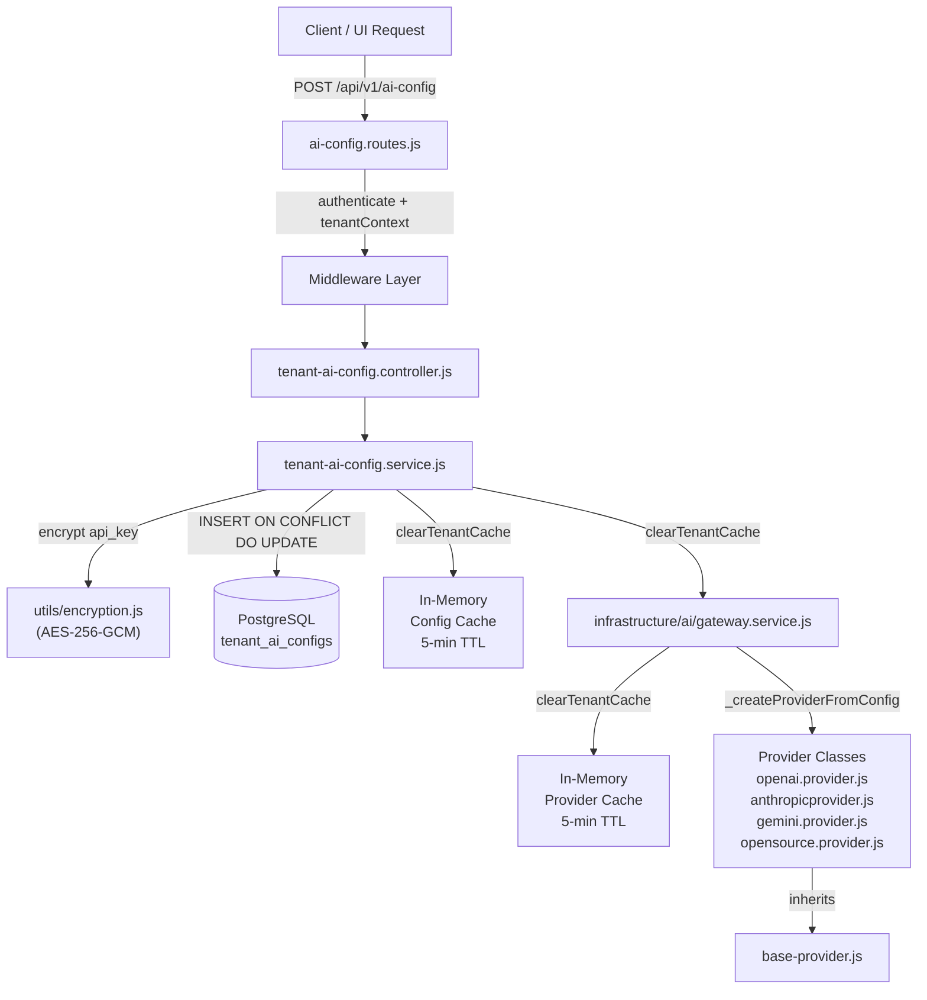
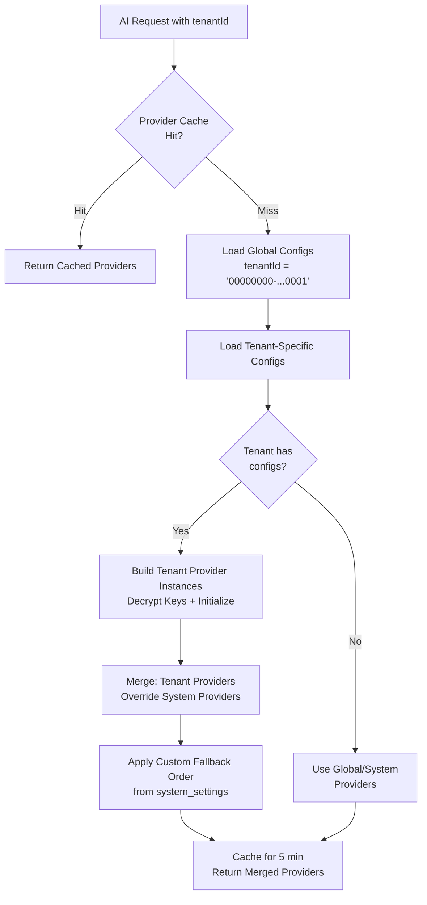

# QAssure AI Config Service — Design Document

**Per-Tenant AI Provider Configuration, Encryption & Gateway Routing**

---

## 1. Overview & Architecture

The AI Config Service enables QAssure to operate as a **Bring Your Own Key (BYOK)** AI platform. Each tenant can register their own AI provider credentials (OpenAI, Anthropic, Gemini, or any OpenAI-compatible open-source endpoint), which are stored encrypted at rest and automatically used by the AI Gateway when that tenant initiates any AI operation.

**Key Design Principles:**
- **Encryption at Rest**: All API keys are encrypted using AES-256-GCM before being stored in PostgreSQL. The plaintext key never touches the database.
- **Cache-First Architecture**: Both the config service and the AI Gateway maintain separate in-memory caches with 5-minute TTLs to eliminate redundant decryption and DB roundtrips on every AI call.
- **Dual-Level Fallback**: If a tenant has no provider configured, the gateway falls back to the **global configs** (tenant UUID `00000000-0000-0000-0000-000000000001`), and then to system environment variable keys.
- **Provider Agnosticism**: The `open-source` provider type allows any OpenAI-compatible endpoint (vLLM, Ollama, Together.ai, Groq, LM Studio, etc.) to be registered as a named provider.
- **Zero-Cost BYOK Billing**: When a tenant uses their own API key (`usesTenantApiKey = true`), the platform billing cost is set to `0` — the tenant pays the vendor directly.

---

## 2. System Architecture Diagram



---

## 3. Provider Resolution & Fallback Chain

When any AI operation is triggered for a tenant, the Gateway resolves which provider to use via `_resolveProviders(tenantId)`:



**Fallback Priority (highest to lowest):**
1. Per-tenant provider config (from `tenant_ai_configs` table)
2. Per-provider fallback from tenant config (`fallback_provider` column)
3. Global fallback mapping from `system_settings` (`category='ai'`, `setting_key='fallback_mapping'`)
4. Custom global fallback order from `system_settings` (`setting_key='fallback_order'`)
5. System-level environment variable keys (`OPENAI_API_KEY`, `ANTHROPIC_API_KEY`, etc.)

---

## 4. Encryption Architecture

All API keys are protected at rest with **AES-256-GCM** symmetric authenticated encryption.

```
Stored Format: base64(iv) : base64(authTag) : base64(ciphertext)
```

| Component | Detail |
| :--- | :--- |
| **Algorithm** | `aes-256-gcm` (authenticated encryption, tamper-proof) |
| **Key Source** | `ENCRYPTION_KEY` env var — must be a 64-character hex string (32 bytes) |
| **IV** | 16 random bytes generated per encryption (`crypto.randomBytes(16)`) |
| **Auth Tag** | 16-byte GCM authentication tag (prevents ciphertext tampering) |
| **Display** | `maskApiKey()` shows first 8 + last 4 chars: `DPm2DIP2...T1NI` |

---

## 5. Database Schema: `tenant_ai_configs`

This table stores the complete configuration for each provider per tenant. Built from migrations `055`, `056`, `089`, `095`, and `101`.

| Column | Type | Nullable | Description |
| :--- | :--- | :--- | :--- |
| `id` | UUID (PK) | No | Auto-generated record ID |
| `tenant_id` | UUID (FK → tenants) | No | Owning tenant. CASCADE delete. |
| `provider` | VARCHAR(50) | No | Provider name: `openai`, `anthropic`, `gemini`, or any custom string |
| `config_type` | VARCHAR(20) | No | `direct` (vendor API key) or `azure` (Azure Foundry/OpenAI Service) |
| `display_name` | VARCHAR(255) | Yes | Human-readable label (e.g., `"My OpenAI Prod"`) |
| `encrypted_api_key` | TEXT | No | AES-256-GCM encrypted API key in `iv:authTag:ciphertext` format |
| `endpoint` | TEXT | Yes | Base URL. Required for `azure` config and all open-source providers |
| `deployment` | VARCHAR(255) | Yes | Azure deployment name / model alias |
| `api_version` | VARCHAR(50) | Yes | Azure API version (e.g., `2024-12-01-preview`) |
| `custom_models` | JSONB | Yes | Array of model IDs available via this config. Default: `[]` |
| `custom_pricing` | JSONB | Yes | Per-model cost override: `{ "gpt-4o": { "input": 0.005, "output": 0.015 } }` |
| `default_model` | VARCHAR(255) | Yes | The model used when no explicit model is specified |
| `custom_embedding_models` | JSONB | Yes | Array of embedding model names (added in migration 089) |
| `default_embedding_model` | VARCHAR(255) | Yes | Primary embedding model for RAG pipelines (migration 089) |
| `fallback_provider` | VARCHAR(50) | Yes | Provider to fall back to if this one fails (migration 095) |
| `cancel_url` | VARCHAR(500) | Yes | Endpoint for canceling in-flight open-source model requests (migration 101) |
| `is_active` | BOOLEAN | No | Whether config is active. Default: `true` |
| `last_verified_at` | TIMESTAMPTZ | Yes | Timestamp of last successful `testConnection` call |
| `last_error` | TEXT | Yes | Last error from a failed connection test or decryption failure |
| `created_by` | UUID (FK → users) | Yes | User who created the config |
| `updated_by` | UUID (FK → users) | Yes | User who last updated the config |
| `created_at` | TIMESTAMPTZ | No | Record creation timestamp |
| `updated_at` | TIMESTAMPTZ | No | Record last update timestamp |

**DB Constraints:**
- `UNIQUE (tenant_id, provider)` — Only one config per provider per tenant
- `chk_config_type CHECK (config_type IN ('azure', 'direct'))`
- Original `chk_provider` constraint was **dropped in migration 089** to allow free-form provider names (Gemini, Mistral, custom models)

**DB Indexes:**
- `idx_tenant_ai_configs_tenant` — on `tenant_id`
- `idx_tenant_ai_configs_active` — partial index on `(tenant_id, is_active)` WHERE `is_active = true`

---

## 6. Provider Class Hierarchy

```
BaseAIProvider (base-provider.js)
├── OpenAIProvider       (openai.provider.js)       → Direct + Azure OpenAI
├── AnthropicProvider    (anthropic.provider.js)    → Direct + Azure Anthropic
├── GeminiProvider       (gemini.provider.js)       → Google AI Studio / Vertex
└── OpenSourceProvider   (opensource.provider.js)  → Any OpenAI-compatible endpoint
```

**BaseAIProvider contract** (all providers must implement):
| Method | Description |
| :--- | :--- |
| `initialize()` | Validates config, creates SDK client, sets `isEnabled` |
| `healthCheck()` | Sends a minimal test request to verify the endpoint is reachable |
| `createCompletion(options)` | Text/chat completion |
| `createEmbedding(input, model)` | Generates embedding vectors |
| `createStreamingCompletion(options, onChunk)` | Streamed text completion |
| `createMultimodalCompletion(options)` | Vision/file + text input |
| `calculateCost(model, inputTokens, outputTokens)` | Returns `0` for BYOK, token-cost otherwise |
| `cancelExecution(requestId, providerConfig)` | Cancels in-flight request via `cancel_url` |
