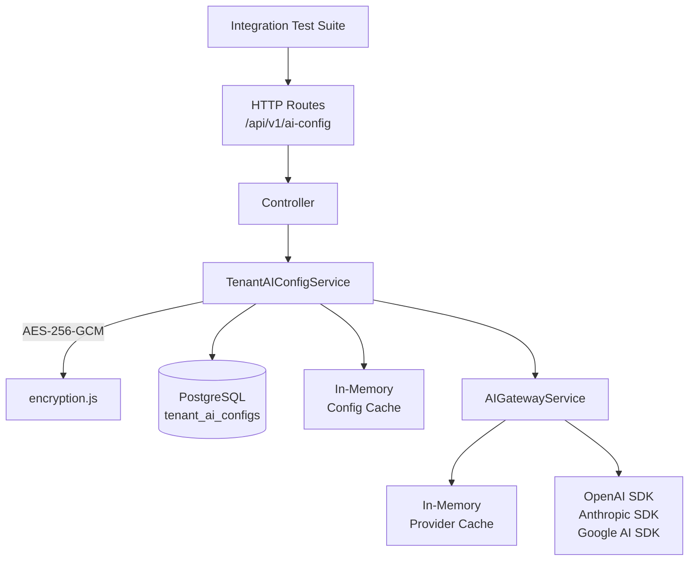

# QAssure AI Config Service — Integration Testing Document

---

## 1. Integration Scope

Integration tests validate the AI Config service working with all real external systems:

1. **PostgreSQL** — Upsert ON CONFLICT behavior, proper encryption storage, index usage.
2. **Encryption + DB round-trip** — Key encrypted on write, decryptable on read, masked in API responses.
3. **AI Provider SDKs** — Real connectivity to OpenAI, Anthropic, Gemini, and local vLLM.
4. **Gateway Cache Coordination** — Config changes propagate through both caches correctly.
5. **Gateway Fallback Chain** — Tenant-level provider overrides system fallback properly.
6. **Multi-Tenant Isolation** — Tenant A's configs do not bleed into Tenant B's provider resolution.

---

## 2. Integration Architecture

---

## 3. Integration Test Scenarios

### 3.1 Scenario A: Upsert + Encryption Round-Trip

**Goal**: Confirm the API key is stored encrypted and never returned in plaintext.

**Steps**:
1. `POST /api/v1/ai-config` with `{ provider: "openai", config_type: "direct", api_key: "sk-test-real-key-12345", default_model: "gpt-4o" }`.
2. **Verify response**: `api_key_masked` is `"sk-test-...2345"`. No `api_key` or `encrypted_api_key` field in response.
3. **Verify DB**: Query `SELECT encrypted_api_key FROM tenant_ai_configs WHERE provider='openai'`. Value must:
   - NOT equal `"sk-test-real-key-12345"` (plaintext).
   - Match the format `<base64>:<base64>:<base64>` (iv:authTag:ciphertext).
4. **Decrypt in test**: Call `decrypt(encrypted_api_key)` directly → must return `"sk-test-real-key-12345"`.
5. **Upsert again** with a new `api_key`. Verify DB `encrypted_api_key` changed (new random IV). Verify `last_error` is `null`.

---

### 3.2 Scenario B: ON CONFLICT DO UPDATE (No Duplicate Records)

**Goal**: Confirm multiple POSTs for the same provider don't create duplicate rows.

**Steps**:
1. `POST /api/v1/ai-config` with `provider: "anthropic"` → row created.
2. `POST /api/v1/ai-config` with same `provider: "anthropic"`, different `api_key` → row updated.
3. **Verify DB**: `SELECT COUNT(*) FROM tenant_ai_configs WHERE provider='anthropic' AND tenant_id=<id>` → result must be `1`.
4. **Verify**: The second POST's `api_key` was stored (encrypted), not the first.

---

### 3.3 Scenario C: Config Cache Invalidation on Upsert

**Goal**: Confirm that after a config change, the cached version is no longer used.

**Steps**:
1. Call `getActiveConfigs(tenantId)` directly on the service → triggers DB query, caches result.
2. `POST /api/v1/ai-config` to update the config (new key, new model) → invalidates cache.
3. Call `getActiveConfigs(tenantId)` again → must hit DB (cache miss), return new config with updated model.
4. **Verify**: Decrypted key in the second call matches the newly provided key.

---

### 3.4 Scenario D: Gateway Provider Cache Invalidation

**Goal**: Confirm the Gateway provider cache is cleared when a config is changed via the API.

**Steps**:
1. Trigger an AI completion call for the tenant → Gateway builds and caches provider instances.
2. `DELETE /api/v1/ai-config/openai` for the tenant → should call `getAIGateway().clearTenantCache(tenantId)`.
3. Trigger another AI completion call → Gateway must re-resolve providers from DB (cache miss).
4. **Verify**: If OpenAI was the only tenant provider, the second call falls back to system/global config (no crash).

---

### 3.5 Scenario E: testConnection Real Provider Integration

**Goal**: Confirm the test endpoint accurately reflects provider health.

**Steps**:
1. Create a config with a **valid** production API key for `openai`.
2. `POST /api/v1/ai-config/openai/test` → **200**, `{ healthy: true, latency_ms: <number> }`.
3. **Verify DB**: `last_verified_at` is set. `last_error` is `null`.
4. Create a config with a **invalid** API key (`"invalid-key-1234567890"`).
5. `POST /api/v1/ai-config/openai/test` → **200**, `{ healthy: false, error: "401 Unauthorized..." }`.
6. **Verify DB**: `last_error` is set to the error string.

---

### 3.6 Scenario F: Gateway Fallback Chain Integration

**Goal**: Confirm tenant provider config takes precedence over system environment keys.

**Steps**:
1. System has `OPENAI_API_KEY` set in environment (system provider initialized).
2. Tenant A has no custom configs → AI calls use system provider.
3. Create an `anthropic` config for Tenant A.
4. `POST /ai-config` for anthropic with a valid Anthropic key.
5. Trigger AI completion for Tenant A with `provider: "anthropic"` → must use Tenant A's key (not system).
6. **Verify** via `last_verified_at` / API response `provider` field.
7. Delete Tenant A's anthropic config → AI call falls back to system providers again.

---

### 3.7 Scenario G: Multi-Tenant Isolation

**Goal**: Confirm Tenant A's provider configs are invisible to Tenant B.

**Steps**:
1. Create `openai` config for **Tenant A** with key `"sk-tenant-a-key-12345"`.
2. Create `anthropic` config for **Tenant B** with key `"sk-ant-tenant-b-12345"`.
3. As **Tenant B** (using Tenant B's JWT):
   - `GET /ai-config/openai` → **404** (`NOT_FOUND`).
   - `GET /ai-config` → returns only `["anthropic"]`.
4. Call `getActiveConfigs("tenantB-id")` internally → result only contains `anthropic`, not `openai`.
5. **Verify DB**: Both records exist but are isolated by `tenant_id`.

---

### 3.8 Scenario H: Open-Source Provider Full Registration

**Goal**: Register a vLLM endpoint and validate it works end-to-end.

**Prerequisites**: A local vLLM server running on `http://localhost:8000/v1` with `Mistral 7B` loaded.

**Steps**:
1. `POST /ai-config` with `{ provider: "Mistral 7B", config_type: "direct", api_key: "any-key-12345", endpoint: "http://localhost:8000/v1", default_model: "Mistral 7B", cancel_url: "http://localhost:8000/cancel" }` → 200.
2. `POST /ai-config/Mistral 7B/test` → `{ healthy: true, latency_ms: ... }`.
3. Trigger an AI completion call via Prompt Service for this tenant → Gateway resolves `Mistral 7B` as first provider, sends request to vLLM.
4. **Verify** response contains content from vLLM.

---

## 4. Integration Test Infrastructure Requirements

| Dependency | Requirement |
| :--- | :--- |
| **PostgreSQL** | Test DB with migrations 055, 056, 089, 095, 101 applied |
| **ENCRYPTION_KEY** | Set to a 64-char hex test key in `.env.test` |
| **AI Provider Keys** | Optional real keys in `.env.test` for live provider tests (skip-able in CI) |
| **vLLM / Ollama** | Required only for Scenario H open-source provider test |
| **Cleanup** | Truncate `tenant_ai_configs` between test suites |
| **NODE_ENV** | `test` — ensures no external events are published |
