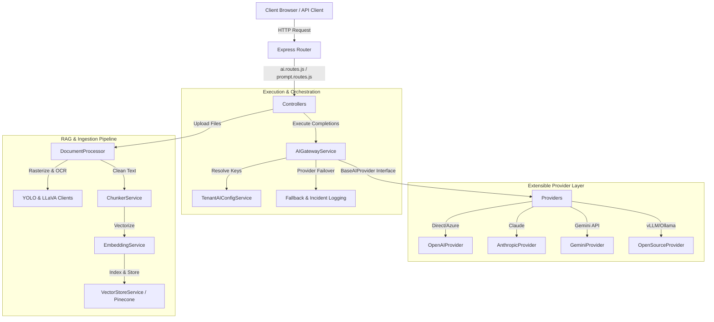

# QAssure Platform AI Infrastructure & Route Guide (Knowledge Transfer)

This guide provides an architectural breakdown of QAssure's AI subsystem. It is structured to help you present a comprehensive and technical Knowledge Transfer (KT) session covering the API routes, prompt engineering pipeline, provider design, and RAG ingestion flow.

---

## 1. High-Level Architecture Map

The subsystem decouples application features (Audit, CAPA, etc.) from underlying AI models. It supports dynamic multi-tenancy via **Bring Your Own Key (BYOK)**, caching, and failover management.



---

## 2. API & Prompt Routes Layer

### 2.1. Core AI Execution & Config (`ai.routes.js`)
Handles standard completion prompts, health telemetry, and Super Admin failover settings:
* **Middlewares**: Enforces `authenticate` (JWT authentication) and `tenantContext` (cross-tenant isolation).
* **Endpoints**:
  * `GET /providers` & `/providers/:provider/health`: Lists active tenant-scoped providers and executes live connectivity tests.
  * `POST /completions`: Routes prompts through the gateway and logs tokens, latency, cost, and fallback outcomes.
  * `POST /playground`: Tests configurations directly through the gateway without recording completion histories.
  * `GET/POST /fallback-order` & `/fallback-mapping`: Restricts priority failover changes to Platform Super Admins (`requireSuperAdmin`).

### 2.2. Prompt Management Pipeline (`prompt.routes.js`)
Manages the lifecycle of prompt templates, testing suites, and file-based execution:
* **Multipart Upload**: Configures a 50MB memory buffer via `multer` for multimodal document parsing.
* **Version Control**: Supports Git-like version tracking (cloning, viewing history, and rolling back templates via `POST /:id/rollback`).
* **Execution & Test Cases**:
  * `POST /:id/execute`: Renders templates with dynamic inputs and triggers completion streaming.
  * `POST /:id/cancel`: Remote execution cancellation handler.
  * `POST /:id/execute-with-file`: Parses uploaded files (PDF, DOCX, CSV, Image) using the layout parser and runs them against the prompt template.
  * `POST /:id/test-cases` & `POST /test-cases/:testCaseId/run`: Runs assertion tests on prompts to benchmark outputs.

---

## 3. Extensible Provider Contract (`src/infrastructure/ai`)

To support multiple cloud vendors and local models, QAssure implements a unified provider strategy. All providers are registered in `index.js` for centralized import.

### 3.1. `BaseAIProvider` (`base-provider.js`)
The abstract parent class defining QAssure's AI contracts.
* **Interface Rules**: Any subclass must implement `initialize()`, `healthCheck()`, `createCompletion()`, `createEmbedding()`, and `cancelExecution()`.
* **Cost Tracking**: Includes `calculateCost()` to calculate prompt usage. When `usesTenantApiKey = true` (BYOK mode), calculations evaluate to `0` since billing is handled directly by the tenant.
* **Multimodal Support**: Exposes `supportsMultimodal` and a stubbed `createMultimodalCompletion()` for vision-capable models.

### 3.2. Upstream Cloud Providers
* **`OpenAIProvider` (`openai.provider.js`)**: Wraps the official OpenAI SDK. Supports standard endpoints or **Azure OpenAI deployments** (resolving endpoints, deployments, and versions dynamically).
* **`AnthropicProvider` (`anthropic.provider.js`)**: Integrates Anthropic Claude models (Claude 3.5 Sonnet, Haiku, etc.).
* **`GeminiProvider` (`gemini.provider.js`)**: Integrates Google Gemini API using native REST calls (v1beta API structure).

### 3.3. `OpenSourceProvider` (`opensource.provider.js`)
Binds to local or custom API engines (e.g., vLLM, Ollama, Together, Groq) using an OpenAI-compatible SDK:
* **Sanitization**: Strips trailing `/chat/completions` from base URLs before feeding endpoints to the SDK client.
* **Cost Neutrality**: Sets all calculated costs to zero.
* **Remote Request Cancellation**:
  * If a request is streaming, calls `AbortController.signal` locally to abort.
  * For remote models, extracts the tenant's `cancelUrl`, resolves the API credentials, and issues an asynchronous `POST {cancelUrl} { request_id: requestId }` to terminate the inference process at the model host level.

---

## 4. Orchestration & Gateways (`gateway.service.js`)

`AIGatewayService` is the central brain of QAssure's AI operations.

### 4.1. Tenant Configuration Resolution & Caching
* On every request, `_resolveProviders(tenantId)` determines whether to use system-wide credentials or dynamic tenant configurations (loaded via `TenantAIConfigService`).
* **Cache Strategy**: Resolved and decrypted API credentials are stored in `tenantProviderCache` for **5 minutes** (`TENANT_CACHE_TTL_MS = 300000`) to avoid decryption latency on every prompt.

### 4.2. Resilient Failover & Fallback
If a provider returns an error (outage, timeout, rate limit code `429`), the gateway automatically fail-overs requests:
1. **Precedence**: First checks per-tenant custom fallback mapping (e.g. Gemini fallback for OpenAI). Second, falls back to globally configured system setting mappings. Lastly, cascades down the priority order array (e.g., `['openai', 'gemini', 'open-source']`).
2. **Alerting**: On fallback trigger, the gateway invokes `_handleFallbackLogAndNotify()` which:
   * Logs diagnostic snapshots into the `ai_fallbacks` database.
   * Publishes high-priority alerts to active system administrators via **Kafka** (`qassure.ai.events`).
   * Sends diagnostic alerts to system admins via **SMTP/Email**.

---

## 5. RAG & Multimodal Ingestion Pipeline

When files are processed or indexed, they pass through a structured ingestion pipeline:

```
File Upload ──> DocumentProcessor ──> ChunkerService ──> EmbeddingService ──> VectorStoreService (Pinecone)
```

### 5.1. YOLO & LLaVA Clients
* **`YoloClient` (`yolo.client.js`)**: Calls LTTS's YOLO layout detection server. Recognizes bounding boxes (`bbox_xyxy`) for document segments (paragraphs, headers, tables, images).
* **`LlavaClient` (`llava.client.js`)**: Communicates with the LTTS LLaVA vision-language model via `multipart/form-data` to synthesize textual summaries of page segments.

### 5.2. `DocumentProcessor` (`document.processor.js`)
* **Standard Extraction**: Parses text from `.pdf` (using classic/modern `pdf-parse` polyfills), `.docx` (mammoth), and spreadsheets (exceljs to CSV).
* **LTTS Multimodal Extraction (`processBufferMultimodal`)**:
  1. Rasterizes PDF files into page-by-page PNG images at **200 DPI** using `pdf2pic`.
  2. Runs YOLO on each page image to extract regions and structural layouts.
  3. Formats a compound prompt referencing the page number, regions found, and details for LLaVA.
  4. Calls LLaVA to generate a visual-linguistic transcription of the page (including descriptions of tables and figures).
  5. If the LLaVA client is unconfigured or fails, automatically falls back to standard text extraction.

### 5.3. `ChunkerService` (`chunker.service.js`)
Splits large text payloads into clean segments to prepare them for vector embedding:
* **Parameters**: Defaults to a chunk size of **512 tokens** with a **50 token overlap** (assuming ~4 characters per token).
* **Recursive Splitting**: Evaluates text boundaries using primary separator lists (`\n\n`, `\n`, `. `, ` `, etc.).
* **Structural Splitting**: Also supports `chunkByParagraphs` and `chunkBySentences` to maintain semantic context.

### 5.4. `EmbeddingService` (`embedding.service.js`)
Converts chunks into high-dimensional vector representations. It calls `gateway.createEmbedding()`, dynamically identifying which tenant/provider models support vector calculation (defaulting to OpenAI's 1536-dimension models).

### 5.5. `VectorStoreService` (`vector-store.service.js`)
Interacts with **Pinecone** to store and search vector indexes:
* **Per-Dimension Indexing**: Automatically separates vector indexes by dimensionality (e.g. `qassure-knowledge-768`, `qassure-knowledge-1536`).
* **Lazy Initialization**: Serverless indexes are created dynamically on the first document upsert for a new dimension. Includes in-flight creation locks to prevent duplicate index creation.
* **In-Memory Fallback**: If `PINECONE_API_KEY` is missing or connection fails, the service falls back to a local in-memory Javascript database that calculates similarity using cosine calculations.
