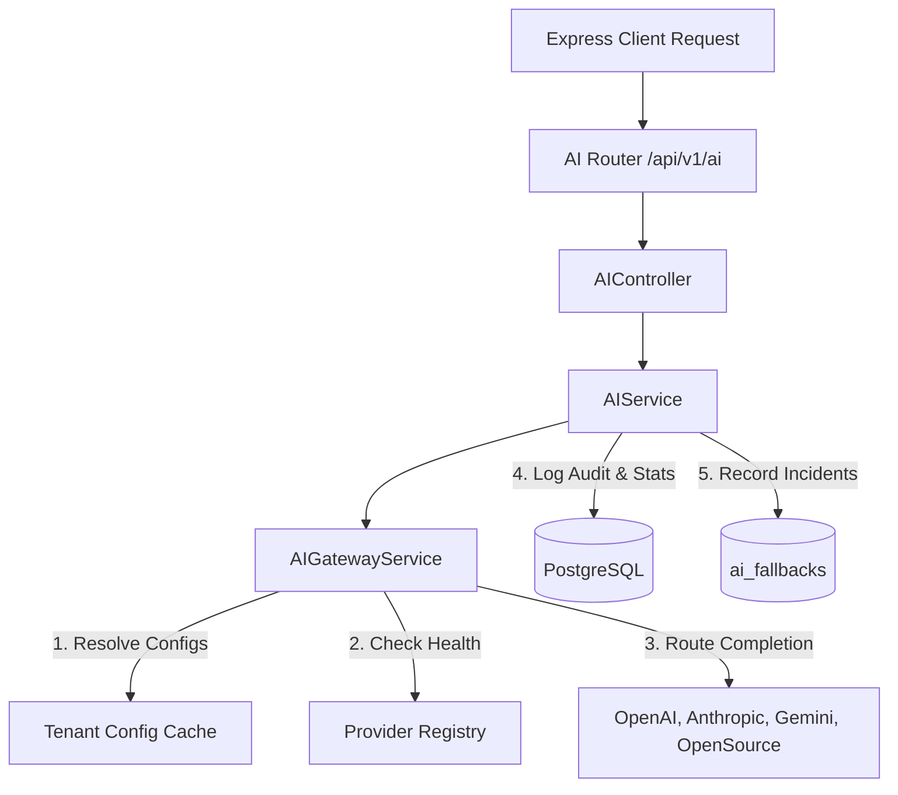
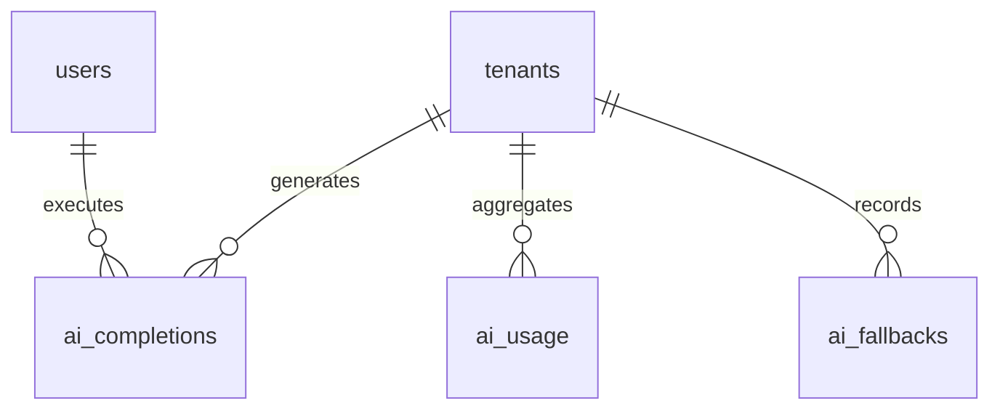
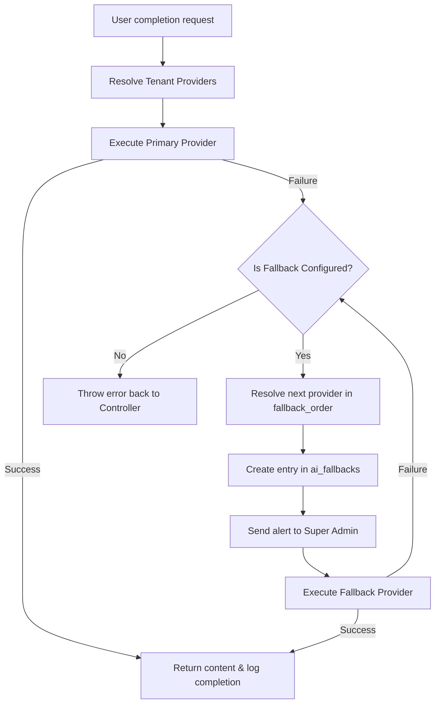

# QAssure AI Gateway Service — Architectural Design Document

---

## 1. Architectural Vision

The **AI Gateway Service** is the central execution plane for all AI operations on the QAssure Platform. It decouples the core business modules (Prompt Management, RAG / Knowledge Service, Workflow Engine) from concrete AI provider SDKs and credentials.

Key capabilities:
1. **Dynamic Provider Overriding**: Automatically switches from global system credentials to tenant-specific keys (BYOK) based on context headers.
2. **Resilient Fallback Chains**: If a primary LLM endpoint returns a rate limit, timeout, or service error, the gateway automatically fails over to predefined backup providers.
3. **Usage & Cost Tracking**: Calculates token volumes and estimates dollar costs for every model call, updating daily aggregations per tenant and provider.
4. **Active Connection Auditing**: Logs each execution with a unique UUID for billing and regulatory compliance.

---

## 2. Component Architecture

The module features a highly structured architecture:

- **Express Router Layer (`ai.routes.js`)**: Defines routing tables, requires authentication, injects tenant context, verifies RBAC rules (`ai:read`, `ai:create`), and runs Zod validators.
- **Controller Layer (`ai.controller.js`)**: Converts HTTP requests into service executions, manages error conversions (converting provider errors to standard HTTP status codes), and handles raw playground calls.
- **Service Layer (`ai.service.js`)**: Handles daily usage aggregations (`ai_usage`), manages cost summaries, stores audit trails in `ai_completions`, and configures fallback settings.
- **Gateway Core (`gateway.service.js`)**: Loads and instantiates provider wrapper objects, tracks active provider caches, performs token and cost estimations, and manages failovers.
- **Provider Adapters (`openai.provider.js`, `anthropic.provider.js`, `gemini.provider.js`, `opensource.provider.js`)**: Concrete classes wrapping vendor SDKs and REST APIs to provide a uniform call signature.

---

## 3. Database Schema Design

The AI Gateway operations are recorded across three tables:

### 3.1 `ai_completions`

Stores execution metadata for audits, logging, and pricing verification.

| Column | Type | Constraints | Description |
| :--- | :--- | :--- | :--- |
| `id` | `UUID` | `PRIMARY KEY`, Default `gen_random_uuid()` | Unique log identifier. |
| `tenant_id` | `UUID` | `allowNull: false` | Owning tenant ID. |
| `module_id` | `UUID` | `allowNull: true` | Calling functional module. |
| `user_id` | `UUID` | `allowNull: true` | Executing user. |
| `use_case` | `VARCHAR(255)` | `NOT NULL`, Default `"api_completion"` | Categorization of completion. |
| `provider` | `VARCHAR(100)` | `NOT NULL` | Resolved provider. |
| `model` | `VARCHAR(100)` | `NOT NULL` | Resolved model. |
| `prompt_template_id` | `UUID` | `allowNull: true` | Optional link to Prompt template. |
| `prompt` | `TEXT` | `NOT NULL` | Full prompt string. |
| `response` | `TEXT` | `allowNull: true` | Raw generated content. |
| `temperature` | `DECIMAL` | `allowNull: true` | Temperature setting. |
| `max_tokens` | `INTEGER` | `allowNull: true` | Maximum output tokens. |
| `prompt_tokens` | `INTEGER` | `allowNull: true` | Input tokens consumed. |
| `completion_tokens` | `INTEGER` | `allowNull: true` | Output tokens consumed. |
| `total_tokens` | `INTEGER` | `allowNull: true` | Combined token count. |
| `cost_usd` | `DECIMAL(10,6)`| `allowNull: true` | USD cost estimate. |
| `latency_ms` | `INTEGER` | `allowNull: true` | Roundtrip latency. |
| `status` | `VARCHAR(50)` | `NOT NULL` | `completed`, `failed`, `pending`. |
| `error_message` | `TEXT` | `allowNull: true` | Captured failure text. |
| `error_code` | `VARCHAR(100)` | `allowNull: true` | Normalized error code. |
| `correlation_id` | `VARCHAR` | `allowNull: true` | HTTP request tracker. |
| `fallback_provider` | `VARCHAR` | `allowNull: true` | Provider used on failover. |
| `metadata` | `JSONB` | `allowNull: true` | Context details. |
| `created_at` | `TIMESTAMP` | `NOT NULL`, Default `NOW()` | Timestamp. |

**Indexes**:
- `idx_ai_completions_tenant` on `(tenant_id)`
- `idx_ai_completions_provider` on `(provider)`
- `idx_ai_completions_status` on `(status)`
- `idx_ai_completions_tenant_created` on `(tenant_id, created_at)`

---

### 3.2 `ai_usage`

Daily aggregated usage database for dashboards and reporting.

| Column | Type | Constraints | Description |
| :--- | :--- | :--- | :--- |
| `id` | `UUID` | `PRIMARY KEY` | Record ID. |
| `tenant_id` | `UUID` | `FOREIGN KEY` -> `tenants(id)` ON DELETE CASCADE | Owning tenant. |
| `provider` | `VARCHAR(100)` | `NOT NULL` | Resolved provider. |
| `model` | `VARCHAR(100)` | `NOT NULL` | Resolved model. |
| `period_start` | `TIMESTAMP` | `NOT NULL` | Day start (00:00:00). |
| `period_end` | `TIMESTAMP` | `NOT NULL` | Day end (23:59:59). |
| `period_type` | `VARCHAR(20)` | `NOT NULL`, Default `"daily"` | Grouping scale. |
| `request_count` | `INTEGER` | `NOT NULL`, Default `1` | Total executions. |
| `success_count` | `INTEGER` | `NOT NULL`, Default `1` | Successful runs. |
| `failure_count` | `INTEGER` | `NOT NULL`, Default `0` | Failed runs. |
| `cached_count` | `INTEGER` | `NOT NULL`, Default `0` | Cache hits. |
| `total_prompt_tokens`| `BIGINT` | `NOT NULL` | Accumulated input tokens. |
| `total_completion_tokens`| `BIGINT` | `NOT NULL` | Accumulated output tokens. |
| `total_tokens` | `BIGINT` | `NOT NULL` | Combined tokens. |
| `total_cost_usd` | `DECIMAL(12,6)`| `NOT NULL` | Accumulated cost. |
| `avg_latency_ms` | `INTEGER` | `NOT NULL` | Running average latency. |
| `updated_at` | `TIMESTAMP` | `NOT NULL` | Timestamp. |

**Constraints**:
- UNIQUE constraint on `(tenant_id, provider, model, period_start)`.

---

### 3.3 `ai_fallbacks`

Stores incident reports of API failovers.

| Column | Type | Constraints | Description |
| :--- | :--- | :--- | :--- |
| `id` | `UUID` | `PRIMARY KEY`, Default `gen_random_uuid()` | Event ID. |
| `tenant_id` | `UUID` | `FOREIGN KEY` -> `tenants(id)` ON DELETE CASCADE | Owning tenant. |
| `failed_provider` | `VARCHAR(50)` | `NOT NULL` | Primary provider that failed. |
| `failed_model` | `VARCHAR(255)` | `allowNull: true` | Primary model that failed. |
| `fallback_provider`| `VARCHAR(50)` | `NOT NULL` | Fallback provider used. |
| `fallback_model` | `VARCHAR(255)` | `allowNull: true` | Fallback model used. |
| `error_message` | `TEXT` | `allowNull: true` | Error details. |
| `config_details` | `JSONB` | `Default '{}'` | Configurations used. |
| `created_at` | `TIMESTAMP` | `NOT NULL`, Default `NOW()` | Timestamp. |

---

## 4. Fallback Routing & Priority Flow

The Gateway uses a fallback structure to handle endpoint failures:

1. **Resolution**: Merges tenant-specific providers with global fallback configurations.
2. **Failover Execution**: If the primary provider fails (e.g. timeout or API key error), the gateway checks the `fallback_order` or `fallback_mapping` to identify the next provider.
3. **Incident Logging**: Logs the event to `ai_fallbacks` and notifies administrators via dashboard and email alerts.
4. **Completion**: If a backup succeeds, the execution returns with `fallbackUsed: true` and is logged in `ai_completions`.
