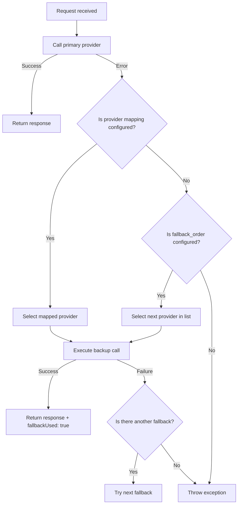

# QAssure AI Gateway Service — Functional Documentation

---

## 1. Core Functions & Business Rules

The AI Gateway Service manages connections to external AI models and tracks resource consumption.

### 1.1 Usage & Performance Tracking
- Every execution routed through the endpoint `/completions` generates a UUID recorded in the `ai_completions` table.
- Playground requests (`POST /playground`) run model calls without adding records to the `ai_completions` table.
- Daily usage metrics are updated in the `ai_usage` table. This updates total requests, success rates, token volume, average latency, and dollar costs.

### 1.2 Tenant Key isolation (BYOK)
- Tenant configurations are stored in the database.
- Key resolution:
  - If a tenant has registered custom credentials (endpoint, key, organization) in the `tenant_ai_configs` table, the gateway loads and uses those credentials.
  - If no custom credentials exist, the gateway falls back to the system environment variables (`OPENAI_API_KEY`, etc.).
- Plaintext API keys are encrypted at rest using AES-256-GCM and are decrypted in memory when initializing provider connections.

---

## 2. Model & Cost Resolution

The Gateway manages model features and calculates costs:

1. **Resolution API**: `GET /models` returns the list of models supported by the active providers.
2. **Pricing Models**: Providers maintain hardcoded input and output pricing tables per 1,000 tokens (e.g. `gpt-4o` costs $0.005 per 1K input tokens and $0.015 per 1K output tokens).
3. **BYOK Pricing Bypass**: If a tenant uses their own API key (BYOK), the system sets input/output pricing parameters to 0 in cost reports since billing is handled directly through the tenant's account:
   ```javascript
   pricing: provider.usesTenantApiKey ? { input: 0, output: 0 } : provider.getPricing(model)
   ```
4. **Usage Calculations**: When a call completes, the gateway multiplies input and output tokens by their model rates to calculate the final USD cost stored in the DB.

---

## 3. Fallback & Failover Strategy Rules

If a primary endpoint fails, the gateway applies fallback configurations to prevent service disruption.



1. **Target Fallbacks**:
   - The gateway first checks for a direct mapping setting (e.g. `{"openai": "anthropic"}`).
   - If no direct mapping exists, the gateway falls back to the list in `fallback_order`.
2. **Alerts & Non-Repudiation**:
   - When a failover occurs, the gateway creates a record in `ai_fallbacks` containing the primary provider, the fallback provider, the error description, and configuration details.
   - Real-time alerts are sent to the super admin dashboard and configured email recipients.
