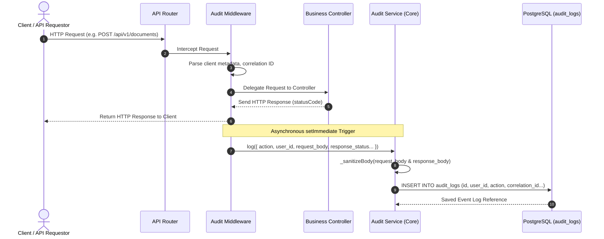

# Audit Log Service - Design Document
**Secure Compliance Audit Trail Orchestrator (FDA 21 CFR Part 11)**

---

## 1. Overview
The Audit Log Service is a fundamental compliance component of the QAssure platform. It functions as a secure, high-integrity ledger designed to comply with **FDA 21 CFR Part 11** electronic records regulations. It monitors system usage, data changes, authentication events, and administrative activities, ensuring absolute accountability, data integrity, and non-repudiation.

Key design principles:
*   **Immutability**: Once recorded, audit logs must not be altered or deleted.
*   **7-Year Retention Policy**: Technical controls enforce the storage of audit logs for a minimum of seven years.
*   **Asynchronous Decoupling**: API request auditing runs out-of-band via Node.js micro-task loops (`setImmediate`), preventing audit logging from impacting core request latency.
*   **Sensitive Data Sanitization**: Standard algorithms filter out passwords, tokens, API keys, and hashes before logs reach the storage layer.

---

## 2. Architecture & Data Flow

### 2.1 Audit Event Ingestion Pipeline

The diagram below details the path an audit event takes from an API request/internal trigger to the database:

### 2.2 Core Logic Rules

1.  **Check Tracking Status**: Before committing a log, `AuditService` queries the active status of the specified `resource_type` in `audit_log_resource_types`. If tracking is disabled, the operation is skipped.
2.  **Redaction & Sanitization**: Any values associated with keys such as `password`, `token`, `secret`, `api_key`, or `key` are automatically replaced with `[REDACTED]`.
3.  **Tenant Isolation**: All operations enforce strict tenant isolation at the SQL query level unless the acting user possesses the global `isSuperAdmin` role.

---

## 3. Database Schema Mapping

Below are the detailed definitions of the database schemas backing the Audit Log Service:

### 3.1 Audit Logs (`audit_logs`)
Stores the immutable logs containing details of action executions, user identities, IPs, changes, and metadata.
*   `id` (UUID, Primary Key, Non-Nullable): Unique audit log identifier.
*   `tenant_id` (UUID, Nullable): Scopes the audit log to a specific tenant. Left blank (null) for global or system-wide operations.
*   `user_id` (UUID, Nullable): Foreign key referencing the `users` table. Identifies the user executing the action.
*   `module_id` (UUID, Nullable): Foreign key referencing the `modules` table. Identifies the originating microservice.
*   `action` (String(100), Non-Nullable): The type of action performed (e.g., `'CREATE'`, `'READ'`, `'UPDATE'`, `'DELETE'`, `'LOGIN'`, `'LOGOUT'`, `'API_CALL'`).
*   `resource_type` (String(100), Non-Nullable): The type of target entity affected (e.g., `'document'`, `'user'`, `'tenant'`, `'qms_connection'`, `'ai_completion'`).
*   `resource_id` (String(255), Nullable): Primary key of the affected target entity.
*   `request_method` (String(10), Nullable): HTTP verb used (e.g. `'GET'`, `'POST'`, `'PUT'`, `'PATCH'`, `'DELETE'`).
*   `request_path` (String(500), Nullable): Full path of the endpoint called.
*   `request_body` (JSONB, Nullable): Redacted and sanitized JSON payload of the request.
*   `response_status` (Integer, Nullable): HTTP status code returned to the client (100–599).
*   `response_body` (JSONB, Nullable): Redacted and sanitized JSON payload of the response (typically recorded for errors only).
*   `ip_address` (String(45), Nullable): IPv4 or IPv6 client address.
*   `user_agent` (Text(500), Nullable): Browser user-agent string.
*   `correlation_id` (String(100), Nullable): Correlation ID linking multiple logs to a single client flow.
*   `changes` (JSONB, Nullable): Contains the detailed state delta (before/after values).
*   `metadata` (JSONB, Nullable): Optional JSON bag containing environment variables, user roles, authentication mode, and extra parameters.
*   `created_at` (Date, Non-Nullable): Creation timestamp.
*   `updated_at` (Date, Non-Nullable): Update timestamp.

### 3.2 Audit Log Resource Types (`audit_log_resource_types`)
Manages registration, categorization, and feature switches (enable/disable tracking) for different platform resources.
*   `id` (UUID, Primary Key, Non-Nullable): Unique resource type identifier.
*   `name` (String, Non-Nullable, Unique): Name identifier (e.g., `'Module'`, `'ApiKey'`, `'User'`).
*   `type` (Enum, Default: `'PLATFORM'`): Scope level. Options: `'PLATFORM'` or `'MODULE'`.
*   `module_id` (UUID, Nullable): Links the resource type to a specific module if `type` is set to `'MODULE'`.
*   `audit_log_tracking` (Boolean, Default: `true`): Flag controlling whether events under this type should be logged.
*   `created_at` (Date, Non-Nullable): Creation timestamp.
*   `updated_at` (Date, Non-Nullable): Update timestamp.
