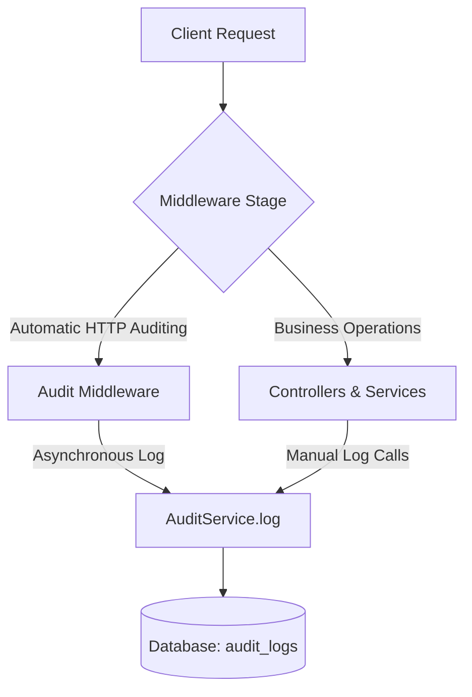

# Audit Log Service - Knowledge Transfer (KT) Guide
**Secure Regulatory and Compliance Logging System (FDA 21 CFR Part 11)**

---

## 1. Overview
The Audit Log Service is a core cross-cutting capability in QAssure designed to meet strict regulatory standards, specifically **FDA 21 CFR Part 11**. It provides an immutable, comprehensive log trail of all user actions, security events, data mutations, and API requests across the platform.

### Key Objectives
*   **Immutability**: Logs cannot be modified or deleted during their retention window.
*   **7-Year Retention**: Built-in business validation prevents any log deletion before 7 years.
*   **Traceability & Auditability**: Logs record *who* did *what*, *when*, *from where*, and *why* (via correlation IDs, change payloads, and request metadata).
*   **Zero-Latency Impact**: Automatic API auditing is processed asynchronously using Node.js `setImmediate`, keeping request-response loops fast.

---

## 2. Capturing Audits: Integration Flow

The service captures audits through a dual-mechanism approach:



### 2.1 Layer 1: Automatic HTTP-Level Auditing (`auditMiddleware`)
Registered globally or for specific route trees, `auditMiddleware` (in `src/middleware/audit.middleware.js`) intercepts all incoming requests and outgoing responses.
*   **Asynchronous Logging**: Uses `setImmediate()` to log events after the response is sent, avoiding performance overhead.
*   **Payload Sanitization**: Automatic masking of sensitive fields (e.g. passwords, tokens, API keys) in request and response bodies.
*   **Bypass Rules**: Skips common operational paths (e.g. `/health`, `/metrics`, `/metrics`) and the direct audit insertion endpoints themselves to prevent recursive loops.

### 2.2 Layer 2: Explicit Code-Level Auditing (`AuditService.log`)
For complex mutations, security-critical status changes, or actions occurring outside HTTP request loops, services call the singleton service directly.
*   **Access**:
    ```javascript
    const { getAuditService } = require('./audit.service');
    await getAuditService().log({
      action: 'USER_ROLE_MAPPING_SYNC',
      user_id: creatorId,
      tenant_id: tenantId,
      resource_type: 'user_role',
      resource_id: userId,
      changes: { added_roles, removed_roles },
      metadata: { context: 'tenant_update' }
    });
    ```
*   **Convenience Helpers**:
    *   `logAuth(type, userId, tenantId, success, req)`: Used during logins/logouts.
    *   `logChange(action, userId, tenantId, resourceType, resourceId, changes, req)`: Captures precise data mutations.
    *   `logRequest(req, res, responseBody)`: Middleware-level generic request logger.

---

## 3. Database Schema Mapping

The service interacts with two main tables using Sequelize:

### 3.1 `audit_logs` (Model: `Auditlog`)
Stores the actual immutable audit records.
*   `id` (UUID, Primary Key, Non-Nullable): Unique audit event identifier.
*   `tenant_id` (UUID, Nullable): Scopes the audit log to a specific tenant. Null for platform-level super-admin logs.
*   `user_id` (UUID, Nullable): Foreign key to the user who triggered the event.
*   `action` (String(100), Non-Nullable): Action code (e.g., `'CREATE'`, `'READ'`, `'UPDATE'`, `'DELETE'`, `'LOGIN'`, `'LOGOUT'`).
*   `resource_type` (String(100), Non-Nullable): Resource classification (e.g., `'document'`, `'user'`, `'tenant'`).
*   `resource_id` (String(255), Nullable): Identifier of the affected entity.
*   `module_id` (UUID, Nullable): Associated microservice module identifier.
*   `request_method` (String(10), Nullable): HTTP method (e.g., `'GET'`, `'POST'`).
*   `request_path` (String(500), Nullable): API route queried.
*   `request_body` (JSONB, Nullable): Sanitized payload sent by client.
*   `response_status` (Integer, Nullable): HTTP status code returned.
*   `response_body` (JSONB, Nullable): Sanitized response payload.
*   `ip_address` (String(45), Nullable): Client IP address.
*   `user_agent` (Text(500), Nullable): Browser/Client user-agent.
*   `correlation_id` (String(100), Nullable): Transaction correlation ID.
*   `changes` (JSONB, Nullable): Diff payload containing old vs new values.
*   `metadata` (JSONB, Nullable): Extra contextual fields.

### 3.2 `audit_log_resource_types` (Model: `AuditLogResourceType`)
Controls tracking and filters.
*   `id` (UUID, Primary Key): Unique identifier.
*   `name` (String, Non-Nullable, Unique): E.g., `'document'`, `'ai_completion'`.
*   `type` (Enum: `'PLATFORM'`, `'MODULE'`): Context level of resource.
*   `module_id` (UUID, Nullable): Associated module if it is a module-specific resource type.
*   `audit_log_tracking` (Boolean, Default: `true`): Enable/disable tracking. If set to `false`, the `AuditService` will ignore events for this resource type.

---

## 4. Codebase Components & File Map

*   **Middleware**: `src/middleware/audit.middleware.js`
    *   Intercepts HTTP requests, resolves actions/resource types, and invokes `AuditService`.
*   **Controllers**:
    *   `src/controllers/audit_log_controller.js`: Exposes endpoints for querying, fetching by ID, generating statistics, and exporting logs. Enforces tenant isolation.
    *   `src/controllers/audit_log_resource_type_controller.js`: Handles CRUD for resource type tracking and dropdown options.
*   **Service Layers**:
    *   `src/services/audit.service.js`: Singleton core engine. Manages raw queries, stat aggregation, sanitization (`_sanitizeBody`), and low-level inserts.
    *   `src/services/audit_log_service.js`: Secondary service wrapping Sequelize models, containing business rule validations like the 7-year retention enforcement.
    *   `src/services/audit_log_resource_type_service.js`: Restricts resource types according to module and user permissions.
*   **Validation**: `src/validation/audit_log.schema.js`
    *   Zod validation schemas for creating/updating audit records and checking ID parameters.

---

## 5. Key Helpers & Business Logic

### 5.1 Retention Check (`shouldRetain`)
Located in `audit_log_service.js`, this validator ensures that no audit logs are deleted before 7 years (220,752,000,000 milliseconds):
```javascript
let currentTime = Date.now();
let createdTime = auditlog.created_at.getTime();
let timeDifference = currentTime - createdTime;
let sevenYearsInMilliseconds = 7 * 365 * 24 * 60 * 60 * 1000;
if (timeDifference < sevenYearsInMilliseconds) {
  throw new Error(`Audit log cannot be deleted before 7 years retention period`);
}
```

### 5.2 Sanitization (`_sanitizeBody`)
In `audit.service.js`, recursively scans payloads to redact sensitive fields like passwords, secrets, API keys, and hashes:
```javascript
const sensitiveFields = ['password', 'password_hash', 'token', 'secret', 'api_key', 'key'];
```

---

## 6. Access Control & Isolation
*   **Super Admin**: Has cross-tenant visibility. Can read all logs, query cross-tenant statistics, and register/manage resource types.
*   **Tenant Admin**: Can view all logs mapped to their `tenant_id` and view tenant-specific stats.
*   **Regular User**: Limited to viewing their own logs using the `/my-logs` route.
