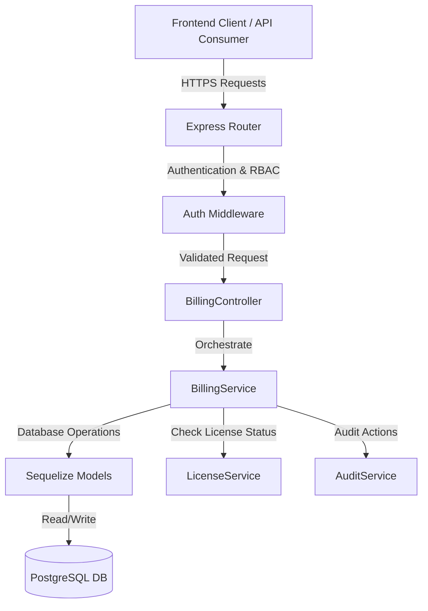

# QAssure Billing Service — Architectural Design Document

---

## 1. Architectural Vision

The **Billing Service** is an administrative and financial module of the QAssure Platform. It manages billing entities, pricing plan details, invoicing lifecycles, and customer payments. By keeping track of invoice statuses (`draft`, `sent`, `paid`, `void`, `overdue`), generating automated invoices upon subscription milestones, and recording transactional history, it ensures transparent revenue tracking and GxP compliance.

### Key Capabilities:
1. **Pricing Management**: Stores details of standard subscription plans (`pricing_plans`) mapped to specific license tiers and application modules.
2. **Auto-Numbering Generation**: Utilizes database sequences and functions (`generate_invoice_number()`, `generate_payment_number()`) to construct sequential invoice IDs (e.g. `INV-YYYY-001002`) and receipt IDs.
3. **Multi-Tenant Invoices**: Formulates tenant-isolated invoices with individual items (`invoice_line_items`) like license base pricing, credits, setup fees, and usage overages.
4. **Payment Recording**: Documents payment receipts (`payments`) noting transaction dates, reference IDs (e.g. wire/check numbers), and status mappings.
5. **Revenue Summaries**: Aggregates month-over-month sales figures for system-wide dashboard reporting.

---

## 2. Component Diagram

The Billing service interacts with the database layer, the licensing service, and external payment interfaces as illustrated below:

---

## 3. Database Schema Design

The SQL schema defined in `phase24_license_billing.sql` maps the relational definitions:

### 3.1 Tables & Fields

#### `pricing_plans`
*   `id` (UUID, PK): Unique plan identifier.
*   `code` (VARCHAR(50), Unique): Plan code (e.g. `platform-starter-monthly`).
*   `name` (VARCHAR(100)): Human-readable label.
*   `license_tier` (VARCHAR(50), FK): Links to `license_tiers`.
*   `application` (VARCHAR(50), FK): Links to `licensable_applications`.
*   `base_price` (DECIMAL(12, 2)): Cost of the plan.
*   `currency` (VARCHAR(3)): Default currency (e.g. `USD`).
*   `billing_cycle` (VARCHAR(20)): `monthly`, `annual`.

#### `invoices`
*   `id` (UUID, PK): Unique invoice identifier.
*   `tenant_id` (UUID, FK): Target tenant ID.
*   `license_id` (UUID, FK): Target license ID.
*   `invoice_number` (VARCHAR(50), Unique): Formatted auto-incremented invoice number.
*   `status` (VARCHAR(30)): `draft`, `sent`, `paid`, `void`, `overdue`.
*   `invoice_date` / `due_date` / `sent_at` / `paid_at` (TIMESTAMPTZ).
*   `subtotal` / `tax_amount` / `discount_amount` / `total` / `amount_due` (DECIMAL).
*   `billing_name` / `billing_email` / `billing_address` (JSONB).

#### `invoice_line_items`
*   `id` (UUID, PK).
*   `invoice_id` (UUID, FK): Links to `invoices`.
*   `description` (VARCHAR(500)).
*   `quantity` (DECIMAL(10,2)).
*   `unit_price` / `amount` (DECIMAL).
*   `item_type` (VARCHAR(30)): `license`, `usage_overage`, `setup_fee`, `discount`, `credit`.

#### `payments`
*   `id` (UUID, PK).
*   `tenant_id` (UUID, FK).
*   `invoice_id` (UUID, FK): Target invoice.
*   `payment_number` (VARCHAR(50), Unique).
*   `amount` / `currency` (DECIMAL / VARCHAR).
*   `status` (VARCHAR(30)): `pending`, `completed`, `failed`, `refunded`, `cancelled`.
*   `payment_method` (VARCHAR(50)): `bank_transfer`, `check`, `wire`, `credit_card`.
*   `reference_number` / `bank_name` / `transaction_date` (VARCHAR / TIMESTAMPTZ).

---

## 4. Integration Points

1. **Licensing Renewal Engine**: Once a manual or automated payment in the `payments` table is successfully recorded as `completed`, the system updates the corresponding invoice's `amount_due` to 0, sets status to `paid`, and triggers `LicenseService.renew()` to extend the validity period of the linked `license` record.
2. **Audit Logging**: Any modifications to invoice states, discount application, or refund events write entries to the platform's audit trails for financial compliance auditing.
3. **Multi-Tenant Scoping**: All invoicing queries are filtered by the requester's `tenant_id` context to enforce tenant isolation.
