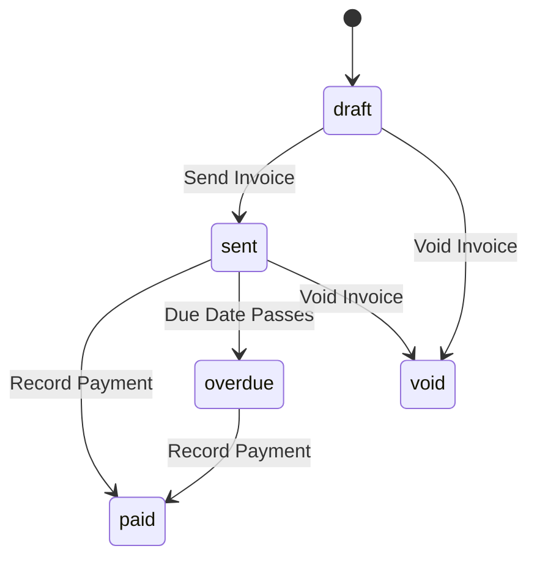

# QAssure Billing Service — Functional Documentation

---

## 1. Billing Lifecycles & States

The Billing Service coordinates statuses across invoices and payments to ensure financial and compliance records are aligned.

### 1.1 Invoice Lifecycle
*   **`draft`**: The initial status of a compiled invoice. Modifications are allowed.
*   **`sent`**: The invoice is finalized, locked against edits, and emailed/sent to the Tenant Admin.
*   **`paid`**: Recording a successful payment for the invoice updates `amount_due` to 0 and transitions status to `paid`.
*   **`void`**: Super Admins can void an invoice to cancel the debt (e.g. if the contract changes).
*   **`overdue`**: Evaluated by background cron tasks when the current system date passes the invoice's `due_date` and the status is still `'sent'`.

### 1.2 Payment Statuses
*   **`pending`**: Payment entry created (e.g. check received but not cleared).
*   **`completed`**: Funds successfully deposited.
*   **`failed`**: The transaction failed.
*   **`refunded`**: Recorded if an admin refunds the amount; this updates the invoice's `amount_due` and returns the payment state.
*   **`cancelled`**: The transaction is marked cancelled.

---

## 2. Invoicing Workflows

### 2.1 Manual Invoice Generation
Super Admins can compile custom invoices via `POST /api/v1/billing/invoices`, assigning custom line items, taxes, discounts, and terms.

### 2.2 Payment Allocation
When recording payments via `POST /api/v1/billing/payments`, the payment amount is subtracted from the target invoice's `amount_due`.
*   **Full Payment**: Sets `amount_due` to 0 and updates the status to `paid`.
*   **Partial Payment**: Reduces the outstanding `amount_due`, keeping the invoice status as `sent` (or `overdue`).
*   **License Renewal Trigger**: Upon transition to `paid`, if the invoice is linked to an active license ID, the service initiates renewal processing to extend the license's `expires_at` date.

---

## 3. Financial Compliance

In compliance with corporate and GxP standards:
*   **Immutable Invoice Sequences**: Once an invoice number is generated (using the PL/pgSQL function `generate_invoice_number()`), it cannot be updated or reused.
*   **Audit Trail Logs**: All events (payment success, voids, refunds) write structured metadata records to the central audit log.
