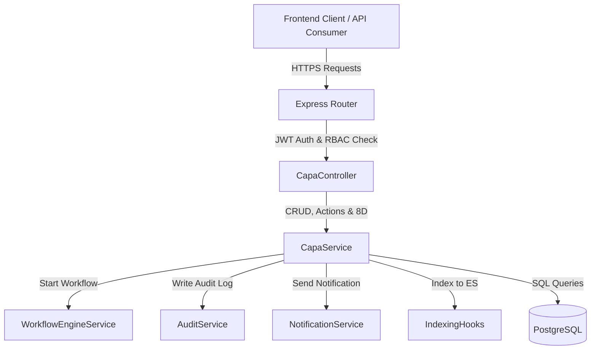
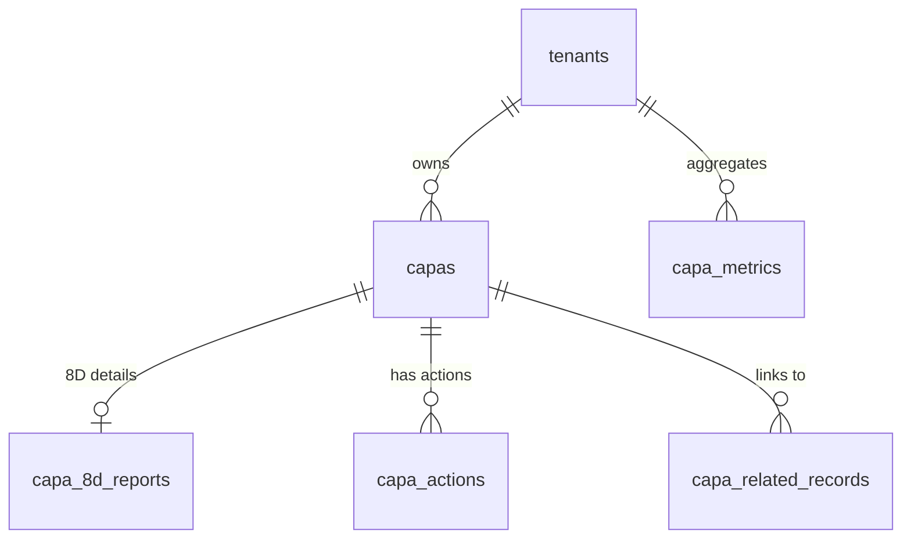

# QAssure CAPA Service — Architectural Design Document

---

## 1. Architectural Vision

The **Corrective and Preventive Action (CAPA) Service** is a core quality assurance module in the QAssure Platform. It manages the lifecycle of quality issues, audits, deviations, customer complaints, and supplier incidents from identification through root-cause analysis, action planning, implementation, verification, and closure. The service incorporates the industry-standard **8D (Eight Disciplines) Problem Solving Methodology** to ensure robust investigation and systematic prevention of recurrence.

### Key Capabilities:
1. **Multi-Tenant CAPA lifecycle**: Strict tenant isolation across all CAPA records, actions, 8D reports, and metrics.
2. **8D Methodology Engine**: Structured sections (D1 to D8) tracked in a dedicated `capa_8d_reports` schema, allowing teams to collaborate on problem-solving sequentially.
3. **Workflow Orchestration**: Seamless integration with the QAssure Workflow Engine (`capa_workflow`) to route CAPA records through formal review, authorization, and implementation phases.
4. **Action Tracking & Verification**: Discrete action items (Immediate, Containment, Corrective, Preventive, and Verification) assigned to owners, tracked with due dates, status updates, and verification trails.
5. **Auditing & GxP Compliance**: Automatic logging of all CRUD operations, status changes, and action completions to the platform's audit trails for FDA 21 CFR Part 11 compliance.
6. **Notification Routing**: Automated notifications to CAPA owners and action assignees on assignment, status change, and closures.

---

## 2. Component Architecture

The CAPA Service consists of the following decoupled components:

*   **Routing Layer (`capa.routes.js`)**: Defines routes, registers authentication (`authenticate`), checks role-based permissions (`authorize('capa:read')` or `authorize('capa:write')`), and passes execution to the controller.
*   **Controller Layer (`capa.controller.js`)**: Sanitizes and validates HTTP requests (parameters, query strings, and payloads), handles responses, and manages static data lookups.
*   **Capa Service (`capa.service.js`)**: Holds business logic, transactional database connections, generates auto-incremented CAPA numbers (e.g. `CAPA-YYYY-XXXX`), manages status rules, and triggers async helper services (Notification, Audit, Workflow, Elasticsearch).
*   **Sequelize Models**:
    *   `Capa`: Maps properties of a CAPA (classification, ownership, dates, verification).
    *   `CapaAction`: Represents a discrete task under a CAPA.
    *   `Capa8DReport`: Details the team, problem description, containment, root cause analysis, corrective/preventive plans, and lessons learned.
    *   `CapaMetric`: Aggregates historical metrics for analytics.
    *   `CapaRelatedRecord`: Links CAPAs to deviations, supplier issues, documents, etc.

---

## 3. Database Schema Design

The CAPA module uses a multi-table relational schema designed for multi-tenancy:

### 3.1 `capas`
Stores the high-level CAPA record information.

| Column | Type | Constraints | Description |
| :--- | :--- | :--- | :--- |
| `id` | `UUID` | `PRIMARY KEY`, Default `gen_random_uuid()` | Unique identifier. |
| `tenant_id` | `UUID` | `NOT NULL`, `REFERENCES tenants(id)` | Multi-tenant separator. |
| `capa_number` | `VARCHAR(100)` | `NOT NULL` | Generated formatted code (e.g., `CAPA-2026-0001`). |
| `title` | `VARCHAR(500)` | `NOT NULL` | CAPA Title. |
| `description` | `TEXT` | `allowNull: true` | Detailed description. |
| `capa_type` | `VARCHAR(50)` | `NOT NULL` | Class: `corrective`, `preventive`, `both`. |
| `source` | `VARCHAR(100)` | `allowNull: true` | Origin: `customer_complaint`, `audit`, `deviation`, `internal`, `supplier`, etc. |
| `priority` | `VARCHAR(50)` | Default `'medium'` | SLA levels: `critical`, `high`, `medium`, `low`. |
| `risk_level` | `VARCHAR(50)` | `allowNull: true` | Risk severity: `high`, `medium`, `low`. |
| `problem_statement`| `TEXT` | `allowNull: true` | Description of the issue. |
| `immediate_action` | `TEXT` | `allowNull: true` | Action taken immediately upon detection. |
| `containment_action`| `TEXT` | `allowNull: true` | Temporary containment actions. |
| `root_cause` | `TEXT` | `allowNull: true` | Core cause identified during investigation. |
| `root_cause_method`| `VARCHAR(100)`| `allowNull: true` | Analysis: `5_why`, `fishbone`, `fmea`, `fault_tree`. |
| `contributing_factors`| `TEXT[]` | `allowNull: true` | Array of peripheral causes. |
| `corrective_action`| `TEXT` | `allowNull: true` | Plan to fix the root cause. |
| `preventive_action`| `TEXT` | `allowNull: true` | Plan to prevent recurrence. |
| `verification_method`| `TEXT` | `allowNull: true` | How effectiveness will be checked. |
| `verification_results`| `TEXT` | `allowNull: true` | Documentation of verification trials. |
| `effectiveness_criteria`| `TEXT` | `allowNull: true` | Standard to judge success. |
| `effectiveness_verified`| `BOOLEAN`| `allowNull: true` | Yes/No flag. |
| `effectiveness_date`| `DATE` | `allowNull: true` | Verification date. |
| `status` | `VARCHAR(50)` | Default `'draft'` | Lifecycle: `draft`, `open`, `investigation`, `action`, `verification`, `closed`, `cancelled`. |
| `owner_id` | `UUID` | `REFERENCES users(id)` | Accountable employee. |
| `department` | `VARCHAR(255)`| `allowNull: true` | Owner's department. |
| `identified_date` | `DATE` | `allowNull: true` | Date the issue was logged/found. |
| `target_date` | `DATE` | `allowNull: true` | Expected closure target. |
| `closed_date` | `DATE` | `allowNull: true` | Actual completion date. |
| `source_record_type`| `VARCHAR(100)`| `allowNull: true` | Originating module type (e.g. `deviation`). |
| `source_record_id`| `UUID` | `allowNull: true` | Originating module record key. |
| `workflow_instance_id`| `UUID` | `REFERENCES workflow_instances(id)` | Workflow engine mapping. |
| `created_by` | `UUID` | `REFERENCES users(id)` | Audit user. |
| `updated_by` | `UUID` | `REFERENCES users(id)` | Audit user. |
| `created_at` | `TIMESTAMPTZ` | Default `NOW()` | Timestamp. |
| `updated_at` | `TIMESTAMPTZ` | Default `NOW()` | Timestamp. |

*   **Indexes**:
    *   Unique constraint `(tenant_id, capa_number)`
    *   `idx_capas_tenant` on `(tenant_id)`
    *   `idx_capas_status` on `(tenant_id, status)`
    *   `idx_capas_owner` on `(owner_id)`
    *   `idx_capas_target` on `(target_date)`

### 3.2 `capa_actions`
Tracks individual task completions.

| Column | Type | Constraints | Description |
| :--- | :--- | :--- | :--- |
| `id` | `UUID` | `PRIMARY KEY`, Default `gen_random_uuid()` | Unique action ID. |
| `capa_id` | `UUID` | `NOT NULL`, `REFERENCES capas(id)` | Parent CAPA relationship. |
| `tenant_id` | `UUID` | `NOT NULL`, `REFERENCES tenants(id)` | Separation key. |
| `action_number` | `INTEGER` | `NOT NULL` | Sequential item counter. |
| `description` | `TEXT` | `NOT NULL` | Specific task description. |
| `action_type` | `VARCHAR(50)` | `NOT NULL` | Type: `immediate`, `containment`, `corrective`, `preventive`, `verification`. |
| `assigned_to` | `UUID` | `REFERENCES users(id)` | Assignee reference. |
| `department` | `VARCHAR(255)`| `allowNull: true` | Target department. |
| `due_date` | `DATE` | `allowNull: true` | SLA Target. |
| `completed_date` | `DATE` | `allowNull: true` | Completion timestamp. |
| `status` | `VARCHAR(50)` | Default `'pending'` | Lifecycle: `pending`, `in_progress`, `completed`, `cancelled`. |
| `evidence` | `TEXT` | `allowNull: true` | Text detailing action execution. |
| `attachments` | `JSONB` | Default `'[]'` | List of verified files. |
| `verified_by` | `UUID` | `REFERENCES users(id)` | Validator reference. |
| `verified_at` | `TIMESTAMPTZ`| `allowNull: true` | Verification timestamp. |
| `verification_notes`| `TEXT` | `allowNull: true` | Verification statement. |

### 3.3 `capa_8d_reports`
Stores data mapped to 8D methodology phases.

| Column | Type | Description |
| :--- | :--- | :--- |
| `id` | `UUID` | Unique 8D record key. |
| `capa_id` | `UUID` | Unique reference matching one CAPA. |
| `tenant_id` | `UUID` | Separation key. |
| `d1_team` | `JSONB` | Team composition array: `[{user_id, role, name}]`. |
| `d1_completed_at` | `TIMESTAMPTZ` | D1 completion date. |
| `d2_problem_description` | `TEXT` | Summary details. |
| `d2_who` / `d2_what` / `d2_when` / `d2_where` / `d2_why` / `d2_how` / `d2_how_many` | `TEXT` | 5W2H Problem isolation framework. |
| `d2_completed_at` | `TIMESTAMPTZ` | D2 completion date. |
| `d3_containment_actions` | `TEXT` | Description of immediate blocks. |
| `d3_verification` | `TEXT` | How containment was verified. |
| `d3_completed_at` | `TIMESTAMPTZ` | D3 completion date. |
| `d4_root_causes` | `TEXT` | Investigation insights. |
| `d4_escape_point` | `TEXT` | Where the issue slipped through quality control. |
| `d4_analysis_method` | `VARCHAR(100)` | Analysis method. |
| `d4_completed_at` | `TIMESTAMPTZ` | D4 completion date. |
| `d5_permanent_corrective_actions` | `TEXT` | Core fixes details. |
| `d5_verification_plan` | `TEXT` | Plan for validation. |
| `d5_completed_at` | `TIMESTAMPTZ` | D5 completion date. |
| `d6_implementation_plan` | `TEXT` | Implementation roadmaps. |
| `d6_validation_results` | `TEXT` | Proof of root cause elimination. |
| `d6_completed_at` | `TIMESTAMPTZ` | D6 completion date. |
| `d7_preventive_actions` | `TEXT` | Actions targeting systemic preventions. |
| `d7_systemic_changes` | `TEXT` | Systemic/SOP modifications. |
| `d7_completed_at` | `TIMESTAMPTZ` | D7 completion date. |
| `d8_lessons_learned` | `TEXT` | Takeaways. |
| `d8_recognition` | `TEXT` | Team acknowledgment notes. |
| `d8_closed_at` | `TIMESTAMPTZ` | D8 final sign-off timestamp. |

---

## 4. Integration Points & Workflows

### 4.1 Workflow Engine Integration
When a CAPA is submitted (`CapaService.submitForInvestigation`), it starts the `capa_workflow` definition:
1. Validates current status is `'draft'`.
2. Starts the workflow instance, storing references to `capa_type` and `priority` in the context.
3. Automatically sets status to `'open'` and stores the `workflow_instance_id`.
4. Subsequent state transitions are managed dynamically via the Workflow Engine or manual override, moving the CAPA to `investigation`, `action`, `verification`, and finally `closed` or `cancelled`.

### 4.2 Search Engine Synchronization
CAPA records participate in elasticsearch indexing via hooks (`IndexingHooks.indexCapa`):
* Index: `qassure-capas` (or multi-tenant equivalent namespaces).
* Mapped fields: `capa_number`, `title`, `description`, `problem_statement`, `root_cause`, `status`, `tenant_id`.
* Synchronization: Index runs during `create` and `update` sequences, ensuring full-text search availability immediately.
