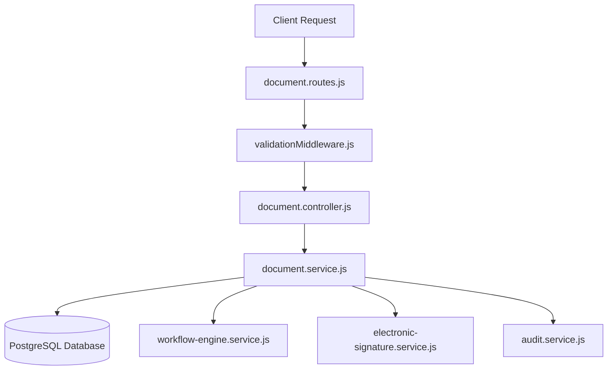

# Knowledge Transfer (KT) Guide: Document Management Service

This document provides a comprehensive technical overview of the **QAssure Document Management Service** (often referred to as the AI Document Vault - AiDV). It is designed to assist developers and engineers in understanding the database structure, Zod schemas, API endpoints, business logic, and integrations with external systems like the Workflow Engine.

---

## 1. Architectural Overview

The Document Management Service handles the controlled lifecycle of documents (such as SOPs, policies, and specifications) in regulated industries. It is designed to meet strict compliance guidelines, including **FDA 21 CFR Part 11** requirements for electronic signatures, access control, and revision audit logs.

---

## 2. Database Schema Definition

The service operates on a set of core relational tables inside the database, tracking metadata, file versions, checkouts, and collaboration comments.

### 2.1 Core Tables

#### `document_categories`
Stores hierarchical category classifications for documents.
*   `id` (UUID, Primary Key)
*   `tenant_id` (UUID, Foreign Key)
*   `name` (VARCHAR)
*   `code` (VARCHAR)
*   `description` (TEXT)
*   `parent_id` (UUID, self-referencing for sub-categories)
*   `requires_training` (BOOLEAN): If true, users must be trained on documents in this category when a version becomes effective.
*   `retention_years` (INTEGER): Retention policy period (defaults to 7).
*   `review_frequency_months` (INTEGER): Periodic review cycle (defaults to 12).

#### `documents` (Master Table)
Holds the main document metadata and links to the current active/approved version.
*   `id` (UUID, Primary Key)
*   `tenant_id` (UUID, Foreign Key)
*   `document_number` (VARCHAR): Unique identifier (e.g., `SOP-001`).
*   `title` (VARCHAR)
*   `description` (TEXT)
*   `category_id` (UUID, Foreign Key)
*   `document_type` (VARCHAR): `SOP`, `WI` (Work Instruction), `FRM` (Form), `POL` (Policy), `SPEC` (Specification).
*   `status` (VARCHAR): `draft` | `in_review` | `approved` | `effective` | `obsolete` | `archived`.
*   `current_version_id` (UUID, Foreign Key): Points to the latest active version in `document_versions`.
*   `owner_id` (UUID, Foreign Key): Document owner.
*   `department` (VARCHAR): Associated organizational department.
*   `effective_date` (DATE)
*   `next_review_date` (DATE)
*   `obsolete_date` (DATE)
*   `workflow_instance_id` (UUID, Foreign Key): Active workflow instance.
*   `source_module` / `source_module_id` / `source_record_id` (TEXT/UUID): Originating module details (used for integrations).
*   `tags` (TEXT[]): Array of labels for GIN-indexed searching.

#### `document_versions`
Stores physical file references and metadata for each draft/release version of a document.
*   `id` (UUID, Primary Key)
*   `document_id` (UUID, Foreign Key)
*   `version_number` (VARCHAR): Version tag (e.g., `1.0`, `1.1`).
*   `major_version` (INTEGER) / `minor_version` (INTEGER)
*   `status` (VARCHAR): `draft` | `in_review` | `approved` | `superseded`.
*   `file_name` / `file_path` / `file_size` / `mime_type` (VARCHAR/BIGINT): Cloud/local file properties.
*   `file_hash` (VARCHAR): SHA-256 integrity hash for safety audits.
*   `content` / `content_html` (TEXT): Inline textual content (for rich text editor mode).
*   `change_summary` / `change_reason` (TEXT): Purpose of edit or revision.
*   `approved_by` (UUID, Foreign Key)
*   `approved_at` (TIMESTAMPTZ)
*   `signature_id` (UUID): Reference to the electronic signature registry.
*   `workflow_instance_id` (UUID, Foreign Key): The workflow instance associated with this version's review cycle.

---

### 2.2 Collaboration Tables (Migration 093 & 094)

To support structured in-app review, the document is broken down into editable, auditable sections with interactive comment threads.

#### `document_sections`
Stores the individual components of a document draft.
*   `id` (UUID, Primary Key)
*   `document_id` (UUID, Foreign Key)
*   `version_id` (UUID, Foreign Key)
*   `section_number` (VARCHAR): Hierarchical index (e.g., `1.2`).
*   `title` (VARCHAR)
*   `content` / `content_html` (TEXT)
*   `order_index` (INTEGER): Ordering sequence.
*   `parent_id` (UUID): Hierarchical self-reference.
*   `review_status` (VARCHAR): `pending` | `reviewed` | `rework`.
*   `reviewed_by` / `reviewed_at` (UUID/TIMESTAMPTZ)
*   `is_mandatory` (BOOLEAN): If true, must be marked reviewed before workflow advancement.
*   **Traceability fields (added in Migration 094)**:
    *   `rework_requested_by` (UUID, Foreign Key)
    *   `rework_requested_at` (TIMESTAMPTZ)
    *   `rework_requested_step` (VARCHAR): The active workflow step name when rework was requested.

#### `document_comments`
Tracks threaded discussion on documents/sections.
*   `id` (UUID, Primary Key)
*   `document_id` (UUID, Foreign Key)
*   `section_id` (UUID, Foreign Key, Nullable): If null, this is a document-level comment; if set, it targets a section.
*   `comment_text` (TEXT)
*   `authored_by` (UUID, Foreign Key)
*   `workflow_step` (VARCHAR): The active workflow step name when the comment was authored (for traceability).
*   `status` (VARCHAR): `open` | `resolved`.
*   `resolved_by` / `resolved_at` (UUID/TIMESTAMPTZ)
*   `parent_id` (UUID, Foreign Key): Enables threaded replies.

---

### 2.3 Management & Audit Tables

#### `document_checkouts`
Handles optimistic concurrency lockouts, ensuring only one user can check out a document for modification at a time.
*   `id` (UUID, Primary Key)
*   `document_id` (UUID, Foreign Key, Unique)
*   `checked_out_by` (UUID, Foreign Key)
*   `checked_out_at` / `expires_at` (TIMESTAMPTZ)
*   `reason` (TEXT)

#### `document_access_log`
The compliance audit trail logging all interactions with documents.
*   `id` (UUID, Primary Key)
*   `document_id` (UUID, Foreign Key)
*   `version_id` (UUID, Foreign Key)
*   `user_id` (UUID, Foreign Key)
*   `action` (VARCHAR): `view` | `download` | `print` | `edit` | `checkout` | `checkin`.
*   `ip_address` (INET)
*   `user_agent` (TEXT)
*   `accessed_at` (TIMESTAMPTZ)

---

## 3. Zod API Validation Schemas (`document.schema.js`)

Requests are validated using schemas defined via the Zod library:

1.  **`CreateDocumentCategorySchema`**: Validates category creation properties. Ensures name and code are provided, constraints parenthood IDs to UUID formats, and bounds integers like review frequencies and retention years.
2.  **`CreateDocumentSchema`**: Validates new documents. Requires title and type, parses file attachments, metadata tags, custom fields, and permits optional sections mapping.
3.  **`UpdateDocumentSchema`**: Partial update validator for document metadata.
4.  **`SubmitForReviewSchema`**: Validates document submission, requiring a valid UUID `workflow_definition_id`.
5.  **`ListDocumentQuerySchema`**: Handles lists query parameters (sanitizes status, pagination offsets/limits, owners, and search strings).

---

## 4. API Endpoints Reference (`document.routes.js`)

All endpoints require authentication (JWT or API Keys) and inject a tenant context:

| Method | Endpoint | Description | Access |
| :--- | :--- | :--- | :--- |
| **GET** | `/categories` | Fetch category list | `document:read` |
| **POST** | `/categories` | Create category | `document:create` |
| **PUT** | `/categories/:id` | Update category details | `document:create` |
| **DELETE**| `/categories/:id` | Remove category | `document:create` |
| **GET** | `/types` | Fetch supported document types | Authenticated |
| **GET** | `/statuses` | Fetch document status definitions | Authenticated |
| **GET** | `/due-for-review` | Get documents due for periodic review | `document:read` |
| **POST** | `/` | Create a new document | `document:create` |
| **GET** | `/` | Query / Search documents list | `document:read` |
| **GET** | `/:id` | Get document details | `document:read` |
| **PUT** | `/:id` | Edit document metadata | `document:create` |
| **GET** | `/:id/versions` | List all document versions | `document:read` |
| **POST** | `/:id/versions` | Append a new version draft | `document:create` |
| **POST** | `/:id/checkout` | Lock document for editing | `document:create` |
| **POST** | `/:id/checkin` | Unlock/Save document edits | `document:create` |
| **GET** | `/:id/sections` | Get document sections | `document:read` |
| **PATCH**| `/:id/sections/:sectionId` | Edit section content | `document:read` |
| **POST** | `/:id/sections/:sectionId/review` | Mark section as reviewed/rework | `document:read` |
| **GET** | `/:id/comments` | List document/section comments | `document:read` |
| **POST** | `/:id/comments` | Add comment / reply to thread | `document:read` |
| **PATCH**| `/:id/comments/:commentId/resolve` | Resolve comment thread | `document:read` |
| **POST** | `/:id/submit` | Submit document to review workflow | `document:create` |
| **POST** | `/:id/approve` | Approve document status | `document:create` |
| **POST** | `/:id/reject` | Reject document status | `document:create` |
| **POST** | `/:id/make-effective`| Make approved document active | `document:create` |
| **POST** | `/:id/obsolete` | Retire document to obsolete status | `document:create` |

---

## 5. Service & Business Logic (`document.service.js`)

The `DocumentService` coordinates transactions, validates operations, integrates signatures, and controls transitions.

### 5.1 Concurrency Control (Checkout / Checkin)
*   **Checkout**: Checks if a record exists in `document_checkouts`. If not, creates one with a timeout limit. Users cannot edit files or submit versions if another user holds the checkout lock.
*   **Checkin**: Deletes the checkout entry, freeing the lock.

### 5.2 Workflow Engine Integration
Document states (`draft` -> `in_review` -> `approved` -> `effective`) are heavily interlinked with the Workflow Engine:

1.  **`submitForReview`**:
    *   Finds or accepts a `workflow_definition_id`.
    *   Calls `workflowEngine.startWorkflow(...)` providing context: entity type (`document`), entity ID, tenant ID, and creator.
    *   Associates the resulting `workflow_instance_id` with both the `documents` and `document_versions` records, and transitions the document status to `in_review`.
2.  **Collaborative Section Editing**:
    *   During review, the active step assignee coordinates edits.
    *   `updateSection` and `markSectionStatus` verify if `req.user.id` matches the current active step task assignee in the workflow engine.
    *   Mandatory sections must be marked `reviewed` before the task can be advanced.
3.  **`approve`**:
    *   Verifies if the workflow instance is complete using `workflowEngine.getInstance(...)`.
    *   If the workflow status is `completed`, sets the document status to `approved`.
4.  **`reject`**:
    *   Clears/terminates the active workflow and resets the document status to `draft` for revisions.

### 5.3 Version Promotion & Electronic Signatures (Part 11)
When making an approved document active via `makeEffective`:
*   Invokes the Electronic Signature service to check the signature token authenticity (verifying user password + signing purpose).
*   Records the `signature_id` on the version.
*   Updates the document's `current_version_id` to point to the newly released version.
*   Calculates the `next_review_date` based on the category's `review_frequency_months` setting.
*   Demotes any prior active version to `superseded` in the `document_versions` table.
*   Triggers Kafka events and publishes notification emails via the notification service.
