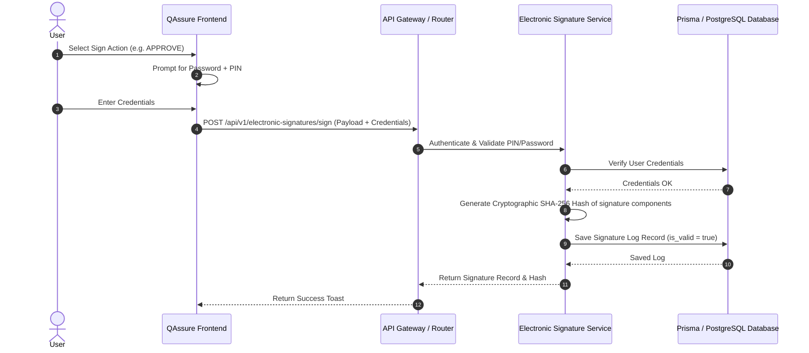

# Electronic Signature Service - Design Document
**FDA 21 CFR Part 11 Compliant Digital Authentication System**

---

## 1. Overview & Compliance
The Electronic Signature module in QAssure is designed to meet the strict regulatory standards of **FDA 21 CFR Part 11** for electronic records and electronic signatures. 

Key compliance guidelines addressed in this design include:
*   **Dual-factor Verification**: Each signature action requires a validation challenge (combination of user password and secondary PIN).
*   **Non-Repudiation**: Signatures are cryptographically hashed and tied directly to the signer's identity and the document's state.
*   **Audit Trail Retention**: Once created, signatures cannot be deleted. Any revocation or invalidation must be stored as a separate, explanatory transaction, retaining the original record.
*   **Signature Meanings**: Every signature includes a clearly defined meaning (e.g., approval, authorship, verification).

---

## 2. Architecture & Data Flow

### 2.1 Cryptographic Hash Validation
To ensure document integrity and prevent tampering:
1. A unique SHA-256 fingerprint is calculated upon creation:
   $$\text{Hash} = \text{SHA256}(\text{signer\_id} + \text{resource\_id} + \text{resource\_type} + \text{action} + \text{timestamp} + \text{salt})$$
2. During verification, this hash is recomputed and compared to the stored hash. Any mismatch indicates a database or state modification breach.

---

## 3. Database Schema Mapping
The Prisma schema for electronic signatures establishes relationships between users, resources (documents), and workflows.

| Field Name | Type | Description |
| :--- | :--- | :--- |
| `id` | UUID | Primary key identifying the signature event. |
| `tenant_id` | UUID | Scope control for multi-tenancy. |
| `signer_id` | UUID | Reference to the user who signed. |
| `resource_type` | String | Target object type (e.g. `document`, `workflow_task`). |
| `resource_id` | String | Target object ID. |
| `resource_name` | String | Name/Title of target object at time of signing. |
| `action` | Enum | Action type (`APPROVE`, `REJECT`, `REVIEW`, etc.). |
| `meaning` | String | Compliance reason text. |
| `auth_method` | String | Authentication type used (`password_pin`). |
| `signed_at` | DateTime | Timestamp of signing event. |
| `is_valid` | Boolean | Integrity status (becomes `false` if invalidated). |
| `invalidated_at` | DateTime | Timestamp of administrative invalidation. |
| `invalidate_reason` | String | Reason explanation for invalidation. |
| `signature_hash` | String | Cryptographic SHA-256 checksum. |
| `ip_address` | String | Network address client origin. |
