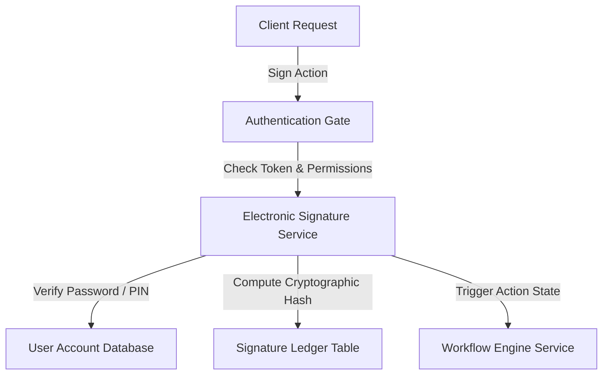

# Electronic Signature Service - Integration Testing Document

---

## 1. Integration Scope
Integration testing ensures the Electronic Signature service communicates correctly with other key services in the QAssure microservice topology:
1.  **Workflow Engine & Task Transitions**: Verifying task approvals execute sign checks when required.
2.  **User Authentication Service**: Verifying token exchange and user status checks.
3.  **Audit Trail Logging Database**: Ensuring logs record hashes and network metadata correctly.

---

## 2. Integration Scenarios

### 2.1 Scenario: Workflow Engine State Transition Protection
*   **Goal**: Ensure a workflow task cannot transition to `APPROVED` status unless a valid signature has been written for that resource ID.
*   **Steps**:
    1.  Call workflow transition API to request transition of task `T-100` to `APPROVED`.
    2.  The engine checks if the step requires a signature. If signature is required but missing, transition is blocked (returns `400 Bad Request` or transitional validation error).
    3.  Call `POST /electronic-signatures/sign` to register the compliant signature record.
    4.  Retry transition request. The engine queries the signature resource status API, verifies signature validity, and allows transition.

### 2.2 Scenario: RBAC Authorization & Gatekeeper Verification
*   **Goal**: Verify endpoint protection middleware works as expected.
*   **Steps**:
    1.  Request `/statistics` with a regular tenant user token. Verify output status is `403 Forbidden`.
    2.  Request `/statistics` with an auditor token (contains `audit_logs:read`). Verify output status is `200 OK`.
    3.  Request `/invalidate` with a tenant manager token. Verify output status is `403 Forbidden`.
    4.  Request `/invalidate` with a super admin token. Verify status is `200 OK` (or validation response).
