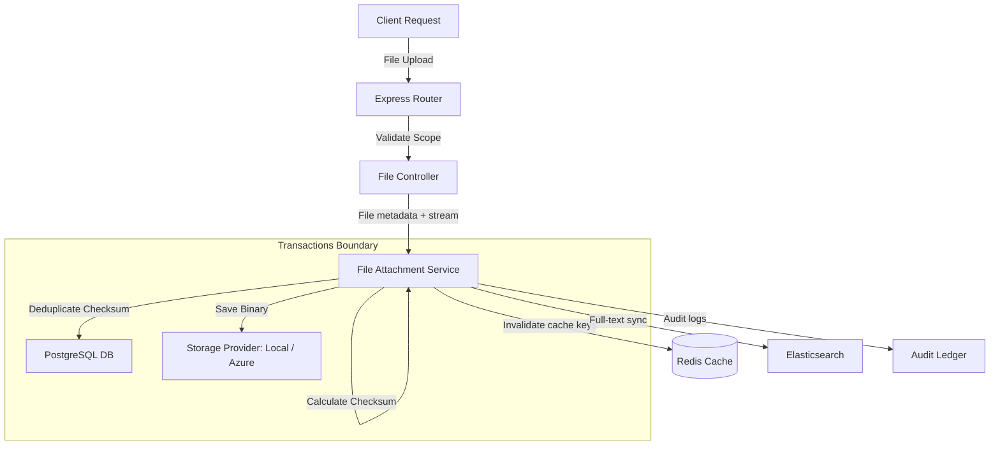

# File Attachment Service - Integration Testing Document

---

## 1. Integration Scope
Integration testing ensures the File Attachment Service coordinates correctly with other QAssure modules and external systems:
1.  **Relational Database (PostgreSQL)**: Verifying transaction commits and rollbacks (e.g. rollbacks when physical file storage fails).
2.  **Redis Cache System**: Confirming cache evictions on updates and cache hits on metadata lookups.
3.  **Physical Storage Providers**: Verifying local disk reads/writes and Azure Blob Container connectivity.
4.  **Elasticsearch (ES)**: Ensuring text extraction values are indexed in `qassure-files`.
5.  **Audit Service**: Verifying compliance logging events.

---

## 2. Integration Architecture



---

## 3. Integration Testing Scenarios

### 3.1 Scenario A: Storage Failure Transaction Rollback
*   **Goal**: Ensure database integrity by rolling back SQL record creations if the storage provider fails to save the file binary.
*   **Steps**:
    1.  Initialize a file upload request.
    2.  Inject a mock storage provider that throws an error during the `save` execution step.
    3.  Call the service upload method.
    4.  Verify that the service throws an error.
    5.  Check the database to confirm that:
        -   No records were inserted into the `file_attachments` table.
        -   No records were inserted into the `file_blobs` table.
        -   The tenant's `used_storage_bytes` remains unchanged.

### 3.2 Scenario B: Elasticsearch Index Synchronization
*   **Goal**: Confirm that uploaded documents are automatically parsed and indexed in Elasticsearch.
*   **Steps**:
    1.  Upload a Word Document (`.docx`) containing the phrase: `"Verify integration index sync works."`.
    2.  Wait for the background content extraction task to finish.
    3.  Query the Elasticsearch cluster:
        ```bash
        GET /qassure-files/_search?q=integration
        ```
    4.  Verify that the returned search results include the document metadata and the extracted text payload.

### 3.3 Scenario C: Multi-Tenant Namespace Separation
*   **Goal**: Confirm that files uploaded by Tenant A are isolated and cannot be accessed by Tenant B, even if the file ID is known.
*   **Steps**:
    1.  Authenticate a request for Tenant A.
    2.  Upload `confidential_report.pdf` and copy the returned attachment `id`.
    3.  Authenticate a request for Tenant B.
    4.  Attempt to download the file using the copied attachment `id`:
        ```http
        GET /api/v1/files/:id/download
        ```
    5.  Verify that the service returns a `404 Not Found` error and does not leak Tenant A's document.
