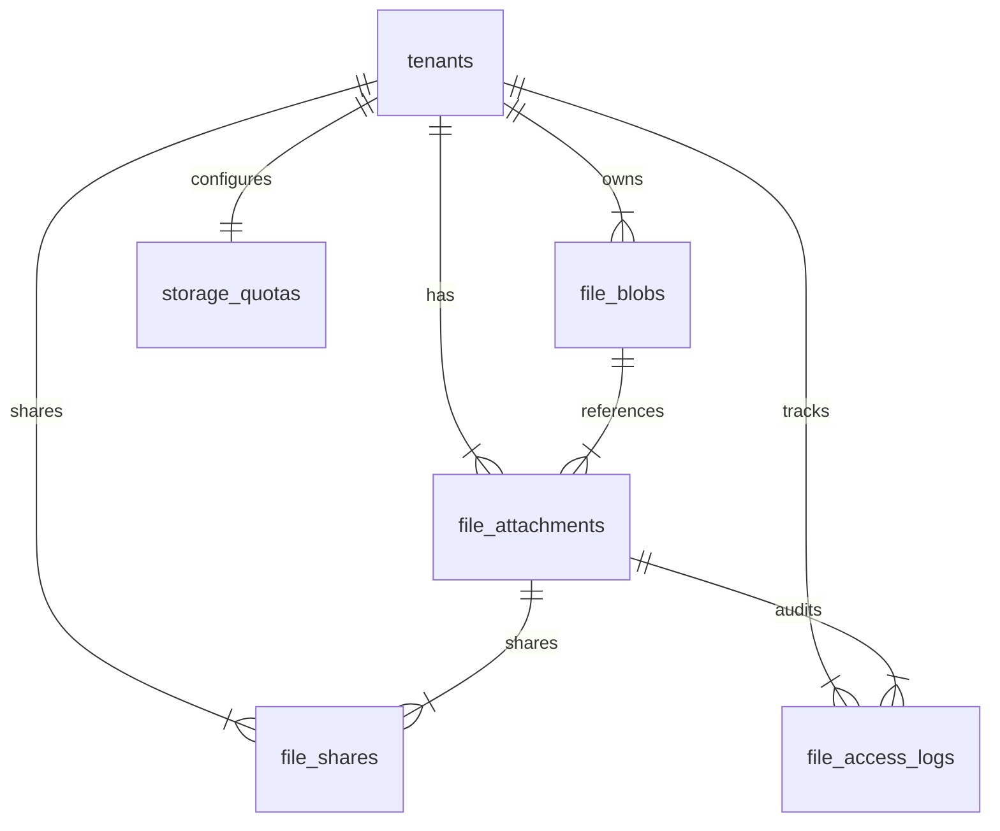

# QAssure File Attachment Service

## Technical Knowledge Transfer (KT) Guide

Welcome to the technical Knowledge Transfer (KT) guide for the **File Attachment Service** of the QAssure Platform. This document outlines the service's hybrid storage architecture, route registrations, database schemas, deduplication mechanics, access logging, and content extraction pipeline.

---

## 1. Architectural Overview

The File Attachment Service is a secure, multi-tenant hybrid file management system. It provides automated content extraction (for indexing and compliance), sharing controls (time-bound/download-limited tokens), and storage quota enforcement, combined with database deduplication using reference-counted binary blobs.

### Directory & Component Map

- **Routing Layer**: [file-attachment.routes.js](file:///home/tech4biz/Downloads/Sibarchan/QAssure/QAssur-backend/src/routes/file-attachment.routes.js) handles HTTP routes, Multer middleware for file ingestion, validation schemas, and RBAC authorization middleware.
- **Validation Layer**: [file-attachment.schema.js](file:///home/tech4biz/Downloads/Sibarchan/QAssure/QAssur-backend/src/validation/file-attachment.schema.js) enforces request payloads using Zod schemas for file uploads, metadata updates, and share creations.
- **Controller Layer**: [file-attachment.controller.js](file:///home/tech4biz/Downloads/Sibarchan/QAssure/QAssur-backend/src/controllers/file-attachment.controller.js) coordinates incoming HTTP requests, maps files and payloads to service parameters, handles downloads/previews, and sanitizes outgoing error structures.
- **Service Layer**: 
  - [file-attachment.service.js](file:///home/tech4biz/Downloads/Sibarchan/QAssure/QAssur-backend/src/services/file-attachment.service.js) drives the core logic, including storage provider routing (Local vs. Azure vs. S3 vs. GCP), checksum-based deduplication, reference-counting lifecycle, quota tracking, sharing tokens, access auditing, and Elasticsearch indexing.
- **Database Model Layer**:
  - [file_attachment.js](file:///home/tech4biz/Downloads/Sibarchan/QAssure/QAssur-backend/src/sequelize-models/file_attachment.js) maps the file attachment reference records.
  - [file_blob.js](file:///home/tech4biz/Downloads/Sibarchan/QAssure/QAssur-backend/src/sequelize-models/file_blob.js) maps the physical file details used for backend binary deduplication.
  - [file_share.js](file:///home/tech4biz/Downloads/Sibarchan/QAssure/QAssur-backend/src/sequelize-models/file_share.js) maps external sharing tokens and download thresholds.
  - [storage_quota.js](file:///home/tech4biz/Downloads/Sibarchan/QAssure/QAssur-backend/src/sequelize-models/storage_quota.js) defines tenant storage caps, maximum upload boundaries, and allowed file types.
  - [file_access_log.js](file:///home/tech4biz/Downloads/Sibarchan/QAssure/QAssur-backend/src/sequelize-models/file_access_log.js) records access timelines (downloads, views, uploads) for compliance checks.

---

## 2. System Interaction Workflows

### A. Secure File Upload & Deduplication Pipeline

When a user submits a file, the system computes its checksum to check if the exact binary already exists inside the tenant and calling context, avoiding redundant physical storage.

```mermaid
sequenceDiagram
    autonumber
    actor User as Client User
    participant Router as file-attachment.routes
    participant Ctrl as file-attachment.controller
    participant Svc as file-attachment.service
    database DB as PostgreSQL DB
    participant Store as Storage Provider (Local/Azure/S3/GCP)
    participant ES as Elasticsearch (ES)

    User->>Router: POST /api/v1/files/upload (multipart form + token)
    Note over Router: Multer checks file size (<100MB) & blacklisted extensions
    Router->>Ctrl: upload(req, res)
    Ctrl->>Svc: upload(tenantId, file, entityType, entityId, options, uploadedBy, req)
    
    Svc->>Svc: getQuota(tenantId)
    Note over Svc: Checks remaining storage & allowed MIME types
    Svc->>Svc: _calculateChecksum(file.buffer)
    
    Note over Svc: Starts DB Transaction (BEGIN)
    Svc->>DB: Fetch user.supplier_id (Server-side lookup)
    Svc->>DB: Query file_blobs WHERE checksum & module_id & supplier_id (FOR UPDATE)
    
    alt Blob Exists (Deduplicated Case)
        DB-->>Svc: Returns existing blob record
        Svc->>DB: UPDATE file_blobs SET reference_count = reference_count + 1
    else Blob Does Not Exist (New Binary Case)
        Svc->>Store: save(relativePath, fileBuffer)
        Store-->>Svc: returns storage details
        Svc->>DB: INSERT INTO file_blobs (reference_count = 1)
        DB-->>Svc: Returns new blob record
    end
    
    Svc->>DB: INSERT INTO file_attachments (pointing to blob_id)
    Svc->>DB: COMMIT
    
    Svc->>Svc: Invalidate Redis Cache (entity files, tenant quota)
    Svc->>ES: indexFileToES(attachment)
    Svc->>DB: INSERT INTO file_access_logs (action = 'upload')
    
    Svc-->>Ctrl: Returns formatted attachment record
    Ctrl-->>User: 201 Created (JSON metadata)
```

### B. File Download & Preview Flow

To display or download a file, the system resolves its storage provider, applies tenant filters, increments download logs, and pipes the binary stream back to the client.

```mermaid
sequenceDiagram
    autonumber
    actor User as Client User
    participant Ctrl as file-attachment.controller
    participant Svc as file-attachment.service
    database DB as PostgreSQL DB
    participant Store as Storage Provider (Local/Azure/S3/GCP)

    User->>Ctrl: GET /api/v1/files/:id/download (JWT auth)
    Ctrl->>Svc: getFilePath(id, tenantId, userId, req)
    Svc->>Svc: getById(id, tenantId) (checks Redis cache first)
    
    opt Not Cached
        Svc->>DB: SELECT * FROM file_attachments JOIN file_blobs
        DB-->>Svc: Returns file + blob details
    end
    
    Svc->>DB: INSERT INTO file_access_logs (action = 'download')
    Svc->>DB: UPDATE file_attachments SET download_count = download_count + 1
    
    alt Storage Provider = Local
        Svc->>Store: Resolve absolute local path
        Svc-->>Ctrl: Returns { path, attachment, storageType: 'local' }
        Ctrl-->>User: Sends file via res.sendFile(path)
    else Storage Provider = Azure / S3 / GCP
        Svc->>Store: getSignedUrl(filePath) (generates signed URL)
        Svc-->>Ctrl: Returns { path: SIGNED_URL, attachment, storageType: 'azure' | 's3' | 'gcp' }
        Ctrl-->>User: Redirects client or pipes stream to HTTP Response
    end
```

### C. Reference Deletion and Blob Dereferencing Flow

Deleting a file removes the logical reference (`file_attachments`). The backend decrements the physical blob's reference count and deletes the binary from disk/Azure only when the count reaches zero.

```mermaid
sequenceDiagram
    autonumber
    actor Admin as User / Admin
    participant Ctrl as file-attachment.controller
    participant Svc as file-attachment.service
    database DB as PostgreSQL DB
    participant Store as Storage Provider (Local/Azure/S3/GCP)

    Admin->>Ctrl: DELETE /api/v1/files/:id?hard=true&keep_blob=false
    Ctrl->>Svc: delete(id, tenantId, hardDelete, userId, keepBlob)
    Svc->>Svc: getVersionHistory(id, tenantId) (gathers all versions in chain)
    
    Note over Svc: Starts DB Transaction (BEGIN)
    loop For each file version
        Svc->>DB: UPDATE file_blobs SET reference_count = reference_count - 1
        DB-->>Svc: Returns updated reference_count & is_soft_deleted status
        
        opt reference_count == 0
            alt keepBlob == true OR hardDelete == false (Soft Delete)
                Svc->>DB: UPDATE file_blobs SET is_soft_deleted = TRUE, soft_deleted_at = NOW()
            else keepBlob == false AND hardDelete == true (Hard Delete)
                Svc->>Store: delete(storagePath) (purges file from Local/Azure/S3/GCP)
                Svc->>DB: UPDATE file_attachments SET blob_id = NULL
                Svc->>DB: DELETE FROM file_blobs WHERE id = blob_id
            end
        end
    end
    
    alt hardDelete == true
        Svc->>DB: DELETE FROM file_attachments WHERE id = ANY(version_ids)
    else hardDelete == false
        Svc->>DB: UPDATE file_attachments SET deleted_at = NOW() WHERE id = ANY(version_ids)
    end
    Svc->>DB: COMMIT
    
    Svc->>Svc: Evict Redis cache & remove documents from Elasticsearch
    Svc->>DB: INSERT INTO audit_logs (action = 'DELETE')
    Svc-->>Ctrl: Returns true
    Ctrl-->>Admin: 200 OK (JSON confirmation)
```

---

## 3. Route Definition and Validation Reference

All file attachment endpoints require authentication and tenant context (except public shared links). They are prefixed by `/api/v1/files`.

| Route Method | URL Path | Permission Required | Validation Schema | Description |
| :--- | :--- | :--- | :--- | :--- |
| **GET** | `/shared/:token` | Public (Anonymous) | None | Ingress path for accessing shared files using temporary link tokens. |
| **POST** | `/upload` | `files:create` | `UploadFileSchema` | Ingests a single multipart file attachment, calculating checksums for deduplication. |
| **POST** | `/upload/multiple` | `files:create` | `UploadFileSchema` | Uploads up to 10 files concurrently inside a parallel promise loop. |
| **GET** | `/` | `files:read` | None (Query parsing) | Lists files, applying filters (tags, category, metadata keys). |
| **GET** | `/dropdown-options` | `files:read` OR `document:read` | None | Returns a lightweight file catalog listing for selectors and dropdown fields. |
| **GET** | `/filter-options` | `files:read` | None | Dynamically parses unique metadata keys and tags for directory filtering. |
| **GET** | `/categories-filter-options` | `files:read` | None | Lists unique categories and category IDs stored in the table. |
| **GET** | `/stats` | `files:read` | None | Returns storage totals, file type distributions, and tenant usage metrics. |
| **GET** | `/quota` | `files:read` | None | Fetches storage quota limits (max bytes, blocklist, allowed MIME types). |
| **PUT** | `/quota` | `files:admin` | None | Updates tenant storage limits (bytes, size restrictions, and extensions). |
| **GET** | `/entity/:entity_type/:entity_id` | `files:read` | `validateUUID('entity_id')` | Returns files associated with a business object (e.g., CAPA, Training record). |
| **GET** | `/:id` | `files:read` | `validateUUID('id')` | Returns a single file attachment record. |
| **PUT** | `/:id` | `files:update` | `validateUUID('id')`, `UpdateFileMetadataSchema` | Updates description, tags, categories, or JSONB metadata fields. |
| **DELETE** | `/:id` | `files:delete` | `validateUUID('id')` | Soft deletes or hard deletes files, checking reference counts. |
| **GET** | `/:id/download` | `files:read` | `validateUUID('id')` | Downloads the binary (local file sending or Azure SAS URL routing). |
| **GET** | `/:id/preview` | None (Bypasses RBAC) | `validateUUID('id')` | Serves file content inline (e.g., PDF or images) for in-browser rendering. |
| **GET** | `/:id/content` | `files:read` | `validateUUID('id')` | Extracts text and HTML using Mammoth (.docx) or pdf-parse (.pdf). |
| **POST** | `/:id/versions` | `files:create` | `validateUUID('id')` | Uploads a new version of the file, shifting the `is_current_version` flag. |
| **GET** | `/:id/versions` | `files:read` | `validateUUID('id')` | Returns the historical version chain (ordered from oldest to newest). |
| **POST** | `/:id/share` | `files:create` | `validateUUID('id')`, `CreateShareSchema` | Generates a shared link or user assignment with specific parameters. |
| **DELETE** | `/shares/:shareId` | `files:delete` | `validateUUID('shareId')` | Revokes an active file share, invalidating the associated token. |
| **POST** | `/blobs/purge-soft-deleted` | `files:admin` | None | Admin cleanup task to purge soft-deleted blobs with zero references. |

---

## 4. Key Implementation Details

### A. Checksum-Based Deduplication Engine
To reduce storage costs, QAssure uses file-level deduplication:
- **Scope**: Checksum duplication checks are restricted within the scope of the tenant, module, and supplier. This is query-scoped using `tenant_id`, `module_id`, and `supplier_id`.
- **Identity Matching**: The comparison query uses `IS NOT DISTINCT FROM` instead of standard equality checks to correctly match nullable `module_id` and `supplier_id` fields without breaking on NULLs.
- **Reference Tracking**: The table `file_blobs` maintains a `reference_count` counter. When files are uploaded, if a blob exists, the service increments this counter. Deletions decrement it, triggering file system cleanup when it hits `0`.

### B. Hybrid Storage Architecture
The system supports multiple physical backends dynamically resolved from the tenant's active bucket configuration:
- **Local Storage**: Files are saved in a multi-tenant folder tree:
  `uploads/{tenant_id}/{entity_type}/{YYYY}/{MM}/{uuid}_{sanitized_name}.ext`
- **Azure Blob Storage**: Uses `@azure/storage-blob` with container-level Shared Access Signature (SAS) tokens (encrypted using AES-256-GCM). It streams file uploads and generates signed SAS URLs for downloads.
- **Amazon S3**: Uses `@aws-sdk/client-s3` and `@aws-sdk/s3-request-presigner` with S3 credentials (AWS Access Key ID and Secret Access Key, encrypted using AES-256-GCM). It generates temporary presigned URLs for secure downloads.
- **Google Cloud Storage (GCS)**: Uses `@google-cloud/storage` with Service Account Keys (encrypted using AES-256-GCM). It generates signed URLs for secure downloads.

### C. Dynamic Quotas and Validation Guardrails
Quota constraints are validated before write operations:
1. **Blocked Extensions**: File extensions are filtered against `storage_quotas.blocked_extensions` (defaulting to `.exe`, `.bat`, `.cmd`, `.sh`, `.ps1`, `.msi`, `.dll`, `.com`, `.scr`, `.vbs`, `.js`).
2. **MIME Type Allowlist**: If `allowed_mime_types` is set, only matching MIME structures are allowed.
3. **Usage Calculations**: Checks the total size of the uploaded file against the tenant's remaining quota capacity (`max_storage_bytes - used_storage_bytes`).

### D. Automated Content Extraction & Search Indexing
For full-text search integration:
- **PDF Extraction**: Uses `pdf-parse` with DOMMatrix and Path2D polyfills to extract text and format pages inside HTML paragraph blocks.
- **DOCX Extraction**: Uses `mammoth` to extract raw text and convert structures into semantic HTML markup.
- **Elasticsearch Ingestion**: Extracted files are indexed into `qassure-files` using fields like `tags`, `category`, `uploaded_by_email`, and description properties.

---

## 5. Database Schema & Tables Map



### `file_blobs`
- `id` (UUID, PK) - Unique identifier for the deduplicated binary.
- `tenant_id` (UUID, FK) - Tenant ownership context.
- `checksum` (VARCHAR(64)) - SHA-256 hash of the binary file.
- `module_id` (UUID, Nullable) - Calling application context.
- `supplier_id` (UUID, Nullable) - Supplier identifier lookup.
- `storage_provider` (VARCHAR(50)) - Storage provider type (local, azure, s3, or gcp).
- `storage_path` (VARCHAR(1000)) - Relative path on the storage backend.
- `stored_name` (VARCHAR(500)) - Unique name (`uuid_name.ext`).
- `mime_type` (VARCHAR(255)) - MIME structure.
- `file_size` (BIGINT) - Size in bytes.
- `reference_count` (INTEGER) - Total active attachments pointing to this blob.
- `is_soft_deleted` (BOOLEAN) - Indicates if the blob is soft-deleted.
- `soft_deleted_at` (TIMESTAMP) - Timestamp when the blob was soft-deleted.

### `file_attachments`
- `id` (UUID, PK) - Unique identifier.
- `tenant_id` (UUID, FK) - Tenant ownership context.
- `original_name` (VARCHAR(500)) - Original file name.
- `stored_name` (VARCHAR(500)) - Deduplicated blob file name.
- `file_path` (VARCHAR(1000)) - Storage location path.
- `mime_type` (VARCHAR(255)) - MIME structure.
- `file_size` (BIGINT) - Size in bytes.
- `checksum` (VARCHAR(64)) - SHA-256 hash of the file.
- `storage_provider` (VARCHAR(50)) - Location type.
- `entity_type` (VARCHAR(100)) - Associated entity class (e.g., `'capa'`, `'document'`).
- `entity_id` (UUID) - Unique ID of the associated entity.
- `category` (VARCHAR(255)) - Category name.
- `category_id` (VARCHAR(255)) - Category identifier.
- `source_module` (VARCHAR(100)) - Ingress path module.
- `source_module_id` (UUID, Nullable) - ID of the calling module.
- `description` (TEXT) - Optional description.
- `tags` (VARCHAR[]) - Filter tags.
- `version` (INTEGER) - Incremental version number.
- `is_current_version` (BOOLEAN) - Indicates if this is the current active version.
- `previous_version_id` (UUID, FK) - Pointer to the previous version.
- `blob_id` (UUID, FK) - Associated physical blob record.
- `download_count` (INTEGER) - Number of downloads.
- `metadata` (JSONB) - Key-value metadata.
- `uploaded_by` (UUID, FK) - User who uploaded the file.
- `deleted_at` (TIMESTAMP, Nullable) - Timestamp for soft deletion.

### `file_shares`
- `id` (UUID, PK) - Unique share ID.
- `tenant_id` (UUID, FK) - Tenant context.
- `file_id` (UUID, FK) - Associated file.
- `share_token` (VARCHAR(100)) - Random access token.
- `share_type` (VARCHAR(50)) - `'link'` or `'user'`.
- `shared_with_user_id` (UUID, FK, Nullable) - Recipient user ID.
- `shared_with_email` (VARCHAR(255), Nullable) - Recipient email.
- `permissions` (VARCHAR(50)) - `'view'` or `'download'`.
- `expires_at` (TIMESTAMP, Nullable) - Expiration timestamp.
- `max_downloads` (INTEGER, Nullable) - Maximum download limit.
- `current_downloads` (INTEGER) - Current download count.
- `created_by` (UUID, FK) - User who created the share.
- `last_accessed_at` (TIMESTAMP, Nullable) - Last access timestamp.
- `is_active` (BOOLEAN) - Indicates if the share link is active.

### `storage_quotas`
- `id` (UUID, PK) - Unique quota record ID.
- `tenant_id` (UUID, FK) - Associated tenant.
- `max_storage_bytes` (BIGINT) - Total storage capacity limit.
- `max_file_size_bytes` (BIGINT) - Maximum single file size limit.
- `used_storage_bytes` (BIGINT) - Total storage used.
- `file_count` (INTEGER) - Total active files uploaded.
- `allowed_mime_types` (TEXT[]) - Allowed MIME structures.
- `blocked_extensions` (TEXT[]) - Blocked file extensions.

### `file_access_logs`
- `id` (UUID, PK) - Log entry ID.
- `tenant_id` (UUID, FK) - Tenant context.
- `file_id` (UUID, FK) - Audited file ID.
- `user_id` (UUID, FK, Nullable) - Executing user ID.
- `action` (VARCHAR(50)) - Action performed (e.g., `'upload'`, `'download'`).
- `ip_address` (VARCHAR(45)) - Client IP address.
- `user_agent` (VARCHAR(500)) - Client user agent.

---

## 6. KT Cheat Sheet: Common Developer Tasks

### A. How to trigger a programmatical upload from another service?

To attach a file programmatically (e.g., generating compliance reports or saving certificates), inject the attachment service:

```javascript
const { getFileAttachmentService } = require('./file-attachment.service');

const fileAttachmentService = getFileAttachmentService();

const uploadedFile = await fileAttachmentService.upload(
  tenantId,
  {
    originalname: 'capa_corrective_action_evidence.pdf',
    mimetype: 'application/pdf',
    buffer: pdfBuffer,
    size: pdfBuffer.length
  },
  'capa',
  capaId,
  {
    category: 'Evidence',
    description: 'System generated corrective action signature verification log.',
    tags: ['audit', 'compliance', 'system-generated'],
    metadata: { generatedBy: 'capa-engine' }
  },
  systemUserId,
  req // Express request context for API key tracking and IP lookup
);
```

### B. How are Cloud Storage Providers (AWS S3 and GCS) configured?

Cloud storage providers are defined in the `tenant_storage_buckets` table and resolved dynamically using the tenant's bucket assignments.

1. **Amazon S3**:
   - Class: `S3StorageProvider` (implements `save`, `delete`, `exists`, `getFullPath`, `read`, `getStream`, `getSignedUrl`).
   - Libraries: `@aws-sdk/client-s3` and `@aws-sdk/s3-request-presigner`.
   - Dynamic Resolution: Decrypts `s3_secret_key` in-memory using AES-256-GCM and initializes the S3 client using `s3_access_key`, `s3_region`, and optional `s3_endpoint`.

2. **Google Cloud Storage (GCS)**:
   - Class: `GCSStorageProvider` (implements `save`, `delete`, `exists`, `getFullPath`, `read`, `getStream`, `getSignedUrl`).
   - Library: `@google-cloud/storage`.
   - Dynamic Resolution: Decrypts the service account credentials JSON string in `gcs_service_account_key` in-memory using AES-256-GCM, and initializes the storage client using `gcs_project_id`.

### C. How to extract text from a file and perform a search?

To search within document attachments, call the content extraction method:

```javascript
const { getFileAttachmentService } = require('./file-attachment.service');

const service = getFileAttachmentService();
try {
  const content = await service.extractContent(fileId, tenantId);
  console.log('Extracted raw text content:', content.text);
  console.log('Extracted document markup:', content.html);
} catch (error) {
  console.error('Failed to extract content:', error.message);
}
```
