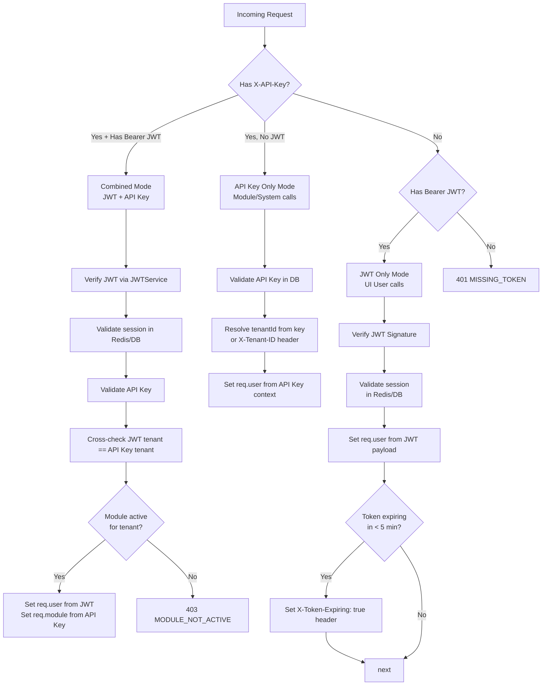
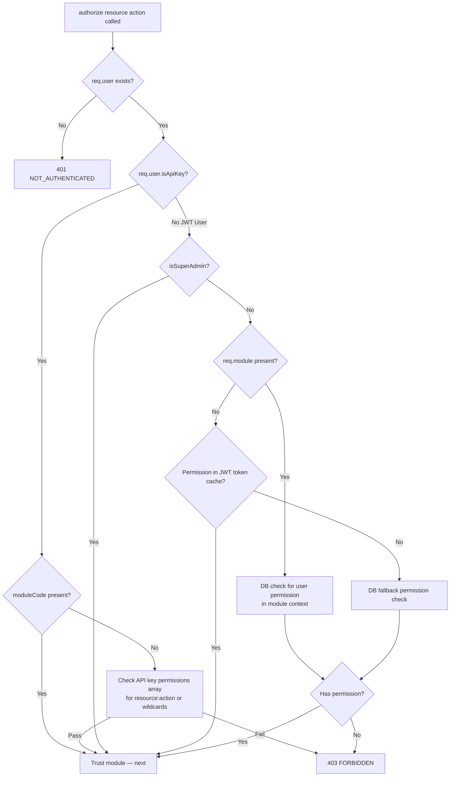

# QAssure Identity & Platform Service — Design Document
**Multi-Tenant Identity, RBAC, SSO & Security Compliance Infrastructure**

---

## 1. Overview & Architecture

The Identity & Platform Service is the **core security backbone** of QAssure. It provides the complete lifecycle for user authentication, session management, multi-tenancy, role-based access control (RBAC), and module-level Single Sign-On (SSO) token exchange. Every other service in QAssure depends on this service for identity verification and permission enforcement.

Key design principles include:
*   **Defense-in-Depth Authentication**: Supports three distinct authentication modes — JWT-only (UI users), API Key-only (module-to-platform), and Combined JWT+API Key (user in module context). Every mode is handled by a single unified `authenticate` middleware.
*   **Hierarchical Multi-Tenancy**: Tenants are fully isolated at the database level. All resources are scoped with `tenant_id`. The `tenantContext` middleware enforces this boundary on every request, with an in-memory 5-minute cache for performance.
*   **Layered RBAC**: Permissions are evaluated in a strict priority chain: Super Admin bypass → Token-cached permissions (fast path) → Database lookup (live permission updates). Permissions follow the `resource:action` pattern (e.g., `users:read`, `security:create`).
*   **Module SSO via Launch Tokens**: External modules (CAPA, Training, Documents) authenticate users by receiving a short-lived launch token from the platform and verifying it using their own API key. This eliminates the need to transmit user credentials between services.
*   **FDA 21 CFR Part 11 Compliance**: All security operations are logged. Password policy enforcement, access review campaigns, and electronic signature PINs are built into the user identity model.

---

## 2. Architecture & Data Flow

### 2.1 Authentication Decision Tree

The unified `authenticate` middleware examines every incoming request and selects the appropriate verification path:



### 2.2 Module SSO (Launch Token) Flow

```mermaid
sequenceDiagram
    autonumber
    actor User as QAssure UI User
    participant Platform as Identity Service
    participant Module as External Module (e.g. CAPA)
    database DB as PostgreSQL DB

    rect rgb(240, 248, 255)
        Note over User, DB: Step 1 — Platform issues launch token
        User->>Platform: POST /api/v1/modules/:id/launch (Bearer JWT)
        Platform->>DB: Verify module is active for tenant
        Platform->>DB: INSERT into sessions (short-lived launch token, TTL 5 min)
        Platform-->>User: Returns { launch_url: "/app/launch?token=<launchToken>" }
    end

    rect rgb(255, 240, 245)
        Note over Module, DB: Step 2 — Module verifies token on behalf of user
        User->>Module: Redirects to launch_url
        Module->>Platform: POST /api/v1/modules/verify-launch-token\n(X-API-Key: <moduleApiKey>)
        Platform->>DB: Look up launch token in sessions table
        Platform->>DB: Validate token not expired, not revoked
        Platform->>DB: Validate API Key belongs to the same module
        Platform->>DB: Fetch user's roles and permissions for this module
        Platform-->>Module: Returns full user context (id, email, roles, permissions, tenant)
        Module-->>User: Establishes authenticated session inside module
    end
```

### 2.3 Authorization Evaluation Chain



---

## 3. Database Schema Mapping

| Table Name | Description |
| :--- | :--- |
| `users` | Core identity records with authentication, contact info, and security fields |
| `tenants` | Organization records with subscription tier, SSO, 2FA, and branding config |
| `roles` | Role definitions scoped to tenant, platform, or module |
| `permissions` | Granular `resource:action` grants attached to roles |
| `user_roles` | Many-to-many assignment of roles to users, optionally scoped to tenant and module |
| `user_tenants` | Multi-tenancy membership table — users can belong to multiple tenants |
| `sessions` | Active JWT session registry with expiry and revocation tracking |
| `password_history` | Tracks past hashed passwords to prevent reuse (21 CFR Part 11) |
| `password_policy` | Tenant-level password complexity, expiry, and lockout configuration |
| `security_settings` | Tenant-level MFA, session timeout, IP allowlists, and compliance mode flags |
| `access_reviews` | Periodic user access review campaigns (SOD compliance) |
| `access_review_items` | Individual user decisions within a review campaign |

### `users` Table — Column Reference

| Column | Type | Nullable | Description |
| :--- | :--- | :--- | :--- |
| `id` | UUID (PK) | No | Unique user identifier |
| `email` | VARCHAR(255) | No | Email address (case-insensitive unique index) |
| `password_hash` | VARCHAR(255) | Yes | Bcrypt hashed password |
| `first_name` | VARCHAR(100) | Yes | First name |
| `last_name` | VARCHAR(100) | Yes | Last name |
| `status` | VARCHAR | No | `active`, `suspended`, `deleted`, `pending` |
| `auth_provider` | VARCHAR | No | `local`, `saml`, `oauth` |
| `saml_subject` | VARCHAR(255) | Yes | SAML NameID for SSO users |
| `oauth_provider` | VARCHAR(50) | Yes | OAuth provider name |
| `oauth_subject` | VARCHAR(255) | Yes | OAuth subject identifier |
| `last_login_at` | TIMESTAMP | Yes | Last successful login timestamp |
| `login_count` | INTEGER | Yes | Total login count |
| `last_login_ip` | VARCHAR(45) | Yes | IP address of last login |
| `preferences` | JSONB | Yes | User UI preferences |
| `signature_pin_hash` | VARCHAR(255) | Yes | Electronic signature PIN hash |
| `signature_pin_set_at` | TIMESTAMP | Yes | PIN set timestamp |
| `password_changed_at` | TIMESTAMP | Yes | Last password change date |
| `password_expires_at` | TIMESTAMP | Yes | Password expiry date |
| `failed_login_attempts` | INTEGER | Yes | Failed attempt counter (lockout) |
| `locked_until` | TIMESTAMP | Yes | Account lockout expiry |
| `contact_phone` | VARCHAR(50) | Yes | Phone number |
| `address_line1/2` | VARCHAR(255) | Yes | Street address |
| `city/state/postal_code/country` | VARCHAR | Yes | Location details |
| `department_id` | UUID (FK) | Yes | Department assignment |
| `designation_id` | UUID (FK) | Yes | Job designation |
| `category` | VARCHAR | No | User category (`tenant_user`, `super_admin`, etc.) |
| `supplier_id` | UUID (FK) | Yes | Linked supplier for supplier portal users |
| `force_password_reset` | BOOLEAN | No | Forces reset on next login |

### `tenants` Table — Column Reference

| Column | Type | Nullable | Description |
| :--- | :--- | :--- | :--- |
| `id` | UUID (PK) | No | Unique tenant identifier |
| `name` | VARCHAR(100) | No | Organization name (unique) |
| `slug` | VARCHAR(100) | No | URL-safe slug (unique) |
| `status` | VARCHAR | No | `active`, `suspended`, `inactive` |
| `settings` | JSONB | Yes | Feature flags and configuration |
| `subscription_tier` | VARCHAR(50) | Yes | `starter`, `professional`, `enterprise` |
| `max_users` | INTEGER | Yes | User seat limit |
| `max_modules` | INTEGER | Yes | Module access limit |
| `domain` | VARCHAR(255) | Yes | Custom domain for SSO routing |
| `enable_sso` | BOOLEAN | No | SSO feature flag |
| `enable_2fa` | BOOLEAN | No | 2FA enforcement flag |
| `logo_file_path` | VARCHAR(500) | Yes | Branding logo path |
| `favicon_file_path` | VARCHAR(500) | Yes | Branding favicon path |
| `primary_color` | VARCHAR(50) | Yes | Brand primary color (hex) |
| `secondary_color` | VARCHAR(50) | Yes | Brand secondary color |
| `accent_color` | VARCHAR(50) | Yes | Brand accent color |

### `sessions` Table — Column Reference

| Column | Type | Nullable | Description |
| :--- | :--- | :--- | :--- |
| `id` | UUID (PK) | No | Session ID |
| `user_id` | UUID (FK) | No | Associated user |
| `tenant_id` | UUID (FK) | Yes | Associated tenant |
| `token_hash` | VARCHAR(255) | No | SHA-256 hash of access token |
| `refresh_token_hash` | VARCHAR(255) | Yes | SHA-256 hash of refresh token |
| `ip_address` | VARCHAR(45) | Yes | Client IP address |
| `user_agent` | TEXT | Yes | Client browser/agent string |
| `expires_at` | TIMESTAMP | No | Access token expiry |
| `refresh_expires_at` | TIMESTAMP | Yes | Refresh token expiry |
| `revoked_at` | TIMESTAMP | Yes | Revocation timestamp (null = active) |

---

## 4. Key Design Choices

### 4.1 Three-Mode Unified `authenticate` Middleware
Rather than maintaining separate middleware for each authentication context, QAssure consolidates all three modes into a single `authenticate` function. This simplifies route code and ensures consistent error handling across the platform.

### 4.2 JWT Payload Caching for Permission Fast-Path
Permissions embedded in the JWT token provide an O(1) lookup for the majority of requests, avoiding database roundtrips for every API call. The database permission check is a fallback triggered only when the token-cached list doesn't include the required permission (handles the case where permissions were updated after token issuance).

### 4.3 Tenant Cache with 5-Minute TTL
The `tenantContext` middleware caches tenant records in a Node.js `Map` for 5 minutes to avoid redundant database queries on every request. Cache is invalidated via `clearTenantCache()` when tenant status or settings change.

### 4.4 Super Admin Scope
A Super Admin role bypasses all RBAC checks in the `authorize` middleware. This is validated via `permissionService.isSuperAdmin()` and is marked on `req.user.isSuperAdmin = true` for downstream controllers to use.
