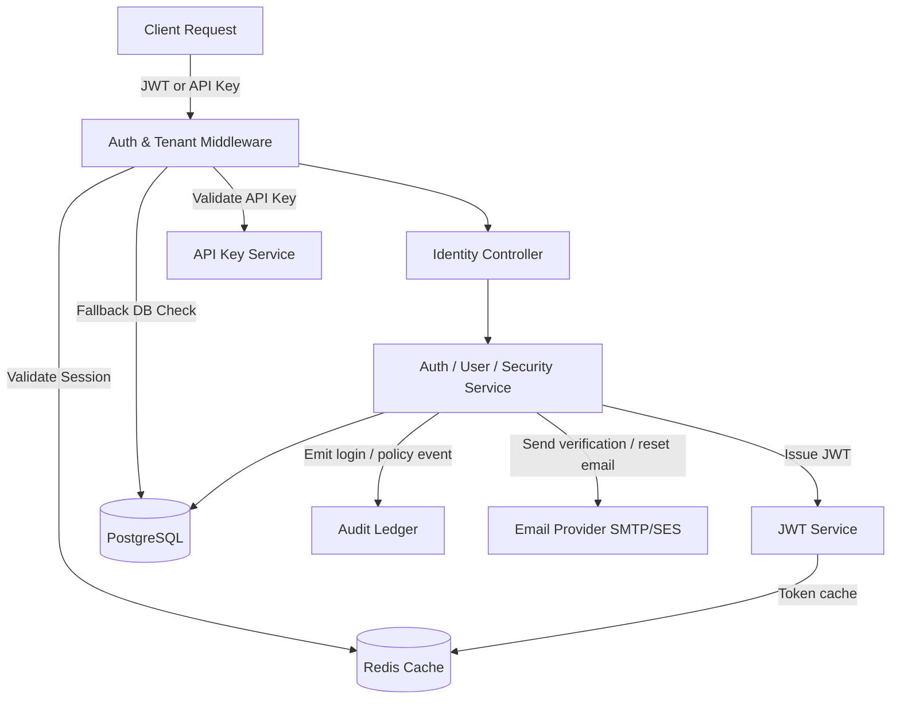

# QAssure Identity & Platform Service — Integration Testing Document

---

## 1. Integration Scope

Integration testing ensures the Identity Service coordinates correctly with all external systems and dependencies:

1. **PostgreSQL Database**: Verifying session creation, user status updates, role cascades, and transactional integrity.
2. **Redis Cache**: Confirming session token caching, invalidation on logout, and tenant cache behavior.
3. **Email Provider**: Verifying verification and password-reset emails are dispatched with correct tokens.
4. **JWT Infrastructure**: Ensuring tokens signed in the auth service are verifiable by all consuming services.
5. **API Key Service**: Verifying module API key validation, tenant cross-check, and module activation checks.
6. **Audit Service**: Confirming security events (login, role changes, password resets, access review decisions) are written to the audit ledger.

---

## 2. Integration Architecture

---

## 3. Integration Testing Scenarios

### 3.1 Scenario A: Session Validity Across Redis & PostgreSQL

**Goal**: Confirm that a revoked session is rejected even if the JWT signature is still technically valid.

**Steps**:
1. Login → Capture `access_token` and `session_id`.
2. Confirm session exists in `sessions` table with `revoked_at = NULL`.
3. Call `POST /auth/logout` with the token.
4. Confirm `revoked_at` is now set in PostgreSQL.
5. Confirm Redis session key for `session_id` is deleted.
6. Reuse the original `access_token` to call `GET /auth/me`.
7. **Verify**: Response is `401 SESSION_EXPIRED` — the middleware checks Redis/DB even for a valid JWT signature.

---

### 3.2 Scenario B: Role Permission DB Fallback After Token Issuance

**Goal**: Confirm that permission updates after login are enforced without requiring re-login.

**Steps**:
1. Login as a user with `users:read` permission. Token payload includes this permission.
2. Admin removes `users:read` from the user's role via `DELETE /permissions/:id`.
3. Without logging in again, call `GET /users/` with the original JWT.
4. **Verify**: The request is denied (403) because the `authorize` middleware falls back to a live DB permission check after the token-cached permission check misses on other resources, ensuring the DB is the source of truth for updated permissions.

---

### 3.3 Scenario C: Module SSO Token Lifecycle Integration

**Goal**: Validate the complete cross-service SSO handshake between Platform and an external Module.

**Steps**:
1. Super Admin enables Module A for Tenant X via `POST /tenants/:id/modules/:moduleId/enable`.
2. Register Module A's API key in the platform.
3. Tenant X user logs in → receives `access_token`.
4. User calls `POST /modules/moduleA-id/launch` with Bearer token → receives `launch_url` with `token`.
5. Module A backend calls `POST /modules/verify-launch-token` sending:
   - `X-API-Key: <moduleA-api-key>`, `Body: { token }`
6. **Verify**: 200 response with full user context (`user`, `tenant`, `roles`, `permissions`).
7. **Expiry test**: Wait 5+ minutes. Re-call step 5 → **401 Token expired**.
8. **Wrong API Key test**: Call step 5 with Module B's API key → **403 Module not authorized**.

---

### 3.4 Scenario D: Multi-Tenant Data Isolation

**Goal**: Confirm that Tenant A's resources are completely inaccessible to Tenant B.

**Steps**:
1. Create User A in Tenant A with role `Manager`.
2. Authenticate as Tenant B admin (separate JWT with different `tenant_id`).
3. `GET /users/:userA_id` with Tenant B's JWT and `x-tenant-id: <tenantB-id>` → **Verify**: 404 Not Found.
4. `GET /roles` with Tenant B's JWT → **Verify**: Returns only Tenant B's roles (not Tenant A's).
5. `GET /departments` with Tenant B's JWT → **Verify**: Returns only Tenant B's departments.

---

### 3.5 Scenario E: Access Review Campaign Full Lifecycle

**Goal**: Validate the complete access review flow from creation to execution.

**Steps**:
1. `POST /security/access-reviews` — Create a campaign scoped to all users.
2. `POST /security/access-reviews/:id/start` — Populate review items.
3. `GET /security/access-reviews/:id/items` — Fetch the list of users to review. Confirm at least one user.
4. `POST /security/access-reviews/:id/items/:itemId/decide` — Decide `revoke` for user U1.
5. `POST /security/access-reviews/:id/items/:itemId/decide` — Decide `certify` for user U2.
6. `POST /security/access-reviews/:id/execute` (Super Admin) — Execute decisions.
7. **Verify**: User U1's role has been removed from `user_roles`. User U2's role is unchanged.
8. **Verify**: Audit log entries exist for each revocation action.

---

### 3.6 Scenario F: API Key Module Activation Check

**Goal**: Confirm that a module's API key is rejected if the module is disabled for the tenant.

**Steps**:
1. Register Module B with an API key.
2. Do NOT enable Module B for Tenant Y.
3. Call any authenticated endpoint with `X-API-Key: <moduleB-key>` and `x-tenant-id: <tenantY-id>`.
4. **Verify**: Response is `403 MODULE_NOT_ACTIVE`.
5. Enable Module B for Tenant Y via `POST /tenants/:id/modules/:id/enable`.
6. Retry step 3.
7. **Verify**: Response is `200 OK` with full module context in `req.user`.

---

## 4. Integration Test Infrastructure Requirements

| Dependency | Requirement |
| :--- | :--- |
| **PostgreSQL** | Test database with all migrations applied. Seeded with a super admin user. |
| **Redis** | Running Redis instance (can use `ioredis-mock` for CI) |
| **Email Provider** | Use a test trap (e.g., Mailhog or Ethereal) to capture outgoing emails |
| **Environment** | `NODE_ENV=test` with `JWT_SECRET`, `DB_URL`, `REDIS_URL` configured |
| **Cleanup** | Each test suite should rollback or truncate affected tables after execution |
