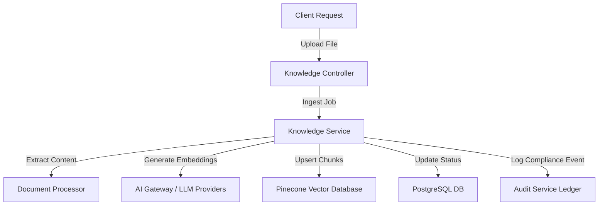

# Knowledge Service (RAG) - Integration Testing Document

---

## 1. Integration Scope
Integration testing ensures the Knowledge Service communicates correctly with other components in the system topology:
1.  **AI Gateway Service**: Verifying model provider config resolution, keys injection, and fallback routing.
2.  **Vector Store (Pinecone Database)**: Verifying connection stability, index creations, namespace writes, and queries.
3.  **Relational Database (PostgreSQL)**: Verifying document status updates, collection count increments, and search history logging.
4.  **Audit Service**: Verifying audit logs are recorded for security actions (such as collection creation or deletion).

---

## 2. Integration Architecture

---

## 3. Integration Testing Scenarios

### 3.1 Scenario A: Multimodal Fallback Processing
*   **Goal**: Ensure that if LLaVA is not configured, the ingestion pipeline falls back to standard text extraction instead of throwing an error.
*   **Steps**:
    1.  Call create collection with `processingMode="multimodal"`.
    2.  Temporarily disable or unconfigure the LLaVA client in settings.
    3.  Upload `manual.pdf` to the collection.
    4.  Verify that background processing succeeds and text chunks are populated via standard PDF parser.
    5.  Check that the document status updates to `completed` in PostgreSQL, with metadata indicating the fallback occurred.

### 3.2 Scenario B: Cross-Collection Search & Merging
*   **Goal**: Verify searching across multiple collections with different embedding dimensions merges results correctly.
*   **Steps**:
    1.  Create Collection A (using OpenAI dimension 1536) and Collection B (using Gemini dimension 768).
    2.  Ingest documents into both collections.
    3.  Call the search endpoint without a specific `collectionId` (global cross-collection query).
    4.  Verify the service:
        -   Groups collections by provider/model configuration.
        -   Generates embeddings for each group.
        -   Queries each Pinecone index in parallel.
        -   Merges and sorts candidates by score.
    5.  Verify the returned list contains results from both collections, sorted by score.

### 3.3 Scenario C: Multi-Tenant Tenant Context Leak Verification
*   **Goal**: Confirm that Tenant A cannot retrieve chunks belonging to Tenant B under any search parameters.
*   **Steps**:
    1.  Create collections for Tenant A and Tenant B.
    2.  Ingest a document containing the unique keyword `"TenantAlphaSecretCode"` into Tenant A's collection.
    3.  Authenticate a request with Tenant B's token.
    4.  Perform a search with the query `"TenantAlphaSecretCode"`.
    5.  Verify that the returned results are empty and no metadata leaks occur.
