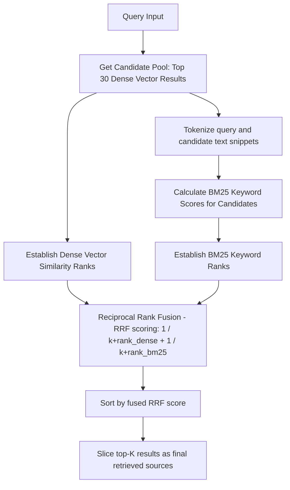

# QAssure Knowledge (RAG) Service
## Technical Knowledge Transfer (KT) Guide

Welcome to the technical Knowledge Transfer (KT) guide for the **Knowledge / RAG Service** of the QAssure Platform. This document outlines the service's architecture, route registry, request handling, validations, core service logic, database schemas, and integration with the AI Gateway and Vector databases.

---

## 1. Architectural Overview

The Knowledge Service provides a tenant-isolated Retrieval-Augmented Generation (RAG) system. It enables creating vector collections, ingesting documents (PDF, DOCX, XLSX, TXT, JSON, MD), chunking/embedding content, executing semantic/hybrid searches, and conducting history-aware contextual conversations with confidence scoring.

### Directory & Component Map

- **Routing Layer**: [knowledge.routes.js](file:///home/tech4biz/Downloads/Sibarchan/QAssure/QAssur-backend/src/routes/knowledge.routes.js) handles HTTP route definitions, Multer memory storage configuration for file uploads, request file type filtering, and maps authorization policies/permissions (`ai:create`, `ai:read`, `ai:update`, `ai:delete`).
- **Controller Layer**: [knowledge.controller.js](file:///home/tech4biz/Downloads/Sibarchan/QAssure/QAssur-backend/src/controllers/knowledge.controller.js) parses parameters, executes validation logic, formats HTTP responses, and handles server-side error mapping.
- **Service Layer**:
  - [knowledge.service.js](file:///home/tech4biz/Downloads/Sibarchan/QAssure/QAssur-backend/src/services/knowledge.service.js) contains core business logic: collection management, asynchronous document ingestion, chunking, embedding generation, semantic and cross-collection merging, hybrid search, and RAG pipelines.
- **AI Infrastructure (Gateway & Support Services)**:
  - [gateway.service.js](file:///home/tech4biz/Downloads/Sibarchan/QAssure/QAssur-backend/src/infrastructure/ai/gateway.service.js) resolves multi-tenant provider settings, API keys, and handles LLM model execution (e.g. Mistral, Qwen).
  - [embedding.service.js](file:///home/tech4biz/Downloads/Sibarchan/QAssure/QAssur-backend/src/infrastructure/ai/embedding.service.js) abstracts generating vectors via OpenAI, Gemini, or local models.
  - [document.processor.js](file:///home/tech4biz/Downloads/Sibarchan/QAssure/QAssur-backend/src/infrastructure/ai/document.processor.js) extracts raw text from files using PDF-parse, Mammoth (Word), and ExcelJS (Excel).
  - [chunker.service.js](file:///home/tech4biz/Downloads/Sibarchan/QAssure/QAssur-backend/src/infrastructure/ai/chunker.service.js) segments raw text into semantic paragraphs.
  - [vector-store.service.js](file:///home/tech4biz/Downloads/Sibarchan/QAssure/QAssur-backend/src/infrastructure/ai/vector-store.service.js) routes queries and upserts to Pinecone serverless indexes matching specific dimensions (e.g. 1536, 768, 1024).

---

## 2. System Interaction Workflows

### A. Document Ingestion Pipeline
When a user uploads a document, the process runs asynchronously to ensure high responsiveness. It supports two main modes:
1. **Standard Text Extraction Mode** (classic parsing)
2. **Multimodal Ingestion Mode** (LTTS: Rasterize PDF → YOLO layout detection → LLaVA visual description)

```mermaid
sequenceDiagram
    autonumber
    actor Client as Frontend Client
    participant Router as knowledge.routes
    participant Ctrl as knowledge.controller
    participant Svc as knowledge.service
    participant DocProc as document.processor
    participant Embed as embedding.service
    participant VS as vector-store.service
    database DB as PostgreSQL DB

    Client->>Router: POST /api/v1/ai/knowledge/documents (Multipart Form)
    Note over Router: Validates auth, tenant context, & MIME type
    Router->>Ctrl: uploadDocument(req, res)
    Ctrl->>Svc: ingestDocument(collectionId, fileBuffer, fileName, mimeType, context)
    Svc->>DB: Insert document into `knowledge_documents` (status = 'processing')
    Svc-->>Ctrl: Returns job receipt (status = 'processing')
    Ctrl-->>Client: 202 Accepted (queued for processing)

    Note over Svc: Spawns async background task (_processDocument)
    alt processingMode == 'multimodal'
        Svc->>DocProc: processBufferMultimodal(buffer, mimeType, fileName, context)
        Note over DocProc: Rasterize PDF to PNGs -> Detect regions via YOLO -> Transcribe via LLaVA
        DocProc-->>Svc: Extracted visual description text & metadata
    else processingMode == 'text' (Standard)
        Svc->>DocProc: processBuffer(buffer, mimeType, fileName)
        Note over DocProc: Extract text via PDF-parse / Mammoth / ExcelJS
        DocProc-->>Svc: Clean raw text & metadata
    end

    Svc->>Svc: Chunk text into paragraphs (chunkSize: 512)
    loop Embedding in batches (batch size: 100)
        Svc->>Embed: embedBatch(texts, config)
        Embed-->>Svc: List of Float32 vectors
    end

    Svc->>VS: upsert(vectors, namespace, dimension)
    Note over VS: Resolves/creates Pinecone index based on dimension
    VS-->>Svc: Upsert result (index name, index host)

    Svc->>DB: Update `knowledge_documents` (status = 'completed', word_count, chunk_count, metadata, processed_at)
    Svc->>DB: Increment counts in `knowledge_collections` (document_count, chunk_count)
```

### B. Hybrid Retrieval (Dense + BM25 + RRF)
To catch both semantic matches (synonyms, conceptual paraphrasing) and strict keyword matches (codes, abbreviations like CAPA or SOP-1234), QAssure uses a Hybrid Retrieval workflow:



### C. LTTS-Style RAG Answering Flow
The RAG pipeline provides context-grounded conversational completions, incorporating history-aware querying, intent classification, hybrid retrieval, Mistral-based answering, and Qwen-based confidence scoring.

```mermaid
sequenceDiagram
    autonumber
    actor Client as Frontend Client
    participant Ctrl as knowledge.controller
    participant Svc as knowledge.service
    participant Gate as gateway.service
    participant Provider as LLM Provider (Mistral / Qwen)
    database DB as PostgreSQL DB

    Client->>Ctrl: POST /api/v1/ai/knowledge/rag-answer { query, collectionId, conversationHistory, ... }
    Ctrl->>Svc: ragAnswer(query, context)
    
    alt Has Conversation History
        Svc->>Svc: Prepend prior user turns to current query (History-Aware Retrieval Query)
    end

    alt Intent is Summarization / Document-level
        Svc->>Svc: Intent routing: Request broad retrieval (topK=50, minScore=0)
    else Intent is Specific
        Svc->>Svc: Call _hybridRetrieve (Dense + BM25 + RRF)
    end

    Svc->>Svc: Construct context block from top sources
    
    Svc->>Gate: createCompletion(Mistral7b system prompt + context + history + query)
    Gate->>Provider: Generate Answer (Mistral 7B)
    Provider-->>Gate: Text response
    Gate-->>Svc: Answer

    Svc->>Gate: createCompletion(Qwen7B evaluator prompt + context + query + answer)
    Gate->>Provider: Score Answer Grounding (Qwen 7B)
    Provider-->>Gate: Numerical rating (0.0 to 1.0)
    Gate-->>Svc: Confidence Score

    Svc->>DB: Log search history to `knowledge_search_history` (search_type = 'context')
    Svc-->>Ctrl: Returns { answer, confidence, sources, metadata }
    Ctrl-->>Client: 200 OK
```

---

## 3. Route Definition and Validation Reference

All routes require user authentication (`authenticate`) and tenant scope initialization (`tenantContext`). Route handlers enforce granular RBAC permissions.

| Method | Path | Permission | File / Multer Validation | Description |
| :--- | :--- | :--- | :--- | :--- |
| **POST** | `/collections` | `ai:create` | `req.body`: `name` (required), `processingMode` (must be `text` or `multimodal`). | Creates a knowledge collection. Resolves embedding configs dynamically. |
| **GET** | `/collections` | `ai:read` | `req.query`: `page` (default 1), `limit` (default 20), `status` (default 'active'). | Lists active collections for the current tenant. |
| **GET** | `/collections/:id` | `ai:read` | `req.params`: `id` (UUID). | Retrieves metadata for a single collection. |
| **PUT** | `/collections/:id` | `ai:update` | `req.params`: `id`, `req.body`: `name`, `description`, `metadata`. | Updates collection name, description, and metadata fields. |
| **DELETE** | `/collections/:id` | `ai:delete` | `req.params`: `id`. | Deletes collection, its documents, vector store data, and search logs. |
| **GET** | `/collections/:collectionId/documents` | `ai:read` | `req.params`: `collectionId`. `req.query`: `page`, `limit`, `status`. | Lists ingested documents for a collection with vector metadata. |
| **POST** | `/documents` | `ai:create` | Multer limit: **50MB**. MIME types: PDF, DOCX, DOC, TXT, MD, JSON. | Uploads and queues a document for background text extraction & vectorization. |
| **GET** | `/documents/:id/status` | `ai:read` | `req.params`: `id`. | Returns document status (`processing`, `completed`, `failed`). |
| **DELETE** | `/documents/:id` | `ai:delete` | `req.params`: `id`. | Deletes a document from the database and removes all chunks from Pinecone. |
| **POST** | `/search` | `ai:read` | `req.body`: `query` (required), `collectionId`, `documentIds`, `topK`, `minScore`. | Executes standard semantic search over collections or specific documents. |
| **POST** | `/search/context` | `ai:read` | `req.body`: `query` (required), `collectionId`, `documentIds`, `topK`, `minScore`. | Executes search and compiles chunks into a unified string context block. |
| **POST** | `/rag-answer` | `ai:read` | `req.body`: `query` (required), `collectionId`, `documentIds`, `conversationHistory` (optional array). | End-to-end RAG API. Retrieves context, answers via Mistral, scores via Qwen. |
| **GET** | `/search/history` | `ai:read` | `req.query`: `page`, `limit`, `collectionId`, `documentId`. | Lists search log entries for audit trails and history tracking. |
| **GET** | `/search/history/:id` | `ai:read` | `req.params`: `id`. | Fetches a specific historical search entry. |
| **GET** | `/stats` | `ai:read` | None. | Aggregates Pinecone index stats (record counts, namespaces) across dimensions. |

---

## 4. Key Implementation Details

### A. Multi-Tenant Defense-in-Depth
Strict tenant separation is implemented at both relational and vector database layers:
- **Relational Isolation**: Every database query includes a `tenant_id` filter (e.g. `WHERE tenant_id = $1` in native queries, or handled transparently in model scopes).
- **Vector Isolation**: Vectors are isolated using Pinecone namespaces named according to the pattern `{tenantId}_{collectionId}`. Upserts, queries, and deletions are explicitly restricted to the client's current namespace.

### B. Dynamic Multi-Index Routing
Different embedding models produce vectors of different sizes (e.g. OpenAI's `text-embedding-3-small` is 1536, Google's `gemini-embedding-001` is 768, and BGE-M3 is 1024).
- To support multi-model capability, `vector-store.service.js` dynamically routes operations to specific indexes based on vector dimensions.
- Indexes are named `{indexBaseName}-{dimension}` (e.g. `qassure-knowledge-1536`).
- If a tenant requests an embedding size that does not yet have an index, the service uses a mutex (`creationLocks` Map) to handle lazy initialization, preventing race conditions from concurrently creating duplicate indexes.

```javascript
// Resolve the Pinecone index for a given dimension
async _getIndexForDimension(dimension) {
  if (!this.initialized) await this.initialize();
  if (dimension === null || dimension === undefined) {
    const cached = this.indexCache.get(null);
    if (cached) return cached;
    throw new Error("No default index and no dimension specified");
  }
  if (this.indexCache.has(dimension)) {
    return this.indexCache.get(dimension);
  }
  // Safe concurrency lock to avoid API conflicts during creation
  if (this.creationLocks.has(dimension)) {
    return this.creationLocks.get(dimension);
  }
  const creationPromise = this._resolveOrCreateIndex(dimension);
  this.creationLocks.set(dimension, creationPromise);
  try {
    const result = await creationPromise;
    this.indexCache.set(dimension, result);
    return result;
  } finally {
    this.creationLocks.delete(dimension);
  }
}
```

### C. Hybrid Retrieval and Fusion
Standard vector similarity searches can miss exact matches for specific terminology (such as system error codes, chemical formulas, or standard operating procedure codes like `SOP-782`).
- To prevent this, `_hybridRetrieve` fetches a candidate pool of 30 dense vector matches.
- It tokenizes the candidate texts and calculates keyword scores using the BM25 formula.
- Dense similarity rankings and BM25 scores are fused using **Reciprocal Rank Fusion (RRF)**:
  $$\text{RRF Score} = \frac{1}{60 + \text{Rank}_{\text{dense}}} + \frac{1}{60 + \text{Rank}_{\text{BM25}}}$$
- The candidates are re-sorted by their fused RRF scores, and the top-K chunks are selected as context.

### D. File Format Parsing Strategies
Extracted text is cleaned to remove excessive newlines and normalized to spaces. Files are parsed using specific packages:
- **PDF**: Handled using `pdf-parse`, wrapped to support classic versions and newer Class-based ESM structures.
- **DOCX / DOC**: Parsed via `mammoth` to extract clean text without styling overhead.
- **XLSX / XLS**: Excel sheets are converted to CSV layout format using `exceljs`, converting tables into comma-separated text lines to maintain rows and column relations.
- **JSON**: Read as text and formatted for readability.
- **TXT / MD**: Read directly as raw UTF-8 string data.

### E. Multimodal Ingestion Pipeline (LTTS Style)
For complex document formats (such as layout-heavy PDFs containing charts, diagrams, and tables):
- The document is rasterized into page-level PNG images at 200 DPI using `pdf2pic`.
- A YOLO visual model runs object detection to identify coordinates (`bbox`) and labels for structural elements (e.g. tables, figures, texts).
- These regions and page images are sent to a **LLaVA multimodal model** with a prompt requesting a detailed page description. This description is saved as the indexable text content.
- If the multimodal services are offline, the pipeline automatically falls back to standard text extraction.

---

## 5. Database Schema Reference

The RAG service relies on three primary tables mapped via Sequelize models in `src/sequelize-models/`:

### A. `knowledge_collections`
Maintains the metadata, configuration, and state of vector databases.

```sql
CREATE TABLE knowledge_collections (
  id UUID PRIMARY KEY DEFAULT gen_random_uuid(),
  tenant_id UUID NOT NULL REFERENCES tenants(id) ON DELETE CASCADE,
  name VARCHAR(255) NOT NULL,
  description TEXT,
  metadata JSONB DEFAULT '{}',
  document_count INTEGER DEFAULT 0,
  chunk_count INTEGER DEFAULT 0,
  status VARCHAR(50) DEFAULT 'active',
  embedding_model VARCHAR(255),
  embedding_dimension INTEGER,
  embedding_provider VARCHAR(100),
  processing_mode VARCHAR(20) DEFAULT 'text',
  created_by UUID REFERENCES users(id) ON DELETE SET NULL,
  created_at TIMESTAMP WITH TIME ZONE NOT NULL DEFAULT CURRENT_TIMESTAMP,
  updated_at TIMESTAMP WITH TIME ZONE NOT NULL DEFAULT CURRENT_TIMESTAMP
);

CREATE INDEX idx_knowledge_collections_tenant ON knowledge_collections(tenant_id);
CREATE INDEX idx_knowledge_collections_status ON knowledge_collections(tenant_id, status);
```

### B. `knowledge_documents`
Stores document ingestion state, sizes, MIME types, processing durations, and vector hosts.

```sql
CREATE TABLE knowledge_documents (
  id UUID PRIMARY KEY DEFAULT gen_random_uuid(),
  collection_id UUID NOT NULL REFERENCES knowledge_collections(id) ON DELETE CASCADE,
  tenant_id UUID NOT NULL REFERENCES tenants(id) ON DELETE CASCADE,
  file_name VARCHAR(500) NOT NULL,
  mime_type VARCHAR(100) NOT NULL,
  file_size INTEGER,
  word_count INTEGER,
  chunk_count INTEGER,
  status VARCHAR(50) DEFAULT 'pending', -- 'pending', 'processing', 'completed', 'failed'
  error_message TEXT,
  metadata JSONB DEFAULT '{}', -- Contains enriched data (model parameters, vector host, page count)
  created_by UUID REFERENCES users(id) ON DELETE SET NULL,
  processed_at TIMESTAMP WITH TIME ZONE,
  created_at TIMESTAMP WITH TIME ZONE NOT NULL DEFAULT CURRENT_TIMESTAMP,
  updated_at TIMESTAMP WITH TIME ZONE NOT NULL DEFAULT CURRENT_TIMESTAMP
);

CREATE INDEX idx_knowledge_documents_collection ON knowledge_documents(collection_id);
CREATE INDEX idx_knowledge_documents_tenant ON knowledge_documents(tenant_id);
CREATE INDEX idx_knowledge_documents_status ON knowledge_documents(collection_id, status);
```

### C. `knowledge_search_history`
Logs search transactions, query patterns, semantic contexts, and matching results.

```sql
CREATE TABLE knowledge_search_history (
  id UUID PRIMARY KEY DEFAULT gen_random_uuid(),
  tenant_id UUID NOT NULL REFERENCES tenants(id) ON DELETE CASCADE,
  user_id UUID REFERENCES users(id) ON DELETE SET NULL,
  query TEXT NOT NULL,
  collection_id UUID REFERENCES knowledge_collections(id) ON DELETE SET NULL,
  document_ids JSONB DEFAULT '[]',
  results JSONB DEFAULT '[]',
  context TEXT,
  metadata JSONB DEFAULT '{}',
  search_type VARCHAR(50) DEFAULT 'semantic', -- 'semantic' or 'context' (RAG)
  created_at TIMESTAMP WITH TIME ZONE NOT NULL DEFAULT CURRENT_TIMESTAMP,
  updated_at TIMESTAMP WITH TIME ZONE NOT NULL DEFAULT CURRENT_TIMESTAMP
);

CREATE INDEX idx_search_history_tenant ON knowledge_search_history(tenant_id);
CREATE INDEX idx_search_history_collection ON knowledge_search_history(collection_id);
CREATE INDEX idx_search_history_created ON knowledge_search_history(created_at DESC);
```

---

## 6. KT Cheat Sheet: Common Developer Tasks

### A. How to Register a New Embedding Model mapping?
If you add support for a new model, you must map its vector dimension size inside `knowledge.service.js` under the `_getDimensionForModel` helper method. This allows the routing engine to target or create the correct Pinecone index.

```javascript
// src/services/knowledge.service.js
_getDimensionForModel(model) {
  const dimensionMap = {
    "text-embedding-3-small": 1536,
    "text-embedding-3-large": 3072,
    "text-embedding-ada-002": 1536,
    "gemini-embedding-001": 768,
    // Add new model mappings here:
    "custom-pharma-embedding": 1024 
  };
  return dimensionMap[model] || null;
}
```

### B. How to Support parsing for a New File Type?
1. Update `supportedTypes` in the `DocumentProcessor` constructor in [document.processor.js](file:///home/tech4biz/Downloads/Sibarchan/QAssure/QAssur-backend/src/infrastructure/ai/document.processor.js):
   ```javascript
   this.supportedTypes = ['.pdf', '.docx', '.doc', '.txt', '.md', '.json', '.xlsx', '.xls', '.csv'];
   ```
2. Update the switch block inside `process(filePath)` and the mimetype checks inside `processBuffer(buffer, mimeType)` to call your custom parser (e.g. `csv-parse` or custom processing logic):
   ```javascript
   case 'text/csv':
     text = await this._processCsvBuffer(buffer);
     break;
   ```
3. Add the new MIME type to the `allowedTypes` array in `knowledge.routes.js` to allow uploading it through the Multer filter.

### C. Testing and Validation Playground
You can test the RAG endpoints using curl or Postman.
- **Upload Document**:
  ```bash
  curl -X POST http://localhost:3000/api/v1/ai/knowledge/documents \
    -H "Authorization: Bearer <token>" \
    -F "collectionId=<collection_uuid>" \
    -F "file=@/path/to/document.pdf"
  ```
- **Ask a Question (RAG Answer)**:
  ```bash
  curl -X POST http://localhost:3000/api/v1/ai/knowledge/rag-answer \
    -H "Authorization: Bearer <token>" \
    -H "Content-Type: application/json" \
    -d '{
      "query": "What are the CAPA guidelines?",
      "collectionId": "<collection_uuid>",
      "answerProvider": "Mistral7b",
      "confidenceProvider": "qwen7b"
    }'
  ```
