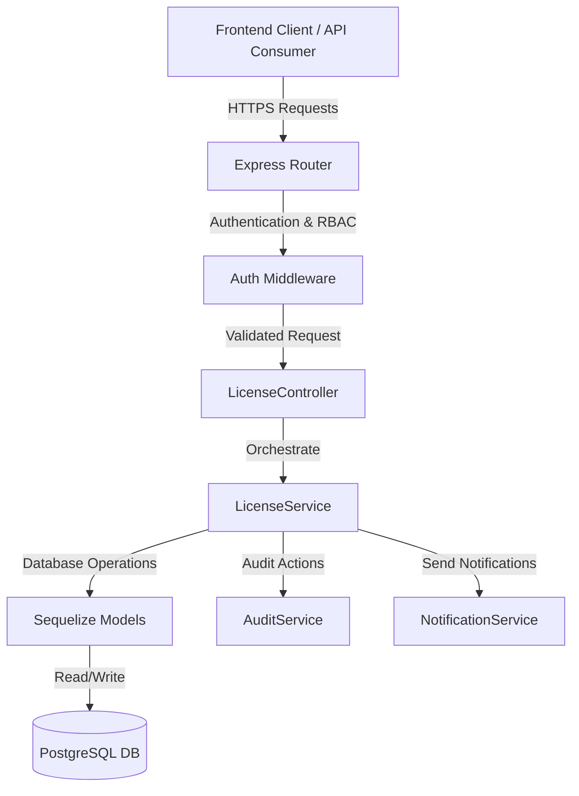

# QAssure License Service — Architectural Design Document

---

## 1. Architectural Vision

The **License Service** is a core administrative module of the QAssure Platform. It manages the validation, activation, lifecycle, usage tracking, and feature control of client licenses. By providing rigid boundary validation and tenant-based limit checks, the service guarantees that clients comply with their subscription scopes (user counts, storage volumes, AI token allocations, and active modules like AiCE, SQM, and DHF).

### Key Capabilities:
1. **Reference Gating**: Enforces standardized tiers (`starter`, `professional`, `enterprise`, `custom`) and license types (`subscription`, `perpetual`, `trial`, `freemium`).
2. **Dynamic License Generation**: Utilizes PG PL/pgSQL database procedures (`generate_license_key()`) to compile secure, randomized, checksum-bounded license keys.
3. **Activation Lifecycle**: Manages instance/device-fingerprint bindings (`license_activations`) for local installations or dedicated multi-tenant deployments.
4. **Real-time Usage Auditing**: Frequently increments counts (active users, total projects, storage GB, AI tokens) in `license_usage_current` and takes monthly snapshots in `license_usage` to identify tier breaches.
5. **Tamper-Evident Audit Logging**: Commits license events (`activated`, `revoked`, `limits_updated`) to an immutable `license_audit_log` with hash chains for compliance.

---

## 2. Component Diagram

The License service interacts with the database layer, standard middlewares, and other administrative services as illustrated below:

---

## 3. Database Schema Design

The SQL schema defined in `phase24_license_billing.sql` maps the relational definitions:

### 3.1 Reference Tables

#### `license_types`
*   `code` (VARCHAR(50), PK): Unique type code (e.g. `subscription`, `perpetual`, `trial`, `freemium`, `enterprise`).
*   `name` (VARCHAR(100)): Human-readable label.
*   `description` (TEXT): Details of the access parameters.
*   `is_active` (BOOLEAN): Activity toggle.

#### `license_tiers`
*   `code` (VARCHAR(50), PK): Tier label (e.g. `starter`, `professional`, `enterprise`, `custom`).
*   `name` (VARCHAR(100)): Tier name.
*   `description` (TEXT): Details of included limits.
*   `max_users` (INTEGER): Upper limit on active user accounts.
*   `max_projects` (INTEGER): Limit on projects.
*   `max_ai_tokens` (INTEGER): Month-to-date AI token budget.
*   `max_storage_gb` (INTEGER): Storage limit.
*   `features` (JSONB): Array of active module flags.

#### `licensable_applications`
*   `code` (VARCHAR(50), PK): Module code (e.g. `platform`, `aice`, `aich`, `dhf`, `sqm`, `pms`).
*   `name` (VARCHAR(100)): Module name.
*   `requires_platform` (BOOLEAN): Flag indicating if base platform license is needed.

### 3.2 Transactional Tables

#### `licenses`
*   `id` (UUID, PK): Unique license identifier.
*   `tenant_id` (UUID, FK): Target tenant ID.
*   `license_key` (VARCHAR(100), Unique): Encoded license key.
*   `license_type` (VARCHAR(50), FK): Links to `license_types`.
*   `tier` (VARCHAR(50), FK): Links to `license_tiers`.
*   `application` (VARCHAR(50), FK): Links to `licensable_applications`.
*   `status` (VARCHAR(30)): `pending`, `active`, `warning`, `grace`, `suspended`, `revoked`, `expired`.
*   `activation_state` (VARCHAR(30)): `not_activated`, `pending_activation`, `activated`, `deactivated`.
*   `issued_at` / `activated_at` / `starts_at` / `expires_at` (TIMESTAMPTZ).
*   `limits` (JSONB): Override settings for user/storage boundaries.
*   `features` (JSONB): Enabled features.

#### `license_activations`
*   Tracks device-specific activation runs. Includes: `instance_id`, `device_fingerprint`, `ip_address`, `user_agent`, and `activated_at` timestamps.

#### `license_usage` & `license_usage_current`
*   Tracks current MTD usage vs limits (users count, project count, storage, AI tokens).

#### `license_audit_log`
*   Holds historical logs, previous/new JSON states, and tamper-evident hashes.

---

## 4. Integration Points

1. **Auth Middleware Validation Gate**: The authentication layer uses the `license` schema validation to restrict access. If a tenant's license status becomes `suspended` or `revoked`, the auth middleware automatically blocks API calls with `402 Payment Required` or `403 Forbidden`.
2. **Notification Service Dispatcher**: When a license transitions into a `warning` or `grace` state (computed daily via background cron tasks), the system schedules reminder entries in the `renewal_notifications` table.
3. **Audit Log System**: Relies on a post-update callback hook to log state change details, capturing the IP address, user-agent, and email of the administrator modifying the boundaries.
