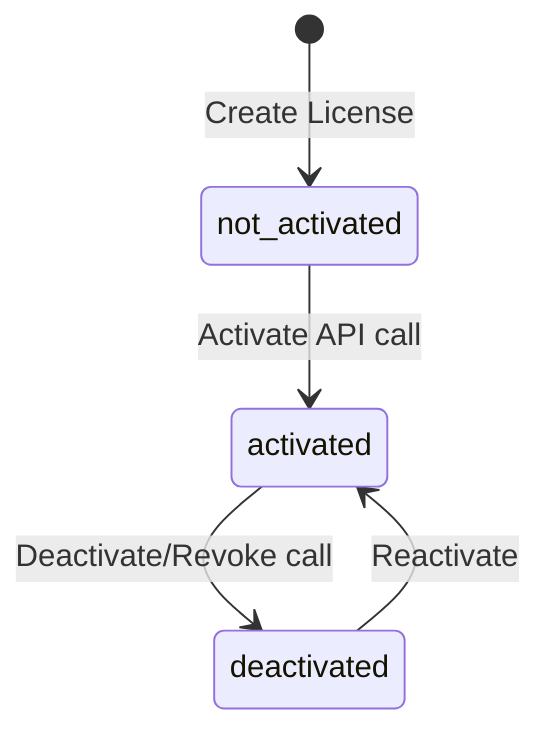

# QAssure License Service — Functional Documentation

---

## 1. License Lifecycle & Activation States

Licenses in QAssure transition through a series of system-managed and admin-managed states to ensure operational security.

### 1.1 Activation States
*   **`not_activated`**: Initial state of a newly generated license key. It is not yet bound to a tenant instance.
*   **`pending_activation`**: Used for offline validation flows where a verification file is generated but not yet confirmed.
*   **`activated`**: The license has been successfully bound to a tenant instance, noting the `device_fingerprint` and host IP.
*   **`deactivated`**: The license has been deactivated (e.g. during an instance migration or hardware change) to allow reactivation elsewhere.

### 1.2 Enforcement Levels
The database trigger `trg_license_status_update` and helper SQL functions evaluate dates and usage boundaries to enforce access rules:
*   **`active`**: Valid license within the active date range.
*   **`warning`**: Triggered when a license is within 30 days of its `expires_at` date. Warning prompts appear in UI headers, but features remain fully unlocked.
*   **`grace`**: Triggered immediately after `expires_at` is passed. Access is permitted for the duration of the `grace_period_days` (default 30 days) to prevent service interruptions during renewal processing.
*   **`suspended`**: Triggered when the grace period ends. User logins are allowed, but writing data or executing modules is blocked.
*   **`expired`**: The license date has passed and no grace period remains. Access is blocked.
*   **`revoked`**: Manually set by a Super Admin to terminate access immediately (e.g. for non-payment or contract breach).

---

## 2. Limit Enforcement & Threshold Alerts

The service tracks consumption metrics (Active Users, Projects, AI Tokens, Storage GB) against license allocations:

1.  **Soft Limits**: Reaching **80%** of an allocated limit sends an automated email notification to the Tenant Admin and logs a warning in the dashboard.
2.  **Hard Limits**: Reaching **100%** of an allocated limit blocks further operations. For example, if `max_users` is 25, creating a 26th user account will be blocked by the API with an error message: `LICENSE_LIMIT_EXCEEDED: Active user threshold reached`.

---

## 3. Compliance and Auditing

To comply with FDA 21 CFR Part 11 requirements, all changes to a license key's configuration, validity dates, features, or states are logged in an **immutable ledger** (`license_audit_log`):
*   **Tamper Detection**: Each entry registers the previous state, the new state, the user context (IP, User Agent, Operator Email), and is protected by hash chains to prevent modification.
*   **Audit Scope**: Captures changes such as `upgraded`, `downgraded`, `limits_updated`, `revoked`, and `grace_warning_triggered`.
