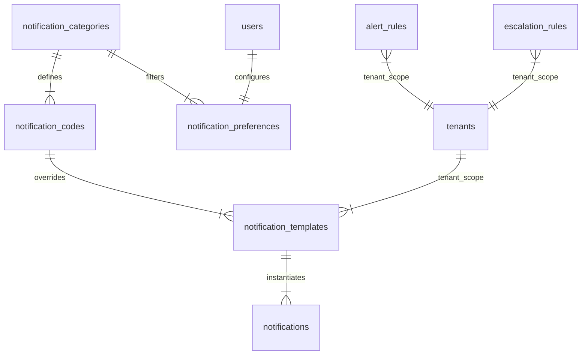
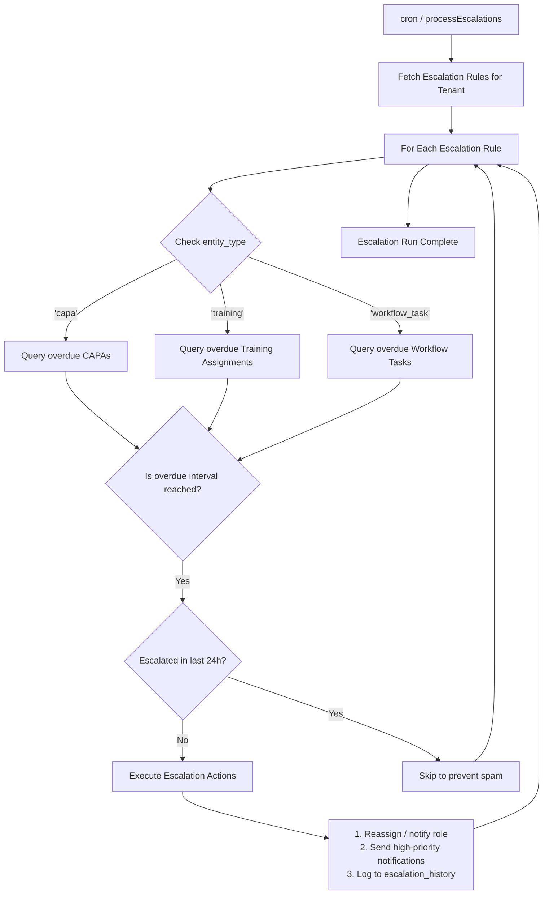

# QAssure Notification Service

## Technical Knowledge Transfer (KT) Guide

Welcome to the technical Knowledge Transfer (KT) guide for the **Notification Service** of the QAssure Platform. This document outlines the service's architecture, routes, database schemas, delivery pipelines, preference matching, WebSocket integration, escalation rules, and cross-service triggers.

---

## 1. Architectural Overview

The QAssure Notification Service is a centralized, multi-tenant, and asynchronous orchestration engine that manages the lifecycle of system alerts and notifications. It supports multi-channel delivery (real-time in-app pushes via WebSockets and email dispatches via a dedicated SMTP/email service) while respecting granular tenant-level templates and user preference controls.

### Directory & Component Map

- **Routing Layer**: [notification.routes.js](file:///home/tech4biz/Downloads/Sibarchan/QAssure/QAssur-backend/src/routes/notification.routes.js) defines the HTTP endpoints, middleware chains (authentication, tenant context), and maps RBAC/Super Admin policies.
- **Controller Layer**:
  - [notification.controller.js](file:///home/tech4biz/Downloads/Sibarchan/QAssure/QAssur-backend/src/controllers/notification.controller.js) handles endpoints for user notifications (fetching, read/dismiss states), preferences, admin templates, alert rules, and manual notification triggers.
  - [notification_category.controller.js](file:///home/tech4biz/Downloads/Sibarchan/QAssure/QAssur-backend/src/controllers/notification_category.controller.js) handles endpoints for notification master categories and specific event codes.
- **Service Layer**:
  - [notification.service.js](file:///home/tech4biz/Downloads/Sibarchan/QAssure/QAssur-backend/src/services/notification.service.js) coordinates template resolution (tenant vs. system-wide defaults), variable interpolation, preferences filtering (quiet hours, category channels), escalation scheduling, and missing-template alerts.
  - [notification_category.service.js](file:///home/tech4biz/Downloads/Sibarchan/QAssure/QAssur-backend/src/services/notification_category.service.js) manages the master data system (categories and code contracts) and handles auto-seeding user notification preferences on new module assignments.
- **Infrastructure Layer**:
  - [websocket/socket.service.js](file:///home/tech4biz/Downloads/Sibarchan/QAssure/QAssur-backend/src/infrastructure/websocket/socket.service.js) manages active real-time Socket.io connections, performs token-based handshake authentication, assigns users to dedicated tenant and user rooms, and pushes live notifications and updated unread counts.

---

## 2. Database Schema & Master Tables Map

The notification architecture is backed by several tables that govern categories, codes, custom templates, logs, rules, and user preferences:



### Table Definitions

#### 1. `notification_categories`
Stores high-level functional groups for classification (e.g. `capa`, `document`, `training`).
- `id` (UUID, PK)
- `name` (VARCHAR) - Display label (e.g. `'CAPA'`).
- `code` (VARCHAR, Unique) - Reference code (e.g. `'capa'`).
- `description` (TEXT)
- `module_id` (UUID, FK -> `modules`) - Link to module licensing.
- `is_active` (BOOLEAN) - Default true.

#### 2. `notification_codes`
Defines the individual trigger contract and the required variable fields.
- `id` (UUID, PK)
- `category_id` (UUID, FK -> `notification_categories`)
- `code` (VARCHAR, Unique) - System trigger key (e.g. `'capa_assigned'`).
- `name` / `description` (VARCHAR/TEXT)
- `default_channels` (VARCHAR[]) - Defaults to `['in_app', 'email']`.
- `default_priority` (VARCHAR) - `'low'`, `'normal'`, `'high'`, or `'urgent'`.
- `variables` (JSONB) - Contract of supported variables (e.g. `["capa_number", "title"]`).
- `is_active` (BOOLEAN)

#### 3. `notification_templates`
Contains the actual title and message markup. Tenant admins can override system defaults.
- `id` (UUID, PK)
- `tenant_id` (UUID, FK -> `tenants`, Nullable) - `NULL` denotes system-wide fallback templates.
- `code` (VARCHAR) - Refers to a `notification_code`.
- `name` / `category` (VARCHAR)
- `title_template` (VARCHAR) - Mustache-style title (e.g. `'Added to Project: {{project_name}}'`).
- `message_template` (TEXT) - In-app notification text.
- `email_subject_template` (VARCHAR)
- `email_body_template` (TEXT) - HTML email markup.
- `default_priority` (VARCHAR)
- `channels` (VARCHAR[]) - Target delivery channels.
- `module_id` (UUID, FK -> `modules`)
- `is_active` (BOOLEAN)

#### 4. `notifications`
Persistent storage of delivered messages.
- `id` (UUID, PK)
- `tenant_id` (UUID, FK -> `tenants`)
- `user_id` (UUID, FK -> `users`)
- `title` / `message` (VARCHAR/TEXT)
- `notification_type` (VARCHAR) - `'info'`, `'success'`, `'warning'`, `'alert'`.
- `category` (VARCHAR)
- `priority` (VARCHAR)
- `is_read` / `read_at` (BOOLEAN/TIMESTAMP)
- `is_dismissed` / `dismissed_at` (BOOLEAN/TIMESTAMP)
- `action_url` (VARCHAR) - Redirection landing link (e.g. `/capa/detail-uuid`).
- `entity_type` / `entity_id` / `entity_name` (VARCHAR/UUID/VARCHAR) - Source resource links.
- `template_id` (UUID, FK -> `notification_templates`)
- `created_by` (UUID, FK -> `users`)
- `expires_at` (TIMESTAMP)

#### 5. `notification_preferences`
Contains granular user preferences, including quiet hours and custom channel flags.
- `id` (UUID, PK)
- `tenant_id` (UUID, FK -> `tenants`)
- `user_id` (UUID, FK -> `users`, Unique)
- `category_preferences` (JSONB) - Map of category codes to custom preferences:
  ```json
  {
    "capa": { "in_app": true, "email": true },
    "document": { "in_app": true, "email": false }
  }
  ```
- `quiet_hours_enabled` (BOOLEAN)
- `quiet_hours_start` / `quiet_hours_end` (TIME) - Format: `'HH:MM:SS'` (UTC).
- `timezone` (VARCHAR) - Defaults to `'UTC'`.

#### 6. `alert_rules` & `escalation_rules`
Defines automation configurations for system events.
- **Alert Rules**: Used to track user events or alert administrators when system states exceed thresholds.
- **Escalation Rules**: Defines escalation logic (reassigns, role notifications, status warnings) for CAPAs, Training Assignments, or Workflows approaching/past due date milestones.

---

## 3. Core Delivery Pipeline (`sendFromTemplate`)

The primary entry point for sending notifications is `sendFromTemplate()`. Below is the logical orchestration sequence when an external service calls the notification system:

```mermaid
sequenceDiagram
    autonumber
    actor Service as External Service
    participant NS as notification.service
    database DB as PostgreSQL DB
    participant WS as socket.service
    participant Email as email.service

    Service->>NS: sendFromTemplate(tenantId, userId, templateCode, variables, options)
    
    rect rgb(240, 245, 255)
        Note over NS: 1. Template Resolution
        NS->>DB: query notification_templates WHERE code = templateCode
        Note over NS: Checks for Tenant Override first, falls back to System Global (tenant_id IS NULL)
        alt Template Not Found
            NS->>NS: _alertMissingTemplate(tenantId, templateCode)
            NS-->>Service: Return null (Silent Fallback)
        end
    end

    rect rgb(245, 250, 245)
        Note over NS: 2. Variable Interpolation
        NS->>NS: _renderTemplate(template, variables)
        Note over NS: Evaluates Mustache templates {{variable}} with fallback to raw values
    end

    rect rgb(255, 245, 240)
        Note over NS: 3. Preference Matching
        NS->>DB: query user status, quiet hours, & category_preferences
        Note over NS: Check if User status = 'active'
        Note over NS: Check Category switches (e.g. capa.in_app = true)
        Note over NS: Check Quiet Hours (if enabled, holds email delivery)
    end

    rect rgb(245, 240, 245)
        Note over NS: 4. Dispatch Channel: In-App
        opt If In-App Delivery Allowed
            NS->>DB: INSERT INTO notifications
            NS->>WS: pushNotification(userId, notification)
            NS->>WS: pushUnreadCount(userId, tenantId)
            Note over WS: Sends socket packet over 'user:userId' room
        end
    end

    rect rgb(255, 250, 240)
        Note over NS: 5. Dispatch Channel: Email
        opt If Email Delivery Allowed & Not in Quiet Hours
            NS->>Email: send(user.email, subject, body, tenantId)
        end
    end

    NS-->>Service: Returns { success: true, notificationId }
```

---

## 4. Real-Time WebSocket Infrastructure

QAssure uses **Socket.io** to provide immediate updates in the UI (badge count bumps, push alerts).

- **Authentication Gate**: Sockets authenticate during connection handshakes via the `Authorization` header containing the JWT token.
- **Tenant Isolation**: On successful authentication, sockets join two specific rooms:
  1. `user:${userId}` — For targeted individual notifications.
  2. `tenant:${tenantId}` — For tenant-wide broadcasts.
- **Unread Count Updates**: When a notification is marked read or dismissed (either via REST API or WebSocket triggers), `pushUnreadCount` recalculates the count and publishes the new integer:
  ```javascript
  socket.emit('unread_count', { count });
  ```

---

## 5. Escalation Rule Processing Engine

The escalation processor handles automated warnings and assignment transitions for overdue tasks. It is run either programmatically or via a background cron scheduler.



---

## 6. Route Definition & Reference

All endpoints are authenticated and enforce tenant isolation. Endpoints under `/categories` are restricted to Super Admins.

| Method | Endpoint | Authorization | Description |
| :--- | :--- | :--- | :--- |
| **GET** | `/api/v1/notifications/me` | Authenticated | Lists in-app notifications for the logged-in user. |
| **GET** | `/api/v1/notifications/me/unread-count` | Authenticated | Returns the integer count of active unread notifications. |
| **PUT** | `/api/v1/notifications/me/read-all` | Authenticated | Marks all unread user notifications as read. |
| **PUT** | `/api/v1/notifications/me/dismiss-all` | Authenticated | Dismisses (hides) all notifications for the user. |
| **PUT** | `/api/v1/notifications/:id/read` | Authenticated | Marks a specific notification as read. |
| **PUT** | `/api/v1/notifications/:id/dismiss` | Authenticated | Dismisses a specific notification. |
| **GET** | `/api/v1/notifications/preferences` | Authenticated | Retrieves the user's notification preferences. |
| **PUT** | `/api/v1/notifications/preferences` | Authenticated | Updates preference toggles & quiet hour values. |
| **GET** | `/api/v1/notifications/templates` | `notifications:read` | Returns active templates scoped to the tenant. |
| **GET** | `/api/v1/notifications/templates/super-admin` | `notifications:read` (Super Admin) | Lists all global/tenant templates across the platform. |
| **POST** | `/api/v1/notifications/templates` | `notifications:write` | Creates a new global or tenant template. |
| **PUT** | `/api/v1/notifications/templates/:id` | `notifications:write` (Super Admin) | Updates a system-level global default template. |
| **PUT** | `/api/v1/notifications/templates/:code/override` | `notifications:write` | Upserts a tenant-specific customization for a template. |
| **DELETE**| `/api/v1/notifications/templates/:code/reset` | `notifications:write` | Deletes a tenant-override template to fall back to default. |
| **GET** | `/api/v1/notifications/categories` | Authenticated | Lists all notification master categories. |
| **POST** | `/api/v1/notifications/categories` | Super Admin | Creates a new notification category. |
| **GET** | `/api/v1/notifications/categories/:categoryId/codes`| Authenticated | Lists trigger codes associated with a category. |
| **POST** | `/api/v1/notifications/categories/:categoryId/codes`| Super Admin | Creates a new event code contract with variable names. |
| **POST** | `/api/v1/notifications/send` | `notifications:write` | Manual trigger endpoint to send direct or templated messages. |
| **GET** | `/api/v1/notifications/socket/status` | `notifications:read` | Returns active WebSocket usage stats. |

---

## 7. Cross-Service Trigger Map

Services across the QAssure platform invoke the Notification Service asynchronously to communicate statuses. The primary methods used are `sendFromTemplate` (requires pre-registered code contract) and raw methods (`send`, `sendByRole`, `sendToMultiple`):

### 1. Workflow Engine Service
- **Template Code**: `workflow_completed`  
  *Trigger*: When a workflow instance moves to its final terminal step.  
  *Recipient*: Originator (`instance.started_by`).  
  *Variables*: `entity_name`, `action`.
- **Template Code**: `workflow_cancelled`  
  *Trigger*: When an active workflow instance is aborted.  
  *Recipient*: Originator (`instance.started_by`).  
  *Variables*: `entity_name`, `reason`.
- **Template Code**: `workflow_task_assigned` / `role_task_assigned`  
  *Trigger*: When a step becomes active and tasks are assigned.  
  *Recipient*: User assignees or roles.  
  *Variables*: `role`, `step_name`.
- **Template Code**: `workflow_task_due_soon`  
  *Trigger*: When an active task is due within 24 hours (run daily by the reminder scheduler).  
  *Recipient*: User assignees or role members.  
  *Variables*: `task_name`, `due_date`.
- **Template Code**: `project_assigned`  
  *Trigger*: When a user is assigned to a project group.  
  *Recipient*: Assigned user.  
  *Variables*: `project_name`, `role`.

### 2. CAPA (Corrective and Preventive Action) Service
- **Template Code**: `capa_assigned`  
  *Trigger*: Assigned as the CAPA owner.  
  *Recipient*: Owner (`createdCapa.owner.id` / `capa.owner_id`).  
  *Variables*: `capa_number`, `title`, `priority`, `target_date`, `status`.
- **Template Code**: `capa_closed`  
  *Trigger*: CAPA moves to a closed state.  
  *Recipient*: Owner.  
  *Variables*: `capa_number`, `title`, `priority`, `target_date`, `status`.

### 3. Training Service
- **Template Code**: `training_assigned`  
  *Trigger*: When a training course assignment is issued.  
  *Recipient*: Assigned trainee (`data.user_id`).  
  *Variables*: `course_title`, `due_date`.
- **Template Code**: `training_completed`  
  *Trigger*: Trainee completes the course.  
  *Recipient*: Training issuer / assigner (`assignment.assigned_by`).  
  *Variables*: `course_title`, `user_name`.

### 4. Document Service
- **Template Code**: `document_submitted`  
  *Trigger*: A document version is submitted for review/approval.  
  *Recipient*: Owner (`doc.owner_id`).  
  *Variables*: `document_number`, `title`.
- **Template Code**: `document_effective`  
  *Trigger*: A document is approved and pushed to effective status.  
  *Recipient*: Owner (`doc.owner_id`).  
  *Variables*: `document_number`, `title`, `effective_date`.
- **Template Code**: `document_approved` / `document_rejected`  
  *Trigger*: Action taken on the document.  
  *Recipient*: Assigned reviewer / owner.  
  *Variables*: `document_number`, `title`, `reason` (on rejection).

### 5. File Attachment Service
- **Template Code**: `file_shared`  
  *Trigger*: Direct file sharing between platform users.  
  *Recipient*: Target shared user.  
  *Variables*: `file_name`.

### 6. Identity & Authentication Service
- **Template Code**: `welcome`  
  *Trigger*: First user profile activation.  
  *Recipient*: Active user.  
  *Variables*: `user_name`.

### 7. Supplier Service (Raw Triggers)
- **Method Call**: `sendByRole`  
  *Trigger*: When a new supplier is added or supplier status is updated.  
  *Recipient*: Users holding the `'quality_manager'` role.  
  *Payload*: Direct title and message values (no template template code).

### 8. AI Gateway Service (Raw Triggers)
- **Method Call**: `send` (System Alert)  
  *Trigger*: Primary AI Provider (e.g. OpenAI) fails, triggering fallback (e.g. Gemini).  
  *Recipient*: All active Super Admins.  
  *Payload*: System alert details, config failure context, masked API keys.

---

## 8. Integration Guide: Adding a New Notification Event

To introduce a new event trigger (for example, a new notification for "Equipment Maintenance Due"), follow this implementation checklist:

### Step 1: Register Category & Code Contracts
Define the category and event variables. This is best accomplished using a Sequelize migration:
```javascript
// Migration: Add equipment category & maintenance due code
await queryInterface.sequelize.query(`
  INSERT INTO notification_categories (id, name, code, description, is_active, created_at, updated_at)
  VALUES (gen_random_uuid(), 'Equipment', 'equipment', 'Equipment calibration and maintenance logs', TRUE, NOW(), NOW())
  ON CONFLICT (code) DO NOTHING;

  INSERT INTO notification_codes (id, category_id, code, name, description, default_channels, default_priority, variables, is_active, created_at, updated_at)
  SELECT 
    gen_random_uuid(), id, 'equipment_calibration_due', 'Calibration Overdue', 
    'Triggered when an instrument requires immediate service', 
    ARRAY['in_app', 'email']::varchar[], 'high', 
    '["equipment_name", "serial_number", "due_date"]'::jsonb, TRUE, NOW(), NOW()
  FROM notification_categories WHERE code = 'equipment';
`);
```

### Step 2: Seed Global Default Template
Add default notification contents. Tenant admins can customize this later via `/override` endpoints:
```javascript
await queryInterface.sequelize.query(`
  INSERT INTO notification_templates 
    (id, tenant_id, code, name, category, title_template, message_template, email_subject_template, email_body_template, default_priority, channels, is_active, created_at)
  VALUES (
    gen_random_uuid(), NULL, 'equipment_calibration_due', 'Calibration Overdue Alert', 'equipment',
    '⚠️ Calibration Required: {{equipment_name}}',
    'Equipment {{equipment_name}} (S/N: {{serial_number}}) is overdue for calibration since {{due_date}}.',
    '[Action Required] Equipment Calibration Overdue: {{equipment_name}}',
    '<p>The instrument <b>{{equipment_name}}</b> (S/N: {{serial_number}}) is past its calibration date: <b>{{due_date}}</b>. Please submit a service log.</p>',
    'high', ARRAY['in_app', 'email']::varchar[], TRUE, NOW()
  );
`);
```

### Step 3: Trigger the Event in Business Logic
Inject the notification service into your target service and fire the event:
```javascript
const { getNotificationService } = require('./notification.service');

// Inside equipment validation logic:
setImmediate(async () => {
  try {
    await getNotificationService().sendFromTemplate(
      tenantId,
      equipment.custodian_id,
      'equipment_calibration_due',
      {
        equipment_name: equipment.name,
        serial_number: equipment.serial_no,
        due_date: new Date(equipment.next_service_date).toLocaleDateString()
      },
      {
        entityType: 'equipment',
        entityId: equipment.id,
        entityName: equipment.name,
        actionUrl: `/equipment/records/${equipment.id}`,
        createdBy: systemUserId
      }
    );
  } catch (error) {
    console.error('[EquipmentService] Failed to dispatch calibration alert:', error.message);
  }
});
```
