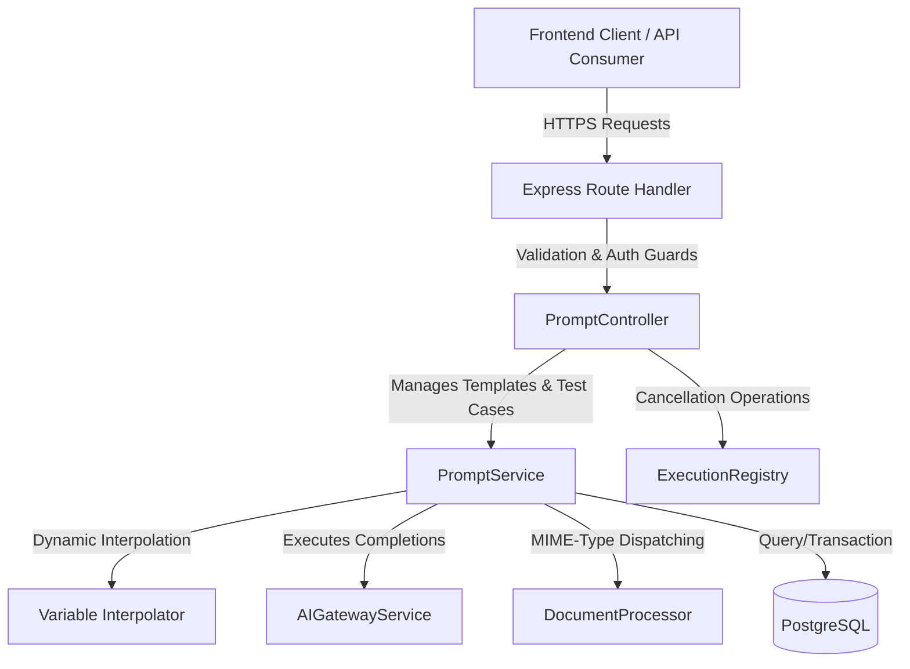
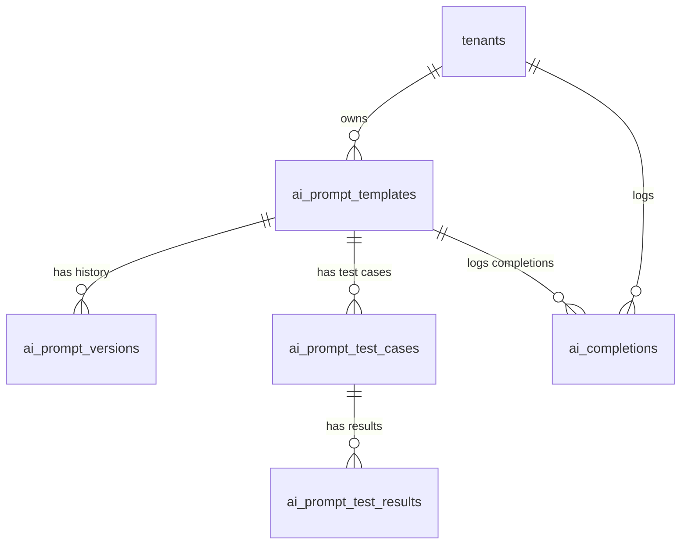
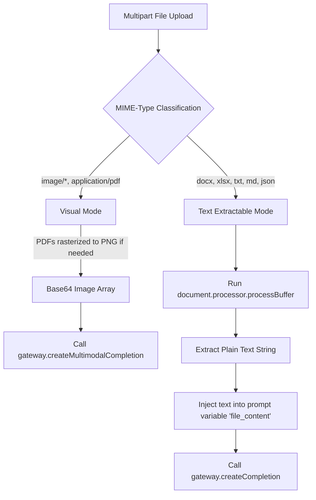

# QAssure Prompt Management Service — Architectural Design Document

---

## 1. Architectural Vision

The **Prompt Management Service** provides a secure, tenant-isolated system for creating, versioning, testing, and executing prompt templates across multiple AI providers (OpenAI, Anthropic, Gemini, and custom OpenSource models).

The service addresses three critical enterprise needs:
1. **Dynamic Prompt Engineering**: Moving prompt templates out of hardcoded backend application code and into an administrative UI where domain experts can refine templates, system instructions, and hyper-parameters.
2. **Strict Version Control & Rollbacks**: Ensuring every change to a template's text creates a new immutable version, allowing safe rollbacks and auditable history.
3. **Execution & Non-Repudiation Logging**: Storing an execution record for every single LLM call, capturing input variables, interpolated prompts, generated completions, latency, token consumption, and financial costs.

---

## 2. Component Architecture

The module is divided into decoupled components:

- **Routing Layer (`prompt.routes.js`)**: Registers API routes, injects `authenticate` and `tenantContext` middleware, runs validation middleware, checks RBAC permissions (`ai:create`, `ai:read`, `ai:delete`), and configures `multer` for memory storage uploads of files up to 50MB.
- **Validation Layer (`prompt.schema.js`)**: Enforces payload contracts using Zod. Validates JSON formats, UUIDs, model pricing schemas, variable shapes, query limits, and request identifiers.
- **Controller Layer (`prompt.controller.js`)**: Parses parameters, handles SSE streaming headers for real-time text delivery, registers abort signals, and handles request cancellation.
- **Service Layer (`prompt.service.js`)**: Enforces isolation rules (tenants can only see or run their own prompts), manages PostgreSQL transactions for template deletion (cleaning up test cases and history), executes prompt completion routines, and logs performance metrics.
- **Execution Registry (`execution-registry.service.js`)**: Maintains an in-memory `Map` linking `clientRequestId` to `AbortController` objects, facilitating real-time abort signals.
- **Document Ingestion (`document.processor.js`)**: Distributes file uploads into "text" extraction (Word, Excel, JSON, Markdown) or "visual" processing (images, PDFs) to feed native LLM multimodal capabilities.

---

## 3. Database Schema Design

The service manages five primary tables in PostgreSQL:

### 3.1 `ai_prompt_templates`

Stores the current configuration of the templates.

| Column | Type | Constraints | Description |
| :--- | :--- | :--- | :--- |
| `id` | `UUID` | `PRIMARY KEY`, Default `gen_random_uuid()` | Unique identifier. |
| `tenant_id` | `UUID` | `allowNull: true` | Target tenant (NULL for global templates). |
| `name` | `VARCHAR(255)` | `NOT NULL` | Human-readable label. |
| `description` | `TEXT` | `allowNull: true` | Detailed purpose of prompt. |
| `use_case` | `VARCHAR(100)` | `NOT NULL` | Routing/functional label (e.g. `"summarize"`). |
| `version` | `INTEGER` | `NOT NULL`, Default `1` | Current version count. |
| `template` | `TEXT` | `NOT NULL` | Template content, e.g. `"Summarize: {{text}}"`. |
| `system_message` | `TEXT` | `allowNull: true` | System prompt instruction. |
| `variables` | `JSONB` | `allowNull: true` | Schema of variables: name, type, required. |
| `default_parameters` | `JSONB` | `allowNull: true` | Execution settings: temperature, max_tokens. |
| `recommended_models` | `JSONB` | `allowNull: true` | Models suggested for this prompt. |
| `status` | `VARCHAR` | `NOT NULL`, Default `"draft"` | Status: `draft`, `active`, `archived`, `deprecated`. |
| `is_default` | `BOOLEAN` | `NOT NULL` | Whether this is the default template for the use case. |
| `module_ids` | `UUID[]` | `allowNull: true` | Associated functional modules. |
| `usage_count` | `BIGINT` | `NOT NULL`, Default `0` | Total executions. |
| `avg_cost_usd` | `DECIMAL(10,6)` | `allowNull: true` | Running average cost. |
| `avg_latency_ms` | `INTEGER` | `allowNull: true` | Running average latency. |
| `success_rate` | `DECIMAL(5,2)` | `allowNull: true` | Running success rate percentage. |
| `tags` | `JSONB` | `allowNull: true` | Filtering tags. |
| `created_by` | `UUID` | `NOT NULL` | User who created the template. |
| `updated_by` | `UUID` | `allowNull: true` | User who last updated the template. |
| `created_at` | `TIMESTAMP` | `NOT NULL`, Default `NOW()` | Timestamp of creation. |
| `updated_at` | `TIMESTAMP` | `NOT NULL`, Default `NOW()` | Timestamp of update. |

**Indexes**:
- `idx_ai_prompt_templates_tenant` on `(tenant_id)`
- `idx_ai_prompt_templates_name` on `(name)`
- `idx_ai_prompt_templates_use_case` on `(use_case)`
- `idx_ai_prompt_templates_status` on `(status)`
- `idx_ai_prompt_templates_default` on `(is_default)`
- `idx_ai_prompt_templates_unique_version` on `(tenant_id, name, version)` UNIQUE

---

### 3.2 `ai_prompt_versions`

Stores historical snapshots of the template when updated.

| Column | Type | Constraints | Description |
| :--- | :--- | :--- | :--- |
| `id` | `UUID` | `PRIMARY KEY` | Unique identifier. |
| `prompt_id` | `UUID` | `FOREIGN KEY` -> `ai_prompt_templates(id)` ON DELETE CASCADE | Parent template. |
| `version` | `INTEGER` | `NOT NULL` | Version index of this snapshot. |
| `template` | `TEXT` | `NOT NULL` | Template body. |
| `system_message` | `TEXT` | `allowNull: true` | System instructions. |
| `variables` | `JSONB` | `allowNull: true` | Variables configuration. |
| `default_parameters` | `JSONB` | `allowNull: true` | Defaults configuration. |
| `change_notes` | `TEXT` | `allowNull: true` | Message explaining edits. |
| `created_by` | `UUID` | `FOREIGN KEY` -> `users(id)` ON DELETE SET NULL | Author. |
| `created_at` | `TIMESTAMP` | `NOT NULL`, Default `NOW()` | Capture timestamp. |

**Indexes**:
- `idx_prompt_versions_prompt` on `(prompt_id)`
- `idx_prompt_versions_version` on `(prompt_id, version)`

---

### 3.3 `ai_completions`

Main execution logging table for audits, non-repudiation, and cost reporting.

| Column | Type | Constraints | Description |
| :--- | :--- | :--- | :--- |
| `id` | `UUID` | `PRIMARY KEY` | Unique ID. |
| `tenant_id` | `UUID` | `NOT NULL` | Owning tenant. |
| `module_id` | `UUID` | `allowNull: true` | Origin module of the call. |
| `user_id` | `UUID` | `allowNull: true` | Executing user. |
| `use_case` | `VARCHAR(100)` | `NOT NULL` | Use case code. |
| `provider` | `VARCHAR(100)` | `NOT NULL` | Resolved provider (e.g. `"openai"`). |
| `model` | `VARCHAR(100)` | `NOT NULL` | Resolved model name. |
| `prompt_template_id` | `UUID` | `allowNull: true` | Link to template used. |
| `prompt` | `TEXT` | `NOT NULL` | Full interpolated prompt sent. |
| `system_message` | `TEXT` | `allowNull: true` | System message sent. |
| `temperature` | `DECIMAL` | `allowNull: true` | Settings used. |
| `max_tokens` | `INTEGER` | `allowNull: true` | Upper bound tokens. |
| `response` | `TEXT` | `allowNull: true` | Raw text response. |
| `status` | `VARCHAR(50)` | `NOT NULL` | `completed`, `failed`. |
| `cached` | `BOOLEAN` | `NOT NULL` | Whether result was served from cache. |
| `streaming` | `BOOLEAN` | `NOT NULL` | Whether stream response was used. |
| `prompt_tokens` | `INTEGER` | `allowNull: true` | Input token count. |
| `completion_tokens` | `INTEGER` | `allowNull: true` | Output token count. |
| `total_tokens` | `INTEGER` | `allowNull: true` | Total token count. |
| `cost_usd` | `DECIMAL(10,6)`| `allowNull: true` | Token-based cost in USD. |
| `latency_ms` | `INTEGER` | `allowNull: true` | Execution duration. |
| `error_message` | `TEXT` | `allowNull: true` | Error description if failed. |
| `error_code` | `VARCHAR(100)` | `allowNull: true` | Standardized error code. |
| `metadata` | `JSONB` | `allowNull: true` | Key-value execution metadata. |
| `created_at` | `TIMESTAMP` | `NOT NULL`, Default `NOW()` | Timestamp. |

---

### 3.4 `ai_prompt_test_cases`

Preconfigured inputs to execute playground assertions.

| Column | Type | Constraints | Description |
| :--- | :--- | :--- | :--- |
| `id` | `UUID` | `PRIMARY KEY` | Test case identifier. |
| `prompt_id` | `UUID` | `FOREIGN KEY` -> `ai_prompt_templates(id)` ON DELETE CASCADE | Associated prompt. |
| `tenant_id` | `UUID` | `FOREIGN KEY` -> `tenants(id)` ON DELETE CASCADE | Tenant namespace. |
| `name` | `VARCHAR(255)` | `NOT NULL` | Test case name. |
| `description` | `TEXT` | `allowNull: true` | Summary of test. |
| `input_variables` | `JSONB` | `NOT NULL` | JSON map of variables values. |
| `expected_output` | `TEXT` | `allowNull: true` | Expected full text. |
| `tags` | `JSONB` | `allowNull: true` | Tags for grouping. |
| `created_by` | `UUID` | `FOREIGN KEY` -> `users(id)` ON DELETE SET NULL | Creator. |

---

### 3.5 `ai_prompt_test_results`

Logs results of test case executions.

| Column | Type | Constraints | Description |
| :--- | :--- | :--- | :--- |
| `id` | `UUID` | `PRIMARY KEY` | Result ID. |
| `test_case_id` | `UUID` | `FOREIGN KEY` -> `ai_prompt_test_cases(id)` ON DELETE CASCADE | Linked test case. |
| `prompt_version` | `INTEGER` | `NOT NULL` | Template version evaluated. |
| `provider` | `VARCHAR(100)` | `allowNull: true` | Provider used. |
| `model` | `VARCHAR(100)` | `allowNull: true` | Model name. |
| `input_variables` | `JSONB` | `allowNull: true` | Copy of variables tested. |
| `output` | `TEXT` | `allowNull: true` | LLM content. |
| `tokens_used` | `INTEGER` | `allowNull: true` | Token usage. |
| `cost_usd` | `DECIMAL(10,6)`| `allowNull: true` | Cost. |
| `latency_ms` | `INTEGER` | `allowNull: true` | Response latency. |
| `run_by` | `UUID` | `FOREIGN KEY` -> `users(id)` ON DELETE SET NULL | Executor. |
| `created_at` | `TIMESTAMP` | `NOT NULL` | Time run. |

---

## 4. Multimodal File Processing Design

When a user submits a file with a prompt via `POST /:id/execute-with-file`, the system executes the following:

1. **Classification**: `document.processor.js` evaluates mimetype.
2. **Text extraction**: Document structure is parsed using native buffers. The resulting text is mapped to `file_content` variables, which replaces `{{file_content}}` in the template.
3. **Visual analysis**: Visual formats are loaded into base64 visual objects and sent natively to models like GPT-4o or Claude 3.5 Sonnet.

---

## 5. Abortable Execution Architecture

To avoid wasted compute and server cost when client requests disconnect or are cancelled:

1. **Registration**: When a client requests execution, the controller generates a `clientRequestId` and creates a JavaScript `AbortController`. The controller and the request ID are registered in the `ExecutionRegistry` Map.
2. **Signal Association**: The `AbortSignal` is passed through the Gateway down to the HTTP Client (Axios/SDK).
3. **Remote Cancellation**: If the model is hosted on an open-source endpoint (e.g. vLLM) that exposes a cancellation endpoint, the service registers the `cancel_url` and sends a `POST` request with the `request_id` to terminate remote GPU rendering instantly.
4. **Cleanup**: When completion completes (successfully or via failure), the registry removes the request keys to avoid memory leaks.
