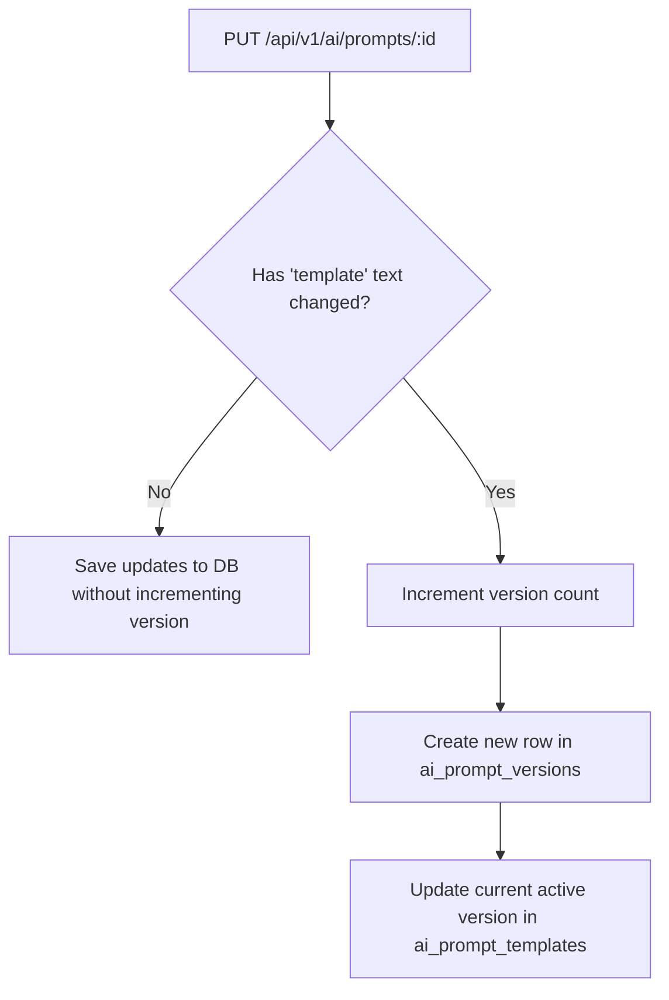
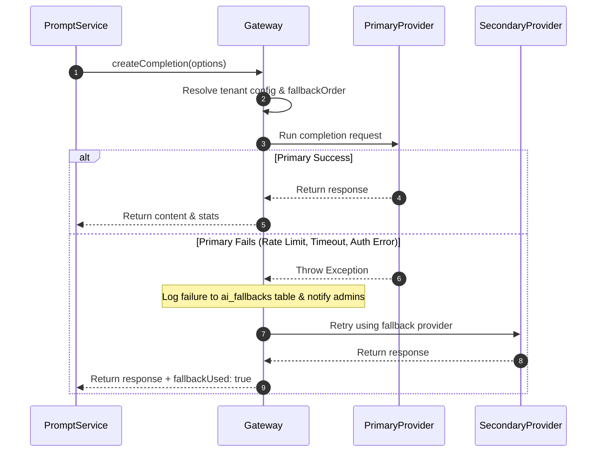

# QAssure Prompt Management Service — Functional Documentation

---

## 1. Functional Core & Business Rules

The Prompt Management Service provides structured templates, execution rules, and audit features to ensure reliability when using LLM completions.

### 1.1 Draft & Activation Lifecycle
- Prompts start with a status of `draft`.
- Only templates in the `active` status can be executed through the endpoint `POST /:id/execute`. If a user attempts to call a `draft`, `deprecated`, or `archived` prompt, the request fails with a 400 bad request error.
- Bypassing guard: The endpoint `POST /:id/test` allows testing `draft` prompts during development.

### 1.2 The "Default" Flag
- Within a given tenant namespace, there can only be **one default prompt** for each `use_case` value.
- If a user marks a template as default during creation or modification, the service executes a transaction that automatically clears the `is_default` flag from any other prompt matching the same `(tenant_id, use_case)`.

---

## 2. Template Variable Interpolation

Templates contain placeholders wrapped in double curly braces, e.g. `{{var_name}}`.

During execution, the service resolves placeholders using the following rules:

1. **Variables Validation**: The template's custom variables configuration is retrieved from the DB (`variables` column).
2. **Missing Required Fields**: If a variable is marked `required: true` and is not provided in the payload, the service throws an error immediately without contacting the AI Provider.
3. **Fallback to Defaults**: If an optional variable is not provided, the service falls back to its configured `default` string.
4. **Regular Expression Replace**: Placeholders are replaced globally in the template string using the expression:
   ```javascript
   const placeholder = `{{${variable.name}}}`;
   finalPrompt = finalPrompt.replace(new RegExp(placeholder, "g"), value || variable.default || "");
   ```
5. **Special Injections**: If the route is an upload route (`execute-with-file`) and text extraction is completed, the string result is automatically mapped to a variable named `file_content` and replaces `{{file_content}}` in the template (even if `file_content` was not declared in the variables array).

---

## 3. Versioning and Rollback Mechanics

To prevent breaking changes, the service uses an automated versioning system:



1. **Change Evaluation**: During updates, the service compares the incoming `template` text with the active version stored in the DB. If it matches, only metadata is updated.
2. **History Isolation**: If the template text has changed, the service increments the version counter, stores the previous version's configuration in `ai_prompt_versions`, and writes the new configuration to `ai_prompt_templates`.
3. **Rollback**: To rollback to a version (e.g. version 2), the service fetches the snapshot from `ai_prompt_versions` where `prompt_id = :id` and `version = 2`. It then updates the template record and increments the active version index, adding a change note: `"Rolled back to version 2"`.

---

## 4. Test Case and Assertion Logic

Users can configure test inputs inside the playground to check prompt quality.

- **Variables Storage**: Input configurations are stored in `ai_prompt_test_cases` under the `input_variables` column.
- **Pre-execution**: When a user executes a test run, the service calls its internal `test()` method, which bypasses the requirement for the prompt to be `active` (allowing testing of draft changes).
- **Assertion and Logging**:
  - The returned response string is recorded in `ai_prompt_test_results`.
  - The run matches output against custom tags or expected text (recorded in `expected_output`).
  - System logs latency, token consumption, and cost for the test run.

---

## 5. Dynamic Fallback and Error Recovery

The Prompt Service executes AI calls by integrating with the **AI Gateway Service**. The gateway applies a fallback strategy to avoid outages:



1. **Fallback Configuration**: The gateway checks `fallback_provider` and falls back if the primary provider fails.
2. **Retry Execution**: If the primary endpoint fails (due to a rate limit, timeout, or auth issue), the gateway retries the request using the fallback provider.
3. **Auditable Fallbacks**: Every time a fallback is triggered, a record is added to `ai_fallbacks` with the error details. A real-time notification is sent to the super admin dashboard.
