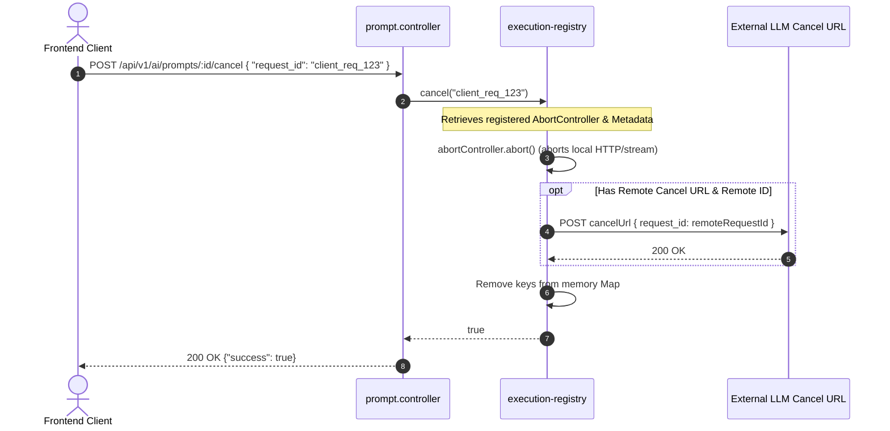

# QAssure Prompt Management Service

## Technical Knowledge Transfer (KT) Guide

Welcome to the technical Knowledge Transfer (KT) guide for the **Prompt Management Service** of the QAssure Platform. This document outlines the service's architecture, routes, database integrations, execution and cancellation pipelines, version control, testing playground, and integration with the AI Gateway.

---

## 1. Architectural Overview

The Prompt Management Service provides a secure, tenant-isolated interface for creating, versioning, testing, and executing prompt templates across various AI providers (OpenAI, Anthropic, Gemini, and custom OpenSource models).

### Directory & Component Map

- **Routing Layer**: [prompt.routes.js](QAssur-backend/src/routes/prompt.routes.js) handles HTTP route definitions, multer configuration for multimodal uploads, and maps Zod validations and authorization policies.
- **Validation Layer**: [prompt.schema.js](QAssur-backend/src/validation/prompt.schema.js) defines request payload validation schemas using Zod.
- **Controller Layer**: [prompt.controller.js](QAssur-backend/src/controllers/prompt.controller.js) parses parameters, handles SSE streaming headers, and maps HTTP requests to service methods.
- **Service Layer**:
  - [prompt.service.js](QAssur-backend/src/services/prompt.service.js) contains core business logic: template variable interpolation, version history records, cloning, playground testing, test cases, and completion storage.
  - [execution-registry.service.js](QAssur-backend/src/services/execution-registry.service.js) maintains active execution `AbortController`s to support HTTP-based execution cancelation.
- **AI Infrastructure (Gateway)**: [gateway.service.js](QAssur-backend/src/infrastructure/ai/gateway.service.js) orchestrates multi-tenant provider settings (BYOK), fallback mapping, token/cost estimation, and alerts super admins.
- **Document Ingestion**: [document.processor.js](QAssur-backend/src/infrastructure/ai/document.processor.js) handles file content classification and text extraction (e.g. PDFs, DOCX, XLSX) during multimodal execution.

---

## 2. System Interaction Workflows

### Standard & Streaming Prompt Execution Flow

This diagram illustrates the lifecycle of a prompt execution, showing both standard JSON responses and SSE (Server-Sent Events) streaming.

```mermaid
sequenceDiagram
    autonumber
    actor Client as Frontend Client
    participant Ctrl as prompt.controller
    participant Svc as prompt.service
    participant Reg as execution-registry
    participant Gate as gateway.service
    participant Provider as AI Provider (LLM)
    database DB as PostgreSQL DB

    Client->>Ctrl: POST /api/v1/ai/prompts/:id/execute (variables, stream: true)
    Ctrl->>Reg: register(clientRequestId, abortController)
    Ctrl->>Svc: execute(promptId, variables, context)
    Svc->>DB: Fetch prompt template details
    DB-->>Svc: template content, variables definition
    Note over Svc: Interpolates {{variables}} into template
    Svc->>Gate: createStreamingCompletion(options, onChunk)
    Gate->>Provider: Request Streaming Completion

    loop Stream Output Chunks
        Provider-->>Gate: SSE chunk
        Gate-->>Svc: invoke onChunk(chunk)
        Svc->>Reg: associateRemoteId(clientRequestId, remoteRequestId)
        Svc-->>Ctrl: callback onChunk()
        Ctrl-->>Client: data: {"content": "..."}
    end

    Provider-->>Gate: Completion Finished
    Gate-->>Svc: Done (metadata & usage stats)
    Svc->>DB: Log to `ai_completions` (success) & increment usage count
    Svc->>Reg: remove(clientRequestId)
    Svc-->>Ctrl: Done metadata
    Ctrl-->>Client: data: {"done": true}
```

### Execution Cancellation Flow

Active requests can be aborted mid-stream or during execution. The client references the execution with a unique `clientRequestId`.



### Multimodal File Processing Pipeline

When executing a prompt template with a file upload, the system automatically routes based on mimetype:

```mermaid
graph TD
    A[File Uploaded] --> B{Mime Type Classification}
    B -- "Image/PDF (Visual Mode)" --> C[Rasterize PDF pages to PNG if necessary]
    C --> D[Convert file to base64 data uri]
    D --> E[Call gateway.createMultimodalCompletion]
    E --> F[Native LLM Vision Pipeline]

    B -- "DOCX/XLSX/TXT (Text Mode)" --> G[Invoke document.processor.processBuffer]
    G --> H[Extract plain text content]
    H --> I[Inject text into {{file_content}} variable]
    I --> J[Call gateway.createCompletion]
    J --> K[Standard Text LLM Pipeline]
```

---

## 3. Route Definition and Validation Reference

All prompt endpoints require authentication and tenant context. They are prefixed by `/api/v1/ai/prompts`.

| Route Method | URL path                      | Permission Required | Validation Schema                        | Description                                                                             |
| :----------- | :---------------------------- | :------------------ | :--------------------------------------- | :-------------------------------------------------------------------------------------- |
| **POST**     | `/`                           | `ai:create`         | `CreatePromptSchema`                     | Creates a new prompt template and records version 1.                                    |
| **GET**      | `/`                           | `ai:read`           | `ListPromptsQuerySchema`                 | Lists prompt templates with pagination, search, tags, and use case filters.             |
| **GET**      | `/:id`                        | `ai:read`           | `IdParamsSchema`                         | Fetches a single prompt template by its UUID.                                           |
| **PUT**      | `/:id`                        | `ai:create`         | `IdParamsSchema`, `UpdatePromptSchema`   | Modifies template values. Increments version if prompt content changes.                 |
| **PATCH**    | `/:id/status`                 | `ai:create`         | `IdParamsSchema`, `UpdateStatusSchema`   | Transition prompt status between `draft`, `active`, `archived`, `deprecated`.           |
| **DELETE**   | `/:id`                        | `ai:delete`         | `IdParamsSchema`                         | Performs a clean transactional delete of the prompt, versions, test cases, and results. |
| **POST**     | `/:id/clone`                  | `ai:create`         | `IdParamsSchema`                         | Clones an existing template into a copy draft.                                          |
| **GET**      | `/:id/versions`               | `ai:read`           | `IdParamsSchema`                         | Returns historical versions and change notes of a template.                             |
| **POST**     | `/:id/rollback`               | `ai:create`         | `IdParamsSchema`, `RollbackSchema`       | Restores a prompt template configuration to a specific version number.                  |
| **POST**     | `/:id/execute`                | `ai:create`         | `IdParamsSchema`, `ExecutePromptSchema`  | Executes prompt using input variables. Supports Server-Sent Events (SSE) streaming.     |
| **POST**     | `/:id/cancel`                 | `ai:create`         | `IdParamsSchema`, `CancelPromptSchema`   | Aborts an ongoing stream or execution.                                                  |
| **POST**     | `/:id/execute-with-file`      | `ai:create`         | Multiparts Form Data                     | Extracts/Rasterizes file attachment, executes multimodal completions.                   |
| **POST**     | `/:id/test`                   | `ai:create`         | `IdParamsSchema`, `TestPromptSchema`     | Playground route. Ignores strict "active" status validation for fast drafts.            |
| **POST**     | `/:id/test-cases`             | `ai:create`         | `IdParamsSchema`, `CreateTestCaseSchema` | Creates a test scenario with predefined input variables.                                |
| **POST**     | `/test-cases/:testCaseId/run` | `ai:create`         | `TestCaseIdParamsSchema`                 | Runs a designated test case and registers output assertions.                            |

---

## 4. Key Implementation Details

### A. Template Variable Interpolation

Templates are designed as strings with double-bracket placeholders, e.g., `{{user_name}}`. During execution, the [prompt.service.js](QAssur-backend/src/services/prompt.service.js#L523-L538) matches these placeholders with incoming variables:

```javascript
let finalPrompt = prompt.template;
const variables = prompt.variables || [];

for (const variable of variables) {
  const value = inputVariables[variable.name];
  if (variable.required && (value === undefined || value === null)) {
    throw new Error(`Required variable missing: ${variable.name}`);
  }
  const placeholder = `{{${variable.name}}}`;
  finalPrompt = finalPrompt.replace(
    new RegExp(placeholder, "g"),
    value || variable.default || "",
  );
}
```

### B. Multi-Tenant BYOK and Fallback Routing

The AI Gateway implements per-tenant provider configurations (Bring Your Own Key). Fallback logic is orchestrated dynamically in [gateway.service.js](QAssur-backend/src/infrastructure/ai/gateway.service.js#L403-L560):

1. **Resolution**: `_resolveProviders(tenantId)` fetches custom API keys/endpoints from `tenant_ai_configs` (with memory caching via `tenantProviderCache`).
2. **BYOK Priority**: Tenant-configured keys are merged over system-default environmental providers.
3. **Dynamic Fallbacks**: If the primary provider (e.g., Azure OpenAI) returns an error, the gateway catches the exception, records a fallback log to `ai_fallbacks`, and retries the request using the next available provider in `fallbackOrder`.
4. **Alerts**: Super Admins are notified instantly via real-time dashboard updates and SMTP emails detailing the API endpoint and provider failure parameters.

### C. Abortable Execution Registry

The `ExecutionRegistry` in [execution-registry.service.js](QAssur-backend/src/services/execution-registry.service.js) facilitates HTTP cancellation:

- An `AbortController` is registered with the `clientRequestId` before executing the request.
- The `signal` from the controller is passed directly down to `axios` or provider-native requests.
- If a cancel request is made:
  1.  `abortController.abort()` cancels the local HTTP stream.
  2.  If the provider is hosted on an open-source engine requiring manual cleanup, a remote cancel URL request is fired: `axios.post(entry.cancelUrl, { request_id: entry.remoteRequestId })`.

### D. Multimodal File Ingestion

In [document.processor.js](QAssur-backend/src/infrastructure/ai/document.processor.js), files are processed based on their MIME type:

- **Visual Mode**: Images and PDF uploads are converted into base64 data buffers and dispatched directly to the LLM's vision model.
- **Text Extractable Mode**: Extracted text from `.docx`, `.doc`, `.xlsx`, `.xls`, `.txt`, `.md`, or `.json` is structured and injected as a `{{file_content}}` placeholder.
- **LTTS Multimodal Ingestion Pipeline**: For advanced PDF parsing, the processor can rasterize the document pages, run layout extraction via YOLO to find visual bounding boxes, transcribe them via LLaVA, and structure the text.

---

## 5. Database Schema & Tables Map

The Prompt Management Service relies on several Postgres tables:

### `ai_prompt_templates`

Stores the metadata and configuration for each prompt template.

- `id` (UUID, PK) - Unique identifier.
- `tenant_id` (UUID, FK) - Associated tenant (NULL indicates system-level templates).
- `name` / `description` / `use_case` (VARCHAR) - UI labels and routing codes.
- `version` (INTEGER) - Current active version.
- `template` (TEXT) - The template body, e.g., `"Summarize this file: {{file_content}}"`
- `system_message` (TEXT) - System prompt instructions.
- `variables` (JSONB) - Schema definition for inputs: `[{"name": "username", "required": true}]`
- `default_parameters` (JSONB) - Default model execution configurations: `{"temperature": 0.7, "max_tokens": 1000}`
- `status` (VARCHAR) - Can be `draft`, `active`, `deprecated`, or `archived`.
- `is_default` (BOOLEAN) - Primary template for a given `use_case`.
- `module_ids` (UUID[]) - Associated functional modules.

### `ai_prompt_versions`

Historical record of templates. Created automatically on template modifications.

- `id` (UUID, PK)
- `prompt_id` (UUID, FK -> `ai_prompt_templates`)
- `version` (INTEGER) - Sequential version tracker.
- `template` / `system_message` / `variables` / `default_parameters` (TEXT/JSONB) - Snapshot at creation time.
- `change_notes` (TEXT) - Descriptions of changes made.

### `ai_completions`

The execution audit trail. Logs all completions, costs, latency, and status.

- `id` (UUID, PK)
- `tenant_id` (UUID, FK)
- `provider` / `model` (VARCHAR) - Provider and model details.
- `prompt` / `system_message` (TEXT) - Actual interpolated strings.
- `response` (TEXT) - Content returned by the AI provider.
- `status` (VARCHAR) - `completed` or `failed`.
- `prompt_tokens` / `completion_tokens` / `total_tokens` (INTEGER) - Usage tokens.
- `cost_usd` (NUMERIC) - Calculated costs based on token pricing models.
- `latency_ms` (INTEGER) - Execution time.
- `error_message` (TEXT) - Caught exception message if status is `failed`.
- `metadata` (JSONB) - Store context arguments, input variables, and client request IDs.

### `ai_fallbacks`

Records incidents where the primary provider failed and the gateway routed to secondary fallbacks.

- `id` (UUID, PK)
- `tenant_id` (UUID) - Target tenant scope.
- `failed_provider` / `failed_model` (VARCHAR)
- `fallback_provider` / `fallback_model` (VARCHAR)
- `error_message` (TEXT)
- `config_details` (JSONB) - Snapshot of configuration, including masked API keys and endpoints.

### `ai_prompt_test_cases` & `ai_prompt_test_results`

Stores test scenarios for playground assertions.

- **Test Cases**: Stores variables, expectations, and tags for regression testing templates.
- **Test Results**: Logs run history, output comparison metrics, token usage, and latency.

---

## 6. KT Cheat Sheet: Common Developer Tasks

### How to add a new prompt variable?

1. Open the Prompt Template in the UI or construct a payload to `PUT /api/v1/ai/prompts/:id`.
2. Add the variable definition in the `variables` JSON array:
   ```json
   {
     "name": "new_var",
     "type": "string",
     "required": true,
     "default": "Default Val"
   }
   ```
3. Update `user_template` to include `{{new_var}}`. This automatically increments the template version.

### How to support a new AI Provider?

1. Create a provider wrapper class in `src/infrastructure/ai/` implementing the `BaseAIProvider` contract (see `openai.provider.js` as reference).
2. Register the provider instantiation inside the `initialize` and `_createProviderFromConfig` routines in [gateway.service.js](QAssur-backend/src/infrastructure/ai/gateway.service.js).
3. Update the provider Zod validation schema in [prompt.schema.js](QAssur-backend/src/validation/prompt.schema.js) to allow the new provider identifier string.
