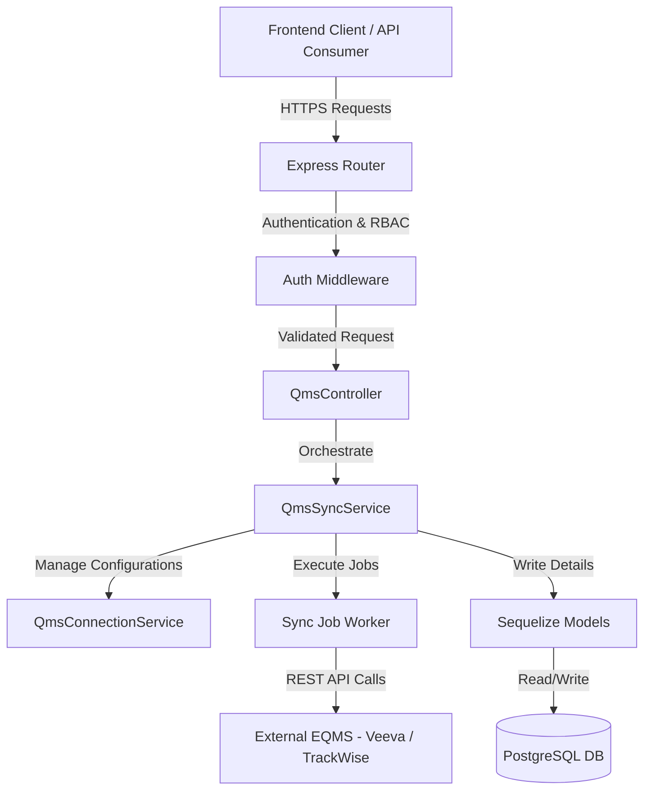

# QAssure QMS Service — Architectural Design Document

---

## 1. Architectural Vision

The **QMS Integration Service** allows QAssure to exchange quality records (CAPAs, deviations, customer complaints, document audits) with third-party Enterprise Quality Management Systems (EQMS) like Veeva, TrackWise, ETQ Reliance, and Salesforce Quality Cloud. By supporting dynamic schema field mapping, conflict detection resolution, and background worker synchronization jobs, the service ensures seamless hybrid deployments.

### Key Capabilities:
1. **EQMS Adapters**: Extensible adapter classes for Veeva Vault, TrackWise, and custom REST connections.
2. **Encrypted Connection Storage**: Securely stores connection configurations (`qms_connections`) with AES-256 encrypted authentication keys.
3. **Dynamic Field Mapper**: Manages mapping definitions (`qms_entity_mappings`) to translate external fields (e.g. `external_status_code`) to target QAssure entity columns.
4. **Sync Execution Engine**: Runs asynchronous job loops (`qms_sync_jobs`) in the background, updating progress percentages, counting logs, and writing to error lists.
5. **Conflict Resolver Ledger**: Stores divergent updates (`qms_sync_conflicts`) where data changed on both ends, allowing managers to resolve fields manually (`source_wins`, `target_wins`, `merge`).

---

## 2. Component Diagram

The QMS service coordinates data between the user, the database, and the external REST APIs of third-party QMS systems:

### 2.1 Routing Layer Components

The Express Router delegates incoming QMS requests to five specialized routing files:
*   **`qms_connection_routes.js`**: Orchestrates configuration storage for credentials, URLs, and status mappings.
*   **`qms_entity_mapping_routes.js`**: Configures attribute mapping schemas and collision strategy metrics.
*   **`qms_sync_job_routes.js`**: Exposes operations for monitoring sync task statuses, progress counters, and execution history.
*   **`qms_sync_conflict_routes.js`**: Provides endpoints to view/update data collision ledger records.
*   **`qms.routes.js`**: Integrates adapter discovery, connectivity checking, live mapping validations, synchronization triggering, job cancellations, and conflict resolutions.

---

## 3. Database Schema Design

The SQL schema defined in `create_qms_tables.sql` maps the relational definitions:

### 3.1 Tables & Fields

#### `qms_connections`
*   `id` (UUID, PK): Unique connection ID.
*   `tenant_id` (UUID, FK): Target tenant ID.
*   `system_type` (VARCHAR(50)): EQMS type (e.g. `veeva`, `trackwise`, `etq`, `custom_rest`).
*   `name` / `description` (VARCHAR(255) / TEXT).
*   `credentials` (TEXT): Encrypted auth parameters (OAuth credentials, API tokens, passwords).
*   `settings` / `sync_config` (JSONB): Mapped filters and active modules.
*   `status` (VARCHAR(50)): `pending`, `connected`, `failed`.
*   `last_connected_at` / `last_sync_at` (TIMESTAMP WITH TIME ZONE).

#### `qms_entity_mappings`
*   `id` (UUID, PK).
*   `connection_id` (UUID, FK): Links to `qms_connections`.
*   `tenant_id` (UUID, FK).
*   `entity_type` (VARCHAR(100)): Target module (e.g., `capa`, `deviation`, `document`).
*   `source_field` (VARCHAR(255)): Field code in external EQMS.
*   `target_field` (VARCHAR(255)): Field code in QAssure.
*   `transformation` (VARCHAR(100)): Function logic (e.g., `uppercase`, `to_date`, `map_status`).
*   `is_required` (BOOLEAN).

#### `qms_sync_jobs`
*   `id` (UUID, PK).
*   `connection_id` (UUID, FK).
*   `job_type` (VARCHAR(50)): `full`, `incremental`.
*   `direction` (VARCHAR(50)): `inbound`, `outbound`, `bidirectional`.
*   `entity_types` (JSONB): Selected modules (e.g. `["capa", "deviation"]`).
*   `status` (VARCHAR(50)): `pending`, `running`, `completed`, `failed`, `cancelled`.
*   `progress` / `total_records` / `synced_records` / `error_count` (INTEGER).
*   `errors` (JSONB): List of error logs detailing failures.

#### `qms_sync_conflicts`
*   `id` (UUID, PK).
*   `connection_id` (UUID, FK).
*   `entity_type` (VARCHAR(100)).
*   `entity_id` (VARCHAR(255)): Target record ID.
*   `source_data` (JSONB): Incoming record fields.
*   `target_data` (JSONB): Local record fields.
*   `status` (VARCHAR(50)): `pending`, `resolved`.
*   `resolution` (VARCHAR(50)): Resolution type (`source_wins`, `target_wins`, `manual_merge`).

---

## 4. Integration Points

1. **Third-Party REST Interfaces**: The system maps outbound/inbound requests to external APIs using specific adapter modules, managing rate limiting and token renewal.
2. **Audit Trails**: All modifications to field mappings, sync activations, and manual conflict resolutions generate events saved in the compliance log.
3. **Task & Notification Service**: Triggers notifications when sync errors exceed defined thresholds or when manual conflict resolutions require manager attention.
