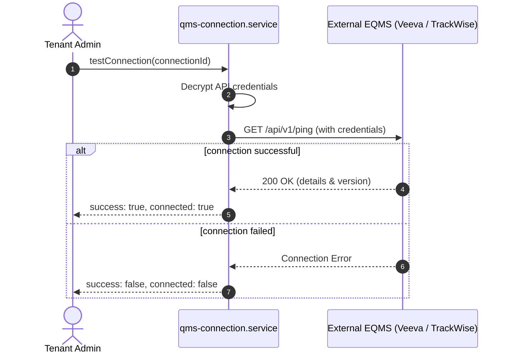

# QAssure QMS Service

## Technical Knowledge Transfer (KT) Guide

Welcome to the technical Knowledge Transfer (KT) guide for the **QMS Integration Service** of the QAssure Platform. This document outlines the service's architecture, database tables, validation triggers, and common developer tasks.

---

## 1. Architectural Overview

The QMS Service manages integration, field transformations, background synchronization jobs, and conflict resolution rules for third-party quality systems (Veeva, TrackWise, etc.).

### Directory & Component Map

- **Routing Layer**:
  *   [qms.routes.js](file:///home/tech4biz/Downloads/Sibarchan/QAssure/QAssur-backend/src/routes/qms.routes.js) (Mount: `/api/v1/qms`): Defines operational, test, schema mapping, and conflict resolution trigger endpoints.
  *   [qms_connection_routes.js](file:///home/tech4biz/Downloads/Sibarchan/QAssure/QAssur-backend/src/routes/qms_connection_routes.js) (Mount: `/api/v1/qms/connections`): Exposes CRUD endpoints for connection configurations.
  *   [qms_entity_mapping_routes.js](file:///home/tech4biz/Downloads/Sibarchan/QAssure/QAssur-backend/src/routes/qms_entity_mapping_routes.js) (Mount: `/api/v1/qms/entity-mappings`): Exposes CRUD endpoints for QMS-to-QAssure field mapping profiles.
  *   [qms_sync_job_routes.js](file:///home/tech4biz/Downloads/Sibarchan/QAssure/QAssur-backend/src/routes/qms_sync_job_routes.js) (Mount: `/api/v1/qms/sync-jobs`): Exposes CRUD endpoints for background synchronization job logs.
  *   [qms_sync_conflict_routes.js](file:///home/tech4biz/Downloads/Sibarchan/QAssure/QAssur-backend/src/routes/qms_sync_conflict_routes.js) (Mount: `/api/v1/qms/sync-conflicts`): Exposes CRUD endpoints for managing data collision logs.
- **Controller Layer**:
  *   [qms.controller.js](file:///home/tech4biz/Downloads/Sibarchan/QAssure/QAssur-backend/src/controllers/qms.controller.js): Controller for custom/operations actions.
  *   [qms_connection_controller.js](file:///home/tech4biz/Downloads/Sibarchan/QAssure/QAssur-backend/src/controllers/qms_connection_controller.js): Controller for connections database CRUD.
  *   [qms_entity_mapping_controller.js](file:///home/tech4biz/Downloads/Sibarchan/QAssure/QAssur-backend/src/controllers/qms_entity_mapping_controller.js): Controller for entity mappings CRUD.
  *   [qms_sync_job_controller.js](file:///home/tech4biz/Downloads/Sibarchan/QAssure/QAssur-backend/src/controllers/qms_sync_job_controller.js): Controller for job logs CRUD.
  *   [qms_sync_conflict_controller.js](file:///home/tech4biz/Downloads/Sibarchan/QAssure/QAssur-backend/src/controllers/qms_sync_conflict_controller.js): Controller for conflict logs CRUD.
- **Service Layer**: Core logic is split across:
  *   [qms-connection.service.js](file:///home/tech4biz/Downloads/Sibarchan/QAssure/QAssur-backend/src/services/qms-connection.service.js) for credentials and encryption.
  *   [qms-sync.service.js](file:///home/tech4biz/Downloads/Sibarchan/QAssure/QAssur-backend/src/services/qms-sync.service.js) for processing inbound/outbound records.
  *   [qms_entity_mapping_service.js](file:///home/tech4biz/Downloads/Sibarchan/QAssure/QAssur-backend/src/services/qms_entity_mapping_service.js) for schema definitions.
- **Sequelize Models**: Models defined under `src/sequelize-models/`, including `qms_connection.js`, `qms_entity_mapping.js`, `qms_sync_job.js`, and `qms_sync_conflict.js`.

---

## 2. System Interaction Workflows

### A. Dynamic Sync and Conflict Resolution
This sequence details how incoming records are mapped, conflicts are detected, and manual resolutions are handled.

```mermaid
sequenceDiagram
    autonumber
    actor Mgr as Quality Manager
    participant Svc as qms-sync.service
    participant Map as qms_entity_mapping_service
    database DB as PostgreSQL DB
    
    Svc->>Map: getMappings(connectionId)
    Map-->>Svc: Mappings array definitions
    Svc->>Svc: Retrieve records from external EQMS
    
    loop for each external record
        Svc->>Svc: Translate fields using mapping rules
        Svc->>DB: Check if record exists locally
        
        alt local record updated concurrently
            Svc->>DB: Insert record into qms_sync_conflicts (status = 'pending')
            Svc->>DB: Log sync error / warning
        else no conflict
            Svc->>DB: Upsert record into local tables (e.g. capas)
        end
    end
    
    Mgr->>Svc: POST /conflicts/{conflictId}/resolve (source_wins)
    Svc->>DB: Update local record with external values
    Svc->>DB: Mark conflict status as 'resolved'
```

---

### B. Connection Verification Flow
This sequence details testing connectivity to external quality systems.



---

### C. Entity Mapping Workflow (`qms_entity_mapping_routes.js`)
This sequence details the request path when creating or modifying dynamic mapping profiles.

```mermaid
sequenceDiagram
    autonumber
    actor Admin as Tenant Admin
    participant Route as entity_mapping_routes
    participant Mid as Validation & Auth Middlewares
    participant Ctrl as qms_entity_mapping_controller
    participant Svc as qms_entity_mapping_service
    database DB as PostgreSQL DB
    
    Admin->>Route: POST/PUT /api/v1/qms/entity-mappings (with payload)
    Route->>Mid: authenticate & tenantContext & verifyTenantAccess
    Mid-->>Route: Middleware verification passed
    Route->>Mid: validate(Create/UpdateSchema)
    alt validation fails
        Mid-->>Admin: 400 Bad Request (Validation details)
    else validation succeeds
        Mid-->>Route: Valid payload
    end
    Route->>Ctrl: create() / update()
    Ctrl->>Svc: create() / update()
    Svc->>DB: Upsert into qms_entity_mappings
    DB-->>Svc: Saved mapping record
    Svc-->>Ctrl: Mapping entity instance
    Ctrl-->>Admin: 201 Created / 200 OK (mapping data)
```

---

### D. Sync Conflict Management & Resolution (`qms_sync_conflict_routes.js`)
This sequence details how detected conflicts are retrieved and manually resolved.

```mermaid
sequenceDiagram
    autonumber
    actor Mgr as Quality Manager
    participant Route as sync_conflict_routes
    participant Mid as Validation & Auth Middlewares
    participant Ctrl as qms_sync_conflict_controller
    participant Svc as qms_sync_conflict_service
    database DB as PostgreSQL DB
    
    Note over Route, DB: Step 1: Querying Conflicts
    Mgr->>Route: GET /api/v1/qms/sync-conflicts (status = 'PENDING')
    Route->>Mid: Auth & Tenant & Feature middlewares
    Mid-->>Route: Authorized
    Route->>Ctrl: findAll()
    Ctrl->>Svc: findAll()
    Svc->>DB: SELECT * FROM qms_sync_conflicts WHERE status = 'PENDING'
    DB-->>Svc: List of conflicts
    Svc-->>Ctrl: Conflict list data
    Ctrl-->>Mgr: 200 OK (Conflicts payload)

    Note over Route, DB: Step 2: Resolving a Conflict
    Mgr->>Route: PUT /api/v1/qms/sync-conflicts/:id (with strategy & notes)
    Route->>Mid: validateParams & validateUpdate
    Mid-->>Route: Validation passed
    Route->>Ctrl: update()
    Ctrl->>Svc: update()
    Svc->>DB: Update qms_sync_conflicts status to 'RESOLVED'
    Svc->>DB: Apply resolved values to local target record (e.g. CAPA/Document)
    DB-->>Svc: Success
    Svc-->>Ctrl: Updated conflict object
    Ctrl-->>Mgr: 200 OK (Resolution result)
```

---

## 3. Key Implementation Details

### A. Field Mapping Transformations
Field mappings are processed in [qms-sync.service.js](file:///home/tech4biz/Downloads/Sibarchan/QAssure/QAssur-backend/src/services/qms-sync.service.js) using the `_applyMapping()` function, which supports direct transfers, case conversions, and priority mappings.

### B. Credential Encryption
Connection credentials (passwords, client secrets, API tokens) are encrypted in the database using AES-256-GCM. The decryption key is managed securely via environment variables.

---

## 4. Developer KT Cheat Sheet: Common Tasks

### A. How to Add a New QMS Adapter?
1. Create a new adapter file under `src/services/adapters/` (e.g., `salesforce-qms.adapter.js`).
2. Implement the standard connection and fetch methods:
   ```javascript
   class SalesforceQmsAdapter {
     async testConnection(credentials) { ... }
     async fetchRecords(entityType, lastSyncAt) { ... }
   }
   ```
3. Register the new adapter in the factory method in `qms-connection.service.js`.

### B. How to Add a Custom Transformation Casting?
1. Open [qms-sync.service.js](file:///home/tech4biz/Downloads/Sibarchan/QAssure/QAssur-backend/src/services/qms-sync.service.js).
2. Add your custom translation logic to the transformation mapper function:
   ```javascript
   case 'custom_trim':
     output[targetField] = String(val).trim();
     break;
   ```
3. Update `qms_entity_mapping.schema.js` validation to allow `custom_trim` in the transformation parameter schema.
