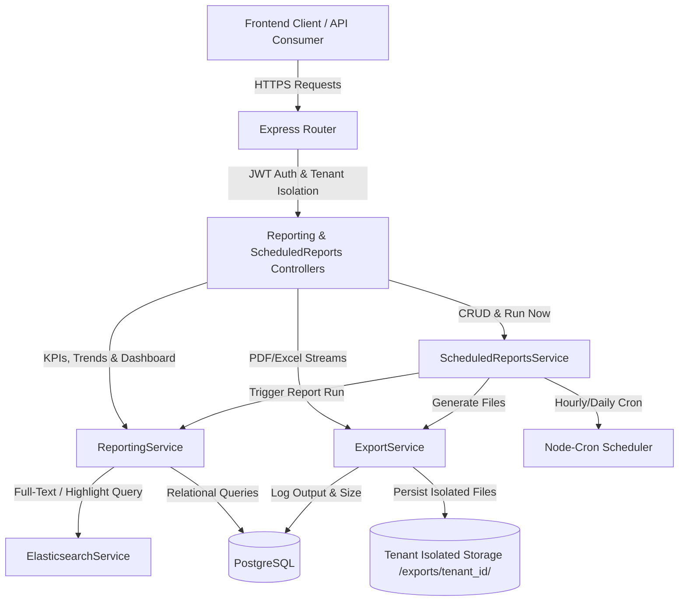
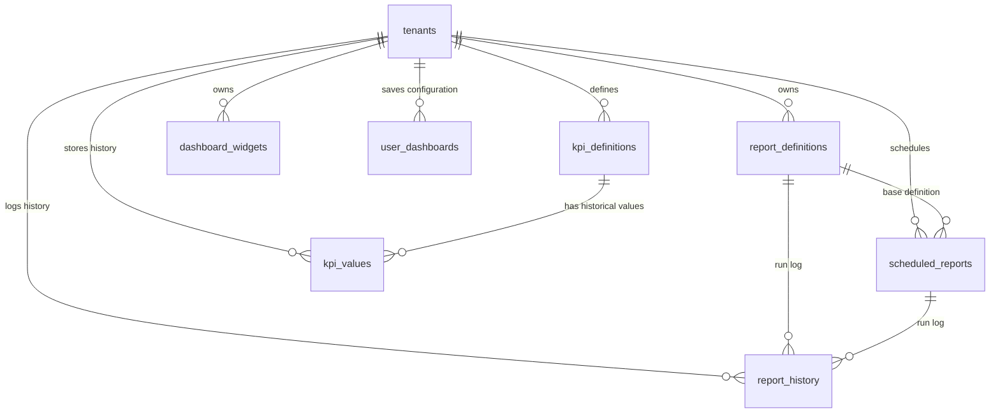
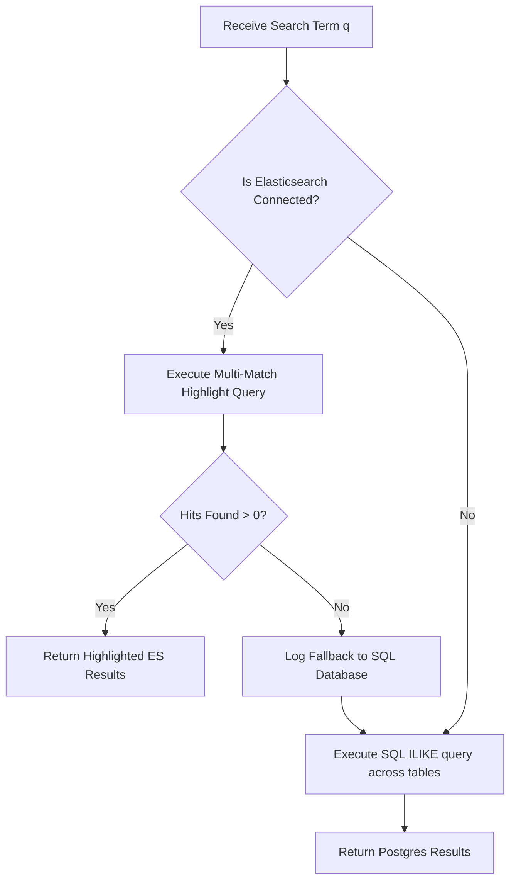

# QAssure Reporting & Analytics Service — Architectural Design Document

---

## 1. Architectural Vision

The **Reporting & Analytics Service** is a centralized analytics, dashboarding, KPI, search, and scheduling engine for the QAssure Platform. It provides a secure, multi-tenant portal for users to view system-wide quality compliance metrics, generate custom/standard reports, export tabular data in regulatory-compliant formats (PDF, Excel), search globally across all platform modules (CAPAs, Documents, Suppliers, Training), and schedule automated recurring report deliveries.

### Key Capabilities:
1. **Executive Dashboards & Compliance Health**: Real-time roll-ups of open CAPAs, document status, training assignment compliance, and supplier qualification statuses, synthesized into an overall Tenant Compliance Health Score.
2. **KPI Engine**: A definition-driven KPI tracking framework that monitors quality metrics against user-defined targets, calculating threshold breaches (warning, critical) dynamically.
3. **Global Federated Search**: High-performance, full-text search capability powered by Elasticsearch with dynamic hit highlighting and a transparent fallback path to database-backed SQL `ILIKE` queries if the search engine is unavailable.
4. **Tenant-Isolated Exports & History**: A secure document export system that compiles analytics into PDF or Excel spreadsheets, persists them inside isolated tenant directory paths (`exports/{tenant_id}/`), and registers audit logs in `report_history` for compliance audits (FDA 21 CFR Part 11).
5. **Scheduled Report Delivery**: A cron-driven task scheduler that automatically triggers reports on daily, weekly, monthly, or quarterly schedules, exports the results, logs history, and sets up files for email or system delivery.



---

## 2. Component Architecture

The service consists of the following decoupled system layers:

*   **Routing Layer (`reporting.routes.js`)**: Defines public API endpoints, gates routes behind JWT authorization (`authenticate`) and role-based permissions (`authorize('reports:read')` or `authorize('reports:write')` / `authorize('audit_logs:read')`), and automatically injects the tenant context middleware.
*   **Controller Layer (`reporting.controller.js` & `scheduled-reports.controller.js`)**: Processes incoming HTTP request headers, route params, query variables, and bodies; interacts with service instances; generates file download streams for exports; and maps errors to standard JSON response payloads.
*   **Reporting Service (`reporting.service.js`)**: Houses core logic to calculate quality KPIs, query trends, fetch executive dashboards, execute pre-defined reports (CAPA summaries, training compliance, document reviews, supplier scorecards), and query audit logs with automatic Postgres-to-Elasticsearch mapping.
*   **Scheduled Reports Service (`scheduled-reports.service.js`)**: Manages the persistent scheduler loop (powered by `node-cron`), schedules upcoming reports by calculating their next-run times, and handles CRUD operations for user schedules.
*   **Export Service (`export.service.js`)**: Translates raw database rows and JSON structures into rich PDF documents (via `pdfkit`) and Excel spreadsheets (via `exceljs`), handles multi-tenant directory partitioning, lists current files, and cleans up exports past their TTL (default 30 days).
*   **Elasticsearch Service (`elasticsearch.service.js`)**: Integrates with the platform's search cluster to index module resources (CAPAs, documents, training, suppliers), checks index health, performs multi-match fuzziness searches, and runs audit log searches.

---

## 3. Database Schema Design

The reporting engine is backed by seven relational tables in PostgreSQL:



### 3.1 `report_definitions`
Stores standard or customized report metadata configurations.

| Column | Type | Constraints | Description |
| :--- | :--- | :--- | :--- |
| `id` | `UUID` | `PRIMARY KEY`, Default `gen_random_uuid()` | Unique report identifier. |
| `tenant_id` | `UUID` | `NOT NULL`, `REFERENCES tenants(id)` | Owning tenant ID. |
| `name` | `VARCHAR(255)` | `NOT NULL` | Human-readable name. |
| `description` | `TEXT` | `allowNull: true` | Description of report purpose. |
| `code` | `VARCHAR(100)` | `allowNull: true` | Unique code used in service router (e.g. `capa_summary`). |
| `report_type` | `VARCHAR(50)` | `NOT NULL` | Type: `dashboard`, `list`, `summary`, `trend`, `compliance`. |
| `category` | `VARCHAR(100)`| `allowNull: true` | Category: `quality`, `training`, `supplier`, `capa`, `executive`. |
| `module` | `VARCHAR(100)`| `allowNull: true` | Source module: `documents`, `training`, `capa`, `suppliers`, `all`. |
| `config` | `JSONB` | `NOT NULL`, Default `'{}'` | Filters, column orders, formatting. |
| `chart_type` | `VARCHAR(50)` | `allowNull: true` | Recommended visual: `bar`, `line`, `pie`, `table`, `card`. |
| `is_system` | `BOOLEAN` | Default `FALSE` | Marks if this report is pre-seeded out of the box. |
| `is_public` | `BOOLEAN` | Default `FALSE` | Marks if accessible by all tenant members. |
| `owner_id` | `UUID` | `REFERENCES users(id)` | User who created the report configuration. |
| `is_active` | `BOOLEAN` | Default `TRUE` | Lifecycle status. |
| `created_by` | `UUID` | `REFERENCES users(id)` | Audit user reference. |
| `created_at` | `TIMESTAMPTZ` | Default `NOW()` | Timestamp. |
| `updated_at` | `TIMESTAMPTZ` | Default `NOW()` | Timestamp. |

*   **Indexes**:
    *   `idx_report_defs_tenant` on `(tenant_id)`
    *   `idx_report_defs_category` on `(category)`
    *   `idx_report_defs_module` on `(module)`
    *   Unique constraint on `(tenant_id, code)`

### 3.2 `scheduled_reports`
Stores configurations for automated recurring report tasks.

| Column | Type | Constraints | Description |
| :--- | :--- | :--- | :--- |
| `id` | `UUID` | `PRIMARY KEY`, Default `gen_random_uuid()` | Unique scheduled task ID. |
| `tenant_id` | `UUID` | `NOT NULL`, `REFERENCES tenants(id)` | Owning tenant ID. |
| `report_definition_id` | `UUID` | `NOT NULL`, `REFERENCES report_definitions(id)` | Associated report config. |
| `name` | `VARCHAR(255)` | `NOT NULL` | Name of the schedule task. |
| `schedule_type` | `VARCHAR(50)` | `NOT NULL` | Frequency: `daily`, `weekly`, `monthly`, `quarterly`. |
| `schedule_config` | `JSONB` | `allowNull: true` | Detailed timing variables (e.g. `{day_of_week: 1, hour: 6}`). |
| `recipients` | `JSONB` | `NOT NULL` | Array of recipient emails/user IDs. |
| `output_format` | `VARCHAR(50)` | Default `'pdf'` | Format: `pdf`, `xlsx`, `csv`. |
| `include_charts` | `BOOLEAN` | Default `TRUE` | Whether charts are rendered inside the document. |
| `is_active` | `BOOLEAN` | Default `TRUE` | Lifecycle toggle. |
| `last_run_at` | `TIMESTAMPTZ` | `allowNull: true` | Time of the last successful generation. |
| `next_run_at` | `TIMESTAMPTZ` | `allowNull: true` | Next scheduled run time. |
| `created_by` | `UUID` | `REFERENCES users(id)` | User who created the schedule. |
| `created_at` | `TIMESTAMPTZ` | Default `NOW()` | Timestamp. |

*   **Indexes**:
    *   `idx_scheduled_reports_tenant` on `(tenant_id)`
    *   `idx_scheduled_reports_next` on `(next_run_at)` WHERE `is_active = TRUE`

### 3.3 `report_history`
Acts as the central audit trail and download portal for all report executions.

| Column | Type | Constraints | Description |
| :--- | :--- | :--- | :--- |
| `id` | `UUID` | `PRIMARY KEY`, Default `gen_random_uuid()` | Execution log ID. |
| `tenant_id` | `UUID` | `NOT NULL`, `REFERENCES tenants(id)` | Owning tenant ID. |
| `report_definition_id` | `UUID` | `REFERENCES report_definitions(id)` | Associated report. |
| `scheduled_report_id` | `UUID` | `REFERENCES scheduled_reports(id)` | Scheduled parent task ID (if automated). |
| `report_name` | `VARCHAR(255)` | `NOT NULL` | Evaluated report label. |
| `executed_by` | `UUID` | `REFERENCES users(id)` | User ID who ran or owns the report trigger. |
| `executed_at` | `TIMESTAMPTZ` | Default `NOW()` | Generation timestamp. |
| `parameters` | `JSONB` | `allowNull: true` | Parameters passed during run. |
| `status` | `VARCHAR(50)` | Default `'completed'` | Run status: `running`, `completed`, `failed`. |
| `row_count` | `INTEGER` | `allowNull: true` | Number of data rows returned. |
| `execution_time_ms` | `INTEGER` | `allowNull: true` | Total database query + processing duration. |
| `output_path` | `VARCHAR(1000)`| `allowNull: true` | Relative file path in storage (`{tenant_id}/{filename}`). |
| `output_format` | `VARCHAR(50)` | `allowNull: true` | File suffix: `pdf`, `xlsx`. |
| `file_size` | `BIGINT` | `allowNull: true` | Size of the generated export in bytes. |
| `error_message` | `TEXT` | `allowNull: true` | Detailed stack or message if status is `failed`. |

*   **Indexes**:
    *   `idx_report_history_tenant` on `(tenant_id)`
    *   `idx_report_history_date` on `(executed_at)`

### 3.4 `kpi_definitions`
Defines automated indicators tracked by the platform.

| Column | Type | Constraints | Description |
| :--- | :--- | :--- | :--- |
| `id` | `UUID` | `PRIMARY KEY`, Default `gen_random_uuid()` | Unique indicator ID. |
| `tenant_id` | `UUID` | `NOT NULL`, `REFERENCES tenants(id)` | Owning tenant ID. |
| `name` | `VARCHAR(255)` | `NOT NULL` | Indicator display name. |
| `code` | `VARCHAR(100)` | `NOT NULL` | Unique code (e.g. `capa_ontime_rate`). |
| `description` | `TEXT` | `allowNull: true` | Purpose description. |
| `module` | `VARCHAR(100)` | `NOT NULL` | Target module. |
| `calculation_type` | `VARCHAR(50)` | `NOT NULL` | Metric formula type: `count`, `percentage`, `average`, `sum`. |
| `query_config` | `JSONB` | `NOT NULL` | Query configuration details. |
| `target_value` | `DECIMAL(15,4)`| `allowNull: true` | Target value to satisfy. |
| `target_direction` | `VARCHAR(20)` | `allowNull: true` | Target rule: `higher_better`, `lower_better`. |
| `warning_threshold` | `DECIMAL(15,4)`| `allowNull: true` | Warning boundary. |
| `critical_threshold`| `DECIMAL(15,4)`| `allowNull: true` | Critical boundary. |
| `unit` | `VARCHAR(50)` | `allowNull: true` | Measurement units (e.g., `%`, `days`, `count`). |
| `decimal_places` | `INTEGER` | Default `0` | Formatting decimals. |
| `is_active` | `BOOLEAN` | Default `TRUE` | Lifecycle toggle. |
| `created_at` | `TIMESTAMPTZ` | Default `NOW()` | Timestamp. |

*   **Indexes**:
    *   `idx_kpi_defs_tenant` on `(tenant_id)`
    *   `idx_kpi_defs_module` on `(module)`
    *   Unique constraint on `(tenant_id, code)`

---

## 4. Multi-Tenant Export Isolation & Storage

Security is paramount in a GxP compliance environment. File exports must be completely isolated between tenants:

1. **Storage Layout**: Generated files are organized on disk with a tenant namespace partition:
   ```
   exports/
   └── [tenant_uuid]/
       ├── capa_summary_report_1718818818000.pdf
       └── executive_dashboard_1718819000000.xlsx
   ```
2. **Path Traversal Protection**: File operations validate input parameters using `path.basename(filename)` to prevent directory traversal exploits (`../`).
3. **Ownership Verification**: Before serving a download, deleting an export, or cleaning files, the `ExportService` computes the target path using the authenticated user's `req.user.tenantId`. Files inside one tenant's directory are completely inaccessible to users in other tenants, returning `404 Not Found` or `403 Forbidden`.
4. **Output Tracking**: Every generated export is tracked in the `report_history` table, writing a relative route `output_path = "{tenant_uuid}/{filename}"`. Legacy exports generated without tenant folders are tracked in the root folder as fallback files.

---

## 5. Global Search: Elasticsearch & PostgreSQL Fallback

To provide unified searching capabilities without risking system availability, the reporting routes utilize a hybrid search orchestration logic:



1. **Active Syncing**: When entities are created or updated, they are indexed into Elasticsearch. The index name incorporates a prefix: `qassure-documents`, `qassure-capas`, `qassure-training`, and `qassure-suppliers`.
2. **Elasticsearch Mode**: The search executes a fuzzy `multi_match` query across fields (`title`, `description`, `content`, `name`, `course_code`, `supplier_code`, `capa_number`) scoped strictly to the user's `tenant_id`. Results are returned with HTML highlight tags (`<mark>query</mark>`).
3. **Database Fallback Mode**: If Elasticsearch is disconnected, or if an index is out of sync (returning 0 results), the `ReportingService` catches the exception and falls back to a SQL query, running parallel `ILIKE %query%` statements against `capas`, `documents`, `suppliers`, and `training_courses`.
