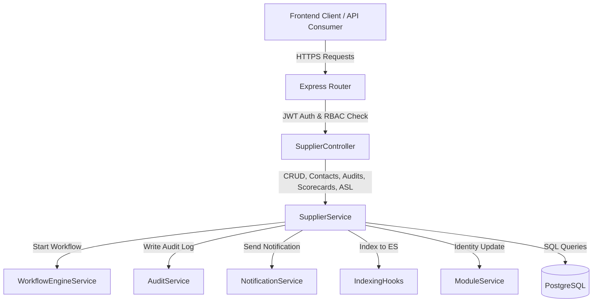
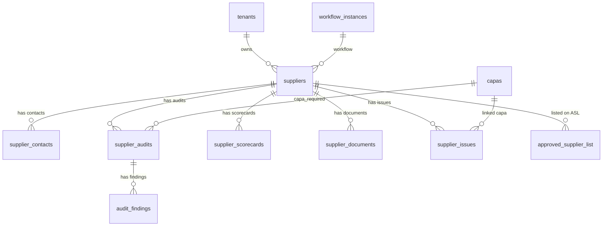

# QAssure Supplier Service — Architectural Design Document

---

## 1. Architectural Vision

The **Supplier Quality Management Service** is a core quality assurance module in the QAssure Platform. It manages the complete lifecycle of supplier relationships — from initial onboarding and qualification through periodic auditing, performance scoring, and approved supplier list (ASL) management. The service is designed to meet pharmaceutical and life science regulatory requirements including ISO 13485, ISO 9001, and FDA 21 CFR Part 820 Subpart E (Purchasing Controls).

### Key Capabilities:
1. **Multi-Tenant Supplier Registry**: Strict tenant isolation across all supplier records, contacts, audits, scorecards, and ASL entries.
2. **Supplier Qualification Workflow**: Automated workflow engine integration (`supplier_approval`) to route new suppliers through formal review and qualification phases.
3. **Audit Management Engine**: Structured supplier audit tracking with scheduled, in-progress, and completed audit records including findings management.
4. **Performance Scorecard System**: Weighted scoring across quality (40%), delivery (30%), service (20%), and cost (10%) dimensions. Automated grade calculation (`A` through `F`) and supplier profile score updates.
5. **Approved Supplier List (ASL)**: Material-category-scoped approval records with expiry tracking, restrictions management, and review scheduling.
6. **Auditing & GxP Compliance**: Automatic background logging of all CRUD operations, status changes, and audit completions to the platform's audit trails for FDA 21 CFR Part 11 compliance.
7. **Notification Routing**: Automated notifications to quality managers on new supplier creation and status changes.
8. **Search Engine Synchronization**: Elasticsearch indexing hooks keep supplier records discoverable across the platform.

---

## 2. Component Architecture

The Supplier Service consists of the following decoupled components:

*   **Routing Layer (`supplier.routes.js`)**: Defines routes, registers authentication (`authenticate`), enforces tenant context (`tenantContext`), checks role-based permissions (`authorize('supplier:read')` or `authorize('supplier:create')` / `authorize('supplier:update')`), and applies Zod validation middleware before passing to the controller.
*   **Controller Layer (`supplier.controller.js`)**: Sanitizes and validates HTTP requests (parameters, query strings, and payloads), handles responses, and provides static data lookups (types, categories, statuses, audit types).
*   **Supplier Service (`supplier.service.js`)**: Holds all business logic — auto-generates supplier codes (`SUP-XXXXX`) and audit numbers (`SA-YYYY-XXXX`), manages status transitions with validation, orchestrates scorecard weighted scoring and grade calculation, triggers async helper services (Notification, Audit, Workflow, Elasticsearch, ModuleService identity sync).
*   **Validation Layer (`supplier.schema.js`)**: Zod schemas enforcing type safety and field constraints for create/update supplier, add contact, create scorecard, and ID params.
*   **Database Tables** (PostgreSQL raw queries via `pool`):
    *   `suppliers`: Master supplier record.
    *   `supplier_contacts`: Multiple contacts per supplier with primary designation.
    *   `supplier_audits`: Scheduled and completed audit records.
    *   `audit_findings`: Individual findings within each audit.
    *   `supplier_scorecards`: Period-based performance scorecards.
    *   `supplier_documents`: Certificates, agreements, and specifications.
    *   `supplier_issues`: Performance issue tracking linked to CAPAs.
    *   `approved_supplier_list`: Material-category approval records.

---

## 3. Database Schema Design

The Supplier Quality module uses a multi-table relational schema designed for multi-tenancy:

### 3.1 `suppliers`
Stores the master supplier record information.

| Column | Type | Constraints | Description |
| :--- | :--- | :--- | :--- |
| `id` | `UUID` | `PRIMARY KEY`, Default `gen_random_uuid()` | Unique identifier. |
| `tenant_id` | `UUID` | `NOT NULL`, `REFERENCES tenants(id) ON DELETE CASCADE` | Multi-tenant separator. |
| `supplier_code` | `VARCHAR(100)` | `NOT NULL`, Unique per tenant | Auto-generated formatted code (e.g., `SUP-00001`). |
| `name` | `VARCHAR(500)` | `NOT NULL` | Commercial supplier name. |
| `legal_name` | `VARCHAR(500)` | `allowNull: true` | Registered legal entity name. |
| `supplier_type` | `VARCHAR(100)` | `allowNull: true` | Class: `manufacturer`, `distributor`, `service_provider`, `raw_material`, `contract_manufacturer`, `logistics`. |
| `category` | `VARCHAR(100)` | `allowNull: true` | Impact level: `critical`, `major`, `minor`. |
| `risk_level` | `VARCHAR(50)` | `allowNull: true` | Risk: `high`, `medium`, `low`. |
| `primary_contact_name` | `VARCHAR(255)` | `allowNull: true` | Default contact person. |
| `primary_contact_email` | `VARCHAR(255)` | `allowNull: true` | Default contact email. |
| `primary_contact_phone` | `VARCHAR(50)` | `allowNull: true` | Default contact phone. |
| `website` | `VARCHAR(500)` | `allowNull: true` | Supplier website URL. |
| `address_line1` | `VARCHAR(255)` | `allowNull: true` | Street address line 1. |
| `address_line2` | `VARCHAR(255)` | `allowNull: true` | Street address line 2. |
| `city` | `VARCHAR(100)` | `allowNull: true` | City. |
| `state` | `VARCHAR(100)` | `allowNull: true` | State/Province. |
| `country` | `VARCHAR(100)` | `allowNull: true` | Country. |
| `postal_code` | `VARCHAR(20)` | `allowNull: true` | Postal/ZIP code. |
| `tax_id` | `VARCHAR(100)` | `allowNull: true` | Tax identifier. |
| `duns_number` | `VARCHAR(20)` | `allowNull: true` | Dun & Bradstreet number. |
| `status` | `VARCHAR(50)` | Default `'pending'` | Lifecycle: `pending`, `qualified`, `approved`, `conditional`, `suspended`, `disqualified`. |
| `approved_date` | `DATE` | `allowNull: true` | Date supplier was formally approved. |
| `expiry_date` | `DATE` | `allowNull: true` | Approval expiry (auto-set 1 year from approval date). |
| `quality_agreement_signed` | `BOOLEAN` | Default `FALSE` | Quality agreement flag. |
| `quality_agreement_date` | `DATE` | `allowNull: true` | Quality agreement signing date. |
| `last_audit_date` | `DATE` | `allowNull: true` | Updated when audit is completed. |
| `next_audit_date` | `DATE` | `allowNull: true` | Scheduled next audit date. |
| `certifications` | `JSONB` | Default `'[]'` | Array: `[{name, issuing_body, expiry_date, document_url}]`. |
| `current_score` | `DECIMAL(5,2)` | `allowNull: true` | Latest overall scorecard score. |
| `score_grade` | `VARCHAR(10)` | `allowNull: true` | Grade: `A` (≥90), `B` (≥80), `C` (≥70), `D` (≥60), `F` (<60). |
| `products_services` | `TEXT[]` | `allowNull: true` | List of product/service categories supplied. |
| `workflow_instance_id` | `UUID` | `REFERENCES workflow_instances(id)` | Qualification workflow mapping. |
| `created_by` | `UUID` | `REFERENCES users(id)` | Creating user. |
| `updated_by` | `UUID` | `REFERENCES users(id)` | Last updating user. |
| `created_at` | `TIMESTAMPTZ` | Default `NOW()` | Creation timestamp. |
| `updated_at` | `TIMESTAMPTZ` | Default `NOW()` | Last update timestamp. |

**Indexes**:
*   Unique constraint `(tenant_id, supplier_code)`
*   `idx_suppliers_tenant` on `(tenant_id)`
*   `idx_suppliers_status` on `(tenant_id, status)`
*   `idx_suppliers_category` on `(category)`
*   `idx_suppliers_expiry` on `(expiry_date) WHERE status = 'approved'`

---

### 3.2 `supplier_contacts`
Stores multiple contacts per supplier.

| Column | Type | Constraints | Description |
| :--- | :--- | :--- | :--- |
| `id` | `UUID` | `PRIMARY KEY` | Unique contact ID. |
| `supplier_id` | `UUID` | `NOT NULL`, `REFERENCES suppliers(id) ON DELETE CASCADE` | Parent supplier. |
| `tenant_id` | `UUID` | `NOT NULL`, `REFERENCES tenants(id) ON DELETE CASCADE` | Tenant separation. |
| `name` | `VARCHAR(255)` | `NOT NULL` | Contact full name. |
| `title` | `VARCHAR(255)` | `allowNull: true` | Job title. |
| `email` | `VARCHAR(255)` | `allowNull: true` | Contact email. |
| `phone` | `VARCHAR(50)` | `allowNull: true` | Office phone. |
| `mobile` | `VARCHAR(50)` | `allowNull: true` | Mobile phone. |
| `contact_type` | `VARCHAR(100)` | `allowNull: true` | Role: `primary`, `quality`, `sales`, `technical`, `emergency`. |
| `is_primary` | `BOOLEAN` | Default `FALSE` | Primary contact flag. |
| `notes` | `TEXT` | `allowNull: true` | Additional notes. |
| `created_at` | `TIMESTAMPTZ` | Default `NOW()` | Timestamp. |

---

### 3.3 `supplier_audits`
Tracks scheduled and completed supplier audits.

| Column | Type | Constraints | Description |
| :--- | :--- | :--- | :--- |
| `id` | `UUID` | `PRIMARY KEY` | Unique audit ID. |
| `supplier_id` | `UUID` | `NOT NULL`, `REFERENCES suppliers(id) ON DELETE CASCADE` | Parent supplier. |
| `tenant_id` | `UUID` | `NOT NULL`, `REFERENCES tenants(id) ON DELETE CASCADE` | Tenant separation. |
| `audit_number` | `VARCHAR(100)` | `NOT NULL`, Unique per tenant | Auto-generated: `SA-YYYY-XXXX`. |
| `audit_type` | `VARCHAR(100)` | `NOT NULL` | Type: `initial`, `periodic`, `for_cause`, `follow_up`, `desktop`. |
| `audit_scope` | `TEXT` | `allowNull: true` | Scope description. |
| `scheduled_date` | `DATE` | `allowNull: true` | Planned audit date. |
| `actual_date` | `DATE` | `allowNull: true` | Actual audit execution date. |
| `lead_auditor_id` | `UUID` | `REFERENCES users(id)` | Lead auditor reference. |
| `audit_team` | `JSONB` | `allowNull: true` | Team: `[{user_id, name, role}]`. |
| `status` | `VARCHAR(50)` | Default `'planned'` | Lifecycle: `planned`, `in_progress`, `completed`, `cancelled`. |
| `findings_count` | `INTEGER` | Default `0` | Total findings count. |
| `major_findings` | `INTEGER` | Default `0` | Major findings count. |
| `minor_findings` | `INTEGER` | Default `0` | Minor findings count. |
| `observations` | `INTEGER` | Default `0` | Observation count. |
| `overall_rating` | `VARCHAR(50)` | `allowNull: true` | Rating: `acceptable`, `conditional`, `unacceptable`. |
| `score` | `DECIMAL(5,2)` | `allowNull: true` | Numeric audit score. |
| `executive_summary` | `TEXT` | `allowNull: true` | Audit summary narrative. |
| `strengths` | `TEXT` | `allowNull: true` | Documented strengths. |
| `weaknesses` | `TEXT` | `allowNull: true` | Documented weaknesses. |
| `recommendations` | `TEXT` | `allowNull: true` | Improvement recommendations. |
| `capa_required` | `BOOLEAN` | Default `FALSE` | Flag indicating CAPA is needed. |
| `capa_id` | `UUID` | `REFERENCES capas(id)` | Linked CAPA reference. |
| `next_audit_date` | `DATE` | `allowNull: true` | Next scheduled audit date. |
| `workflow_instance_id` | `UUID` | `REFERENCES workflow_instances(id)` | Workflow engine mapping. |
| `created_by` | `UUID` | `REFERENCES users(id)` | Creating user. |
| `created_at` | `TIMESTAMPTZ` | Default `NOW()` | Timestamp. |
| `updated_at` | `TIMESTAMPTZ` | Default `NOW()` | Timestamp. |

---

### 3.4 `supplier_scorecards`
Stores period-based weighted performance scorecards.

| Column | Type | Description |
| :--- | :--- | :--- |
| `id` | `UUID` | Unique scorecard ID. |
| `supplier_id` | `UUID` | Parent supplier reference. |
| `tenant_id` | `UUID` | Tenant separation key. |
| `period_start` | `DATE` | Evaluation period start date. |
| `period_end` | `DATE` | Evaluation period end date. |
| `quality_score` | `DECIMAL(5,2)` | Quality dimension score (0–100). Weight: 40%. |
| `defect_rate` | `DECIMAL(5,4)` | Defect rate metric. |
| `lot_acceptance_rate` | `DECIMAL(5,2)` | Lot acceptance rate metric. |
| `complaints_count` | `INTEGER` | Number of complaints in the period. |
| `delivery_score` | `DECIMAL(5,2)` | Delivery dimension score (0–100). Weight: 30%. |
| `on_time_delivery_rate` | `DECIMAL(5,2)` | On-time delivery percentage. |
| `lead_time_adherence` | `DECIMAL(5,2)` | Lead time adherence percentage. |
| `service_score` | `DECIMAL(5,2)` | Service dimension score (0–100). Weight: 20%. |
| `responsiveness_score` | `DECIMAL(5,2)` | Responsiveness metric. |
| `documentation_score` | `DECIMAL(5,2)` | Documentation quality metric. |
| `cost_score` | `DECIMAL(5,2)` | Cost dimension score (0–100). Weight: 10%. |
| `price_competitiveness` | `DECIMAL(5,2)` | Price competitiveness metric. |
| `overall_score` | `DECIMAL(5,2)` | Weighted composite score. |
| `grade` | `VARCHAR(10)` | Grade: `A`, `B`, `C`, `D`, `F`. |
| `trend` | `VARCHAR(20)` | Performance trend: `improving`, `stable`, `declining`. |
| `notes` | `TEXT` | Additional commentary. |
| `calculated_by` | `UUID` | User who calculated the scorecard. |
| `calculated_at` | `TIMESTAMPTZ` | Calculation timestamp. |

**Unique constraint**: `(supplier_id, period_start, period_end)`

---

### 3.5 `approved_supplier_list`
Manages material-category scoped ASL approvals.

| Column | Type | Description |
| :--- | :--- | :--- |
| `id` | `UUID` | Unique ASL entry ID. |
| `supplier_id` | `UUID` | Approved supplier reference. |
| `tenant_id` | `UUID` | Tenant separation key. |
| `material_category` | `VARCHAR(255)` | Material/category approved for (e.g., `API`, `Packaging`). |
| `material_codes` | `TEXT[]` | Specific material code list. |
| `approval_scope` | `TEXT` | Scope of the approval. |
| `restrictions` | `TEXT` | Any restrictions or conditions. |
| `approved_date` | `DATE` | Date of approval. |
| `expiry_date` | `DATE` | Approval expiry date. |
| `review_date` | `DATE` | Next review date. |
| `status` | `VARCHAR(50)` | Lifecycle: `active`, `expired`, `suspended`, `removed`. |
| `approved_by` | `UUID` | Approving user reference. |
| `signature_id` | `UUID` | Electronic signature reference. |
| `notes` | `TEXT` | Approval notes. |
| `created_at` | `TIMESTAMPTZ` | Timestamp. |

**Unique constraint**: `(supplier_id, material_category)`

---

## 4. Integration Points & Workflows

### 4.1 Qualification Workflow Integration
When a supplier is submitted (`SupplierService.submitForApproval`), it starts the `supplier_approval` workflow definition:
1. Validates current status is `'pending'`.
2. Starts the workflow instance, storing `category` and `risk_level` in the context.
3. Automatically sets status to `'qualified'` and stores the `workflow_instance_id`.
4. Subsequent state transitions (`approved`, `conditional`, `suspended`, `disqualified`) can be managed via the `PATCH /:id/status` endpoint or the Workflow Engine.

### 4.2 Scorecard Auto-Scoring
When `SupplierService.createScorecard` is called:
1. Weighted overall score is calculated: `(quality × 0.4) + (delivery × 0.3) + (service × 0.2) + (cost × 0.1)`.
2. Grade is assigned: `A` (≥90), `B` (≥80), `C` (≥70), `D` (≥60), `F` (<60).
3. The supplier master record (`current_score`, `score_grade`) is automatically updated.

### 4.3 Audit Completion & Supplier Profile Sync
When `SupplierService.completeAudit` is called:
1. Audit record is updated to `'completed'` with all findings, rating, and score data.
2. The parent supplier's `last_audit_date` and `next_audit_date` are automatically updated.
3. GxP audit log entry is written via `AuditService`.

### 4.4 Approval Expiry Automation
When `updateStatus` transitions a supplier to `'approved'`:
1. `approved_date` is set to the current date.
2. `expiry_date` is automatically set to exactly 1 year from the approval date.
3. The dashboard `expiring_soon` metric tracks suppliers where `expiry_date < NOW() + INTERVAL '30 days'`.

### 4.5 Search Engine Synchronization
Supplier records participate in Elasticsearch indexing via hooks (`IndexingHooks.indexSupplier`):
*   Triggered during `create` operations.
*   Mapped fields: `supplier_code`, `name`, `category`, `status`, `tenant_id`.
*   Ensures full-text search availability immediately after creation.

### 4.6 Module Identity Sync
On `create` and `update`, the `ModuleService.sendIdentityUpdate` function is invoked to keep cross-module supplier references synchronized.
