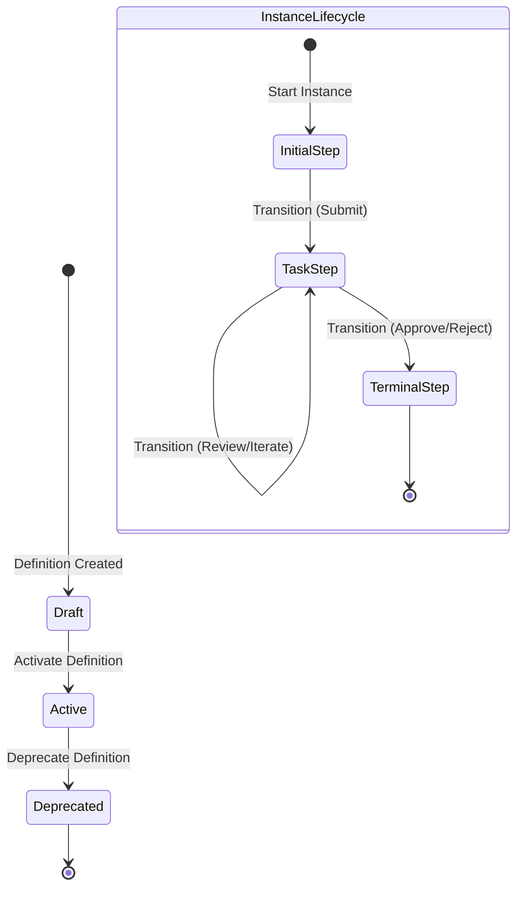
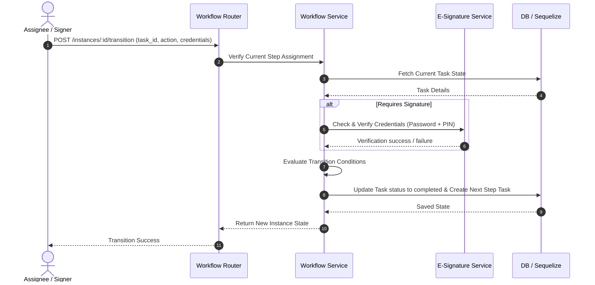

# Workflow Engine Service - Design Document
**Configurable Multi-Step State Transition Orchestrator**

---

## 1. Overview
The Workflow Engine Service in QAssure acts as the central state-machine, driving records through sequential business steps (e.g. Draft -> Review -> Approved/Rejected). It provides conditional logic, role/user assignments, SLA compliance alerts, and mandatory compliance validation gates (comments, attachments, signatures).

Key design objectives include:
*   **Definition & Versioning**: Workflows are declared using definitions, steps, and transitions. Definitions can be cloned, deprecated, and activated.
*   **Asynchronous Processing**: Transition events publish hooks and trigger actions.
*   **Dynamic Assignees**: Steps assign work to individual users, tenant roles, or the originator.
*   **FDA Compliance Integration**: Steps can enforce electronic signature checks or mandatory reviewer comments.

---

## 2. Architecture & Data Flow

### 2.1 State Transitions Sequence

---

## 3. Database Schema Mapping
The Workflow Engine uses Sequelize to map relationships and persist states. Below are the complete schemas for all seven workflow-related database tables.

### 3.1 Workflow Definitions (`workflow_definitions`)
Persists workflow blueprints and entity templates.
*   `id` (UUID, Primary Key, Non-Nullable): Unique ID.
*   `tenant_id` (UUID, Non-Nullable): Scopes ownership to tenant.
*   `name` (String(255), Non-Nullable): Readable name.
*   `description` (Text, Nullable): Long form description.
*   `code` (String(100), Non-Nullable): Unique identifier key.
*   `version` (Integer, Default: 1): Revision control version.
*   `entity_type` (String(100), Non-Nullable): Entity class target (e.g. `document`, `capa`).
*   `status` (String(50), Default: `'draft'`): Blueprints states (`draft`, `active`, `deprecated`, `archived`).
*   `is_default` (Boolean, Default: `false`): Sets fallback status.
*   `config` (JSONB, Default: `{}`): Custom config payload.
*   `created_by` (UUID, Nullable): Foreign key to authoring user.
*   `updated_by` (UUID, Nullable): Foreign key to updating user.
*   `source_module` (Array(String), Default: `['platform']`): Binds system roots.
*   `source_module_id` (Array(UUID), Default: `[]`): Associated module context.
*   `created_at` (Date): Creation timestamp.
*   `updated_at` (Date): Update timestamp.

### 3.2 Workflow Steps (`workflow_steps`)
Steps declared under a specific definition.
*   `id` (UUID, Primary Key, Non-Nullable): Unique step ID.
*   `workflow_definition_id` (UUID, Non-Nullable): Associated definition parent ID.
*   `tenant_id` (UUID, Non-Nullable): Associated tenant ID.
*   `step_code` (String(100), Non-Nullable): Key code referencing the step.
*   `name` (String(255), Non-Nullable): Display name.
*   `description` (Text, Nullable): Purpose definition.
*   `sequence` (Integer, Non-Nullable): Placement index order.
*   `step_type` (String(50), Default: `'task'`): Type of step (`initial`, `task`, `approval`, `terminal`).
*   `assignee_type` (String(50), Nullable): Group type routing (`user`, `role`, `originator`).
*   `assignee_id` (UUID, Nullable): Singular target user.
*   `assignee_user_ids` (Array(UUID), Nullable): Multi-user target mappings.
*   `assignee_role` (String(100), Nullable): Target role name code.
*   `assignee_role_ids` (Array(UUID), Nullable): Allowed user-role mappings.
*   `sla_hours` (Integer, Nullable): Completion deadline threshold.
*   `sla_warning_hours` (Integer, Nullable): Warning buffer before breach.
*   `sla_escalation_hours` (Integer, Nullable): Breach escalation threshold.
*   `escalation_to` (String(50), Nullable): Escalation strategy target.
*   `escalation_role` (String(100), Nullable): Escalated target role.
*   `escalation_user_id` (UUID, Nullable): Escalated target user.
*   `requires_signature` (Boolean, Default: `false`): Enforces Electronic Signature verification.
*   `requires_comment` (Boolean, Default: `false`): Enforces validation comments.
*   `requires_attachment` (Boolean, Default: `false`): Enforces attachments.
*   `available_actions` (JSONB, Default: `['approve', 'reject']`): Allowed step actions list.
*   `form_config` (JSONB, Nullable): Component inputs configuration.
*   `created_at` (Date): Creation timestamp.
*   `updated_at` (Date): Update timestamp.

### 3.3 Workflow Transitions (`workflow_transitions`)
Connects sequential steps defining routes.
*   `id` (UUID, Primary Key, Non-Nullable): Unique ID.
*   `workflow_definition_id` (UUID, Non-Nullable): Associated definition parent ID.
*   `tenant_id` (UUID, Non-Nullable): Tenant context ID.
*   `from_step_id` (UUID, Non-Nullable): Start step pointer.
*   `to_step_id` (UUID, Non-Nullable): Target step pointer.
*   `action` (String(100), Non-Nullable): Trigger action key.
*   `name` (String(255), Nullable): Display label.
*   `condition_expression` (Text, Nullable): Logical validation formula.
*   `condition_config` (JSONB, Nullable): JSON structures of validation rules.
*   `requires_signature` (Boolean, Default: `false`): Enforces signature.
*   `requires_comment` (Boolean, Default: `false`): Enforces comment.
*   `signature_meaning` (String(255), Nullable): Standardized FDA text justification.
*   `priority` (Integer, Default: 0): Resolving priority.
*   `created_at` (Date): Creation timestamp.

### 3.4 Workflow Instances (`workflow_instances`)
Active runtime execution tracking records.
*   `id` (UUID, Primary Key, Non-Nullable): Unique ID.
*   `entity_name` (String(500), Nullable): Target entity display name.
*   `cancelled_at` (Date, Nullable): Cancellation timestamp.
*   `cancelled_by` (UUID, Nullable): User ID initiating cancellation.
*   `cancellation_reason` (Text, Nullable): Reason description.
*   `workflow_definition_id` (UUID, Non-Nullable): Bound definition template.
*   `tenant_id` (UUID, Non-Nullable): Scoped tenant ID.
*   `entity_type` (String(100), Non-Nullable): Bound record type.
*   `entity_id` (UUID, Non-Nullable): Bound record ID.
*   `current_step_id` (UUID, Nullable): Active current step pointer.
*   `status` (String(50), Default: `'pending'`): Status (`pending`, `active`, `completed`, `cancelled`).
*   `started_by` (UUID, Nullable): Instance originator.
*   `started_at` (Date, Nullable): Start timestamp.
*   `completed_at` (Date, Nullable): Finish timestamp.
*   `context` (JSONB, Default: `{}`): Execution state bag.
*   `source_module` (String(100), Default: `'platform'`): Parent module.
*   `source_module_id` (UUID, Nullable): Parent context ID.
*   `created_at` (Date): Creation timestamp.
*   `updated_at` (Date): Update timestamp.

### 3.5 Workflow Tasks (`workflow_tasks`)
Pending user assignment records representing steps.
*   `id` (UUID, Primary Key, Non-Nullable): Unique task ID.
*   `tenant_id` (UUID, Non-Nullable): Scoped tenant ID.
*   `workflow_instance_id` (UUID, Non-Nullable): Owner instance pointer.
*   `workflow_step_id` (UUID, Non-Nullable): Target step description.
*   `assigned_to` (UUID, Nullable): Claimed user assignee.
*   `assigned_user_ids` (Array(UUID), Nullable): Eligible user list.
*   `assigned_role` (String(100), Nullable): Eligible role.
*   `assigned_role_ids` (Array(UUID), Nullable): Eligible role list.
*   `assigned_at` (Date, Default: Now): Creation time.
*   `assigned_by` (UUID, Nullable): Instantiator.
*   `status` (String(50), Default: `'pending'`): Task status (`pending`, `completed`, `cancelled`).
*   `due_at` (Date, Nullable): SLA completion deadline.
*   `warning_sent_at` (Date, Nullable): Warning dispatch timestamp.
*   `overdue_reminder_sent_at` (Date, Nullable): Overdue reminder dispatch timestamp.
*   `escalated_at` (Date, Nullable): Escalation trigger timestamp.
*   `escalated_to` (UUID, Nullable): Escalated target user.
*   `completed_at` (Date, Nullable): Task execution time.
*   `completed_by` (UUID, Nullable): Executing user ID.
*   `action_taken` (String(100), Nullable): Resolved action key.
*   `comments` (Text, Nullable): Logged justification.
*   `delegated_from` (UUID, Nullable): Originating delegator.
*   `delegation_reason` (Text, Nullable): Explanation context.
*   `signature_id` (UUID, Nullable): Reference link to e-signature record.
*   `created_at` (Date): Creation timestamp.
*   `updated_at` (Date): Update timestamp.

### 3.6 Workflow History (`workflow_history`)
Immutable audit log trails of all movements.
*   `id` (UUID, Primary Key, Non-Nullable): Unique ID.
*   `tenant_id` (UUID, Non-Nullable): Scoped tenant ID.
*   `signature_id` (UUID, Nullable): Associated FDA e-signature log.
*   `workflow_instance_id` (UUID, Non-Nullable): Reference instance ID.
*   `event_type` (String(100), Non-Nullable): Log event classifier.
*   `from_step_id` (UUID, Nullable): Source step pointer.
*   `to_step_id` (UUID, Nullable): Destination step pointer.
*   `from_step_name` (String(255), Nullable): Source display name.
*   `to_step_name` (String(255), Nullable): Target display name.
*   `action` (String(100), Nullable): Executed action code.
*   `comments` (Text, Nullable): Appended feedback comment.
*   `performed_by` (UUID, Nullable): Initiating user ID.
*   `performed_by_name` (String(255), Nullable): Initiator full name.
*   `performed_at` (Date, Default: Now): Transaction time.
*   `metadata` (JSONB, Nullable): Auxiliary logs structure.
*   `created_at` (Date): Creation timestamp.

### 3.7 Workflow Delegates (`workflow_delegates`)
Automatic assignment routing records.
*   `id` (UUID, Primary Key, Non-Nullable): Unique ID.
*   `tenant_id` (UUID, Non-Nullable): Scoped tenant ID.
*   `delegator_id` (UUID, Non-Nullable): User passing the authority.
*   `delegate_id` (UUID, Non-Nullable): User receiving the authority.
*   `workflow_definition_id` (UUID, Nullable): Optional workflow restriction limit.
*   `entity_type` (String(100), Nullable): Optional entity target limit.
*   `starts_at` (Date, Non-Nullable): Start date active window.
*   `ends_at` (Date, Nullable): End date active window.
*   `is_active` (Boolean, Default: `true`): Explicit enablement flag.
*   `reason` (Text, Nullable): Purpose definition.
*   `created_by` (UUID, Nullable): Requesting user.
*   `created_at` (Date): Creation timestamp.
