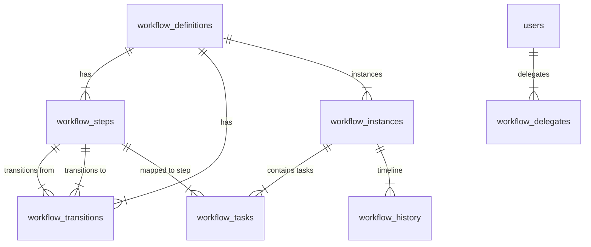

# QAssure Workflow Service

## Technical Knowledge Transfer (KT) Guide

Welcome to the technical Knowledge Transfer (KT) guide for the **Workflow Service** of the QAssure Platform. This document outlines the service's architecture, routes, database schemas, validation layers, execution engine, task assignments, delegation, SLA mechanisms, and integrations (e.g., electronic signatures and document service gates).

---

## 1. Architectural Overview

The Workflow Service is a robust, multi-tenant state machine engine that handles the lifecycle of business processes (definitions, steps, transitions, instances, and tasks) for different entity types (like documents or compliance records).

### Directory & Component Map

- **Routing Layer**: [workflow.routes.js](file:///home/tech4biz/Downloads/Sibarchan/QAssure/QAssur-backend/src/routes/workflow.routes.js) handles HTTP route definitions, middleware chains (authentication, tenant context), and maps validation schemas and RBAC authorization policies.
- **Validation Layer**: [workflow.schema.js](file:///home/tech4biz/Downloads/Sibarchan/QAssure/QAssur-backend/src/validation/workflow.schema.js) enforces strict request payloads using Zod schemas for definitions, transitions, tasks, and instances.
- **Controller Layer**: [workflow.controller.js](file:///home/tech4biz/Downloads/Sibarchan/QAssure/QAssur-backend/src/controllers/workflow.controller.js) parses query/body parameters, extracts user roles and tenant scopes, maps incoming HTTP requests to service calls, and handles responses and error formats.
- **Service Layer**:
  - [workflow-definition.service.js](file:///home/tech4biz/Downloads/Sibarchan/QAssure/QAssur-backend/src/services/workflow-definition.service.js) manages workflow templates: definition creation, step and transition layouts, clone/deprecate actions, assignee validation, and structure validation.
  - [workflow-engine.service.js](file:///home/tech4biz/Downloads/Sibarchan/QAssure/QAssur-backend/src/services/workflow-engine.service.js) drives the state machine lifecycle. It starts instances, completes tasks, executes transitions, resets sections on rework, handles electronic signatures, records historical audits, and publishes events.
  - [workflow-task.service.js](file:///home/tech4biz/Downloads/Sibarchan/QAssure/QAssur-backend/src/services/workflow-task.service.js) manages individual tasks. It handles task queues (`getMyTasks`), claims, releases, delegations, and contains the cron hooks for SLA warning and escalation alerts.
- **Scheduler Layer**:
  - [reminder.scheduler.js](file:///home/tech4biz/Downloads/Sibarchan/QAssure/QAssur-backend/reminder.scheduler.js) checks daily and on server boot for pending tasks that are due soon (within 24 hours) or overdue, and triggers the respective notification templates.

---

## 2. System Interaction Workflows

### A. Workflow Definition Creation & Structure Validation

This sequence details how a new workflow template is created and structurally verified before it can be stored.

```mermaid
sequenceDiagram
    autonumber
    actor Admin as Workflow Admin
    participant Ctrl as workflow.controller
    participant Svc as workflow-definition.service
    database DB as PostgreSQL DB

    Admin->>Ctrl: POST /api/v1/workflows/definitions (payload)
    Ctrl->>Svc: create(tenantId, data, createdBy)
    Note over Svc: Starts database transaction (BEGIN)
    Svc->>DB: INSERT INTO workflow_definitions
    Svc->>Svc: _validateAssignees()
    Svc->>DB: INSERT INTO workflow_steps
    Svc->>DB: INSERT INTO workflow_transitions
    Svc->>Svc: _validateStructure()
    Note over Svc: Runs connectivity check (e.g. 1 initial, >=1 terminal)
    Svc->>DB: COMMIT
    Svc-->>Ctrl: returns full definition details
    Ctrl-->>Admin: 201 Created (JSON data)
```

### B. Starting a Workflow Instance & Assigning the Initial Task

When a user triggers a business process (e.g. submitting a document for review), a workflow instance is spun up.

```mermaid
sequenceDiagram
    autonumber
    actor User as Originator User
    participant Ctrl as workflow.controller
    participant Eng as workflow-engine.service
    participant Def as workflow-definition.service
    database DB as PostgreSQL DB
    participant Kafka as Kafka Event Broker

    User->>Ctrl: POST /api/v1/workflows/instances (payload)
    Ctrl->>Eng: startWorkflow({tenantId, workflowCode, context, startedBy, req})
    Note over Eng: Starts database transaction (BEGIN)
    Eng->>Def: getById() or getByCode()
    Def-->>Eng: active workflow definition
    Note over Eng: Identifies step with step_type = 'initial'
    Eng->>DB: INSERT INTO workflow_instances (status = 'active')
    Eng->>Eng: _createTask()
    Note over Eng: Resolves assignees & checks active delegation
    Eng->>DB: INSERT INTO workflow_tasks (status = 'pending')
    Eng->>DB: INSERT INTO workflow_history (event_type = 'workflow_started')
    Eng->>DB: COMMIT
    Eng->>Kafka: Publish "workflow.started" event
    Eng-->>Ctrl: Returns instance details
    Ctrl-->>User: 201 Created
```

### C. Transitioning a Task (including Section Gates, Signatures & Auto-Approve)

Active tasks can be transitioned forward (e.g. approved) or backward (e.g. rejected / rework). This sequence maps that process.

```mermaid
sequenceDiagram
    autonumber
    actor User as Assigned User / Role Claimer
    participant Ctrl as workflow.controller
    participant Eng as workflow-engine.service
    database DB as PostgreSQL DB
    participant ESig as electronic-signature.service
    participant Doc as document.service
    participant Kafka as Kafka Event Broker

    User->>Ctrl: POST /api/v1/workflows/instances/:id/transition (task_id, action, signature)
    Ctrl->>Eng: transition({tenantId, instanceId, taskId, action, signature, performedBy})
    Note over Eng: Starts database transaction (BEGIN)
    Eng->>DB: Fetch instance and task raw status
    Note over Eng: Validates assignee permission & action
    opt If entity_type = 'document' (Section Completion Gate)
        Eng->>Doc: countSectionsByStatus(), countUnresolvedComments()
        Note over Eng: Validates all sections reviewed if terminal step, or no inherited issues if forward step
    end
    opt If transition requires signature
        Eng->>ESig: sign(password, pin, action)
        ESig-->>Eng: signature_id
    end
    Eng->>DB: UPDATE workflow_tasks SET status = 'completed'
    Eng->>DB: UPDATE workflow_instances SET current_step_id = to_step_id
    Eng->>DB: INSERT INTO workflow_history (event_type = 'step_completed')
    opt If backward/rework transition & entity_type = 'document'
        Eng->>Doc: resetSectionsForRework()
    end
    opt If to_step_type = 'terminal' (Workflow Completion)
        Eng->>DB: UPDATE workflow_instances SET status = 'completed'
        opt If entity_type = 'document'
            Eng->>DB: UPDATE documents & document_versions SET status = 'approved'
            Eng->>Doc: markWorkflowApproved()
        end
        Eng->>DB: INSERT INTO workflow_history (event_type = 'workflow_completed')
        Eng->>Kafka: Publish "workflow.completed" event
    end
    opt If to_step_type != 'terminal' (Create task for next step)
        Eng->>Eng: _createTask() for next step
    end
    Eng->>DB: COMMIT
    Eng->>Kafka: Publish "workflow.transitioned" event
    Eng-->>Ctrl: Returns updated instance details
    Ctrl-->>User: 200 OK
```

---

## 3. Route Definition and Validation Reference

All workflow endpoints require authentication and tenant context. They are prefixed by `/api/v1/workflows`.

| Route Method | URL Path | Permission Required | Validation Schema | Description |
| :--- | :--- | :--- | :--- | :--- |
| **POST** | `/definitions` | `workflow:create` | `CreateWorkflowDefinitionSchema` | Creates a new workflow template structure. |
| **GET** | `/definitions` | `workflow:read` | None (Query parsing) | Lists definitions with filters (status, entity type, module, etc). |
| **GET** | `/definitions/:id` | `workflow:read` | `IdParamsSchema` | Fetches a workflow template definition by UUID. |
| **PUT** | `/definitions/:id` | `workflow:create` | `IdParamsSchema`, `UpdateWorkflowDefinitionSchema` | Updates metadata (name, description, status, config). |
| **DELETE** | `/definitions/:id` | `workflow:admin` | `IdParamsSchema` | Hard deletes a definition (only if no instances exist). |
| **POST** | `/definitions/:id/clone` | `workflow:create` | `IdParamsSchema` | Clones a definition into a draft copy. |
| **POST** | `/definitions/:id/activate` | `workflow:create` | `IdParamsSchema` | Transitions a definition status to `active`. |
| **POST** | `/definitions/:id/deprecate` | `workflow:create` | `IdParamsSchema` | Transitions a definition status to `deprecated`. |
| **GET** | `/tasks` | Authenticated | None (Query parsing) | Retrieves a list of active workflow tasks assigned to the user, their roles, or delegators. |
| **GET** | `/tasks/counts` | Authenticated | None (Query parsing) | Returns pending, overdue, due soon, and weekly task counts for dashboards. |
| **GET** | `/tasks/:id` | Authenticated | `IdParamsSchema` | Fetches details and available transitions for a specific task. |
| **POST** | `/tasks/:id/delegate` | Authenticated (Disabled) | `IdParamsSchema`, `DelegateTaskSchema` | *Unused / Commented out in routes.* Re-assigns the task to another active tenant user with matching roles. |
| **POST** | `/tasks/:id/claim` | Authenticated (Disabled) | `IdParamsSchema` | *Unused / Commented out in routes.* Claims a role-assigned task, setting status to `in_progress`. |
| **POST** | `/tasks/:id/release` | Authenticated (Disabled) | `IdParamsSchema` | *Unused / Commented out in routes.* Releases a claimed task back into the pool. |
| **POST** | `/instances` | Authenticated | `StartWorkflowSchema` | Spins up a new workflow instance and issues its first task. |
| **GET** | `/instances` | `workflow:read` | None (Query parsing) | Lists active and completed workflow instances. |
| **GET** | `/instances/:id` | Authenticated | `IdParamsSchema` | Fetches an instance with its active task and definition structure. |
| **GET** | `/instances/:id/history` | Authenticated | `IdParamsSchema` | Returns the audit logs and historic timeline of an instance. |
| **GET** | `/instances/:id/actions` | Authenticated | `IdParamsSchema` | Lists actions valid at the instance's current step. |
| **POST** | `/instances/:id/transition` | Authenticated | `IdParamsSchema`, `TransitionWorkflowSchema` | Executes a transition step, completing the active task. |
| **POST** | `/instances/:id/cancel` | Originator / Admin | `IdParamsSchema`, `CancelWorkflowSchema` | Aborts a workflow, skipping pending tasks. |

---

## 4. Key Implementation Details

### A. Structure Validation (`_validateStructure`)

To prevent runtime errors, a workflow definition is validated during creation in `workflow-definition.service.js`:

```mermaid
graph TD
    A[Start Structure Validation] --> B{Has exactly 1 'initial' step?}
    B -- No --> C[Throw Error: Exactly 1 initial step required]
    B -- Yes --> D{Has at least 1 'terminal' step?}
    D -- No --> E[Throw Error: At least 1 terminal step required]
    D -- Yes --> F[Loop through all steps]
    
    F --> G{Is step terminal?}
    G -- No --> H{Has outgoing transitions?}
    H -- No --> I[Throw Error: Must have at least 1 outgoing transition]
    H -- Yes --> J{Is step reachable?}
    
    G -- Yes --> K{Has outgoing transitions?}
    K -- Yes --> L[Throw Error: Terminal step cannot have outgoing transitions]
    K -- No --> J
    
    J -- No --> M[Throw Error: Step is unreachable (no incoming transitions)]
    J -- Yes --> N[Next Step / Validation Complete]
```

### B. SLA Warning, Escalation, and Reminder Engine

Task deadlines and automatic assignee notifications are processed via cron schedulers:

- **SLA Calculation**: When a task is created, its `due_at` is calculated based on the step's `sla_hours`.
- **SLA Warnings & Overdue Reminders (`reminder.scheduler.js`)**: 
  - Runs daily at 9:00 AM UTC and on server startup (after a 45-second delay).
  - **Due Soon Warnings**: Pulls pending tasks due within the next 24 hours where `warning_sent_at` is NULL. It fires the `workflow_task_due_soon` notification template to all resolved assignees and sets `warning_sent_at = NOW()`.
  - **Overdue Reminders**: Pulls pending tasks past their `due_at` where `overdue_reminder_sent_at` is NULL or is older than 24 hours. It fires the `workflow_task_overdue` notification template and updates `overdue_reminder_sent_at = NOW()`.
- **Escalations**: Overdue tasks (`due_at < NOW()` and `escalated_at IS NULL`) are escalated. The system records a `task_escalated` history, reassigns the task, publishes a Kafka event, and logs the incident.

### C. Electronic Signatures

Certain high-risk transitions require FDA 21 CFR Part 11 compliant electronic signatures:
1. The transition Zod validation schema checks that the password is provided.
2. In `workflow-engine.service.js`, the signature is sent to the `electronic-signature.service.js`.
3. The password and optional PIN are verified.
4. A signature record is logged in the `electronic_signatures` table containing the user, action, timestamp, meaning, user agent, and IP address. The resulting `signature_id` is linked to the completed task and history record.

### D. Section Completion Gates & Rework Resets

For `document` entity workflows, the engine integrates directly with `document.service.js`:
- **Forward Progress Guard**: Non-backward transitions block forward progress if there are pending unreviewed sections or unresolved comments inherited from previous steps.
- **Terminal Guard**: Reaching the final terminal step requires 100% of sections to be reviewed and all comments to be marked as resolved.
- **Rework Reset**: If a user selects a backward/rework action (e.g. `reject`, `rework`, `return`), the engine automatically invokes `documentService.resetSectionsForRework()`, resetting section statuses for editing.

---

## 5. Database Schema & Tables Map

The Workflow Service is mapped across these PostgreSQL tables:



### `workflow_definitions`
- `id` (UUID, PK) - Unique identifier.
- `tenant_id` (UUID, FK) - Mapped tenant context.
- `name` / `code` / `description` (VARCHAR) - Labels and template code keys.
- `entity_type` (VARCHAR) - Target entities (e.g. `'document'`, `'evidence'`).
- `entity_id` (UUID, Nullable) - Specific entity instance override.
- `status` (VARCHAR) - `'draft'`, `'active'`, `'deprecated'`, or `'archived'`.
- `is_default` (BOOLEAN) - Serves as fallback template for `entity_type`.
- `config` (JSONB) - Miscellaneous rules.
- `source_module` (VARCHAR[]) - Authorized modules (e.g. `['documents', 'evidence']`).
- `source_module_id` (UUID[]) - Authorized module IDs.

### `workflow_steps`
- `id` (UUID, PK)
- `workflow_definition_id` (UUID, FK)
- `step_code` (VARCHAR) - Key matching transitions (e.g. `'draft'`, `'mgr_review'`).
- `name` / `description` (VARCHAR)
- `sequence` (INTEGER) - Order sequence (defaults to lowest for initial step).
- `step_type` (VARCHAR) - `'initial'`, `'task'`, `'approval'`, or `'terminal'`.
- `assignee_type` (VARCHAR) - `'user'`, `'role'`, or `'originator'`.
- `assignee_user_ids` (UUID[]) - User assignees (if `'user'`).
- `assignee_role_ids` (UUID[]) - Role assignees (if `'role'`).
- `sla_hours` / `sla_warning_hours` / `sla_escalation_hours` (INTEGER) - SLA parameters.
- `requires_signature` / `requires_comment` / `requires_attachment` (BOOLEAN) - Gate requirements.
- `available_actions` (JSONB) - Actions permitted (e.g. `["approve", "reject"]`).

### `workflow_transitions`
- `id` (UUID, PK)
- `workflow_definition_id` (UUID, FK)
- `from_step_id` (UUID, FK -> `workflow_steps`)
- `to_step_id` (UUID, FK -> `workflow_steps`)
- `action` (VARCHAR) - Triggering action (e.g. `'approve'`).
- `name` (VARCHAR) - Display label.
- `requires_signature` / `requires_comment` (BOOLEAN)
- `signature_meaning` (VARCHAR) - Compliant signoff text.
- `priority` (INTEGER) - Multi-transition evaluation order.

### `workflow_instances`
- `id` (UUID, PK)
- `tenant_id` (UUID, FK)
- `workflow_definition_id` (UUID, FK)
- `entity_type` / `entity_id` / `entity_name` (VARCHAR/UUID) - Targeted record metadata.
- `current_step_id` (UUID, FK -> `workflow_steps`)
- `status` (VARCHAR) - `'active'`, `'completed'`, `'cancelled'`, or `'suspended'`.
- `context` (JSONB) - Payload arguments and parameters.
- `started_by` (UUID, FK -> `users`)
- `completed_at` / `cancelled_at` (TIMESTAMP)

### `workflow_tasks`
- `id` (UUID, PK)
- `tenant_id` (UUID, FK)
- `workflow_instance_id` (UUID, FK)
- `workflow_step_id` (UUID, FK)
- `assigned_user_ids` (UUID[], Nullable) - Explicitly assigned user UUIDs.
- `assigned_role_ids` (UUID[], Nullable) - Role group assignment.
- `status` (VARCHAR) - `'pending'`, `'in_progress'`, `'completed'`, `'skipped'`, or `'delegated'`.
- `action_taken` / `comments` (VARCHAR) - Completed results.
- `signature_id` (UUID, FK -> `electronic_signatures`) - Electronic signature association.
- `due_at` / `completed_at` / `escalated_at` / `warning_sent_at` / `overdue_reminder_sent_at` (TIMESTAMP)

### `workflow_history`
- `id` (UUID, PK)
- `workflow_instance_id` (UUID, FK)
- `event_type` (VARCHAR) - e.g. `'workflow_started'`, `'step_completed'`, `'workflow_completed'`.
- `from_step_id` / `to_step_id` (UUID)
- `action` / `comments` (VARCHAR)
- `performed_by` (UUID, FK -> `users`)
- `signature_id` (UUID, FK)
- `metadata` (JSONB)

### `workflow_delegates`
- `id` (UUID, PK)
- `tenant_id` (UUID, FK)
- `delegator_id` (UUID, FK -> `users`)
- `delegate_id` (UUID, FK -> `users`)
- `starts_at` / `ends_at` (TIMESTAMP) - Temporal window active checks.
- `is_active` (BOOLEAN)

---

## 6. KT Cheat Sheet: Common Developer Tasks

### A. How to trigger a workflow start from another service?

Invoke the engine service inside the database transaction or routine:

```javascript
const { getWorkflowEngineService } = require('./workflow-engine.service');

const workflowEngine = getWorkflowEngineService();
const instance = await workflowEngine.startWorkflow({
  tenantId: document.tenant_id,
  workflowCode: 'DOC_REVIEW_FLOW', // Or leave null to resolve default
  entityType: 'document',
  entityId: document.id,
  entityName: document.name,
  context: { document_type: document.type },
  startedBy: user.id,
  req // pass express request to bind module context automatically
});
```

### B. How to add a custom step-gate validation?

Modify the `transition` method in `workflow-engine.service.js` under section 3.5:

```javascript
if (instance.entity_type === 'your_entity_type') {
  const result = await yourCustomService.checkGates(instance.entity_id);
  if (!result.isValid) {
    throw new Error(`Cannot transition: ${result.reason}`);
  }
}
```

### C. How to define a new workflow programmatically?

Generate a JSON structure representing steps and transitions, and call the definition service:

```javascript
const { getWorkflowDefinitionService } = require('./workflow-definition.service');

const service = getWorkflowDefinitionService();
const definition = await service.create(tenantId, {
  name: 'Simple Approval',
  code: 'SIMPLE_APP',
  entity_type: 'evidence',
  steps: [
    {
      step_code: 'start',
      name: 'Start Step',
      step_type: 'initial',
      assignee_type: 'originator'
    },
    {
      step_code: 'review',
      name: 'Review Step',
      step_type: 'task',
      assignee_type: 'role',
      assignee_role_ids: ['role-uuid-here'],
      available_actions: ['approve', 'reject']
    },
    {
      step_code: 'done',
      name: 'Finished',
      step_type: 'terminal'
    }
  ],
  transitions: [
    { from_step: 'start', to_step: 'review', action: 'submit' },
    { from_step: 'review', to_step: 'done', action: 'approve' },
    { from_step: 'review', to_step: 'start', action: 'reject' }
  ]
}, adminUser.id);
```
